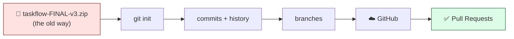
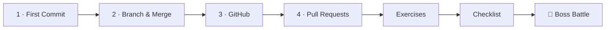

# 🌿 World 3 — Git

> *"Stop emailing zip files. Put TaskFlow under version control and push it to GitHub. — Marcus, Senior Eng"*



---

## 📨 Your ticket

```
From:    Marcus <marcus@cloudforge.inc>
To:      You <new-hire@cloudforge.inc>
Subject: [TICKET-031] Get TaskFlow under version control

Hey — I've seen the zip files. taskflow-final.zip, taskflow-final-v2.zip,
taskflow-FINAL-actually.zip... 😩 Stop. That's not how we ship software.

This week, get TaskFlow under proper version control:

  1. git init the project and make real commits
  2. Learn to branch and merge (we never touch main directly)
  3. Push it to a new GitHub repo
  4. Open and merge a Pull Request — that's how every change lands

When you're done there'll be a nasty merge conflict waiting for you to
resolve. Beat that and your Git onboarding is officially complete.

— Marcus
```

In World 2 you created the TaskFlow scaffold and a backup script. Right now it's just a folder — one bad `rm` away from gone, invisible to your team. By the end of this world it's a versioned project with history, branches, and a home on GitHub that anyone can clone.

---

## 🎯 What you'll achieve in this world

- ✅ Understand **why version control exists** and turn TaskFlow into a Git repo
- ✅ Make commits, write a `.gitignore`, and read history
- ✅ **Branch** for features and **merge** them back into `main`
- ✅ Push to **GitHub** and understand remotes + authentication
- ✅ Collaborate the professional way with **Pull Requests**
- ✅ Resolve a real **merge conflict** under pressure

---

## 🗺️ Level map

| Level | Lesson | Difficulty | Time | XP |
|------:|--------|:----------:|:----:|---:|
| 1 | [Why Version Control + Your First Commit](lessons/01-why-version-control-and-first-commit.md) | 🟢 Easy | 20 min | 125 |
| 2 | [Branching & Merging](lessons/02-branching-and-merging.md) | 🟡 Medium | 25 min | 125 |
| 3 | [GitHub & Remotes](lessons/03-github-and-remotes.md) | 🟢 Easy | 20 min | 125 |
| 4 | [Pull Requests & Collaboration](lessons/04-pull-requests-and-collaboration.md) | 🟢 Easy | 20 min | 125 |
| 👹 | [Boss Battle — The Merge Conflict from Hell](boss-battle.md) | 🟡 Medium | 30 min | 500 |

➕ Extra reps + Side Quest: [exercises.md](exercises.md) · ✅ Ready to advance? [checklist.md](checklist.md)

---

## 🧭 Recommended order



Do them in order — each lesson's Project Mission builds directly on the previous one's TaskFlow repo.

---

## 📦 Project status

**Coming in:** `~/projects/taskflow` exists as a plain folder — the scaffold and backup script you built in World 2. No version control yet.

**Going out:** `taskflow` is a Git repository with a clean commit history and a `.gitignore`, hosted on **GitHub**, with at least one merged Pull Request. World 4 will build the real REST API *inside* this repo — every change from here on flows through branches and PRs.

---

## 🆓 Cost note

Everything in this world is **100% free**. Git is open-source; GitHub's free tier gives you unlimited public repositories. No credit card, no paid plan. See [RESOURCES.md → World 3](../../RESOURCES.md) for free docs, a video, and `learngitbranching.js.org` to practice branching visually.

---

[↑ Back to README](../../README.md)  ·  [🗺️ Roadmap](../../ROADMAP.md)  ·  [▶️ Start Level 1 →](lessons/01-why-version-control-and-first-commit.md)
