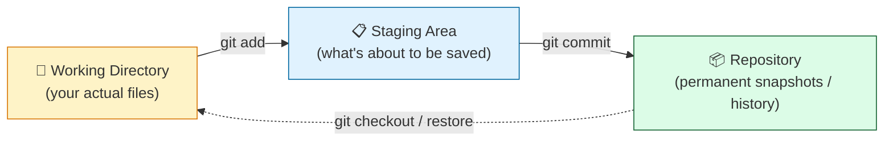

# Level 1 — Why Version Control + Your First Commit

| | |
|---|---|
| 🎚️ **Difficulty** | 🟢 Easy |
| ⏱️ **Estimated time** | 20 minutes |
| ⭐ **XP reward** | 100 (Quest) + 25 (Quiz) |

[← World Home](../README.md) · [↑ Phase Home](../README.md) · [→ Next: Branching & Merging](02-branching-and-merging.md)

---

## 📖 Story

A Slack message lands in your DMs:

> **Marcus (Senior Eng):** *"Hey — I've been watching you email `taskflow-final.zip`, then `taskflow-final-v2.zip`, then `taskflow-FINAL-actually.zip`. Stop. 🛑 That's not how we work here. Put TaskFlow under version control and push it to GitHub. Start by turning that folder into a real Git repo today. We'll do the GitHub part once you've got commits."*

You glance at your Desktop. He's right — there are four zip files and you genuinely don't know which one is newest. Today that ends.

---

## 🎯 Goal

By the end of this lesson you will:
- Understand **what version control is** and the pain it removes
- Turn `~/projects/taskflow` into a Git repository with `git init`
- Read the state of your repo with `git status`
- Stage and **commit** your first snapshot with `git add` and `git commit`
- Tell Git what to **ignore** with a `.gitignore` file

---

## 🧠 Concepts

**Version control** is a system that records *snapshots* of your project over time. Each snapshot — called a **commit** — is a labeled save point you can return to. Git is the version control system the whole industry runs on.

Git has three "places" your files can be in. Understanding this picture is the single most important thing in this whole world:



- **Working Directory** — the files you see and edit right now.
- **Staging Area** (the "index") — a holding tray. You pick *exactly* which changes go into the next snapshot.
- **Repository** — the `.git` folder. Once you commit, the snapshot lives here forever (until you rewrite history on purpose).

The two-step `add` → `commit` feels odd at first, but it's a feature: it lets you commit *some* changes now and leave others for later, so each commit tells one clean story.

### Why this exists

Before Git, "version control" meant `report_final_v7_REALLY_final.zip`. That approach breaks the moment more than one person — or more than one feature — is involved. You can't see *what* changed, *who* changed it, or *why*. You can't safely undo a mistake from last Tuesday.

Git fixes all of that. Every commit records the exact change, a message explaining it, the author, and the time. You can travel back to any snapshot, compare any two, and never lose work again. That's why your `taskflow.zip` habit has to die.

---

## 🛠️ Hands-on Lab

> 🐧 Do everything inside **Ubuntu (WSL2)**, in your project folder from World 2.

### Step 1 — Check Git is installed

```bash
# Git ships with Ubuntu; confirm it's there
git --version
```

You should see something like `git version 2.x`. If it's missing, install it: `sudo apt update && sudo apt install -y git`.

### Step 2 — Tell Git who you are (one-time setup)

Every commit is signed with a name and email. Set yours once:

```bash
# Your name and email get stamped on every commit you make
git config --global user.name "Your Name"
git config --global user.email "you@example.com"

# Make 'main' the default branch name for new repos
git config --global init.defaultBranch main

# Confirm it stuck
git config --global --list
```

### Step 3 — Initialize the repository

```bash
cd ~/projects/taskflow

# Turn this plain folder into a Git repository
git init
```

Git replies `Initialized empty Git repository in .../taskflow/.git/`. That hidden `.git` folder *is* your repository — the box where all snapshots will live.

### Step 4 — Read the status

```bash
git status
```

Git lists your files as **Untracked** — it sees them but isn't saving them yet. `git status` is the command you'll run more than any other; it always tells you where you stand.

### Step 5 — Tell Git what to ignore

Some files should *never* be committed: dependency folders, build output, secrets, and the backup archives your World 2 script produces. Create a `.gitignore`:

```bash
cat > .gitignore << 'EOF'
# Node dependencies — re-installed from package.json, never committed
node_modules/

# Backup archives produced by our World 2 backup script
*.tar.gz

# OS / editor noise
.DS_Store
EOF
```

Now run `git status` again — anything matching those patterns vanishes from the list. Git is now pretending those files don't exist (for tracking purposes).

### Step 6 — Stage your files

```bash
# Stage everything that isn't ignored
git add .

# See what's now staged (shown in green / "Changes to be committed")
git status
```

`git add .` moves your current files into the **staging area** — the holding tray for your next snapshot.

### Step 7 — Make your first commit

```bash
# Save the snapshot with a clear message
git commit -m "Initial commit: TaskFlow project scaffold"
```

🎉 That's your first commit. View the history:

```bash
git log --oneline
```

You'll see one line: a short ID (the commit hash) and your message. That snapshot is now permanent.

---

## 🎮 Mini Challenge

Make a small change and commit it — proving you understand the `add` → `commit` rhythm.

```bash
# Add a line to your README (create it if it doesn't exist)
echo "TaskFlow — a task manager platform." >> README.md
```

Now, using only what you learned: stage **just** that change and commit it with the message `Add project description to README`.

<details>
<summary>💡 Reveal answer</summary>

```bash
git add README.md          # stage only this file
git commit -m "Add project description to README"
git log --oneline          # now shows two commits
```

You could also have used `git add .` — but naming the file explicitly is a good habit when you only mean to commit one thing.
</details>

---

## 📦 Project Mission

Put **TaskFlow** under version control for real. Inside `~/projects/taskflow`:

1. `git init` the project (if you haven't already in the lab).
2. Create a `.gitignore` that ignores **`node_modules/`** and your **`*.tar.gz`** backups.
3. Make a clean **first commit** of the whole scaffold.

```bash
cd ~/projects/taskflow

git init

cat > .gitignore << 'EOF'
node_modules/
*.tar.gz
.DS_Store
EOF

git add .
git commit -m "Initial commit: TaskFlow project scaffold"

# Prove it
git log --oneline
git status
```

🎯 **Mission complete when:** `git log --oneline` shows at least one commit, `git status` reports a **clean working tree** (nothing to commit), and your `*.tar.gz` backups do **not** appear in `git status`.

---

## ⚠️ Common Mistakes

| Mistake | What happens | Fix |
|--------|--------------|-----|
| Running `git init` in your home folder by accident | Git tries to track your *entire* home directory | `rm -rf ~/.git` (only the stray one!), then `cd ~/projects/taskflow` and `git init` there |
| Forgetting `git add` before `git commit` | "nothing to commit" — your changes weren't staged | Run `git add .`, then commit |
| Committing `node_modules/` | A huge, useless folder bloats your repo | Add it to `.gitignore` *before* the first `git add` |
| Creating `.gitignore` *after* committing a file | The file is already tracked, so ignoring it does nothing | `git rm --cached <file>`, then commit the `.gitignore` |
| No `user.name` / `user.email` set | Git refuses to commit, asks who you are | Run the two `git config --global` commands from Step 2 |

---

## 🤔 Reflection Questions

1. In your own words, what problem does version control solve that zip files can't?
2. What's the difference between the **staging area** and the **repository**?
3. Why do we put `node_modules/` and `*.tar.gz` in `.gitignore` instead of committing them?

---

## 📝 Quiz

1. **`git init` does what?**
   - a) Uploads your code to GitHub
   - b) Creates a new Git repository in the current folder
   - c) Deletes all untracked files
2. **The staging area is…**
   - a) the permanent history of your project
   - b) a holding tray for the changes that go into your next commit
   - c) a backup server
3. **A `.gitignore` file is used to…**
   - a) tell Git which files to *never* track
   - b) hide files from your operating system
   - c) speed up your internet

<details>
<summary>✅ Answers</summary>

1: **b** · 2: **b** · 3: **a**
</details>

---

## ✅ Completion Checklist

- [ ] `git --version` works and I set my `user.name` and `user.email`
- [ ] I ran `git init` inside `~/projects/taskflow`
- [ ] I created a `.gitignore` ignoring `node_modules/` and `*.tar.gz`
- [ ] I made a first commit and `git log --oneline` shows it
- [ ] `git status` reports a clean working tree (Project Mission)
- [ ] I passed the quiz
- [ ] I added **+125 XP** to [PROGRESS.md](../../../PROGRESS.md)

---

[← World Home](../README.md) · [↑ Phase Home](../README.md) · [→ Next: Branching & Merging](02-branching-and-merging.md)
