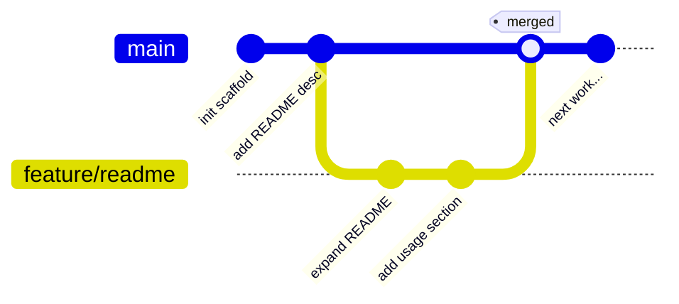

# Level 2 — Branching & Merging

| | |
|---|---|
| 🎚️ **Difficulty** | 🟡 Medium |
| ⏱️ **Estimated time** | 25 minutes |
| ⭐ **XP reward** | 100 (Quest) + 25 (Quiz) |

[← Prev: Why Version Control + First Commit](01-why-version-control-and-first-commit.md) · [↑ Phase Home](../README.md) · [→ Next: GitHub & Remotes](03-github-and-remotes.md)

---

## 📖 Story

> **Marcus (Senior Eng):** *"Nice — TaskFlow's got commits now. 👏 Next rule: we never build features directly on `main`. `main` is sacred — it's what ships. When you start work, you cut a **branch**, do your thing there, and merge it back when it's solid. Try it: make a branch, improve that README, and merge it into `main`. Once you've felt branching, GitHub will make total sense."*

---

## 🎯 Goal

By the end of this lesson you will:
- Understand **what a branch is** and why teams never work directly on `main`
- Create and switch branches with `git branch`, `git switch`, and `git checkout`
- Make commits on a branch without touching `main`
- **Merge** a branch back into `main`

---

## 🧠 Concepts

A **branch** is a movable label pointing at a commit — a parallel line of work. `main` keeps humming along while you experiment on a branch. If your experiment works, you **merge** it in. If it doesn't, you delete the branch and `main` was never touched.



Read that top-to-bottom: `main` has two commits, then you branch off into `feature/readme`, make two commits there, and finally **merge** that branch back into `main`. The merge brings your branch's work into `main` as one combined history.

A quick vocabulary note that trips everyone up:
- `git switch` — modern, clear command for *moving between* branches.
- `git checkout` — the older command that does switching **and** other things (you'll still see it everywhere, so know it).
- `HEAD` — Git's word for "the branch/commit you're currently on."

### Why this exists

Imagine five engineers all committing straight to `main`. Half-finished features collide, a broken commit blocks everyone's deploy, and there's no way to review work before it lands. Branches give every piece of work its own sandbox. `main` stays releasable at all times, and each feature can be reviewed and merged independently. This branch-per-feature habit is the foundation of how every professional team — and every pull request in the next lessons — works.

---

## 🛠️ Hands-on Lab

> 🐧 Inside `~/projects/taskflow` (the repo you created in Level 1).

### Step 1 — See where you are

```bash
cd ~/projects/taskflow

# List branches; the * marks your current one
git branch

# Confirm a clean starting point
git status
```

You're on `main`, with no pending changes. Good.

### Step 2 — Create and switch to a feature branch

```bash
# Create a new branch AND switch to it in one step
git switch -c feature/readme

# Confirm: the * should now be on feature/readme
git branch
```

> 💡 `git switch -c <name>` is shorthand for "create the branch, then switch to it." The old equivalent is `git checkout -b <name>`.

You're now on `feature/readme`. Any commit you make lands here, not on `main`.

### Step 3 — Make a change and commit it (on the branch)

```bash
# Improve the README on this branch
cat >> README.md << 'EOF'

## Features
- Create, list, update, and delete tasks
- Built with Node.js + Express (coming in World 4)

## Status
🚧 Under active development.
EOF

git add README.md
git commit -m "Expand README with features and status sections"
```

### Step 4 — Prove `main` is untouched

```bash
# Hop back to main
git switch main

# Look at the README — your new sections are GONE here
cat README.md
```

This is the magic: your changes live safely on the branch. `main` is exactly as you left it.

### Step 5 — Merge the branch into `main`

```bash
# Make sure you're ON main (you merge INTO the branch you're standing on)
git switch main

# Bring feature/readme's work into main
git merge feature/readme

# The README now HAS your new sections
cat README.md
```

Because `main` hadn't changed, Git does a clean **fast-forward** merge — it just slides `main` forward to match your branch. Effortless.

### Step 6 — Clean up the merged branch

```bash
# The branch's work is now in main, so we can delete the branch label
git branch -d feature/readme

git branch        # feature/readme is gone; main remains
git log --oneline # your README commit is part of main's history
```

---

## 🎮 Mini Challenge

Create a branch called `feature/license`, add a one-line `LICENSE` file on it, commit, then merge it into `main` — all from memory.

<details>
<summary>💡 Reveal answer</summary>

```bash
git switch -c feature/license
echo "MIT License — TaskFlow, 2026." > LICENSE
git add LICENSE
git commit -m "Add LICENSE file"

git switch main
git merge feature/license
git branch -d feature/license

ls LICENSE        # now present on main
```
</details>

---

## 📦 Project Mission

Practice the real team workflow on TaskFlow: **branch → change → merge**.

1. From `main`, create a feature branch (e.g. `feature/readme`).
2. Improve `README.md` on that branch (add a description, features, or setup notes) and commit.
3. Switch to `main`, **merge** the branch in, and delete the merged branch.

```bash
cd ~/projects/taskflow
git switch main

git switch -c feature/readme
# ...edit README.md...
git add README.md
git commit -m "Improve README on feature branch"

git switch main
git merge feature/readme
git branch -d feature/readme

git log --oneline   # the README work is now on main
```

🎯 **Mission complete when:** `git log --oneline` on `main` shows your README commit, `git branch` shows the feature branch is gone, and you can explain why `main` was unchanged until you ran `git merge`.

---

## ⚠️ Common Mistakes

| Mistake | What happens | Fix |
|--------|--------------|-----|
| Committing while on `main` instead of a branch | Work lands on the sacred branch | Make the branch *first* with `git switch -c`, then commit |
| Running `git merge feature` while standing *on* the feature branch | Merges `main` into the feature, not the other way | `git switch main` first, then `git merge feature/...` |
| `git switch <name>` fails: "did not match any" | The branch doesn't exist yet | Use `-c` to create it: `git switch -c <name>` |
| Trying to switch with uncommitted changes that conflict | Git blocks the switch to protect your work | Commit (or `git stash`) your changes first |
| Deleting an unmerged branch with `-d` | Git refuses to protect unmerged work | If you really mean it, `-D` force-deletes — but be sure |

---

## 🤔 Reflection Questions

1. Why do professional teams forbid committing directly to `main`?
2. What does it mean that a branch is "just a movable pointer to a commit"?
3. After `git merge feature/readme`, why was the merge a "fast-forward"? When might it *not* be?

---

## 📝 Quiz

1. **A branch in Git is best described as…**
   - a) a full copy of your entire project on disk
   - b) a movable label pointing at a commit — a parallel line of work
   - c) a backup zip file
2. **To merge `feature/x` into `main`, you should first…**
   - a) be on `feature/x`
   - b) be on `main`, then run `git merge feature/x`
   - c) delete `main`
3. **`git switch -c feature/login` does what?**
   - a) deletes the `feature/login` branch
   - b) creates `feature/login` and switches to it
   - c) commits your changes

<details>
<summary>✅ Answers</summary>

1: **b** · 2: **b** · 3: **b**
</details>

---

## ✅ Completion Checklist

- [ ] I created a branch with `git switch -c` and confirmed with `git branch`
- [ ] I committed a change on the branch and verified `main` was untouched
- [ ] I merged the branch into `main` and saw the change appear
- [ ] I deleted the merged branch with `git branch -d`
- [ ] My TaskFlow README change is on `main` (Project Mission)
- [ ] I passed the quiz
- [ ] I added **+125 XP** to [PROGRESS.md](../../../PROGRESS.md)

---

[← Prev: Why Version Control + First Commit](01-why-version-control-and-first-commit.md) · [↑ Phase Home](../README.md) · [→ Next: GitHub & Remotes](03-github-and-remotes.md)
