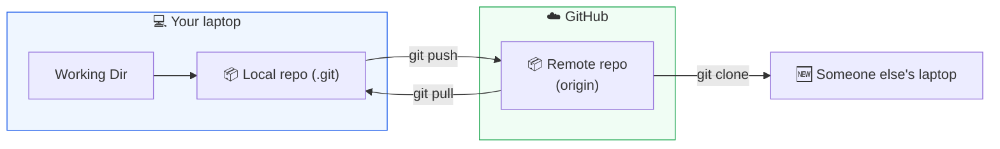

# Level 3 — GitHub & Remotes

| | |
|---|---|
| 🎚️ **Difficulty** | 🟢 Easy |
| ⏱️ **Estimated time** | 20 minutes |
| ⭐ **XP reward** | 100 (Quest) + 25 (Quiz) |

[← Prev: Branching & Merging](02-branching-and-merging.md) · [↑ Phase Home](../README.md) · [→ Next: Pull Requests & Collaboration](04-pull-requests-and-collaboration.md)

---

## 📖 Story

> **Marcus (Senior Eng):** *"Branching, merging — you've got the local side down. But TaskFlow only exists on your laptop. If your machine dies, it's gone, and nobody else can see it. Push it to **GitHub**. That's our shared home for every repo. Create the repo, connect it, push. Then send me the link and I'll start reviewing."*

This is the moment your project stops being a folder on one laptop and becomes something the whole team — and the whole world — can see.

---

## 🎯 Goal

By the end of this lesson you will:
- Understand **remotes** — what GitHub actually is to Git
- Create a new **GitHub repository**
- Connect your local repo to it with `git remote add`
- **Push** your commits to GitHub
- Know how `git clone` and authentication (PAT / SSH) work

---

## 🧠 Concepts

So far everything has lived in your local `.git` folder. A **remote** is a copy of your repository that lives somewhere else — usually on **GitHub**, a hosting service for Git repos. You **push** to send your commits up, and **pull** to bring others' commits down.



Key terms:
- **`origin`** — the conventional nickname for your main remote (so you type `origin` instead of the full URL).
- **`git clone`** — download a full copy of a remote repo (commits, branches, history) to a new machine.
- **`git push` / `git pull`** — upload / download commits between local and remote.

### Why this exists

A repo on one laptop is one spilled coffee away from gone. GitHub gives you an off-machine backup, a way for teammates to get your code (`clone`), a place to collaborate (pull requests — next lesson), and a public portfolio URL you can show recruiters. "Push it to GitHub" is the universal first thing a team asks of a new project — because until it's there, it effectively doesn't exist to anyone but you.

### A word on authentication

GitHub won't let just anyone push to your repo — you must prove it's you. Two common ways:

- **Personal Access Token (PAT)** — over HTTPS, you log in with your username and a *token* (not your password — GitHub disabled password pushes). Create one at **GitHub → Settings → Developer settings → Personal access tokens**, give it `repo` scope, and paste it when Git asks for a "password."
- **SSH key** — generate a key pair with `ssh-keygen`, add the *public* key to **GitHub → Settings → SSH keys**, and push over `git@github.com:...` URLs with no password prompts.

For this bootcamp, **HTTPS + PAT** is the simplest start. (See **RESOURCES.md → World 3** for the GitHub Docs link with exact steps.)

---

## 🛠️ Hands-on Lab

> 🆓 GitHub is free. A free account and public repos cost nothing and give you unlimited use for learning.

### Step 1 — Create a GitHub account (if you don't have one)

Go to **https://github.com** and sign up. Verify your email.

### Step 2 — Create an empty repository on GitHub

1. Click the **+** (top-right) → **New repository**.
2. **Repository name:** `taskflow`
3. **Visibility:** Public (fine for a portfolio project).
4. ⚠️ **Do NOT** check "Add a README", ".gitignore", or "license" — your local repo already has commits. Adding files here would create a conflicting history.
5. Click **Create repository**.

GitHub shows you a setup page with a URL like `https://github.com/yourname/taskflow.git`. Keep it handy.

### Step 3 — Connect your local repo to the remote

```bash
cd ~/projects/taskflow

# Add the remote and name it 'origin' (use YOUR url)
git remote add origin https://github.com/yourname/taskflow.git

# Confirm it's set
git remote -v
```

`git remote -v` should print your URL twice (one for `fetch`, one for `push`).

### Step 4 — Push your commits to GitHub

```bash
# Push the 'main' branch and set it to track origin/main (-u, first time only)
git push -u origin main
```

The first push over HTTPS asks for your GitHub **username** and a **password** — paste your **Personal Access Token** as the password (not your account password).

> 💡 The `-u` flag links your local `main` to `origin/main`. After this first push, you can just type `git push` and `git pull` with no extra arguments.

### Step 5 — See it live

Refresh your repository page on GitHub. Your files, commits, and history are all there. 🎉 Click around — every commit message you wrote is visible under **Commits**.

### Step 6 — Understand `git clone` (read-along)

When a teammate (or future you, on a new machine) wants this project, they don't recreate it — they clone it:

```bash
# Downloads the whole repo + history into a new 'taskflow' folder
git clone https://github.com/yourname/taskflow.git
```

`clone` automatically sets up `origin` for them, so they can push/pull immediately.

---

## 🎮 Mini Challenge

Make a tiny change locally, commit it, and get it onto GitHub — then verify it appears on the website.

<details>
<summary>💡 Reveal answer</summary>

```bash
echo "" >> README.md
echo "Hosted on GitHub 🚀" >> README.md
git add README.md
git commit -m "Note GitHub hosting in README"
git push            # no args needed thanks to -u earlier
```

Refresh the GitHub page — the new README line and a new commit appear. The whole loop is: **edit → add → commit → push.**
</details>

---

## 📦 Project Mission

Give TaskFlow a home on the internet.

1. Create a new **public GitHub repository** named `taskflow` (empty — no README/license).
2. Add it as `origin` to your local repo.
3. **Push** your `main` branch to GitHub.

```bash
cd ~/projects/taskflow
git remote add origin https://github.com/yourname/taskflow.git
git push -u origin main
git remote -v        # confirms origin is connected
```

🎯 **Mission complete when:** your `taskflow` repo on GitHub shows your files and full commit history, `git remote -v` lists `origin`, and `git status` says your branch is **up to date with `origin/main`**.

---

## ⚠️ Common Mistakes

| Mistake | What happens | Fix |
|--------|--------------|-----|
| Initializing the GitHub repo *with* a README | Push rejected: histories diverge | Recreate the GitHub repo empty, or `git pull --rebase origin main` then push |
| Typing your account password at the prompt | Auth fails — passwords are disabled for Git | Generate a **PAT** and paste it as the "password" |
| `remote origin already exists` | You ran `git remote add origin` twice | `git remote set-url origin <url>` to fix it instead |
| Forgetting `-u` on the first push | Later `git push` complains there's no upstream | Push once with `git push -u origin main` |
| Pushing the wrong branch name | `error: src refspec ... does not match` | Check `git branch`; push the branch you're actually on |

---

## 🤔 Reflection Questions

1. What's the difference between your **local** repository and the **remote** on GitHub?
2. Why does GitHub require a token (or SSH key) instead of just a password?
3. If your laptop died right now, what would `git clone` let you do — and why is that valuable?

---

## 📝 Quiz

1. **`origin` is…**
   - a) your first commit
   - b) the conventional name for your main remote repository
   - c) the `main` branch
2. **`git push -u origin main` does what?**
   - a) deletes the main branch on GitHub
   - b) uploads `main` to GitHub and sets it to track `origin/main`
   - c) downloads the repo
3. **To authenticate an HTTPS push to GitHub you use…**
   - a) your account password
   - b) a Personal Access Token (PAT) in place of the password
   - c) no authentication at all

<details>
<summary>✅ Answers</summary>

1: **b** · 2: **b** · 3: **b**
</details>

---

## ✅ Completion Checklist

- [ ] I created a free GitHub account and an empty `taskflow` repository
- [ ] I added the remote with `git remote add origin <url>`
- [ ] I pushed `main` with `git push -u origin main` (using a PAT or SSH)
- [ ] My files and commit history are visible on GitHub
- [ ] `git status` says my branch is up to date with `origin/main` (Project Mission)
- [ ] I passed the quiz
- [ ] I added **+125 XP** to [PROGRESS.md](../../../PROGRESS.md)

---

[← Prev: Branching & Merging](02-branching-and-merging.md) · [↑ Phase Home](../README.md) · [→ Next: Pull Requests & Collaboration](04-pull-requests-and-collaboration.md)
