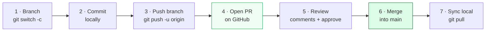

# Level 4 — Pull Requests & Collaboration

| | |
|---|---|
| 🎚️ **Difficulty** | 🟢 Easy |
| ⏱️ **Estimated time** | 20 minutes |
| ⭐ **XP reward** | 100 (Quest) + 25 (Quiz) |

[← Prev: GitHub & Remotes](03-github-and-remotes.md) · [↑ Phase Home](../README.md) · [→ Boss Battle](../boss-battle.md)

---

## 📖 Story

> **Marcus (Senior Eng):** *"Got the link — TaskFlow's on GitHub, looks great. Last thing before I sign off on your Git onboarding: we don't merge our own branches straight into `main`. We open a **Pull Request** so someone can review it first. Make a small change on a branch, push it, open a PR, and merge it through the GitHub UI. That's the exact loop we'll use for every change to TaskFlow from now on."*

---

## 🎯 Goal

By the end of this lesson you will:
- Understand what a **Pull Request (PR)** is and why teams use them
- Push a feature branch to GitHub
- **Open** a PR, read the diff, and (self-)review it
- **Merge** the PR and sync your local `main`

---

## 🧠 Concepts

A **Pull Request** is a request to merge one branch into another — *with a discussion and review attached*. You push a branch, open a PR on GitHub, teammates review the changes, leave comments, approve, and then it gets merged. The PR is where code is *discussed* before it becomes part of `main`.



The merge itself happens on **GitHub's** `main` this time — not your laptop's. So after merging, your *local* `main` is behind; you `git pull` to catch up.

### Why this exists

Merging straight to `main` means broken or unreviewed code can ship instantly. Pull Requests add a gate: another human (or an automated test — that's World 7) checks the change before it lands. PRs create a written record of *why* every change was made, make code review easy with side-by-side diffs, and are the unit of collaboration on essentially every software team alive. Learning the PR loop now means you already know how real teams ship code.

---

## 🛠️ Hands-on Lab

> 🐧 Local commands run in `~/projects/taskflow`. The PR steps happen in your browser on GitHub.

### Step 1 — Create a feature branch and make a change

```bash
cd ~/projects/taskflow
git switch main
git pull                      # make sure local main is current

git switch -c feature/setup-docs

cat >> README.md << 'EOF'

## Getting Started
1. Clone the repo
2. (Coming in World 4) `npm install`
3. (Coming in World 4) `npm start`
EOF

git add README.md
git commit -m "Add Getting Started section to README"
```

### Step 2 — Push the branch to GitHub

```bash
# Push this new branch and set its upstream
git push -u origin feature/setup-docs
```

GitHub often prints a handy link in the output:
`Create a pull request for 'feature/setup-docs' on GitHub by visiting: https://github.com/...`

### Step 3 — Open the Pull Request

1. Go to your repo on GitHub. A yellow banner offers **"Compare & pull request"** — click it. (Or go to the **Pull requests** tab → **New pull request**.)
2. Confirm the merge direction: **base: `main`** ← **compare: `feature/setup-docs`**.
3. Give it a clear **title** (e.g. *"Add Getting Started section to README"*) and a short **description** of what and why.
4. Click **Create pull request**.

### Step 4 — Review the change

1. Open the **Files changed** tab. This is the **diff** — green lines added, red lines removed. This is exactly what a reviewer inspects.
2. On a real team a teammate reviews here. Solo, you can still leave a comment and approve to feel the loop.

### Step 5 — Merge the Pull Request

1. Back on the **Conversation** tab, click **Merge pull request** → **Confirm merge**.
2. GitHub merges `feature/setup-docs` into `main` *on the remote*.
3. Click **Delete branch** — the merged branch is no longer needed on GitHub.

### Step 6 — Sync your local repo

Your *local* `main` doesn't know about the merge yet. Catch it up:

```bash
git switch main
git pull                          # pulls the merged change into local main

# Tidy up the now-merged local branch
git branch -d feature/setup-docs

git log --oneline                 # the merge commit + your work are on main
```

---

## 🎮 Mini Challenge

Without step-by-step help, run the full loop again for a one-line change: branch → commit → push → open PR → merge → pull.

<details>
<summary>💡 Reveal answer</summary>

```bash
git switch main && git pull
git switch -c feature/badge
echo "" >> README.md && echo "" >> README.md
git add README.md
git commit -m "Add WIP status badge"
git push -u origin feature/badge
```
Then on GitHub: **Compare & pull request → Create → Merge → Delete branch.** Finally, locally:
```bash
git switch main && git pull
git branch -d feature/badge
```
</details>

---

## 📦 Project Mission

Ship a change to TaskFlow the way a real team does — through a Pull Request.

1. Create a feature branch and make a small, real improvement to TaskFlow's `README.md`.
2. **Push** the branch to GitHub.
3. **Open a PR** on GitHub (base `main` ← your branch), review the diff, and **merge** it.
4. **Pull** the merged `main` back to your laptop and delete the local branch.

```bash
cd ~/projects/taskflow
git switch main && git pull
git switch -c feature/readme-polish
# ...edit README.md...
git add README.md
git commit -m "Polish README for first review"
git push -u origin feature/readme-polish
# → open + merge the PR on GitHub, delete the remote branch
git switch main && git pull
git branch -d feature/readme-polish
```

🎯 **Mission complete when:** a merged Pull Request appears under your repo's **Pull requests → Closed** tab, your change is on GitHub's `main`, and `git pull` brought that merge into your local `main`.

---

## ⚠️ Common Mistakes

| Mistake | What happens | Fix |
|--------|--------------|-----|
| PR direction reversed (base = your branch) | The diff looks empty or backwards | Set **base: `main`**, **compare: your feature branch** |
| Forgetting to push the branch before opening a PR | GitHub can't see the branch to compare | `git push -u origin <branch>` first |
| Not pulling after the merge | Local `main` is stale; next branch starts behind | `git switch main && git pull` after every merge |
| Deleting the local branch before merging | You lose unmerged commits | Merge (or confirm it's merged) *before* `git branch -d` |
| Committing directly to `main` "just this once" | Skips review; defeats the whole point | Always: branch → push → PR → merge |

---

## 🤔 Reflection Questions

1. What does a Pull Request add that a plain local `git merge` does not?
2. Why must you `git pull` your local `main` after merging a PR on GitHub?
3. On the **Files changed** tab, what is a reviewer actually looking at, and why is a small PR easier to review than a huge one?

---

## 📝 Quiz

1. **A Pull Request is…**
   - a) a way to download someone else's repo
   - b) a request to merge a branch, with review and discussion attached
   - c) the same as `git push`
2. **After merging a PR on GitHub, your local `main` is…**
   - a) automatically updated
   - b) behind until you run `git pull`
   - c) deleted
3. **When opening a PR, the correct setup is…**
   - a) base = your feature branch, compare = main
   - b) base = main, compare = your feature branch
   - c) base and compare are the same branch

<details>
<summary>✅ Answers</summary>

1: **b** · 2: **b** · 3: **b**
</details>

---

## ✅ Completion Checklist

- [ ] I pushed a feature branch to GitHub
- [ ] I opened a Pull Request (base `main` ← my branch) and reviewed the diff
- [ ] I merged the PR on GitHub and deleted the remote branch
- [ ] I ran `git pull` to sync my local `main`
- [ ] A merged PR shows under **Pull requests → Closed** (Project Mission)
- [ ] I passed the quiz
- [ ] I added **+125 XP** to [PROGRESS.md](../../../PROGRESS.md)

---

> 🎉 You can now version, branch, push, and collaborate. One challenge stands between you and World 4: the merge conflict from hell.

[← Prev: GitHub & Remotes](03-github-and-remotes.md) · [↑ Phase Home](../README.md) · [→ 👹 Boss Battle: The Merge Conflict from Hell](../boss-battle.md)
