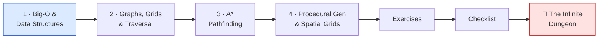

# 🧮 World 4 — Algorithms & Data Structures

> Ashfall is *playable* (World 3): you can move, collide, collect, follow with the camera, and the save sticks. But every room is hand-placed, so every run is identical — and the moment you drop an "enemy" in, it walks straight into a wall. This world makes the game **infinite and alive**: pick the right data structures for a tile-map, see a grid as a graph, write **A\*** so enemies actually path to you, and **procedurally generate** a connected dungeon every run — with a spatial grid that answers "who's near the player?" fast.

[↑ Home](../../README.md) · [🗺️ Roadmap](../../ROADMAP.md) · [📊 Progress](../../PROGRESS.md)

---

## 📨 Your ticket

```
From:    Maya <maya@pixelforge.studio>
To:      You <new-hire@pixelforge.studio>
Cc:      Kenji <kenji@pixelforge.studio>
Subject: [W4-DUNGEON] Same room every time, and the enemies are blind

The slice plays great — but two things are killing the fantasy of a
roguelite, and they're both *algorithms* problems, not art problems:

  - Every run is the SAME hand-made room. A roguelite lives or dies on
    "every run feels new." I need dungeons GENERATED — rooms and corridors,
    different each time, but always fully connected (no room you can't
    reach, ever).
  - I dropped a test enemy in and it walked face-first into a wall and
    stayed there. Enemies need to actually NAVIGATE — find a real path
    around walls to the player, not shove into geometry.
  - And once there are dozens of entities, "which enemies are near the
    player?" can't be a loop over everything every frame. That gets slow
    fast. We need a smarter spatial lookup.

So, the algorithms toolkit:

  1. Pick the RIGHT data structures for the tile-map (not "everything is a
     List").
  2. Treat the grid as a GRAPH — neighbors, BFS/DFS, flood fill to prove a
     dungeon is connected.
  3. A* pathfinding so an agent finds the shortest path around walls.
  4. Procedural generation (seeded, repeatable) + a spatial hash grid for
     fast "who's nearby" queries.

Kenji's got you. Boss check: a dungeon that's different and connected every
run, an agent that A*-paths from the entrance to the player across it, and a
spatial grid answering neighbor queries. Ship that and World 5 — the actual
*gameplay* (loot, combat, abilities) — is yours.

— Maya
```

This is World 4 of 13. Everything you build advances the **one growing Ashfall project** in `~/projects/ashfall`. You arrive with a playable slice (W3); you leave with an *infinite*, navigable game world.

---

## 🎯 What you'll achieve in this world

- 🧮 Reason about **Big-O** and pick **arrays / `List` / `Dictionary` / `HashSet` / `Queue` / `Stack`** by access pattern — and model Ashfall's tile-map with the right one
- 🕸️ See a **grid as a graph** — neighbors, **BFS/DFS**, flood fill — and prove a dungeon is fully **connected** with BFS reachability
- 🧭 Implement **A\*** (= Dijkstra + an admissible Manhattan heuristic, open/closed sets) as a reusable `Pathfinder` that returns a path of tiles
- 🎲 Generate dungeons with a **seeded PRNG** (repeatable runs), rooms + corridors, and a **spatial hash grid** for fast neighbor queries feeding the pathfinder and gameplay

---

## 🗺️ Level map

| Level | Lesson | Difficulty | XP |
|------:|--------|:----------:|---:|
| 1 | [Big-O & Data Structures](lessons/01-big-o-and-data-structures.md) | 🟢 Easy | 125 |
| 2 | [Graphs, Grids & Traversal](lessons/02-graphs-grids-and-traversal.md) | 🟡 Medium | 125 |
| 3 | [A* Pathfinding](lessons/03-a-star-pathfinding.md) | 🔴 Hard | 125 |
| 4 | [Procedural Generation & Spatial Grids](lessons/04-procedural-generation-and-spatial-grids.md) | 🔴 Hard | 125 |
| 👹 | [Boss Battle — The Infinite Dungeon](boss-battle.md) | 🔴 Hard | 500 |

➕ Extra reps: [exercises.md](exercises.md) · ✅ Ready to advance? [checklist.md](checklist.md)

---

## 🧭 Recommended order



Go in order — each lesson is a layer the next one stands on. Data structures (L1) give you the tile-map and the containers (`Queue`, `HashSet`, `Dictionary`) every later algorithm needs. Graph traversal (L2) treats that grid as a graph and proves connectivity — BFS is *literally* the skeleton you upgrade into A\*. A\* (L3) adds a heuristic to that search so enemies navigate. Procedural gen (L4) builds the dungeons A\* will path across, and a spatial grid (built on L1's `Dictionary`) makes neighbor queries fast. The boss **assembles all four** into one infinite, navigable world.

---

## 📦 Ashfall project status

**Entering World 4:** a playable vertical slice (W3) — device-agnostic input, a physics player controller, walls/triggers, a follow camera, and a save system — but the world is a single **hand-made** room, there's no notion of a dungeon, and any "enemy" is blind to geometry.

**Leaving World 4:** a **procedurally generated** dungeon that's different and fully **connected** every run, a reusable **A\*** `Pathfinder` an enemy uses to navigate around walls to the player, and a **spatial hash grid** answering "who's near the player?" in near-constant time — all persisted by the W3 save system (seed + state).

```mermaid
flowchart TB
    subgraph ashfall["~/projects/ashfall · Assets/Scripts"]
        map["World/<br/>TileMap (right data structures · L1)"]
        graph["World/<br/>GridGraph (neighbors · BFS/DFS · flood fill · L2)"]
        path["AI/<br/>Pathfinder (A* · open/closed sets · L3)"]
        gen["World/<br/>DungeonGenerator (seeded PRNG · rooms+corridors · L4)"]
        spatial["World/<br/>SpatialHashGrid (fast neighbor queries · L4)"]
    end
    gen -->|tiles| map
    map -->|cells as nodes| graph
    graph -->|connectivity proven| gen
    map -->|walkable grid| path
    spatial -->|"enemies near player"| path
    style map fill:#dbeafe,stroke:#1d4ed8
    style gen fill:#dcfce7,stroke:#15803d
    style path fill:#fee2e2,stroke:#b91c1c
```

You hand this to **World 5 — Gameplay Systems**, where these generated, navigable dungeons get *populated*: items, inventory, abilities, combat, and loot worth grabbing.

---

## 👹 Boss teaser

**"The Infinite Dungeon"** — Maya wants proof Ashfall is a real roguelite: each run **generates a random, fully connected dungeon** (seeded, so a run is reproducible), enemies **A\*-path from the entrance to the player** around the walls, and a **spatial hash grid** answers "which enemies are near the player?" without looping over everything. No tutorial — you'll fuse all four lessons into one infinite, navigable world. Beat it to earn the **🧮 Algorithms Engineer** badge, a +250 world-complete bonus, and unlock World 5.

---

## 📚 Resources

Don't go link-hunting — the curated free list lives in [RESOURCES.md](../../RESOURCES.md). For this world, the standouts are **Red Blob Games** (the legendary interactive A\*/grids/hex guides), **VisuAlgo** for watching BFS/DFS/Dijkstra run step by step, and the **roguelikedev** procedural-generation tutorials (rooms + corridors + connectivity). Watch the algorithm animate before you write it — it sticks.

---

[↑ Home](../../README.md) · [🗺️ Roadmap](../../ROADMAP.md) · [📊 Progress](../../PROGRESS.md) · [➡️ Next World: Gameplay Systems](../phase-05-gameplay-systems/README.md) · [▶️ Start Level 1 →](lessons/01-big-o-and-data-structures.md)
