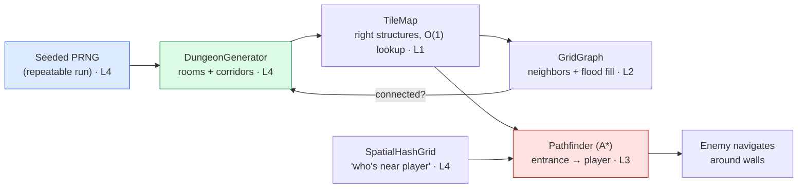

# 👹 Boss Battle — The Infinite Dungeon

| | |
|---|---|
| 🎚️ **Difficulty** | 🔴 Hard |
| ⏱️ **Estimated time** | 90 minutes |
| ⭐ **XP reward** | 500 |
| 🔓 **Unlocks** | World 5 — Gameplay Systems |

[← Checklist](checklist.md) · [↑ Phase Home](README.md) · [↑ Home](../../README.md)

---

## 📨 The incident

```
From:    Maya <maya@pixelforge.studio>
To:      You <new-hire@pixelforge.studio>
Cc:      Kenji <kenji@pixelforge.studio>, Theo <theo@pixelforge.studio>
Subject: [W4-BOSS] Make it a ROGUELITE. Different every run, and the enemies hunt.

The slice is playable, but it's the same room forever and the test enemy is
still standing face-first in a wall. Theo keeps calling Ashfall a roguelite
in pitch meetings — let's make that true in the build, not just the deck.

Here's the bar. I hit "New Run" and:

  - The DUNGEON is generated — rooms and corridors, laid out DIFFERENTLY each
    time. And it's always fully CONNECTED: there is no room I can't walk to.
    (Give me a seed so I can replay a run when I find a bug.)
  - I drop an enemy at the entrance and it NAVIGATES to me — finds a real path
    around the walls with A*, not a straight line into geometry.
  - When I ask "what's near the player?" it doesn't churn through every entity
    on the map. Use a spatial grid so it stays fast as the swarm grows.

That's the whole world in one system: data structures holding the map, the
grid as a graph, A* doing the hunting, generation making it infinite, and a
spatial grid keeping it fast. No tutorial this time — you've got all four
lessons. Wire them into ONE infinite dungeon. Nail it and World 5 — the actual
gameplay: loot, combat, abilities — is yours.

— Maya
```

> ⚔️ **Boss Battle rules:** No tutorials, no copying lesson files wholesale. **Apply** World 4: build the tile-map data model, the grid-graph + connectivity check, the A\* `Pathfinder`, the seeded dungeon generator, and the spatial hash grid yourself, and wire them into one system. You win when every victory condition is met **and you can explain which structure/algorithm owns each behavior** (map → graph → A\* → generator → spatial grid).

---

## 🎯 Your mission

Build an **infinite, navigable dungeon** for Ashfall: each run **generates a random, connected dungeon from a seed**, an enemy **A\*-paths from the entrance to the player** across it, and a **spatial hash grid** answers "enemies near the player" without scanning everything. This is the capstone that fuses every lesson:



Build it from these pieces (at minimum):

1. **Tile-map (L1):** a `TileMap` with O(1) coordinate lookup (`[x,y]` array or `Dictionary<(int,int),Tile>`), tiles tagged walkable/wall.
2. **Generation (L4):** a `DungeonGenerator` seeded by a stored `int seed` → place random non-overlapping rooms, carve corridors between them.
3. **Connectivity (L2):** flood-fill (BFS/DFS) from one floor tile; if it doesn't reach every floor tile, connect the regions (or regenerate) until it does. Prove it.
4. **A\* (L3):** a reusable `Pathfinder` (open set by `f = g + h`, closed `HashSet`, Manhattan heuristic, `cameFrom` reconstruction) returning a walkable tile path from the entrance to the player.
5. **Spatial grid (L4):** a `SpatialHashGrid` bucketing entities by cell so "enemies within radius R of the player" only checks nearby cells.

---

## 🏆 Victory conditions

- [ ] **New Run generates a different dungeon** each time — random rooms + corridors from a **seed** (and the same seed reproduces the exact same dungeon)
- [ ] The dungeon is **provably fully connected** — a flood fill from any floor tile reaches *every* floor tile (no unreachable rooms)
- [ ] The tile-map uses a structure with **O(1) coordinate lookup**, not an O(n) scan
- [ ] An enemy **A\*-paths from the entrance to the player**, routing **around walls** (not a straight line into geometry), and the path is walkable end to end
- [ ] A\* uses an **open set ordered by `f = g + h`**, a **closed set**, an **admissible (Manhattan) heuristic**, and **reversed `cameFrom` reconstruction**
- [ ] "**Enemies near the player**" is answered via a **spatial hash grid** — only nearby cells are checked, not every entity
- [ ] It's **one runnable system** ("New Run" → generated dungeon + navigating enemy + working neighbor query)
- [ ] You can explain which structure/algorithm owns each behavior

---

## 🧪 How you'll know you won

```bash
cd ~/projects/ashfall
ls Assets/Scripts/World Assets/Scripts/AI
# → TileMap.cs, GridGraph.cs, DungeonGenerator.cs, SpatialHashGrid.cs, Pathfinder.cs
```

Then in the Editor / a build:
- Hit **New Run** twice — you get **two different** dungeon layouts. Feed the **same seed** twice — you get the **same** layout.
- Toggle a debug view: a **flood fill** from the entrance lights up **every** floor tile (none left dark → fully connected).
- Drop an enemy at the entrance — it **walks a path around the walls** to the player; draw the path and confirm every tile is floor.
- Spawn 100 enemies and query "near the player" — the returned set matches a brute-force check, but the spatial grid only touched a handful of **cells** (log the count).

If all that holds, Ashfall is an *infinite, navigable* roguelite world. You've won.

<details>
<summary>🔎 Reference solution — only after you've tried! (high-level sketch + key code)</summary>

**The shape of it (each piece owns one job):**

| Piece | Job | Lesson |
|---|---|---|
| `TileMap` | O(1) walkable/wall lookup by coordinate | L1 |
| `GridGraph` | walkable neighbors + flood-fill connectivity | L2 |
| `Pathfinder` | A\* path of tiles (entrance → player) | L3 |
| `DungeonGenerator` | seeded rooms + corridors, guaranteed connected | L4 |
| `SpatialHashGrid` | fast "entities near a point" queries | L4 |

**Generator: seeded rooms + corridors (deterministic from a seed):**

```csharp
using System.Collections.Generic;
using UnityEngine;

public class DungeonGenerator
{
    public TileMap Generate(int width, int height, int seed)
    {
        var rng = new System.Random(seed);            // L4: same seed → same dungeon
        var map = new TileMap(width, height);         // starts all-wall
        var rooms = new List<RectInt>();

        for (int i = 0; i < 12; i++)                  // try to place rooms
        {
            var room = new RectInt(rng.Next(1, width - 8), rng.Next(1, height - 8),
                                   rng.Next(4, 8), rng.Next(4, 8));
            if (rooms.Exists(r => r.Overlaps(room))) continue;
            map.CarveRoom(room);
            if (rooms.Count > 0)                      // connect to the previous room
                map.CarveCorridor(Center(rooms[^1]), Center(room), rng);
            rooms.Add(room);
        }

        // L2: guarantee connectivity before returning.
        while (!IsFullyConnected(map))
            ConnectNearestRegions(map, rng);          // carve a corridor between split regions
        return map;
    }
}
```

**Connectivity: flood fill proves every floor tile is reachable (L2):**

```csharp
bool IsFullyConnected(TileMap map)
{
    var start = map.FirstFloorTile();
    var seen = new HashSet<Vector2Int> { start };
    var q = new Queue<Vector2Int>(); q.Enqueue(start);   // BFS / flood fill
    while (q.Count > 0)
        foreach (var n in map.WalkableNeighbors(q.Dequeue()))
            if (seen.Add(n)) q.Enqueue(n);
    return seen.Count == map.FloorTileCount;             // reached ALL floor → connected
}
```

**A\*: open set by f = g + h, closed set, reversed reconstruction (L3):**

```csharp
using System.Collections.Generic;
using UnityEngine;

public static class Pathfinder
{
    static int Manhattan(Vector2Int a, Vector2Int b)        // admissible on a 4-neighbor grid
        => Mathf.Abs(a.x - b.x) + Mathf.Abs(a.y - b.y);

    public static List<Vector2Int> FindPath(TileMap map, Vector2Int start, Vector2Int goal)
    {
        var open = new PriorityQueue<Vector2Int>();          // ordered by f = g + h
        var cameFrom = new Dictionary<Vector2Int, Vector2Int>();
        var g = new Dictionary<Vector2Int, int> { [start] = 0 };
        var closed = new HashSet<Vector2Int>();
        open.Enqueue(start, Manhattan(start, goal));

        while (open.Count > 0)
        {
            var cur = open.Dequeue();
            if (cur == goal) return Reconstruct(cameFrom, cur);   // reversed inside
            if (!closed.Add(cur)) continue;

            foreach (var nb in map.WalkableNeighbors(cur))
            {
                int tentative = g[cur] + 1;                       // uniform step cost
                if (g.TryGetValue(nb, out int best) && tentative >= best) continue;
                cameFrom[nb] = cur;                               // best parent so far
                g[nb] = tentative;
                open.Enqueue(nb, tentative + Manhattan(nb, goal));// f = g + h
            }
        }
        return null;                                             // no path
    }

    static List<Vector2Int> Reconstruct(Dictionary<Vector2Int, Vector2Int> cameFrom, Vector2Int cur)
    {
        var path = new List<Vector2Int> { cur };
        while (cameFrom.TryGetValue(cur, out cur)) path.Add(cur);
        path.Reverse();                                          // goal→start becomes start→goal
        return path;
    }
}
```

**Spatial hash grid: bucket by cell, query only nearby cells (L4):**

```csharp
using System.Collections.Generic;
using UnityEngine;

public class SpatialHashGrid
{
    private readonly float cell;
    private readonly Dictionary<Vector2Int, List<int>> buckets = new();   // L1: O(1) bucket lookup

    public SpatialHashGrid(float cellSize) => cell = cellSize;
    Vector2Int Key(Vector2 p) => new(Mathf.FloorToInt(p.x / cell), Mathf.FloorToInt(p.y / cell));

    public void Insert(int id, Vector2 pos)
    {
        var k = Key(pos);
        if (!buckets.TryGetValue(k, out var list)) buckets[k] = list = new List<int>();
        list.Add(id);
    }

    // Only visits the player's cell + the ring around it — not all N entities.
    public List<int> Near(Vector2 pos, int cellRadius = 1)
    {
        var result = new List<int>(); var center = Key(pos);
        for (int dx = -cellRadius; dx <= cellRadius; dx++)
        for (int dy = -cellRadius; dy <= cellRadius; dy++)
            if (buckets.TryGetValue(center + new Vector2Int(dx, dy), out var list))
                result.AddRange(list);
        return result;
    }
}
```

**Why each piece is the right tool:**
- The tile-map as an **array/`Dictionary`** gives O(1) "is this a wall?" — the query A\* and generation hammer every step (L1).
- **Flood fill** (BFS) is the cheapest proof of connectivity: reach-count equals floor-count or it doesn't (L2).
- **A\*** = Dijkstra steered by an **admissible Manhattan heuristic**, so it finds the *shortest* route around walls while expanding far fewer nodes than blind search; the `HashSet` closed set keeps "visited" O(1) (L3).
- A **seeded `System.Random`** makes a run **reproducible** — store the seed, rebuild the exact dungeon for saves and bug reports (L4).
- The **spatial hash grid** turns "who's near the player?" from an O(N) scan into checking a handful of buckets — it scales as the swarm grows (L1/L4).

One system, four lessons, an infinite navigable world. That's all of World 4 in a single dungeon.
</details>

---

## 🎁 Rewards

- 🏆 **+500 XP**
- 🏅 Achievement unlocked: **🧮 Algorithms Engineer** — you turned a hand-made room into an infinite, connected, navigable world that enemies hunt across
- 🔓 **World 5 — Gameplay Systems** unlocks
- 📈 Update [PROGRESS.md](../../PROGRESS.md): mark World 4 ✅ and add the **+250 World Complete bonus**

> 🗒️ Reflection: algorithms aren't an academic exercise — they're the difference between "the same boring room with a blind enemy" and "an infinite dungeon that hunts you." You picked the right structures, saw a grid as a graph, searched it with A\*, generated it from a seed, and made neighbor queries fast. World 5 fills these navigable dungeons with the *game*: items, abilities, combat, and loot worth grabbing.

---

[← Checklist](checklist.md) · [↑ Phase Home](README.md) · [↑ Home](../../README.md) · [⚔️ Enter World 5 →](../phase-05-gameplay-systems/README.md)
