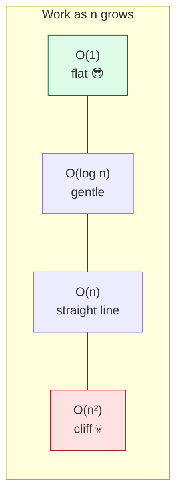
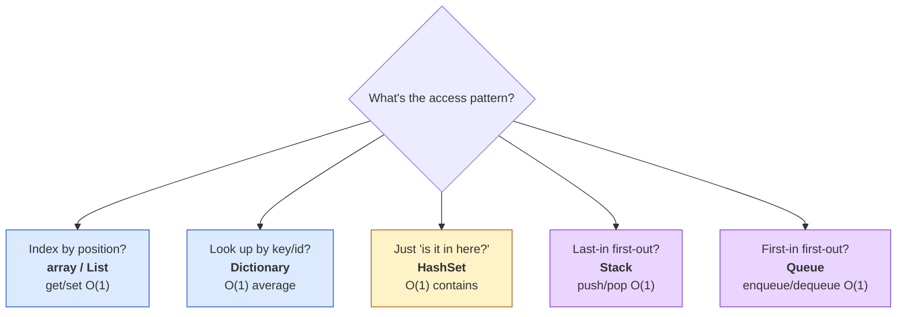

# Level 1 — Big-O & Data Structures

| | |
|---|---|
| 🎚️ **Difficulty** | 🟡 Medium |
| ⏱️ **Estimated time** | 30 minutes |
| ⭐ **XP reward** | 100 (Quest) + 25 (Quiz) |

[← Prev](../README.md) · [↑ Phase Home](../README.md) · [→ Next](02-graphs-grids-and-traversal.md)

---

## 📖 Story

> *"Welcome to World 4. Maya wants procedural dungeons full of enemies that actually chase you — and that means algorithms. But before we write a single pathfinder, we need to talk about **why one line of code can quietly murder your frame rate**. Last week a contractor shipped an inventory that did a linear scan every frame. Fine with 10 items. At 1,000 it dropped us to 12fps. The bug wasn't the feature — it was the **data structure**. At 60fps you get ~16 milliseconds per frame for everything: physics, rendering, AI, the lot. Pick the wrong container and you blow the whole budget on lookups. So today: **Big-O** — a way to predict how code scales before it bites you — and the handful of structures you'll reach for every single day. — Kenji"*

---

## 🎯 Goal

- Build **Big-O intuition**: how an algorithm's cost grows with input size `n`
- Understand why this matters at **60fps with 1,000 entities** (your frame budget)
- Know the everyday structures — **array, `List`, `Dictionary`, `HashSet`, `Stack`, `Queue`** — and *when* to use each
- Understand **cache-friendliness**: why contiguous memory is fast
- Pick the right structure for three real game problems (inventory lookup, cooldown queue, visited set)
- Build Ashfall's **tile-map data model** that the rest of the world stands on

---

## 🧠 Concepts

### Big-O: predicting cost before it hurts

Big-O describes how an operation's cost grows as the input `n` grows — ignoring constants, focusing on the *shape* of the curve. It answers: *"if I have 10× the data, do I do 10× the work, or 100×, or barely any more?"*

| Notation | Name | "If `n` doubles…" | Game example |
|---|---|---|---|
| `O(1)` | constant | …same work | `dict[key]` lookup, `array[i]` |
| `O(log n)` | logarithmic | …one more step | binary search, balanced tree |
| `O(n)` | linear | …double work | scanning a list for an item |
| `O(n log n)` | linearithmic | …a bit more than double | a good sort |
| `O(n²)` | quadratic | …4× work | every entity checks every other |



The trap is that `O(n²)` looks *fine* in testing. With 10 enemies that's 100 checks — invisible. With 1,000 enemies it's **1,000,000 checks every frame**. Big-O is the tool that lets you see the cliff from the test scene.

### The frame budget — why constants stop mattering

At 60fps you have **~16.6 ms per frame**. Everything shares it. A linear scan over an inventory is cheap *once*; do it for 1,000 entities each frame and the `O(n)` becomes `O(n²)` across the system. Replacing one `O(n)` lookup with an `O(1)` one is often the single highest-leverage change you can make. You don't optimize by guessing — you optimize by knowing which curve you're on.

### The structures you'll actually use



- **Array / `List<T>`** — values in a row, accessed by index. `list[i]` is `O(1)`; *searching* for a value (`Contains`) is `O(n)`. Use for ordered data and your tile grid.
- **`Dictionary<K,V>`** — a hash map: jump straight to a value by key in `O(1)` average. Use for "find the cooldown for *this* ability" or "the entity with *this* id."
- **`HashSet<T>`** — membership only, `Contains` in `O(1)`. The right answer to *"have I already visited this tile?"* (you'll use this constantly in traversal next lesson).
- **`Stack<T>`** — last-in, first-out. Undo history, DFS, backtracking.
- **`Queue<T>`** — first-in, first-out. Cooldown/event queues, BFS frontier, spawn waves.

### Cache-friendliness: the hidden constant

Two structures can both be `O(1)` and still differ 10× in real speed, because of **the cache**. The CPU reads memory in chunks (cache lines). An **array** stores elements contiguously, so walking it pulls neighbors along for free — the CPU's prefetcher loves it. A linked structure (or pointer-chasing through scattered objects) jumps all over RAM, missing cache on every step. Rule of thumb: *for tight per-frame loops over many elements, a flat array beats a fancy structure.* Big-O tells you the curve; cache tells you the constant — and at 60fps the constant is real money.

### Why this exists

These are the bricks **every** engine and game is built from — Unity's `List`, Unreal's `TArray`/`TMap`, Godot's `Array`/`Dictionary`, a custom engine's hand-rolled containers all map to the same five ideas. Big-O is language- and engine-agnostic: it's a property of the *algorithm*, not the framework. Knowing it means you can reason about performance from the design doc, before you've written code to profile — and you can read someone else's code and spot the `O(n²)` cliff in their `Update()`. The tile-map model you build today is the literal data structure World 4's BFS, A*, and dungeon generator all read from. Get the container right now and the hard lessons get easy.

---

## 🛠️ Hands-on Lab

> 💻 Each snippet is a runnable C# class. In Unity drop them in `Assets/Scripts/`; or paste into any C# playground (e.g. dotnetfiddle) to watch the Big-O behavior directly.

### Step 1 — Feel the cliff: `List.Contains` vs `HashSet.Contains`

```csharp
using System.Collections.Generic;
using System.Diagnostics;
using UnityEngine;

public class BigOEDemo : MonoBehaviour
{
    void Start()
    {
        int n = 100_000;
        var list = new List<int>();
        var set  = new HashSet<int>();
        for (int i = 0; i < n; i++) { list.Add(i); set.Add(i); }

        // Look up a value that does NOT exist → worst case.
        var sw = Stopwatch.StartNew();
        bool a = list.Contains(-1);   // O(n): scans every element
        long listMs = sw.ElapsedMilliseconds;

        sw.Restart();
        bool b = set.Contains(-1);    // O(1): one hash, done
        long setMs = sw.ElapsedMilliseconds;

        UnityEngine.Debug.Log($"List.Contains: {listMs} ms · HashSet.Contains: {setMs} ms");
        // The List grows linearly with n; the HashSet stays flat. That's Big-O you can feel.
    }
}
```

### Step 2 — Inventory lookup: `Dictionary` instead of a linear scan

```csharp
using System.Collections.Generic;

public class Inventory
{
    // Map item id → count. "How many potions do I have?" is now O(1).
    private readonly Dictionary<string, int> _counts = new();

    public void Add(string id, int amount = 1)
    {
        _counts.TryGetValue(id, out int current); // current = 0 if absent
        _counts[id] = current + amount;
    }

    public int CountOf(string id)
    {
        _counts.TryGetValue(id, out int count);   // O(1) average — no scan
        return count;
    }

    public bool Has(string id) => _counts.ContainsKey(id); // O(1)
}
```

### Step 3 — Cooldown **queue**: FIFO is exactly the right shape

```csharp
using System.Collections.Generic;
using UnityEngine;

// Abilities go on cooldown in the order fired; they come OFF in that same order.
// First-in, first-out → a Queue. We peek the front; pop when its timer is up.
public class CooldownQueue : MonoBehaviour
{
    private struct Entry { public string ability; public float readyAt; }
    private readonly Queue<Entry> _cooling = new();

    public void StartCooldown(string ability, float seconds)
        => _cooling.Enqueue(new Entry { ability = ability, readyAt = Time.time + seconds });

    void Update()
    {
        // Because it's FIFO, the front is always the SOONEST to be ready.
        while (_cooling.Count > 0 && _cooling.Peek().readyAt <= Time.time)
        {
            Entry done = _cooling.Dequeue();      // O(1)
            Debug.Log($"{done.ability} ready!");
        }
    }
}
```

### Step 4 — The tile-map data model (a flat array, the World 4 foundation)

```csharp
// Engine-agnostic core: a grid stored as ONE contiguous array (cache-friendly),
// indexed by (x, y). This is what BFS, A*, and the dungeon generator will read.
public enum TileType { Wall, Floor }

public class TileMap
{
    public readonly int Width, Height;
    private readonly TileType[] _tiles;  // flat array, not [,] — easy to serialize & iterate

    public TileMap(int width, int height)
    {
        Width = width; Height = height;
        _tiles = new TileType[width * height]; // all Wall by default
    }

    private int Index(int x, int y) => y * Width + x;          // 2D → 1D
    public bool InBounds(int x, int y) => x >= 0 && y >= 0 && x < Width && y < Height;

    public TileType Get(int x, int y) => _tiles[Index(x, y)];  // O(1)
    public void Set(int x, int y, TileType t) => _tiles[Index(x, y)] = t; // O(1)
    public bool IsWalkable(int x, int y) => InBounds(x, y) && Get(x, y) == TileType.Floor;
}
```

> 💡 The `y * Width + x` trick flattens a 2D grid into a 1D array. It's `O(1)`, trivially serializable (World 3's save system can write the whole `_tiles` array), and cache-friendly when you scan row by row.

---

## 🎮 Mini Challenge

A teammate's flood-fill / pathfinding code keeps a `List<(int,int)> visited` and writes `if (visited.Contains(tile)) continue;` inside the inner loop. It's correct but crawls on big dungeons. What's the Big-O of that line across the whole fill, and what's the one-line fix?

<details>
<summary>💡 Reveal answer</summary>

`List.Contains` is `O(n)`. Calling it once per visited tile makes the whole fill **`O(n²)`** — the quadratic cliff. Swap the `List` for a **`HashSet<(int,int)>`**: `visited.Contains(tile)` becomes `O(1)`, and the fill drops to **`O(n)`**.

```csharp
var visited = new HashSet<(int, int)>();
// ...
if (visited.Contains(tile)) continue; // now O(1)
visited.Add(tile);
```

A `HashSet` is *the* structure for "have I seen this already?" — you'll use it in every traversal next lesson.
</details>

---

## 📦 Project Mission

Lay World 4's foundation: Ashfall's tile-map data model, chosen with Big-O in mind.

1. Create `Assets/Scripts/World/TileType.cs` and `Assets/Scripts/World/TileMap.cs` (Step 4): a flat `TileType[]`, `Index`, `InBounds`, `Get`/`Set`, `IsWalkable`.
2. Add a quick test scene that fills a 64×64 map mostly with `Wall`, carves a small `Floor` room, and logs the tile at a couple of coordinates to prove `Get`/`Set` work.
3. Refactor any existing item code toward a **`Dictionary`-based** inventory lookup (Step 2) instead of a linear scan — even as a stub, it sets up World 5.
4. Write one sentence in a code comment for each structure choice — *why* `TileType[]` (cache + serialization), *why* `Dictionary` for inventory — so future-you remembers the reasoning.
5. Commit:
   ```bash
   cd ~/projects/ashfall
   git switch -c feature/tilemap-model
   git add Assets/Scripts/World Assets/Scripts/Inventory
   git commit -m "feat: TileMap data model (flat array) + Dictionary inventory lookup — W4 foundation"
   git switch main && git merge feature/tilemap-model && git push
   ```

🎯 **Mission complete when:** Ashfall has a `TileMap` backed by a flat `TileType[]` with `O(1)` `Get`/`Set`/`IsWalkable`, an inventory that looks items up by key (not a scan), and a comment justifying each structure choice by its access pattern.

---

## ⚠️ Common Mistakes

| Mistake | What happens | Fix |
|--------|--------------|-----|
| `List.Contains` in a per-frame / inner loop | Hidden `O(n²)`, fps cliff at scale | Use `HashSet` for membership (`O(1)`) |
| Linear-scanning a list to find by id | `O(n)` every lookup | Use a `Dictionary<id, value>` |
| Picking a structure by habit | Wrong Big-O for the access pattern | Choose by *how you access*: index/key/membership/LIFO/FIFO |
| Scattered objects in a hot loop | Cache misses, slow despite `O(1)` | Store in a flat array; iterate contiguously |
| "Works in the test scene" = done | `O(n²)` invisible at small `n` | Reason about the curve, then profile at target `n` |
| 2D `[,]` array when you need to serialize/iterate | Awkward to save & walk | Flat 1D array with `y * Width + x` |

---

## 🤔 Reflection Questions

1. You have 1,000 enemies and each one checks "is the player in my aggro list?" every frame. With a `List` that's `O(n)` per check — what's the total cost across all enemies, and which structure fixes it?
2. Both an array and a `Dictionary` give `O(1)` access. When would you still prefer the array, and why does the cache make that more than a tie?
3. Why is a `Queue` the natural fit for cooldowns or spawn waves, while a `Stack` fits undo and backtracking? What does the ordering buy you?

---

## 📝 Quiz

1. **`O(n²)` means that when the input doubles, the work…**
   - a) stays the same
   - b) roughly doubles
   - c) roughly quadruples
2. **The best structure for "have I already visited this tile?" is…**
   - a) `List<T>` (`Contains`)
   - b) `HashSet<T>`
   - c) `Stack<T>`
3. **Storing a tile grid in one contiguous flat array (vs scattered objects) mainly helps because…**
   - a) it changes the Big-O from `O(n)` to `O(1)`
   - b) it's cache-friendly, so iteration has a much smaller constant
   - c) it uses less total memory than any alternative

<details>
<summary>✅ Answers</summary>

1: **c** · 2: **b** · 3: **b**
</details>

---

## ✅ Completion Checklist

- [ ] I can read Big-O and spot an `O(n²)` cliff in a hot loop
- [ ] I can explain the 60fps frame budget and why constants/cache matter
- [ ] I can choose array / `List` / `Dictionary` / `HashSet` / `Stack` / `Queue` by access pattern
- [ ] Ashfall has a `TileMap` backed by a flat `TileType[]` with `O(1)` access
- [ ] My inventory looks items up by key, not by scanning
- [ ] I passed the quiz
- [ ] Added **+125 XP** to [PROGRESS.md](../../../PROGRESS.md)

---

[← Prev](../README.md) · [↑ Phase Home](../README.md) · [→ Next](02-graphs-grids-and-traversal.md)
