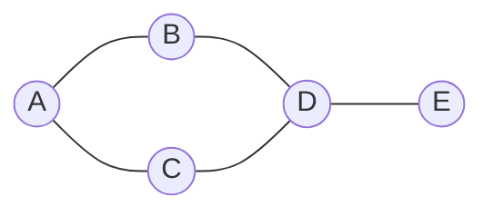
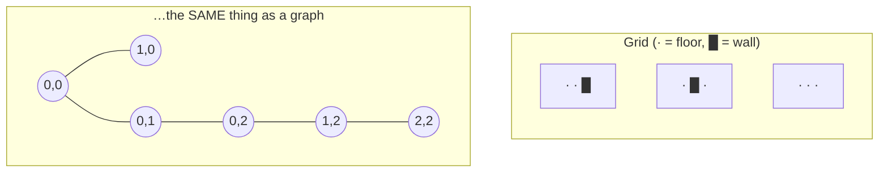
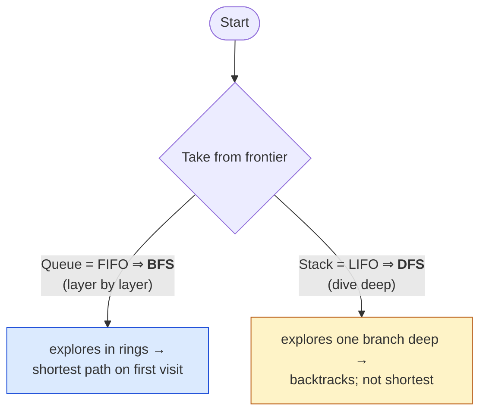

# Level 2 — Graphs, Grids & Traversal

| | |
|---|---|
| 🎚️ **Difficulty** | 🟡 Medium |
| ⏱️ **Estimated time** | 33 minutes |
| ⭐ **XP reward** | 100 (Quest) + 25 (Quiz) |

[← Prev](01-big-o-and-data-structures.md) · [↑ Phase Home](../README.md) · [→ Next](03-a-star-pathfinding.md)

---

## 📖 Story

> *"Nice tile map. Now here's the mind-flip that unlocks the whole world: **your dungeon grid IS a graph.** Every floor tile is a node; every step to a neighboring floor tile is an edge. Once you see it that way, a huge family of classic algorithms just *works* on your level. Maya's worried the random dungeons we're about to generate might have rooms you literally can't reach — so first job is a **reachability check**: from the entrance, which tiles can I get to? That's a graph traversal. We'll learn the two ways to walk a graph — **BFS** and **DFS** — and **flood fill**, the thing that paints a connected region (and powers the bucket tool in every paint app). BFS also hands us, for free, the **shortest path on an unweighted grid**, which is exactly how a dumb-but-correct enemy finds you. — Kenji"*

---

## 🎯 Goal

- Understand **graphs**: nodes, edges, neighbors — and the leap that a **grid is a graph**
- Walk a graph two ways: **BFS** (breadth-first, layer by layer) and **DFS** (depth-first, dive deep)
- Use a **`Queue` for BFS** and a **`Stack`/recursion for DFS** — and know why
- Implement **flood fill** to find a connected region (reachable tiles)
- Use **BFS for shortest path** on an unweighted grid
- Build Ashfall's **connectivity check + BFS reachability** over the dungeon grid

---

## 🧠 Concepts

### A graph is just nodes + edges

A **graph** is a set of **nodes** (vertices) connected by **edges**. That's it. A social network, a road map, a tech tree, a dungeon — all graphs. The power is that algorithms written for "graphs" run on *anything* you can model as nodes + edges.



### Your grid IS a graph

Here's the unlock. Take the `TileMap` from Level 1. Each **floor tile is a node.** Each floor tile is connected by an **edge** to its walkable neighbors (up/down/left/right — the 4 cardinal directions for a top-down dungeon). Walls aren't nodes; you can't step on them.



You never build a separate graph object — you compute neighbors **on the fly** from the grid: *"for tile (x,y), the neighbors are the up to 4 adjacent tiles that are in-bounds and walkable."* That `Neighbors()` function is the edge list of your graph.

### Two ways to walk it: BFS vs DFS

Both visit every reachable node exactly once. The **only** difference is the order — which is decided by the structure holding the **frontier** (the tiles we've discovered but not yet explored):

- **BFS — Breadth-First Search** uses a **`Queue` (FIFO)**. It explores in **rings/layers**: all tiles 1 step away, then all 2 steps away, then 3… Because it expands outward evenly, the *first* time BFS reaches a tile, it did so by a **shortest path** (in number of steps).
- **DFS — Depth-First Search** uses a **`Stack` (LIFO)** (or recursion). It **dives** down one path as far as it can, then backtracks. Great for "can I reach it / explore everything," **not** for shortest path.



The pattern for *both* is identical: keep a **frontier** and a **visited `HashSet`** (Level 1!). Pop a node, mark visited, push its unvisited neighbors. Swap `Queue`↔`Stack` and you swap BFS↔DFS. That `visited` set is what stops you looping forever in a cyclic graph (and your dungeon is full of cycles).

### Flood fill = traversal that paints a region

**Flood fill** is just BFS/DFS that records every node it reaches. Start at a tile, traverse all connected walkable tiles, and the set you collect *is* the connected region — the reachable area, the "this room," the bucket-fill in a paint app. For Ashfall: flood-fill from the entrance, and any floor tile **not** in the result is **unreachable** — a generator bug we must fix.

### BFS = free shortest path (unweighted)

Because BFS reaches each tile by the fewest steps, if you record *where you came from* (a `cameFrom` map), you can walk that back from the goal to the start and get the **shortest path** — no weights needed. This is the correct-but-naive enemy chase. Next lesson, A* makes it *fast* and weight-aware; today, **BFS is the honest baseline** that proves the idea.

### Why this exists

Graph traversal is one of the most reused ideas in all of software — and the *exact same* BFS/DFS runs on a dungeon, a quest dependency tree, a dialogue graph, a navmesh, or a web crawler. It's fully engine-agnostic: Unity, Unreal, Godot, a board game on paper — a grid is a graph everywhere. Internalizing "grid = graph, frontier + visited set, `Queue` for BFS / `Stack` for DFS" means pathfinding, region detection, and connectivity all become the *same* small pattern with the container swapped. Today's BFS shortest path is literally Dijkstra with every edge cost = 1; next lesson we add costs and a heuristic to get A*. Build the traversal muscle now and A* is a two-line upgrade.

---

## 🛠️ Hands-on Lab

> 💻 These build directly on Level 1's `TileMap`. We represent a tile as `(int x, int y)` value tuples — cheap, hashable, perfect `HashSet`/`Dictionary` keys.

### Step 1 — Neighbors: the edges of your grid-graph

```csharp
using System.Collections.Generic;

public static class GridGraph
{
    // 4-directional neighbors (top-down dungeon). The "edges" of our graph,
    // computed on the fly — walls and out-of-bounds simply aren't neighbors.
    private static readonly (int dx, int dy)[] Dirs =
        { (1, 0), (-1, 0), (0, 1), (0, -1) };

    public static IEnumerable<(int x, int y)> Neighbors(TileMap map, (int x, int y) t)
    {
        foreach (var d in Dirs)
        {
            int nx = t.x + d.dx, ny = t.y + d.dy;
            if (map.IsWalkable(nx, ny))   // in-bounds AND floor (from Level 1)
                yield return (nx, ny);
        }
    }
}
```

### Step 2 — Flood fill (BFS) → the set of reachable tiles

```csharp
using System.Collections.Generic;

public static class Reachability
{
    // Returns every walkable tile reachable from `start`. This is flood fill:
    // a BFS that records everyone it meets.
    public static HashSet<(int, int)> Flood(TileMap map, (int x, int y) start)
    {
        var visited = new HashSet<(int, int)>();   // O(1) "seen it?"
        var frontier = new Queue<(int, int)>();     // FIFO ⇒ BFS

        frontier.Enqueue(start);
        visited.Add(start);

        while (frontier.Count > 0)
        {
            var current = frontier.Dequeue();
            foreach (var next in GridGraph.Neighbors(map, current))
            {
                if (visited.Contains(next)) continue; // skip already-seen
                visited.Add(next);
                frontier.Enqueue(next);
            }
        }
        return visited; // == the connected region containing `start`
    }
}
```

### Step 3 — DFS: same shape, swap `Queue` → `Stack`

```csharp
using System.Collections.Generic;

public static class DepthFirst
{
    // IDENTICAL logic to BFS — only the frontier structure changed.
    // Stack = LIFO ⇒ we dive deep down one branch before backtracking.
    public static HashSet<(int, int)> Explore(TileMap map, (int x, int y) start)
    {
        var visited = new HashSet<(int, int)>();
        var frontier = new Stack<(int, int)>();   // <-- the only difference

        frontier.Push(start);
        while (frontier.Count > 0)
        {
            var current = frontier.Pop();
            if (!visited.Add(current)) continue;  // Add returns false if already present
            foreach (var next in GridGraph.Neighbors(map, current))
                if (!visited.Contains(next)) frontier.Push(next);
        }
        return visited;
    }
}
```

### Step 4 — BFS shortest path (record `cameFrom`, then walk it back)

```csharp
using System.Collections.Generic;

public static class BfsPath
{
    // Shortest path (fewest steps) on an UNWEIGHTED grid.
    // null = no path exists.
    public static List<(int, int)> Find(TileMap map, (int x, int y) start, (int x, int y) goal)
    {
        var frontier = new Queue<(int, int)>();
        var cameFrom = new Dictionary<(int, int), (int, int)>(); // node -> where we reached it from

        frontier.Enqueue(start);
        cameFrom[start] = start; // marks start as visited (its own parent)

        while (frontier.Count > 0)
        {
            var current = frontier.Dequeue();
            if (current == goal) break;   // first time we touch goal = shortest (BFS property)

            foreach (var next in GridGraph.Neighbors(map, current))
            {
                if (cameFrom.ContainsKey(next)) continue; // already discovered
                cameFrom[next] = current;
                frontier.Enqueue(next);
            }
        }

        if (!cameFrom.ContainsKey(goal)) return null; // unreachable

        // Reconstruct: walk parents from goal back to start, then reverse.
        var path = new List<(int, int)>();
        var node = goal;
        while (node != start) { path.Add(node); node = cameFrom[node]; }
        path.Add(start);
        path.Reverse();
        return path;
    }
}
```

> 💡 Notice `cameFrom` does double duty: it's both the **visited set** (a key exists ⇒ discovered) *and* the breadcrumb trail for reconstruction. That dual-use map is the exact skeleton A* uses next lesson — we'll just add a *cost* map beside it.

---

## 🎮 Mini Challenge

You run BFS shortest-path from the entrance to a treasure tile and get `null`. Your DFS `Explore` from the same entrance returns a big set of tiles — but the treasure tile **isn't in it** either. What does that tell you about the dungeon, and which World 4 lesson must fix it?

<details>
<summary>💡 Reveal answer</summary>

If neither BFS nor DFS from the entrance reaches the treasure, the treasure is in a **disconnected region** — there is **no walkable path** between them. The map has an unreachable pocket (a room with no corridor). That's not a pathfinding bug; it's a **generation** bug. **Lesson 4 (Procedural Generation)** must guarantee connectivity — typically by flood-filling after generation and carving a corridor to any region the entrance can't reach. Reachability via traversal is exactly the test you'd run to *detect* it.
</details>

---

## 📦 Project Mission

Make Ashfall's dungeon grid traversable and prove it's fully connected.

1. Create `Assets/Scripts/World/GridGraph.cs` (Step 1) — the on-the-fly neighbor function over Level 1's `TileMap`.
2. Add `Assets/Scripts/World/Reachability.cs` with the BFS **flood fill** (Step 2).
3. Add a **connectivity check**: count total floor tiles, flood-fill from the entrance, and assert `flood.Count == totalFloorTiles`. Log a warning listing any unreachable tiles.
4. Add `BfsPath.Find` (Step 4) and prove it: pick two floor tiles, log the returned path length, and confirm a blocked map returns `null`.
5. (Optional) Visualize: draw reachable tiles one color and unreachable ones red with `Debug.DrawLine`/Gizmos so you can *see* connectivity.
6. Commit:
   ```bash
   cd ~/projects/ashfall
   git switch -c feature/grid-traversal
   git add Assets/Scripts/World
   git commit -m "feat: grid-as-graph neighbors, BFS flood-fill reachability + BFS shortest path"
   git switch main && git merge feature/grid-traversal && git push
   ```

🎯 **Mission complete when:** Ashfall can flood-fill the dungeon from the entrance, report whether every floor tile is reachable (connectivity check), and return a correct shortest tile path with BFS — returning `null` when no path exists.

---

## ⚠️ Common Mistakes

| Mistake | What happens | Fix |
|--------|--------------|-----|
| No `visited` set | Infinite loop on cyclic graphs | Track visited (`HashSet` or `cameFrom` keys) |
| Using `Stack` and expecting shortest path | DFS gives *a* path, not the shortest | Use BFS (`Queue`) for unweighted shortest path |
| Marking visited only when *dequeued* | Same node queued many times → slow/dupes | Mark visited when you *enqueue* it |
| Building a separate giant graph object | Wasted memory & sync bugs | Compute neighbors on the fly from the grid |
| 8-direction neighbors without diagonal rules | Enemies "cut corners" through walls | Stick to 4-dir (or guard diagonals explicitly) |
| Forgetting to reverse the reconstructed path | Path runs goal→start | `path.Reverse()` after walking `cameFrom` |

---

## 🤔 Reflection Questions

1. BFS and DFS differ by **one** line — the frontier structure. Explain *why* FIFO yields layer-by-layer (and thus shortest path) while LIFO dives deep.
2. Flood fill and "find reachable tiles" and "the bucket tool in Photoshop" are the same algorithm. What's the single underlying operation they share?
3. BFS gives shortest paths on an *unweighted* grid. What changes if some tiles cost more to cross (mud, lava) — and why does that motivate next lesson's A*?

---

## 📝 Quiz

1. **BFS uses a ___ and DFS uses a ___ for its frontier.**
   - a) Stack; Queue
   - b) Queue; Stack
   - c) Dictionary; HashSet
2. **On an unweighted grid, the first time BFS reaches a tile, the path it took is…**
   - a) the shortest (fewest steps)
   - b) a random valid path
   - c) the longest, then optimized later
3. **Flood fill from the dungeon entrance is the right tool to…**
   - a) sort tiles by distance
   - b) find which tiles are reachable / the connected region
   - c) compress the tile map

<details>
<summary>✅ Answers</summary>

1: **b** · 2: **a** · 3: **b**
</details>

---

## ✅ Completion Checklist

- [ ] I can explain why a tile grid *is* a graph (nodes = floor tiles, edges = walkable neighbors)
- [ ] I can implement BFS and DFS, and explain why swapping `Queue`↔`Stack` swaps them
- [ ] I use a `visited`/`cameFrom` set so traversal never loops forever
- [ ] Ashfall flood-fills the dungeon and reports full connectivity from the entrance
- [ ] My BFS returns a correct shortest path and `null` when unreachable
- [ ] I passed the quiz
- [ ] Added **+125 XP** to [PROGRESS.md](../../../PROGRESS.md)

---

[← Prev](01-big-o-and-data-structures.md) · [↑ Phase Home](../README.md) · [→ Next](03-a-star-pathfinding.md)
