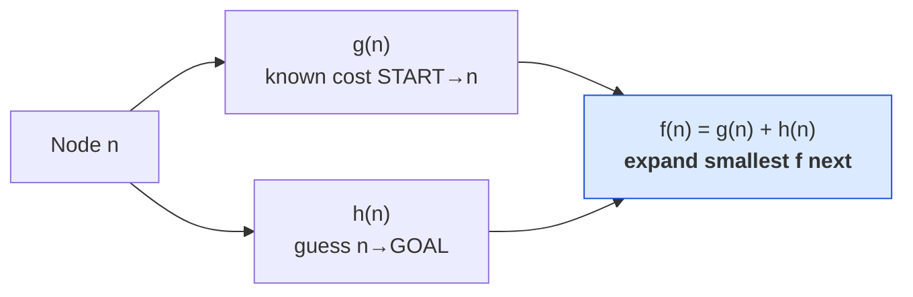
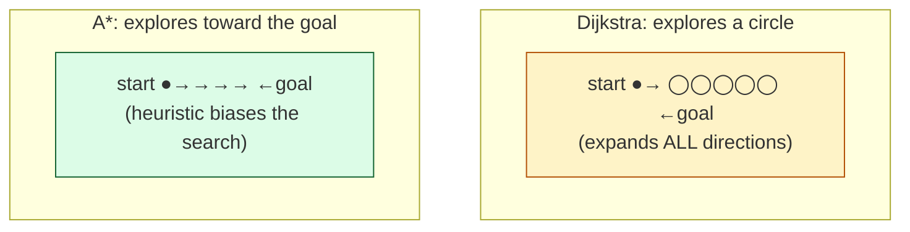
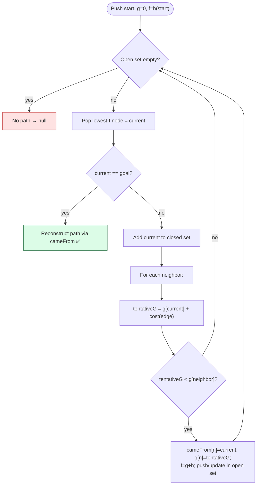

# Level 3 — A* Pathfinding

| | |
|---|---|
| 🎚️ **Difficulty** | 🔴 Hard |
| ⏱️ **Estimated time** | 35 minutes |
| ⭐ **XP reward** | 100 (Quest) + 25 (Quiz) |

[← Prev](02-graphs-grids-and-traversal.md) · [↑ Phase Home](../README.md) · [→ Next](04-procedural-generation-and-spatial-grids.md)

---

## 📖 Story

> *"Your BFS works — but watch it on a big dungeon: it explores a giant circle in *every* direction before it stumbles onto the player. Correct, but wasteful. Maya wants enemies that path **toward** you, not enemies that flood the whole level every frame. So today we build the algorithm that powers basically every game's navigation: **A\*** (\"A-star\"). The idea is gorgeous: BFS/Dijkstra explore blindly outward; A* adds a **heuristic** — an educated guess of how far the goal still is — so it spends its effort heading the *right* direction. It's Dijkstra with a sense of smell. Get the heuristic right (\"admissible\") and A* is **guaranteed** to find the shortest path while exploring a fraction of the tiles. By the end, Ashfall's enemies navigate the dungeon to you. — Kenji"*

---

## 🎯 Goal

- See the line from **BFS → Dijkstra → A\*** (each adds one idea)
- Understand **g, h, f**: cost-so-far, heuristic-to-go, and their sum
- Use the right **heuristic**: **Manhattan** (4-dir grids) vs **Euclidean**
- Understand **admissibility** — why "never overestimate" guarantees the shortest path
- Run A* with an **open set (priority queue)** + **closed set**
- Build Ashfall's reusable **`Pathfinder`** so enemies path to the player

---

## 🧠 Concepts

### From BFS to Dijkstra to A*

Three algorithms, same skeleton (frontier + `cameFrom`), each adding one idea:

| | Picks next node by… | Handles edge costs? | Aims at goal? |
|---|---|---|---|
| **BFS** | insertion order (FIFO) | ❌ all edges = 1 | ❌ blind |
| **Dijkstra** | **lowest cost-so-far** (`g`) | ✅ weighted | ❌ blind (all directions) |
| **A\*** | **lowest `g + h`** (`f`) | ✅ weighted | ✅ **toward goal** |

**Dijkstra** upgrades BFS by always expanding the *cheapest* node so far (`g`) — needed once tiles have different costs (mud = 5, floor = 1). But it still spreads in all directions. **A\*** adds a **heuristic `h`**: an estimate of the remaining distance to the goal. It expands the node with the smallest **`f = g + h`** — the most promising total. That single addition makes it *directional*.



### The heuristic: a guess that points the way

`h(n)` estimates the remaining distance from `n` to the goal. For a **4-directional grid** (no diagonals), the right estimate is **Manhattan distance** — `|dx| + |dy|`, the grid-step count ignoring walls. If you allow diagonal movement, use **Euclidean** (`√(dx² + dy²)`) or Chebyshev instead.



### Admissibility: why A* is *guaranteed* correct

A heuristic is **admissible** if it **never overestimates** the true remaining cost. Manhattan distance is admissible on a 4-dir grid because the real path (around walls) can only be *longer* than the straight grid-step count — never shorter. As long as `h` never overestimates, A* is **guaranteed to return the shortest path**. If `h` overestimates (e.g. you multiply Manhattan by 2), A* gets *faster* but may return a slightly **suboptimal** path — a real, deliberate trade-off games sometimes make. And the two extremes are illuminating: set `h = 0` and A* **becomes Dijkstra**; give every edge cost 1 and Dijkstra **becomes BFS**. They're one family.

### Open set, closed set, priority queue

A* tracks two sets:
- **Open set** — discovered-but-not-yet-expanded nodes, the frontier. We always pull the one with the **lowest `f`**, so it's a **priority queue** (min-heap). .NET 6+ has `PriorityQueue<TElement, TPriority>` built in.
- **Closed set** — fully expanded nodes we won't revisit.



### Why this exists

A* is the workhorse of game navigation — Unity's NavMesh agents, RTS unit movement, every grid roguelike, GPS routing — and the concept is fully engine-agnostic: nodes, edge costs, an admissible heuristic, a priority-queue frontier. Understanding it as *"Dijkstra + a heuristic, which is BFS + costs"* means you can tune the speed/quality dial knowingly (weight the heuristic, swap the distance metric, change edge costs for terrain) instead of treating the navmesh as a black box. The `Pathfinder` you build returns a reusable path-of-tiles that World 6's enemy AI and steering will consume directly — this is the brain enemies will use to hunt the player. For deeper intuition (and gorgeous interactive diagrams), see **RESOURCES.md** for this world — Amit Patel's *Red Blob Games* "Introduction to A*" is the canonical reference.

---

## 🛠️ Hands-on Lab

> 💻 Builds on Level 1's `TileMap` and Level 2's `GridGraph.Neighbors`. Uses .NET's `PriorityQueue<TElement, TPriority>` (Unity 2021.2+/.NET 6). Pure C# — no scene needed to test.

### Step 1 — The heuristic (Manhattan, admissible on a 4-dir grid)

```csharp
using System;

public static class Heuristics
{
    // Manhattan: grid steps ignoring walls. NEVER overestimates on a 4-dir grid
    // (the real path around walls is only ever longer) → admissible → optimal A*.
    public static int Manhattan((int x, int y) a, (int x, int y) b)
        => Math.Abs(a.x - b.x) + Math.Abs(a.y - b.y);

    // Use this instead if you allow diagonal movement.
    public static float Euclidean((int x, int y) a, (int x, int y) b)
        => (float)Math.Sqrt((a.x - b.x) * (a.x - b.x) + (a.y - b.y) * (a.y - b.y));
}
```

### Step 2 — The A* core (open set = priority queue, closed set, g/f maps)

```csharp
using System.Collections.Generic;

public static class Pathfinder
{
    // Returns shortest tile path start→goal, or null if unreachable.
    // costFn lets terrain cost more (default 1 per step → grid is uniform).
    public static List<(int, int)> FindPath(
        TileMap map, (int x, int y) start, (int x, int y) goal,
        System.Func<(int, int), int> costFn = null)
    {
        costFn ??= _ => 1;

        // Open set: pull the node with the LOWEST f. That's a min-priority-queue.
        var open = new PriorityQueue<(int x, int y), int>();
        var cameFrom = new Dictionary<(int, int), (int, int)>();
        var gScore   = new Dictionary<(int, int), int>();   // best known cost START→node
        var closed   = new HashSet<(int, int)>();            // fully expanded

        gScore[start] = 0;
        open.Enqueue(start, Heuristics.Manhattan(start, goal)); // f = g(0) + h

        while (open.Count > 0)
        {
            var current = open.Dequeue();           // lowest f
            if (current == goal) return Reconstruct(cameFrom, current);
            if (!closed.Add(current)) continue;     // skip stale duplicate entries

            foreach (var next in GridGraph.Neighbors(map, current))
            {
                if (closed.Contains(next)) continue;

                int tentativeG = gScore[current] + costFn(next);
                // Found a cheaper way to `next`? (or first time we've seen it)
                if (!gScore.TryGetValue(next, out int known) || tentativeG < known)
                {
                    cameFrom[next] = current;
                    gScore[next]   = tentativeG;
                    int f = tentativeG + Heuristics.Manhattan(next, goal); // g + h
                    open.Enqueue(next, f);          // may add a duplicate; closed-set guards it
                }
            }
        }
        return null; // open set drained → no path exists
    }

    private static List<(int, int)> Reconstruct(
        Dictionary<(int, int), (int, int)> cameFrom, (int, int) current)
    {
        var path = new List<(int, int)> { current };
        while (cameFrom.TryGetValue(current, out var prev))
        {
            current = prev;
            path.Add(current);
        }
        path.Reverse();   // we walked goal→start; flip it
        return path;
    }
}
```

### Step 3 — Weighted terrain (the same code, with costs)

```csharp
// A* already supports weights via costFn. Make mud expensive so enemies route around it:
int Cost((int x, int y) t) => map.Get(t.x, t.y) switch
{
    TileType.Floor => 1,
    // TileType.Mud  => 5,   // (add a Mud tile in World 5 — A* will avoid it automatically)
    _              => 1,
};

var path = Pathfinder.FindPath(map, enemyTile, playerTile, Cost);
```

### Step 4 — An enemy that paths to the player

```csharp
using System.Collections.Generic;
using UnityEngine;

public class EnemyPathing : MonoBehaviour
{
    [SerializeField] private float tileSize = 1f;
    private TileMap _map;
    private List<(int x, int y)> _path;
    private int _step;

    public void Repath((int x, int y) self, (int x, int y) player)
    {
        _path = Pathfinder.FindPath(_map, self, player); // recompute when player moves
        _step = 0;
        // Repath occasionally (e.g. a few times/sec), NOT every frame — that's the W4 budget lesson.
    }

    void Update()
    {
        if (_path == null || _step >= _path.Count) return;
        var target = new Vector3(_path[_step].x * tileSize, _path[_step].y * tileSize, 0f);
        transform.position = Vector3.MoveTowards(transform.position, target, 4f * Time.deltaTime);
        if (Vector3.Distance(transform.position, target) < 0.01f) _step++; // reached → next tile
    }
}
```

> 💡 The path is just a `List` of tiles — World 6's steering will *smoothly follow* it. A* finds the route; movement is a separate concern. And don't call `FindPath` every frame for every enemy — that's the cost cliff from Level 1. Repath a few times a second (or only when the player changes tile), which is exactly what Level 4's spatial grid helps you scope.

---

## 🎮 Mini Challenge

A teammate "optimizes" A* by multiplying the heuristic by 3 (`f = g + 3*h`) because "it reaches the goal way faster." It does run faster — but QA reports enemies sometimes take a *visibly longer* route. Why, and what's the rule they broke?

<details>
<summary>💡 Reveal answer</summary>

Multiplying the heuristic by 3 makes it **overestimate** the true remaining cost, so it's **no longer admissible**. A* still terminates and is faster (it's even greedier toward the goal), but it **loses the shortest-path guarantee** — hence the occasionally longer routes. The rule: *an admissible heuristic never overestimates*. Inflating `h` is a legitimate, deliberate **speed-vs-optimality trade-off** ("weighted A*"), but it's a choice, not a free lunch — and it must be a conscious one, not an accident.
</details>

---

## 📦 Project Mission

Give Ashfall a reusable pathfinder and make an enemy hunt the player.

1. Create `Assets/Scripts/Pathfinding/Heuristics.cs` (Step 1) and `Assets/Scripts/Pathfinding/Pathfinder.cs` (Step 2), reusing Level 1's `TileMap` and Level 2's `GridGraph`.
2. Verify correctness against last lesson: on a uniform map, `Pathfinder.FindPath` must return a path the **same length** as your BFS path (both shortest) — log and compare.
3. Confirm `null` is returned for an unreachable goal (use the connectivity check from Level 2 to set one up).
4. Add the `costFn` hook (Step 3) and prove A* **routes around** a strip of expensive tiles instead of straight through.
5. Wire `EnemyPathing` (Step 4): on a key press, repath from an enemy tile to the player's tile and watch it walk the route. Repath on a timer, **not** every frame.
6. Commit:
   ```bash
   cd ~/projects/ashfall
   git switch -c feature/a-star-pathfinder
   git add Assets/Scripts/Pathfinding Assets/Scripts/Enemies
   git commit -m "feat: A* Pathfinder (Manhattan heuristic, weighted costs) + enemy follows path"
   git switch main && git merge feature/a-star-pathfinder && git push
   ```

🎯 **Mission complete when:** Ashfall has a reusable `Pathfinder.FindPath` returning the shortest tile path (matching BFS length on a uniform grid, `null` when unreachable, routing around weighted tiles), and an enemy that follows that path toward the player.

---

## ⚠️ Common Mistakes

| Mistake | What happens | Fix |
|--------|--------------|-----|
| Heuristic that overestimates | A* returns non-shortest paths | Keep `h` admissible (Manhattan on 4-dir) |
| Wrong metric for movement | Euclidean on a 4-dir grid wastes work | Manhattan for 4-dir, Euclidean/Chebyshev for diagonals |
| Linear scan to find lowest-`f` node | A* runs `O(n²)` — slow | Use a `PriorityQueue`/min-heap for the open set |
| No closed set / re-expanding nodes | Loops, wasted work, wrong costs | Skip nodes already in the closed set |
| Not updating `g` when a cheaper path appears | Suboptimal paths | Replace if `tentativeG < known` |
| Repathing every enemy every frame | Frame-budget cliff (Level 1) | Repath on a timer / on player tile-change |

---

## 🤔 Reflection Questions

1. Set `h = 0` in A* and you get Dijkstra; give every edge cost 1 in Dijkstra and you get BFS. Explain in your own words why they're one family.
2. What does **admissible** mean, and concretely why does "never overestimate" guarantee the shortest path?
3. Weighted A* (inflating `h`) trades optimality for speed. For Ashfall's enemies, is a slightly-suboptimal-but-faster path acceptable? When would it *not* be?

---

## 📝 Quiz

1. **A\* expands the node with the smallest…**
   - a) `g` (cost so far)
   - b) `h` (heuristic to goal)
   - c) `f = g + h`
2. **An admissible heuristic is one that…**
   - a) never overestimates the remaining cost
   - b) is always exactly the real distance
   - c) is as large as possible for speed
3. **The open set in A\* should be backed by a…**
   - a) `Queue` (FIFO)
   - b) priority queue / min-heap (lowest `f` first)
   - c) `Stack` (LIFO)

<details>
<summary>✅ Answers</summary>

1: **c** · 2: **a** · 3: **b**
</details>

---

## ✅ Completion Checklist

- [ ] I can explain BFS → Dijkstra → A* as one family (h=0 ⇒ Dijkstra; cost=1 ⇒ BFS)
- [ ] I understand `g`, `h`, `f` and pick Manhattan vs Euclidean correctly
- [ ] I can explain admissibility and why it guarantees the shortest path
- [ ] My A* uses a priority-queue open set + a closed set
- [ ] Ashfall's `Pathfinder` matches BFS length on uniform grids, returns `null` when blocked, routes around weighted tiles
- [ ] An enemy follows the path toward the player (repathing on a timer)
- [ ] I passed the quiz
- [ ] Added **+125 XP** to [PROGRESS.md](../../../PROGRESS.md)

---

[← Prev](02-graphs-grids-and-traversal.md) · [↑ Phase Home](../README.md) · [→ Next](04-procedural-generation-and-spatial-grids.md)
