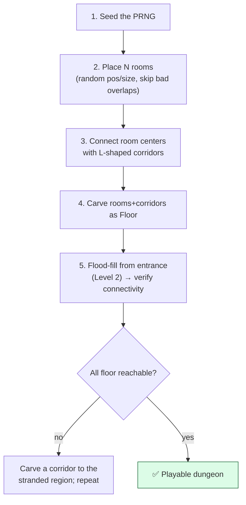
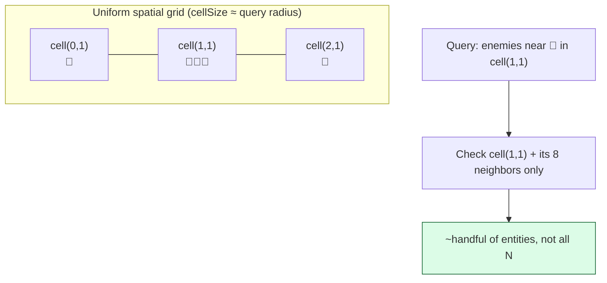

# Level 4 — Procedural Generation & Spatial Grids

| | |
|---|---|
| 🎚️ **Difficulty** | 🔴 Hard |
| ⏱️ **Estimated time** | 35 minutes |
| ⭐ **XP reward** | 100 (Quest) + 25 (Quiz) |

[← Prev](03-a-star-pathfinding.md) · [↑ Phase Home](../README.md) · [→ Next](../boss-battle.md)

---

## 📖 Story

> *"Last lesson of the world, and it's the one Maya's been waiting for: **every run feels new.** We're going to *generate* the dungeon. Two big ideas. First, **seeded randomness** — a PRNG you feed a seed, so 'random' becomes **reproducible**: same seed → same dungeon, every time. That's how you reproduce a bug, share a daily run, and save a level by storing one number instead of the whole map. Second, once the dungeon is full of enemies and pickups, 'which entities are near the player?' becomes a question you ask constantly — and checking every entity against every other is the `O(n²)` cliff from Level 1. The fix is a **spatial grid**: bucket the world into cells so you only check the few entities in nearby cells. Generate the level, then make queries on it fast. That's World 4, done. — Kenji"*

---

## 🎯 Goal

- Understand **seeded PRNG**: reproducible "random" from a single seed
- Generate a dungeon with a **room + corridor** (and a **random-walk**) approach
- **Guarantee connectivity** using Level 2's flood fill (no unreachable rooms)
- Understand **spatial partitioning**: a uniform grid / **spatial hash** for fast neighbor queries
- Turn `O(n²)` "entities near the player" into a near-`O(1)` cell lookup
- Build Ashfall's **dungeon generator + spatial grid** feeding the pathfinder and queries

---

## 🧠 Concepts

### Seeded randomness: reproducible "random"

A computer's "random" numbers come from a **PRNG** (pseudo-random number generator): a deterministic function that, from a starting **seed**, produces a stream that *looks* random. Same seed in ⇒ **exact same stream** out. This is a superpower, not a limitation:

- **Reproduce bugs:** "the crash only happens on seed 1337" → you can replay it exactly.
- **Tiny saves:** store the *seed*, regenerate the whole dungeon on load (World 3's save system just got 1,000× lighter).
- **Daily/shared runs:** everyone playing seed `2026-06-29` gets the same dungeon.


In C#, `new System.Random(seed)` is your seeded PRNG. **Never** use `UnityEngine.Random` (global, shared state) for generation you want reproducible — pass an explicit seeded instance around.

### Generating a dungeon: rooms + corridors

A simple, classic algorithm: scatter some **rooms** (rectangles) without too much overlap, then connect each room's center to the next with an **L-shaped corridor**. Carve all of that as `Floor` into the all-`Wall` `TileMap` from Level 1.



A **random walk** is an even simpler variant: start a "digger" at a tile and step it in random cardinal directions, carving `Floor` as it goes — great for cave-like, organic layouts. Either way, **step 5 is non-negotiable:** generation can produce unreachable pockets, so flood-fill from the entrance (Level 2) and fix any region the entrance can't reach. *Generate, then verify.*

### Spatial partitioning: stop checking everything

Now the level is populated. "Which enemies are within 3 tiles of the player?" The naive answer checks the player against **every** entity — `O(n)` per query, `O(n²)` if every entity asks. The fix is **spatial partitioning**: divide the world into a grid of **cells**; each entity registers in the cell it occupies. To find neighbors, you only look in the player's cell and its **adjacent cells** — a handful of entities, not all of them.



This is **broad-phase**: a cheap pass that narrows thousands of candidates to a few, before any expensive exact check. Physics engines use it for collision; you'll use it for "enemies near player," AoE damage, and culling.

### Uniform grid vs spatial hash

A **uniform grid** is a 2D array of cells — simple and fast when the world is bounded and entities are evenly spread. A **spatial hash** stores cells in a `Dictionary<cellCoord, list>` instead — it only allocates cells that actually contain something, so it handles **unbounded or sparse** worlds without a giant mostly-empty array. Same idea, different backing store. Pick **cell size ≈ your typical query radius**: too small and you scan many cells; too big and each cell holds too many entities (back toward `O(n²)`).

### Why this exists

Procedural generation is what gives roguelikes infinite replayability on a small content budget — and seeded determinism is the discipline that keeps it debuggable, shareable, and cheap to save (the seed plugs straight into World 3's save system, exactly the seam that lesson flagged). Spatial partitioning is one of the most important performance patterns in all of games: it's how engines do broad-phase collision, how RTS games handle thousands of units, how anything answers "what's near me?" at scale. Both are engine-agnostic — Unity, Unreal, Godot, and custom engines all implement seeded PRNGs and spatial structures; the *ideas* transfer everywhere. With this, World 4 is complete: you can generate a connected dungeon (Lesson 4), confirm it's traversable (Lesson 2), path enemies across it (Lesson 3), and query it fast (Lesson 4) — exactly the boss battle, and the foundation World 5 populates with loot and combat. See **RESOURCES.md** for this world (Red Blob Games) for deeper dives on grids and procedural maps.

---

## 🛠️ Hands-on Lab

> 💻 Builds on Level 1's `TileMap` and Level 2's flood fill. Pure C# logic — testable without a scene.

### Step 1 — A seeded RNG you pass around

```csharp
public class Rng
{
    private readonly System.Random _r;   // seeded ⇒ reproducible. NOT UnityEngine.Random.
    public readonly int Seed;

    public Rng(int seed) { Seed = seed; _r = new System.Random(seed); }

    public int Range(int minInclusive, int maxExclusive) => _r.Next(minInclusive, maxExclusive);
    public bool Chance(double p) => _r.NextDouble() < p;
}
```

### Step 2 — Room + corridor dungeon generator

```csharp
using System.Collections.Generic;

public struct Room
{
    public int X, Y, W, H;
    public (int x, int y) Center => (X + W / 2, Y + H / 2);
    public bool Overlaps(Room o) =>
        X < o.X + o.W && X + W > o.X && Y < o.Y + o.H && Y + H > o.Y;
}

public static class DungeonGenerator
{
    public static (TileMap map, (int x, int y) entrance) Generate(
        int width, int height, int roomAttempts, Rng rng)
    {
        var map = new TileMap(width, height);   // all Wall (Level 1)
        var rooms = new List<Room>();

        for (int i = 0; i < roomAttempts; i++)
        {
            var r = new Room {
                W = rng.Range(4, 9), H = rng.Range(4, 9),
                X = rng.Range(1, width - 9), Y = rng.Range(1, height - 9)
            };
            bool clash = false;
            foreach (var other in rooms) if (r.Overlaps(other)) { clash = true; break; }
            if (clash) continue;                 // skip bad placements

            CarveRoom(map, r);
            if (rooms.Count > 0)                 // connect to previous room's center
                CarveCorridor(map, rooms[rooms.Count - 1].Center, r.Center);
            rooms.Add(r);
        }

        var entrance = rooms[0].Center;
        EnsureConnected(map, entrance);          // Step 3 — non-negotiable
        return (map, entrance);
    }

    private static void CarveRoom(TileMap map, Room r)
    {
        for (int x = r.X; x < r.X + r.W; x++)
            for (int y = r.Y; y < r.Y + r.H; y++)
                if (map.InBounds(x, y)) map.Set(x, y, TileType.Floor);
    }

    // L-shaped corridor: horizontal then vertical.
    private static void CarveCorridor(TileMap map, (int x, int y) a, (int x, int y) b)
    {
        for (int x = System.Math.Min(a.x, b.x); x <= System.Math.Max(a.x, b.x); x++)
            if (map.InBounds(x, a.y)) map.Set(x, a.y, TileType.Floor);
        for (int y = System.Math.Min(a.y, b.y); y <= System.Math.Max(a.y, b.y); y++)
            if (map.InBounds(b.x, y)) map.Set(b.x, y, TileType.Floor);
    }
}
```

### Step 3 — Guarantee connectivity (reuse Level 2's flood fill)

```csharp
using System.Collections.Generic;

public static partial class DungeonGenerator { }   // (or fold into the class above)

static class Connectivity
{
    // After generation, every floor tile MUST be reachable from the entrance.
    // Flood from entrance; carve a corridor to any stranded floor region.
    public static void EnsureConnected(TileMap map, (int x, int y) entrance)
    {
        var reachable = Reachability.Flood(map, entrance);   // Level 2 BFS flood fill

        for (int x = 0; x < map.Width; x++)
            for (int y = 0; y < map.Height; y++)
                if (map.Get(x, y) == TileType.Floor && !reachable.Contains((x, y)))
                {
                    // Stranded region found → dig straight to the entrance and re-flood.
                    DigCorridorTo(map, (x, y), entrance);
                    reachable = Reachability.Flood(map, entrance);
                }
    }

    private static void DigCorridorTo(TileMap map, (int x, int y) from, (int x, int y) to)
    {
        for (int x = System.Math.Min(from.x, to.x); x <= System.Math.Max(from.x, to.x); x++)
            map.Set(x, from.y, TileType.Floor);
        for (int y = System.Math.Min(from.y, to.y); y <= System.Math.Max(from.y, to.y); y++)
            map.Set(to.x, y, TileType.Floor);
    }
}
```

> 💻 In Step 2 call `Connectivity.EnsureConnected(map, entrance);` (the snippet shows it inline as `EnsureConnected(...)` — wire it to whichever class you keep it in).

### Step 4 — Spatial hash grid for "near me" queries

```csharp
using System.Collections.Generic;
using UnityEngine;

// Buckets entities into cells of size `cellSize`. Neighbor queries scan only
// the query cell + its 8 neighbors → near-O(1) instead of O(n).
public class SpatialGrid<T>
{
    private readonly float _cellSize;
    private readonly Dictionary<(int, int), List<T>> _cells = new(); // sparse: only used cells

    public SpatialGrid(float cellSize) => _cellSize = cellSize;

    private (int, int) CellOf(Vector2 p)
        => (Mathf.FloorToInt(p.x / _cellSize), Mathf.FloorToInt(p.y / _cellSize));

    public void Clear() => _cells.Clear();   // rebuild each frame for moving entities

    public void Insert(T item, Vector2 pos)
    {
        var c = CellOf(pos);
        if (!_cells.TryGetValue(c, out var list)) _cells[c] = list = new List<T>();
        list.Add(item);
    }

    // All entities in the query cell + 8 neighbors (the broad-phase candidates).
    public IEnumerable<T> Query(Vector2 pos)
    {
        var (cx, cy) = CellOf(pos);
        for (int dx = -1; dx <= 1; dx++)
            for (int dy = -1; dy <= 1; dy++)
                if (_cells.TryGetValue((cx + dx, cy + dy), out var list))
                    foreach (var item in list) yield return item;
    }
}
```

> 💡 Usage each frame: `grid.Clear();` then `Insert` every entity, then `grid.Query(playerPos)` to get the handful of nearby candidates — and only *those* get the exact distance check. Set `cellSize ≈ your query radius`. This is the same broad-phase trick physics engines use for collision.

---

## 🎮 Mini Challenge

QA reports the daily-run feature is broken: two players on "seed 42" get **different dungeons**. The generator uses your seeded `Rng` for room placement — but also calls `UnityEngine.Random.Range(...)` to decide corridor wiggle. What's wrong, and what's the fix?

<details>
<summary>💡 Reveal answer</summary>

`UnityEngine.Random` is a **global, shared** generator — it's *not* seeded by your `Rng`, so its stream differs between machines/sessions, breaking determinism. **Every** random decision in generation must come from the **same seeded instance** you pass around. Replace the `UnityEngine.Random.Range(...)` call with `rng.Range(...)`. Rule: one seeded PRNG, threaded through all of generation — no hidden global randomness.
</details>

---

## 📦 Project Mission

Generate Ashfall's dungeon from a seed and make "near me" queries fast — completing World 4.

1. Create `Assets/Scripts/World/Rng.cs` (Step 1) — a seeded PRNG passed explicitly into generation.
2. Create `Assets/Scripts/World/DungeonGenerator.cs` (Steps 2–3): rooms + L-corridors carved into the `TileMap`, then `EnsureConnected` via Level 2's flood fill.
3. Prove **determinism**: generate twice with the same seed → identical maps; different seed → different map. Log a checksum (e.g. count of floor tiles + a hash of the tile array).
4. Prove **connectivity**: after generation, flood-fill from the entrance and assert every floor tile is reachable (Level 2 check) — zero unreachable tiles.
5. Create `Assets/Scripts/World/SpatialGrid.cs` (Step 4). Drop ~500 dummy entities in, query around a point, and confirm it returns only nearby ones (compare count vs a brute-force `O(n)` scan for correctness).
6. Save just the **seed** (not the whole map) via World 3's `SaveSystem`, and regenerate on load — confirm the same dungeon comes back.
7. Commit:
   ```bash
   cd ~/projects/ashfall
   git switch -c feature/dungeon-gen-spatial-grid
   git add Assets/Scripts/World
   git commit -m "feat: seeded room/corridor dungeon gen (connectivity-guaranteed) + spatial hash grid"
   git switch main && git merge feature/dungeon-gen-spatial-grid && git push
   ```

🎯 **Mission complete when:** Ashfall generates a **deterministic** (same-seed) dungeon whose every floor tile is **reachable from the entrance**, persists via its **seed** through the save system, and answers "entities near a point" through a `SpatialGrid` that returns the same neighbors as brute force at a fraction of the cost.

---

## ⚠️ Common Mistakes

| Mistake | What happens | Fix |
|--------|--------------|-----|
| Using `UnityEngine.Random` for generation | Non-reproducible; daily/shared runs break | Pass a seeded `System.Random` instance everywhere |
| Skipping the connectivity pass | Rooms the player can't reach | Flood-fill from entrance; carve to stranded regions |
| Saving the whole tile map | Huge saves, slow | Save the **seed**; regenerate on load |
| Spatial cell size ≪ or ≫ query radius | Scans too many cells, or cells too crowded | `cellSize ≈ query radius` |
| Not rebuilding the grid for moving entities | Stale positions, missed/ghost neighbors | `Clear()` + reinsert each frame (or update on move) |
| Treating spatial query as the exact answer | Returns candidates outside the radius | It's broad-phase — still do an exact distance check |

---

## 🤔 Reflection Questions

1. Saving the *seed* instead of the whole map makes saves tiny — but what must stay **exactly** identical between save and load for that to work, and what would silently break it?
2. A spatial grid turns "enemies near the player" from `O(n)` into roughly `O(1)`. What property of the query (and choice of cell size) makes that speedup hold — and when does it degrade back toward `O(n²)`?
3. Why is the connectivity flood-fill (Level 2) a *required* step after generation rather than a nice-to-have? What's the player-facing failure if you skip it?

---

## 📝 Quiz

1. **Seeding a PRNG with the same seed gives you…**
   - a) a different random stream each run
   - b) the exact same stream every time (reproducible)
   - c) truly random, unpredictable numbers
2. **A spatial grid speeds up "what's near me?" by…**
   - a) sorting all entities by distance every frame
   - b) only checking the query cell and its neighbors instead of all entities
   - c) reducing the number of entities in the game
3. **After procedurally generating a dungeon, you should…**
   - a) trust it's connected and move on
   - b) flood-fill from the entrance and fix any unreachable regions
   - c) delete all corridors to simplify it

<details>
<summary>✅ Answers</summary>

1: **b** · 2: **b** · 3: **b**
</details>

---

## ✅ Completion Checklist

- [ ] I can explain seeded PRNGs and why determinism matters (debugging, sharing, tiny saves)
- [ ] I generate a room+corridor dungeon and guarantee connectivity with flood fill
- [ ] I never use global `UnityEngine.Random` for reproducible generation
- [ ] Ashfall persists its dungeon via the **seed** and regenerates the same map on load
- [ ] I use a `SpatialGrid` for fast "near me" queries (broad-phase + exact check)
- [ ] I passed the quiz
- [ ] Added **+125 XP** to [PROGRESS.md](../../../PROGRESS.md)

---

[← Prev](03-a-star-pathfinding.md) · [↑ Phase Home](../README.md) · [→ Next](../boss-battle.md)
