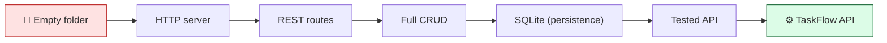
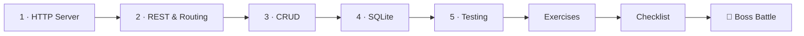
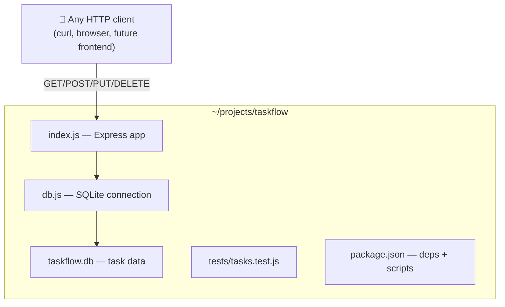

# ⚙️ World 4 — Backend Development

> *"We've talked about TaskFlow long enough. Time to build the actual thing. I need a REST API our future apps can talk to. Node + Express. Start small, ship something real. — Dana, your manager"*



---

## 📨 Your ticket

```
From:    Dana <dana@cloudforge.inc>
To:      You <new-hire@cloudforge.inc>
Subject: [TICKET-040] Build the TaskFlow API (v1)

You've got Linux, Node, Git, and a clean ~/projects/taskflow repo.
Now build the real thing: a REST API for tasks.

A task has: id, title, description, status, dueDate.
The API must let a client create, read, update, and delete tasks.

Roadmap I want:
  1. A bare HTTP server that responds.
  2. Real REST routes (GET tasks, GET one task).
  3. Full CRUD with correct status codes.
  4. Persist to a SQLite database so data survives a restart.
  5. Tests, so we don't ship breakage.

Commit each step. Marcus (Senior Eng) will review. Go build. 🚀

— Dana
```

This is the heart of the bootcamp: **the application everything else wraps around.** Every later world (Docker, AWS, CI/CD, Terraform, Kubernetes) ships *this* API. Build it well.

---

## 🎯 What you'll achieve in this world

- ✅ Run a real **Node.js + Express** HTTP server
- ✅ Understand **REST** and design clean resource routes
- ✅ Build **full CRUD** endpoints with correct HTTP status codes
- ✅ Persist data to a **SQLite** database (survives restarts)
- ✅ Write **automated tests** with Jest + Supertest

By the end you'll have a tested, persistent REST API living in `~/projects/taskflow` — the foundation for the rest of your career here.

---

## 🗺️ Level map

| Level | Lesson | Difficulty | Time | XP |
|------:|--------|:----------:|:----:|---:|
| 1 | [Your First HTTP Server](lessons/01-your-first-http-server.md) | 🟢 Easy | 20 min | 125 |
| 2 | [REST & Routing](lessons/02-rest-and-routing.md) | 🟢 Easy | 20 min | 125 |
| 3 | [Full CRUD Endpoints](lessons/03-crud-endpoints.md) | 🟡 Medium | 25 min | 125 |
| 4 | [Adding a Database (SQLite)](lessons/04-adding-a-database.md) | 🟡 Medium | 25 min | 125 |
| 5 | [Testing Your API](lessons/05-testing-your-api.md) | 🟡 Medium | 25 min | 125 |
| 👹 | [Boss Battle — The Flaky API](boss-battle.md) | 🟡 Medium | 40 min | 500 |

➕ Extra reps: [exercises.md](exercises.md) · ✅ Ready to advance? [checklist.md](checklist.md)

---

## 🧭 Recommended order



Go in order — each lesson edits the *same* TaskFlow project and builds on the last one's code.

---

## 📦 Project status after this world

`~/projects/taskflow` goes from an empty git repo to a **real, tested, persistent REST API**:



You'll hand this off to **World 5 (Docker)**, where you'll package it into a container so it runs anywhere.

---

## 🏆 World achievement

Complete the Boss Battle to earn the **⚙️ API Architect** badge.

---

[↑ Back to README](../../README.md)  ·  [🗺️ Roadmap](../../ROADMAP.md)  ·  [▶️ Start Level 1 →](lessons/01-your-first-http-server.md)
