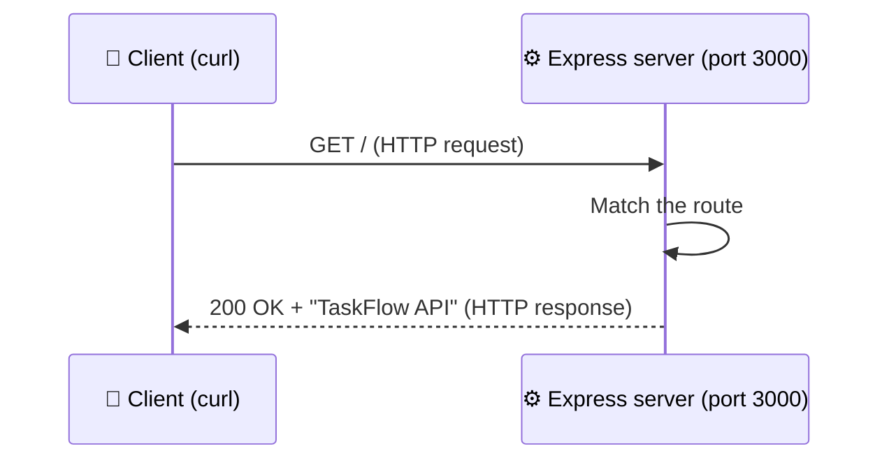

# Level 1 — Your First HTTP Server

| | |
|---|---|
| 🎚️ **Difficulty** | 🟢 Easy |
| ⏱️ **Estimated time** | 20 minutes |
| ⭐ **XP reward** | 100 (Quest) + 25 (Quiz) |

[← World Home](../README.md) · [↑ Phase Home](../README.md) · [→ Next: REST & Routing](02-rest-and-routing.md)

---

## 📖 Story

> *"Okay, forget databases and fancy stuff for a second. Step one of any backend is dead simple: a program that listens on a port and answers when someone knocks. Get that running and respond with 'TaskFlow API'. That's your first commit. — Marcus, Senior Eng"*

Everything you'll ever deploy — to AWS, to Kubernetes, all of it — is, at its core, this: a process listening on a port, answering requests. Let's make one.

---

## 🎯 Goal

- Understand what an **HTTP server** is and what a **port** is
- Initialise a Node project with `npm init`
- Install **Express** and write a minimal server that responds `TaskFlow API`
- Hit your own server with `curl`

---

## 🧠 Concepts

A **web server** is a program that waits for incoming **HTTP requests** and sends back **HTTP responses**. A **client** (a browser, `curl`, a phone app) makes the request; your server answers.

A **port** is a numbered door on your machine. One computer can run many servers, each on its own port. By convention, local web dev uses ports like **3000** or **8080**.

**Express** is a tiny, hugely popular framework that makes writing a Node web server pleasant. Without it you'd hand-parse raw HTTP; with it, you write a few clean lines.



### Why this exists

You *could* write a server using Node's built-in `http` module, but you'd manually parse URLs, methods, and bodies for every route. Express handles the boring HTTP plumbing so you focus on *what your API does*. It's the de-facto standard for Node backends — learning it is learning the job.

---

## 🛠️ Hands-on Lab

> 💻 Do all of this inside **Ubuntu (WSL2)**, in VS Code connected to WSL. You should already have `~/projects/taskflow` from World 2/3.

### Step 1 — Go to your project

```bash
cd ~/projects/taskflow

# Sanity check: this should be a git repo already
git status
```

### Step 2 — Initialise the Node project

`npm init` creates a `package.json` — the manifest that records your project's name, scripts, and dependencies.

```bash
# -y accepts all the defaults (we'll edit the file next)
npm init -y
```

Open `package.json` and make it look like this:

```json
{
  "name": "taskflow",
  "version": "1.0.0",
  "description": "TaskFlow REST API",
  "main": "index.js",
  "scripts": {
    "start": "node index.js"
  },
  "license": "MIT"
}
```

> 💡 The `start` script means you can later run the server with `npm start` instead of remembering the filename.

### Step 3 — Install Express

```bash
npm install express
```

This downloads Express into a `node_modules/` folder and records it under `"dependencies"` in `package.json`. It also creates `package-lock.json` (an exact record of versions).

> ⚠️ **Don't commit `node_modules/`.** Create a `.gitignore`:
> ```bash
> echo "node_modules/" > .gitignore
> ```

### Step 4 — Write the server

Create `index.js`:

```javascript
// index.js — TaskFlow API, the bare minimum
const express = require("express");

const app = express();
const PORT = 3000;

// When someone requests the root URL "/", respond with text.
app.get("/", (req, res) => {
  res.send("TaskFlow API");
});

// Start listening for requests on PORT.
app.listen(PORT, () => {
  console.log(`TaskFlow API listening on http://localhost:${PORT}`);
});
```

### Step 5 — Run it

```bash
npm start
```

You should see: `TaskFlow API listening on http://localhost:3000`. The terminal now **stays busy** — that's the server running, waiting for requests. Leave it.

### Step 6 — Knock on the door with `curl`

Open a **second** Ubuntu terminal (the first is busy running the server):

```bash
curl http://localhost:3000
```

You should get back: `TaskFlow API`. 🎉 You just built and called a web server.

> 💡 To stop the server, go back to the first terminal and press `Ctrl+C`.

---

## 🎮 Mini Challenge

Add a second route at `/health` that responds with the word `ok`. (This is a real-world pattern — load balancers ping a "health check" route to see if your server is alive.)

Restart the server, then test:

```bash
curl http://localhost:3000/health
```

<details>
<summary>💡 Reveal answer</summary>

Add this above `app.listen(...)`:

```javascript
app.get("/health", (req, res) => {
  res.send("ok");
});
```

Restart (`Ctrl+C`, then `npm start`) and `curl http://localhost:3000/health` returns `ok`. Express servers don't pick up code changes until you restart them — remember that.
</details>

---

## 📦 Project Mission

Make this first slice of TaskFlow real and commit it.

```bash
cd ~/projects/taskflow

# You should now have these files (node_modules is git-ignored):
ls -1
# .gitignore  index.js  package-lock.json  package.json  node_modules/

# Stage and commit
git add .gitignore index.js package.json package-lock.json
git commit -m "feat: minimal Express server responding 'TaskFlow API'"
```

🎯 **Mission complete when:** `npm start` runs the server, `curl http://localhost:3000` returns `TaskFlow API`, and you've committed the work to git (`git log` shows your commit).

---

## ⚠️ Common Mistakes

| Mistake | What happens | Fix |
|--------|--------------|-----|
| Running `curl` in the same terminal as the server | The server is blocking that terminal | Open a **second** terminal for `curl` |
| `Error: Cannot find module 'express'` | You didn't `npm install` (or you're in the wrong folder) | `cd ~/projects/taskflow` then `npm install express` |
| `EADDRINUSE: port 3000 in use` | Another server is already on 3000 | Stop the old one (`Ctrl+C`) or change `PORT` |
| Editing `index.js` but seeing old output | Express doesn't hot-reload | Stop (`Ctrl+C`) and `npm start` again |
| Committed `node_modules/` (thousands of files) | Bloated repo | Add `node_modules/` to `.gitignore`; `git rm -r --cached node_modules` |

---

## 🤔 Reflection Questions

1. In your own words, what is a "port" and why does a server need one?
2. What does Express give you that raw Node `http` does not?
3. Why is committing `node_modules/` a bad idea? What does `package.json` let you do instead?

---

## 📝 Quiz

1. **A web server is a program that…**
   - a) edits images
   - b) waits for HTTP requests and sends back responses
   - c) installs Node
2. **`npm install express` does what?**
   - a) starts the server
   - b) downloads Express into `node_modules/` and records it in `package.json`
   - c) deletes your project
3. **Why open a second terminal to run `curl`?**
   - a) curl needs its own terminal by law
   - b) the first terminal is blocked running the server
   - c) it makes curl faster

<details>
<summary>✅ Answers</summary>

1: **b** · 2: **b** · 3: **b**
</details>

---

## ✅ Completion Checklist

- [ ] `npm init -y` created `package.json` and I edited it
- [ ] I installed Express and added `node_modules/` to `.gitignore`
- [ ] `index.js` starts a server that responds `TaskFlow API` at `/`
- [ ] `curl http://localhost:3000` returns `TaskFlow API`
- [ ] I added a `/health` route (Mini Challenge)
- [ ] I committed the work to git (Project Mission)
- [ ] I passed the quiz
- [ ] I added **+125 XP** to [PROGRESS.md](../../../PROGRESS.md)

---

[← World Home](../README.md) · [↑ Phase Home](../README.md) · [→ Next: REST & Routing](02-rest-and-routing.md)
