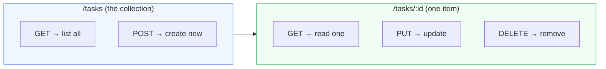

# Level 2 — REST & Routing

| | |
|---|---|
| 🎚️ **Difficulty** | 🟢 Easy |
| ⏱️ **Estimated time** | 20 minutes |
| ⭐ **XP reward** | 100 (Quest) + 25 (Quiz) |

[← Prev: Your First HTTP Server](01-your-first-http-server.md) · [↑ Phase Home](../README.md) · [→ Next: Full CRUD Endpoints](03-crud-endpoints.md)

---

## 📖 Story

> *"A server that says 'TaskFlow API' is cute, but a client wants actual tasks. We design our API the way the whole industry does: REST. Resources have predictable URLs, and HTTP verbs say what to do with them. Give me GET /tasks and GET /tasks/:id to start. — Marcus"*

---

## 🎯 Goal

- Understand the core **REST** principles
- Map HTTP **methods** (GET/POST/PUT/DELETE) to actions on a **resource**
- Build `GET /tasks` and `GET /tasks/:id` backed by an in-memory array
- Return **JSON** and learn what a **route parameter** is

---

## 🧠 Concepts

**REST** (Representational State Transfer) is a style for designing APIs. The big ideas:

- Everything is a **resource** (here: a *task*).
- Each resource type has a **collection URL** (`/tasks`) and an **item URL** (`/tasks/42`).
- The **HTTP method** says what you want to do; the **URL** says to what.
- Responses are usually **JSON**.
- Each request is **stateless** — it carries everything the server needs; the server doesn't remember previous requests.

The verb-to-action map you'll use all world:

| Method | URL | Means |
|--------|-----|-------|
| `GET` | `/tasks` | List all tasks |
| `GET` | `/tasks/:id` | Get one task |
| `POST` | `/tasks` | Create a task |
| `PUT` | `/tasks/:id` | Replace/update a task |
| `DELETE` | `/tasks/:id` | Delete a task |



A **route parameter** is the `:id` part. When a client requests `/tasks/3`, Express puts `3` into `req.params.id` for you.

### Why this exists

Before REST, every API invented its own URLs (`/getTask`, `/taskUpdateNow`, `/deleteit`). Chaos. REST gives a *predictable convention* so any developer can guess your API: "tasks live at `/tasks`, one task at `/tasks/<id>`, and the method tells me the action." Predictability is the whole point — it's why this lesson matters more than it looks.

---

## 🛠️ Hands-on Lab

We'll evolve the `index.js` from Level 1. Replace its contents with this:

```javascript
// index.js — TaskFlow API with read routes
const express = require("express");

const app = express();
const PORT = 3000;

// --- In-memory "database" (we'll swap for SQLite in Level 4) ---
let tasks = [
  { id: 1, title: "Set up repo",   description: "Init git",      status: "done",  dueDate: "2026-06-01" },
  { id: 2, title: "Build the API", description: "Express + REST", status: "todo",  dueDate: "2026-07-01" },
];

// Health check (from Level 1's challenge)
app.get("/health", (req, res) => {
  res.send("ok");
});

// GET /tasks — list all tasks
app.get("/tasks", (req, res) => {
  res.json(tasks);
});

// GET /tasks/:id — get one task by id
app.get("/tasks/:id", (req, res) => {
  // req.params.id is always a STRING — convert to number to compare
  const id = Number(req.params.id);
  const task = tasks.find((t) => t.id === id);

  if (!task) {
    return res.status(404).json({ error: "Task not found" });
  }
  res.json(task);
});

app.listen(PORT, () => {
  console.log(`TaskFlow API listening on http://localhost:${PORT}`);
});
```

Run it:

```bash
cd ~/projects/taskflow
npm start
```

In a **second** terminal, try the routes:

```bash
# List every task (returns a JSON array)
curl http://localhost:3000/tasks

# Get one task by id
curl http://localhost:3000/tasks/2

# Ask for a task that doesn't exist → 404
curl -i http://localhost:3000/tasks/999
```

> 💡 `curl -i` shows the **response headers** including the status line — you'll see `HTTP/1.1 404 Not Found` for the missing task. Reading status codes is a core backend skill.

Notice `res.json(...)` instead of `res.send(...)`: it serialises your object to JSON *and* sets the `Content-Type: application/json` header automatically.

---

## 🎮 Mini Challenge

Add a **query-based filter**: support `GET /tasks?status=todo` so a client can list only tasks with a given status. (If no `status` query is given, return all tasks.)

Test:
```bash
curl "http://localhost:3000/tasks?status=todo"
```

<details>
<summary>💡 Reveal answer</summary>

Replace the `GET /tasks` handler with:

```javascript
app.get("/tasks", (req, res) => {
  const { status } = req.query; // ?status=todo  → req.query.status
  if (status) {
    return res.json(tasks.filter((t) => t.status === status));
  }
  res.json(tasks);
});
```

`req.query` holds everything after the `?` in the URL. Query parameters are perfect for **filtering/sorting** a collection — they don't change *which* resource you target, just *how* it's returned.
</details>

---

## 📦 Project Mission

Commit your read-only API.

```bash
cd ~/projects/taskflow

# Make sure it runs, then stop it (Ctrl+C) before committing
git add index.js
git commit -m "feat: add GET /tasks and GET /tasks/:id (in-memory)"
```

🎯 **Mission complete when:** `curl http://localhost:3000/tasks` returns the JSON array, `curl http://localhost:3000/tasks/2` returns a single task, `curl -i http://localhost:3000/tasks/999` returns a `404`, and the work is committed.

---

## ⚠️ Common Mistakes

| Mistake | What happens | Fix |
|--------|--------------|-----|
| Comparing `req.params.id` directly to `t.id` | Always "not found" (`"2" === 2` is false) | Convert: `Number(req.params.id)` |
| Forgetting `return` before `res.status(404)...` | Code keeps running, may send two responses | `return res.status(404).json(...)` |
| Using `res.send(object)` for arrays/objects | Works, but clearer intent with `res.json()` | Use `res.json()` for JSON responses |
| Defining `/tasks/:id` *before* `/tasks` and expecting trouble | Order rarely matters here, but specific routes should precede catch-alls | Put static routes before parameterised ones when they could collide |
| Editing routes but seeing old behaviour | No hot reload | Restart with `npm start` |

---

## 🤔 Reflection Questions

1. Why is `/tasks/:id` better API design than `/getTaskById?id=5`?
2. What's the difference between a **route parameter** (`/tasks/:id`) and a **query parameter** (`?status=todo`)? When would you use each?
3. What does "stateless" mean for a REST request, and why is it useful when you run many copies of a server?

---

## 📝 Quiz

1. **In REST, the HTTP method (GET/POST/...) tells the server…**
   - a) which resource to act on
   - b) what action to perform on the resource
   - c) the user's password
2. **`req.params.id` for the URL `/tasks/7` is…**
   - a) the number `7`
   - b) the string `"7"`
   - c) `undefined`
3. **`res.json(tasks)` does what `res.send(tasks)` doesn't guarantee?**
   - a) sets `Content-Type: application/json`
   - b) starts the server
   - c) deletes the task

<details>
<summary>✅ Answers</summary>

1: **b** · 2: **b** · 3: **a**
</details>

---

## ✅ Completion Checklist

- [ ] I replaced `index.js` with the in-memory `tasks` array and read routes
- [ ] `GET /tasks` returns a JSON array
- [ ] `GET /tasks/:id` returns one task, and a missing id returns `404`
- [ ] I added the `?status=` filter (Mini Challenge)
- [ ] I committed the work (Project Mission)
- [ ] I passed the quiz
- [ ] I added **+125 XP** to [PROGRESS.md](../../../PROGRESS.md)

---

[← Prev: Your First HTTP Server](01-your-first-http-server.md) · [↑ Phase Home](../README.md) · [→ Next: Full CRUD Endpoints](03-crud-endpoints.md)
