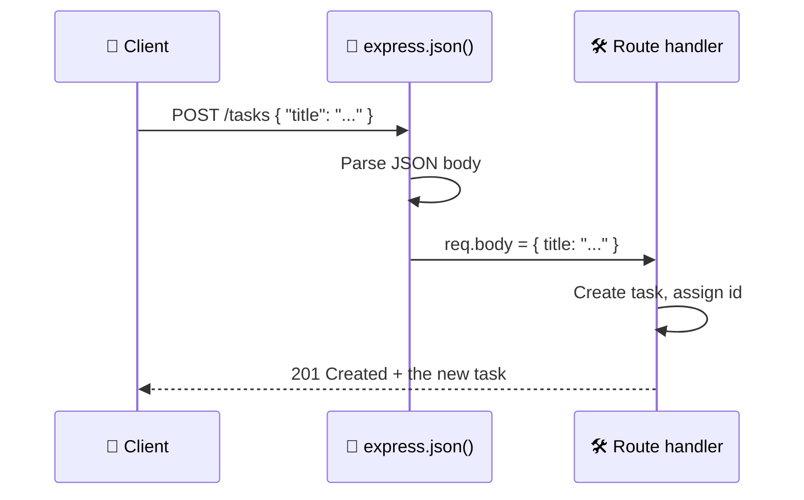

# Level 3 — Full CRUD Endpoints

| | |
|---|---|
| 🎚️ **Difficulty** | 🟡 Medium |
| ⏱️ **Estimated time** | 25 minutes |
| ⭐ **XP reward** | 100 (Quest) + 25 (Quiz) |

[← Prev: REST & Routing](02-rest-and-routing.md) · [↑ Phase Home](../README.md) · [→ Next: Adding a Database](04-adding-a-database.md)

---

## 📖 Story

> *"Reading tasks is half a feature. A real client needs to CREATE, UPDATE, and DELETE them too — that's CRUD. And get the status codes right: 201 when you create something, 204 when you delete, 404 when it's not there. Sloppy status codes are how front-end devs end up cursing your name. — Marcus"*

---

## 🎯 Goal

- Parse incoming **JSON request bodies** with `express.json()`
- Implement **POST**, **PUT**, and **DELETE** for tasks
- Return the **correct HTTP status codes** (200/201/204/400/404)
- Complete a full in-memory **CRUD** API

---

## 🧠 Concepts

**CRUD** = **C**reate, **R**ead, **U**pdate, **D**elete — the four things you do to data. REST maps each to a method:

| CRUD | Method + URL | Success status |
|------|--------------|:--------------:|
| Create | `POST /tasks` | **201** Created |
| Read (all) | `GET /tasks` | 200 OK |
| Read (one) | `GET /tasks/:id` | 200 OK |
| Update | `PUT /tasks/:id` | 200 OK |
| Delete | `DELETE /tasks/:id` | **204** No Content |

**Status codes** are the response's headline — they tell the client what happened *before* it even reads the body:

- **2xx** = success (200 OK, 201 Created, 204 No Content)
- **4xx** = the *client* messed up (400 Bad Request, 404 Not Found)
- **5xx** = the *server* messed up (500 Internal Server Error)

To read the body of a `POST`/`PUT`, you need **`express.json()`** — middleware that parses the incoming JSON into `req.body`. Without it, `req.body` is `undefined`.



### Why this exists

A read-only API is a catalogue, not an application. CRUD is what makes TaskFlow *do* something. And correct status codes aren't pedantry: clients, caches, load balancers, and monitoring tools all make decisions based on them. A `200` on a failed create silently breaks everyone downstream.

---

## 🛠️ Hands-on Lab

Update `index.js`. We add `express.json()` and the three write routes. Here's the **complete** file:

```javascript
// index.js — TaskFlow API with full CRUD (in-memory)
const express = require("express");

const app = express();
const PORT = 3000;

// Parse JSON request bodies into req.body. MUST come before the routes.
app.use(express.json());

// --- In-memory "database" ---
let tasks = [
  { id: 1, title: "Set up repo",   description: "Init git",      status: "done", dueDate: "2026-06-01" },
  { id: 2, title: "Build the API", description: "Express + REST", status: "todo", dueDate: "2026-07-01" },
];
let nextId = 3; // tracks the next id to assign

app.get("/health", (req, res) => res.send("ok"));

// READ all
app.get("/tasks", (req, res) => {
  res.json(tasks);
});

// READ one
app.get("/tasks/:id", (req, res) => {
  const task = tasks.find((t) => t.id === Number(req.params.id));
  if (!task) return res.status(404).json({ error: "Task not found" });
  res.json(task);
});

// CREATE
app.post("/tasks", (req, res) => {
  const { title, description, status, dueDate } = req.body;

  // Basic validation: title is required
  if (!title) {
    return res.status(400).json({ error: "title is required" });
  }

  const task = {
    id: nextId++,
    title,
    description: description || "",
    status: status || "todo",
    dueDate: dueDate || null,
  };
  tasks.push(task);
  res.status(201).json(task); // 201 Created + the new resource
});

// UPDATE
app.put("/tasks/:id", (req, res) => {
  const id = Number(req.params.id);
  const task = tasks.find((t) => t.id === id);
  if (!task) return res.status(404).json({ error: "Task not found" });

  const { title, description, status, dueDate } = req.body;
  if (title !== undefined) task.title = title;
  if (description !== undefined) task.description = description;
  if (status !== undefined) task.status = status;
  if (dueDate !== undefined) task.dueDate = dueDate;

  res.json(task);
});

// DELETE
app.delete("/tasks/:id", (req, res) => {
  const id = Number(req.params.id);
  const index = tasks.findIndex((t) => t.id === id);
  if (index === -1) return res.status(404).json({ error: "Task not found" });

  tasks.splice(index, 1);
  res.status(204).send(); // 204 No Content — nothing to return
});

app.listen(PORT, () => {
  console.log(`TaskFlow API listening on http://localhost:${PORT}`);
});
```

Run it (`npm start`), then exercise every verb from a **second** terminal:

```bash
# CREATE a task — note the -H header and -d JSON body
curl -i -X POST http://localhost:3000/tasks \
  -H "Content-Type: application/json" \
  -d '{"title":"Write tests","description":"Cover the API","status":"todo","dueDate":"2026-08-01"}'
# → HTTP/1.1 201 Created  + the new task (with its new id)

# READ all (your new task is in the list)
curl http://localhost:3000/tasks

# UPDATE the task you just made (use the id it returned, e.g. 3)
curl -i -X PUT http://localhost:3000/tasks/3 \
  -H "Content-Type: application/json" \
  -d '{"status":"done"}'
# → HTTP/1.1 200 OK + the updated task

# DELETE it
curl -i -X DELETE http://localhost:3000/tasks/3
# → HTTP/1.1 204 No Content

# Try to create with no title → 400
curl -i -X POST http://localhost:3000/tasks \
  -H "Content-Type: application/json" -d '{}'
# → HTTP/1.1 400 Bad Request
```

> 💡 `-X` sets the method, `-H` sets a header, `-d` sends the body. The `Content-Type: application/json` header is what tells `express.json()` to parse the body — forget it and `req.body` may be empty.

You now have a **fully working CRUD API**. It's all in memory (data resets on restart) — Level 4 fixes that.

---

## 🎮 Mini Challenge

Add a **PATCH-like guard** to your `PUT`: if the client sends a `status` that isn't one of `"todo"`, `"in-progress"`, or `"done"`, reject it with `400` instead of saving the garbage value.

<details>
<summary>💡 Reveal answer</summary>

Inside the `PUT` handler, before assigning, add:

```javascript
const allowed = ["todo", "in-progress", "done"];
if (status !== undefined && !allowed.includes(status)) {
  return res.status(400).json({ error: `status must be one of: ${allowed.join(", ")}` });
}
```

Validating *enums* like status is one of the most common real-world API checks — it stops bad data at the door. (You'll expand this into full validation in the Side Quest.)
</details>

---

## 📦 Project Mission

Commit the complete in-memory CRUD API.

```bash
cd ~/projects/taskflow
git add index.js
git commit -m "feat: full CRUD endpoints (POST/PUT/DELETE) with status codes"
```

🎯 **Mission complete when:** you can create (`201`), read (`200`), update (`200`), and delete (`204`) a task with `curl`, a create with no title returns `400`, and the work is committed.

---

## ⚠️ Common Mistakes

| Mistake | What happens | Fix |
|--------|--------------|-----|
| Forgetting `app.use(express.json())` | `req.body` is `undefined`, create crashes | Add it **once, before** the routes |
| Omitting `Content-Type: application/json` in curl | Body isn't parsed; `req.body` empty | Always send `-H "Content-Type: application/json"` |
| Returning `200` from a create | Misleads clients/caches | Return `201` for create, `204` for delete |
| Sending a body with `204` | Spec violation; some clients choke | `res.status(204).send()` with no body |
| Reusing an id after delete | Collisions / overwritten data | Use an ever-increasing `nextId`, never reuse |
| Trusting `req.body.title` exists | Crash on missing field | Validate inputs; return `400` on bad input |

---

## 🤔 Reflection Questions

1. Why does `express.json()` have to be registered *before* your routes?
2. What's the practical difference between returning `200` and `201` on a successful `POST`?
3. Why is `204 No Content` the right choice for a successful `DELETE` rather than `200` with a body?

---

## 📝 Quiz

1. **Which status code means "you created a resource"?**
   - a) 200
   - b) 201
   - c) 404
2. **`req.body` is `undefined`. The most likely cause is…**
   - a) the server is off
   - b) you forgot `app.use(express.json())`
   - c) you used the wrong port
3. **A `DELETE` that succeeds should typically return…**
   - a) 204 No Content
   - b) 201 Created
   - c) 500 Internal Server Error

<details>
<summary>✅ Answers</summary>

1: **b** · 2: **b** · 3: **a**
</details>

---

## ✅ Completion Checklist

- [ ] I added `app.use(express.json())` before my routes
- [ ] `POST /tasks` creates a task and returns `201` + the new task
- [ ] `PUT /tasks/:id` updates and returns `200` (or `404` if missing)
- [ ] `DELETE /tasks/:id` returns `204` (or `404` if missing)
- [ ] A `POST` with no `title` returns `400`
- [ ] I added the status enum guard (Mini Challenge)
- [ ] I committed the work (Project Mission)
- [ ] I passed the quiz
- [ ] I added **+125 XP** to [PROGRESS.md](../../../PROGRESS.md)

---

[← Prev: REST & Routing](02-rest-and-routing.md) · [↑ Phase Home](../README.md) · [→ Next: Adding a Database (SQLite)](04-adding-a-database.md)
