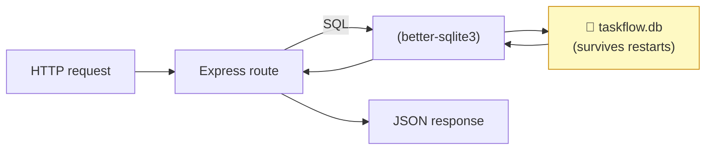

# Level 4 — Adding a Database (SQLite)

| | |
|---|---|
| 🎚️ **Difficulty** | 🟡 Medium |
| ⏱️ **Estimated time** | 25 minutes |
| ⭐ **XP reward** | 100 (Quest) + 25 (Quiz) |

[← Prev: Full CRUD Endpoints](03-crud-endpoints.md) · [↑ Phase Home](../README.md) · [→ Next: Testing Your API](05-testing-your-api.md)

---

## 📖 Story

> *"Quick test: create a task, then restart the server. Gone, right? Our 'database' is a variable in memory — it dies with the process. Before anyone relies on TaskFlow, the data has to survive a restart. Use SQLite: a real SQL database in a single file, zero setup. Swap it in. — Marcus"*

---

## 🎯 Goal

- Understand why in-memory data is **not persistence**
- Install **better-sqlite3** and create a `tasks` table
- Replace the in-memory array with **real SQL queries**
- Confirm data survives a server restart

---

## 🧠 Concepts

Right now `tasks` is a JavaScript array in RAM. When the Node process stops, the array is gone. That's fine for a demo, fatal for a product.

**SQLite** is a full SQL database that lives in a **single file** on disk (`taskflow.db`). No server to run, no install beyond an npm package — perfect for development and small apps. The data is written to disk, so it **persists across restarts**.

We'll use **`better-sqlite3`**: a fast, synchronous SQLite library. "Synchronous" means queries return results directly (no callbacks/promises), which keeps our route code simple and readable.



The four CRUD operations map cleanly to SQL:

| CRUD | SQL |
|------|-----|
| Create | `INSERT INTO tasks (...) VALUES (...)` |
| Read all | `SELECT * FROM tasks` |
| Read one | `SELECT * FROM tasks WHERE id = ?` |
| Update | `UPDATE tasks SET ... WHERE id = ?` |
| Delete | `DELETE FROM tasks WHERE id = ?` |

> ⚠️ Those `?` are **placeholders**. Never build SQL by gluing strings together — that's how you get **SQL injection**. Placeholders let the driver insert values safely.

### Why this exists

Persistence is the line between a toy and a tool. SQLite gives you a *real* relational database — transactions, SQL, durability — with none of the operational weight of running Postgres or MySQL. Later worlds graduate TaskFlow to Postgres; the SQL you learn here carries straight over.

---

## 🛠️ Hands-on Lab

### Step 1 — Install better-sqlite3

```bash
cd ~/projects/taskflow
npm install better-sqlite3
```

> 💡 This compiles a native module. On Ubuntu you may need build tools once: `sudo apt install -y build-essential python3`. If the install succeeds, you're set.

Ignore the database file in git (data shouldn't live in your repo):

```bash
echo "*.db" >> .gitignore
```

### Step 2 — Create a database module

Create `db.js`. It opens the file, creates the table if needed, and seeds two starter rows on first run:

```javascript
// db.js — SQLite connection + schema for TaskFlow
const Database = require("better-sqlite3");

// Opens (or creates) the file taskflow.db in the project folder.
const db = new Database("taskflow.db");

// Create the tasks table once. IF NOT EXISTS makes this safe to run every start.
db.exec(`
  CREATE TABLE IF NOT EXISTS tasks (
    id          INTEGER PRIMARY KEY AUTOINCREMENT,
    title       TEXT NOT NULL,
    description TEXT DEFAULT '',
    status      TEXT DEFAULT 'todo',
    dueDate     TEXT
  )
`);

// Seed a couple of rows the first time only (when the table is empty).
const count = db.prepare("SELECT COUNT(*) AS n FROM tasks").get().n;
if (count === 0) {
  const insert = db.prepare(
    "INSERT INTO tasks (title, description, status, dueDate) VALUES (?, ?, ?, ?)"
  );
  insert.run("Set up repo", "Init git", "done", "2026-06-01");
  insert.run("Build the API", "Express + REST", "todo", "2026-07-01");
}

module.exports = db;
```

`AUTOINCREMENT` means SQLite assigns the `id` for us — no more `nextId` counter, and no id collisions.

### Step 3 — Rewrite the routes to use SQL

Replace `index.js` with this. The route *shapes* are identical to Level 3 — only the data layer changed (array → SQL):

```javascript
// index.js — TaskFlow API backed by SQLite
const express = require("express");
const db = require("./db");

const app = express();
const PORT = 3000;
app.use(express.json());

app.get("/health", (req, res) => res.send("ok"));

// READ all
app.get("/tasks", (req, res) => {
  const tasks = db.prepare("SELECT * FROM tasks").all();
  res.json(tasks);
});

// READ one
app.get("/tasks/:id", (req, res) => {
  const task = db.prepare("SELECT * FROM tasks WHERE id = ?").get(req.params.id);
  if (!task) return res.status(404).json({ error: "Task not found" });
  res.json(task);
});

// CREATE
app.post("/tasks", (req, res) => {
  const { title, description, status, dueDate } = req.body;
  if (!title) return res.status(400).json({ error: "title is required" });

  const result = db
    .prepare("INSERT INTO tasks (title, description, status, dueDate) VALUES (?, ?, ?, ?)")
    .run(title, description || "", status || "todo", dueDate || null);

  // Fetch and return the row we just created (with its new id)
  const task = db.prepare("SELECT * FROM tasks WHERE id = ?").get(result.lastInsertRowid);
  res.status(201).json(task);
});

// UPDATE
app.put("/tasks/:id", (req, res) => {
  const existing = db.prepare("SELECT * FROM tasks WHERE id = ?").get(req.params.id);
  if (!existing) return res.status(404).json({ error: "Task not found" });

  // Merge: keep old value when the field isn't provided
  const { title, description, status, dueDate } = req.body;
  const updated = {
    title:       title       ?? existing.title,
    description: description ?? existing.description,
    status:      status      ?? existing.status,
    dueDate:     dueDate     ?? existing.dueDate,
  };

  db.prepare(
    "UPDATE tasks SET title = ?, description = ?, status = ?, dueDate = ? WHERE id = ?"
  ).run(updated.title, updated.description, updated.status, updated.dueDate, req.params.id);

  res.json(db.prepare("SELECT * FROM tasks WHERE id = ?").get(req.params.id));
});

// DELETE
app.delete("/tasks/:id", (req, res) => {
  const result = db.prepare("DELETE FROM tasks WHERE id = ?").run(req.params.id);
  if (result.changes === 0) return res.status(404).json({ error: "Task not found" });
  res.status(204).send();
});

app.listen(PORT, () => {
  console.log(`TaskFlow API listening on http://localhost:${PORT}`);
});
```

> 💡 `??` is the **nullish coalescing** operator: use the left value unless it's `null`/`undefined`, then use the right. Great for "keep the old value if no new one was sent."

### Step 4 — Prove persistence

```bash
npm start
```

In a **second** terminal:

```bash
# Create a task
curl -X POST http://localhost:3000/tasks \
  -H "Content-Type: application/json" \
  -d '{"title":"Persisted task","status":"todo"}'

# Confirm it's there
curl http://localhost:3000/tasks
```

Now **stop the server** (`Ctrl+C` in the first terminal) and **start it again** (`npm start`). In the second terminal:

```bash
curl http://localhost:3000/tasks
```

Your "Persisted task" is **still there.** 🎉 The data lives in `taskflow.db` on disk, not in memory. That's a real database.

---

## 🎮 Mini Challenge

Open the database directly and confirm your data is really on disk, no Node involved:

```bash
# better-sqlite3 ships a CLI? No — but Node can peek:
node -e "const db=require('better-sqlite3')('taskflow.db'); console.log(db.prepare('SELECT id,title FROM tasks').all())"
```

❓ Why can you read the data with a *separate* Node command while the server isn't even running?

<details>
<summary>💡 Reveal answer</summary>

Because the data lives in the **file** `taskflow.db`, not in the server's memory. Any program that opens that file sees the same rows. That's the entire point of persistence: the data outlives — and is independent of — the process that wrote it. (Tip: install the **SQLite Viewer** VS Code extension to browse `taskflow.db` visually.)
</details>

---

## 📦 Project Mission

Commit the database-backed API.

```bash
cd ~/projects/taskflow

# taskflow.db is git-ignored (added in Step 1); commit code + lockfile only
git add index.js db.js package.json package-lock.json .gitignore
git commit -m "feat: persist tasks in SQLite via better-sqlite3"
```

🎯 **Mission complete when:** you create a task, restart the server, and `GET /tasks` still shows it — and the code (not the `.db` file) is committed.

---

## ⚠️ Common Mistakes

| Mistake | What happens | Fix |
|--------|--------------|-----|
| `npm install better-sqlite3` fails to build | Missing compiler | `sudo apt install -y build-essential python3`, retry |
| Building SQL with string concatenation | SQL injection risk + bugs | Always use `?` placeholders and `.run(values)` |
| Committing `taskflow.db` | Data + binary churn in repo | Add `*.db` to `.gitignore` |
| Expecting `.run()` to return rows | It returns `{ changes, lastInsertRowid }`, not data | `SELECT` the row afterward to return it |
| Comparing `req.params.id` to a TEXT id | Mismatch | SQLite compares fine here; the `?` placeholder handles the type |
| Forgetting `IF NOT EXISTS` on CREATE TABLE | Crashes on second start | Use `CREATE TABLE IF NOT EXISTS` |

---

## 🤔 Reflection Questions

1. Why does an in-memory array "lose" data but a SQLite file doesn't?
2. What is SQL injection, and how do `?` placeholders prevent it?
3. After `INSERT`, why do we run a `SELECT` before responding instead of just echoing `req.body`?

---

## 📝 Quiz

1. **SQLite stores its data…**
   - a) in RAM only
   - b) in a single file on disk
   - c) on a remote server you must run
2. **Why use `?` placeholders in queries?**
   - a) they run faster always
   - b) they safely insert values and prevent SQL injection
   - c) they're required syntax for SELECT
3. **`db.prepare("INSERT ...").run(...)` returns…**
   - a) the inserted row
   - b) an object with `changes` and `lastInsertRowid`
   - c) nothing

<details>
<summary>✅ Answers</summary>

1: **b** · 2: **b** · 3: **b**
</details>

---

## ✅ Completion Checklist

- [ ] I installed `better-sqlite3` and added `*.db` to `.gitignore`
- [ ] `db.js` creates the `tasks` table with `CREATE TABLE IF NOT EXISTS`
- [ ] All five routes now use SQL with `?` placeholders
- [ ] I created a task, restarted the server, and it was still there
- [ ] I read the data with a separate Node command (Mini Challenge)
- [ ] I committed the code (not the `.db` file) (Project Mission)
- [ ] I passed the quiz
- [ ] I added **+125 XP** to [PROGRESS.md](../../../PROGRESS.md)

---

[← Prev: Full CRUD Endpoints](03-crud-endpoints.md) · [↑ Phase Home](../README.md) · [→ Next: Testing Your API](05-testing-your-api.md)
