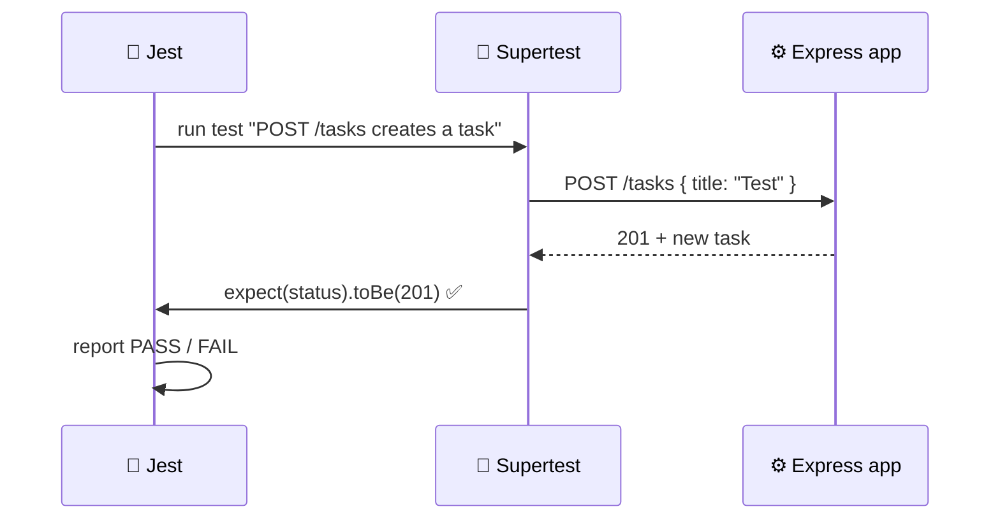

# Level 5 — Testing Your API

| | |
|---|---|
| 🎚️ **Difficulty** | 🟡 Medium |
| ⏱️ **Estimated time** | 25 minutes |
| ⭐ **XP reward** | 100 (Quest) + 25 (Quiz) |

[← Prev: Adding a Database](04-adding-a-database.md) · [↑ Phase Home](../README.md) · [→ Boss Battle](../boss-battle.md)

---

## 📖 Story

> *"Last thing before review: tests. Right now you 'test' by running curl and eyeballing it. That doesn't scale and it won't catch the bug you introduce next Tuesday. Write automated tests that hit your endpoints and assert the responses. If `npm test` is green, I trust the code. — Marcus"*

---

## 🎯 Goal

- Understand **why** automated tests matter
- Refactor so the Express **app is importable** (separate from `listen`)
- Install **Jest** + **Supertest** and write real endpoint tests
- Run the suite with `npm test`

---

## 🧠 Concepts

A **test** is code that runs your code and checks the result automatically. Instead of manually curling six routes after every change, you run `npm test` and get a pass/fail in seconds.

Two tools:

- **Jest** — the test *runner*: finds test files, runs them, reports pass/fail, gives you `expect(...)` assertions.
- **Supertest** — fires fake HTTP requests at your Express app **in-process** (no need to start a real server or open a port).



For tests to work, Supertest needs the `app` **object** — but it must NOT have already called `app.listen()` (that opens a port and would clash). So we split the code:

- **`app.js`** — builds and exports the Express `app` (routes, middleware). No `listen`.
- **`index.js`** — imports `app` and calls `listen`. This is what `npm start` runs.

Tests import `app.js` directly; production runs `index.js`.

### Why this exists

Untested APIs rot. You fix one bug and silently create two. Tests are a **safety net**: they let you change code confidently because the suite screams the instant you break a contract. In World 7 (CI/CD) these same tests run automatically on every push — green tests are what let a robot deploy your code without a human babysitting it.

---

## 🛠️ Hands-on Lab

### Step 1 — Split the app from the server

Create `app.js` with everything from `index.js` **except** the `listen` call, and export the app. (This is your Level 4 code, lightly rearranged.)

```javascript
// app.js — builds the Express app (no listen here)
const express = require("express");
const db = require("./db");

const app = express();
app.use(express.json());

app.get("/health", (req, res) => res.send("ok"));

app.get("/tasks", (req, res) => {
  res.json(db.prepare("SELECT * FROM tasks").all());
});

app.get("/tasks/:id", (req, res) => {
  const task = db.prepare("SELECT * FROM tasks WHERE id = ?").get(req.params.id);
  if (!task) return res.status(404).json({ error: "Task not found" });
  res.json(task);
});

app.post("/tasks", (req, res) => {
  const { title, description, status, dueDate } = req.body;
  if (!title) return res.status(400).json({ error: "title is required" });
  const result = db
    .prepare("INSERT INTO tasks (title, description, status, dueDate) VALUES (?, ?, ?, ?)")
    .run(title, description || "", status || "todo", dueDate || null);
  const task = db.prepare("SELECT * FROM tasks WHERE id = ?").get(result.lastInsertRowid);
  res.status(201).json(task);
});

app.put("/tasks/:id", (req, res) => {
  const existing = db.prepare("SELECT * FROM tasks WHERE id = ?").get(req.params.id);
  if (!existing) return res.status(404).json({ error: "Task not found" });
  const { title, description, status, dueDate } = req.body;
  db.prepare("UPDATE tasks SET title = ?, description = ?, status = ?, dueDate = ? WHERE id = ?").run(
    title ?? existing.title,
    description ?? existing.description,
    status ?? existing.status,
    dueDate ?? existing.dueDate,
    req.params.id
  );
  res.json(db.prepare("SELECT * FROM tasks WHERE id = ?").get(req.params.id));
});

app.delete("/tasks/:id", (req, res) => {
  const result = db.prepare("DELETE FROM tasks WHERE id = ?").run(req.params.id);
  if (result.changes === 0) return res.status(404).json({ error: "Task not found" });
  res.status(204).send();
});

module.exports = app; // ← the key line: export, don't listen
```

Now shrink `index.js` to just start the server:

```javascript
// index.js — start the server (production entry point)
const app = require("./app");

const PORT = 3000;
app.listen(PORT, () => {
  console.log(`TaskFlow API listening on http://localhost:${PORT}`);
});
```

> ✅ Sanity check: `npm start` should still work exactly as before. Nothing changed for the user — we only reorganised.

### Step 2 — Install the test tools

```bash
cd ~/projects/taskflow
npm install --save-dev jest supertest
```

`--save-dev` records them under `"devDependencies"` — tools you need to *develop/test* but not to *run* in production.

Add a `test` script to `package.json`:

```json
{
  "scripts": {
    "start": "node index.js",
    "test": "jest"
  }
}
```

### Step 3 — Write the tests

Create `tests/tasks.test.js`:

```javascript
// tests/tasks.test.js — endpoint tests with Jest + Supertest
const request = require("supertest");
const app = require("./../app");

describe("TaskFlow API", () => {
  test("GET /health returns ok", async () => {
    const res = await request(app).get("/health");
    expect(res.statusCode).toBe(200);
    expect(res.text).toBe("ok");
  });

  test("GET /tasks returns an array", async () => {
    const res = await request(app).get("/tasks");
    expect(res.statusCode).toBe(200);
    expect(Array.isArray(res.body)).toBe(true);
  });

  test("POST /tasks creates a task (201)", async () => {
    const res = await request(app)
      .post("/tasks")
      .send({ title: "Write tests", status: "todo" });
    expect(res.statusCode).toBe(201);
    expect(res.body.id).toBeDefined();
    expect(res.body.title).toBe("Write tests");
  });

  test("POST /tasks with no title returns 400", async () => {
    const res = await request(app).post("/tasks").send({});
    expect(res.statusCode).toBe(400);
  });

  test("GET /tasks/:id for a missing id returns 404", async () => {
    const res = await request(app).get("/tasks/999999");
    expect(res.statusCode).toBe(404);
  });

  test("full lifecycle: create → update → delete", async () => {
    // create
    const created = await request(app)
      .post("/tasks")
      .send({ title: "Lifecycle", status: "todo" });
    const id = created.body.id;

    // update
    const updated = await request(app)
      .put(`/tasks/${id}`)
      .send({ status: "done" });
    expect(updated.statusCode).toBe(200);
    expect(updated.body.status).toBe("done");

    // delete
    const deleted = await request(app).delete(`/tasks/${id}`);
    expect(deleted.statusCode).toBe(204);

    // confirm gone
    const gone = await request(app).get(`/tasks/${id}`);
    expect(gone.statusCode).toBe(404);
  });
});
```

### Step 4 — Run the suite

```bash
npm test
```

You should see Jest list each test with a ✓ and finish with something like **`Tests: 6 passed`**. Green means every endpoint behaves as promised. 🎉

> 💡 These tests run against your real `taskflow.db` and create/delete their own rows, cleaning up after themselves (the lifecycle test deletes what it creates). For a fully isolated test database, see the Mini Challenge.

---

## 🎮 Mini Challenge

Make a test **fail on purpose** to prove the safety net works: in `app.js`, temporarily change the create route to return `res.status(200)` instead of `201`. Run `npm test`.

❓ What does Jest show you? Then change it back.

<details>
<summary>💡 Reveal answer</summary>

The "creates a task (201)" test fails with a clear diff:

```
expect(res.statusCode).toBe(201)
Expected: 201
Received: 200
```

That's the whole value of tests: the instant your code stops honouring its contract, the suite tells you *exactly* what broke and where — before your users (or Marcus) find out. Change it back to `201` and the suite goes green again.
</details>

---

## 📦 Project Mission

Commit your tested API. This is the v1 Marcus asked for.

```bash
cd ~/projects/taskflow
git add app.js index.js tests/ package.json package-lock.json
git commit -m "test: add Jest + Supertest endpoint tests; split app from server"
```

🎯 **Mission complete when:** `npm test` runs and **all tests pass**, `npm start` still serves the API, and the work is committed.

---

## ⚠️ Common Mistakes

| Mistake | What happens | Fix |
|--------|--------------|-----|
| Importing `index.js` in tests | `app.listen` opens a port; Jest hangs/clashes | Import `app.js`; only `index.js` calls `listen` |
| No `test` script in `package.json` | `npm test` errors | Add `"test": "jest"` |
| Forgetting `await` on requests | Test finishes before the response | `await request(app)...` every time |
| Asserting `res.body` for `/health` | It's plain text, not JSON | Use `res.text` for text responses |
| Tests leave junk rows in the DB | Flaky/duplicated data over runs | Delete what you create, or use a throwaway test DB |
| `jest` not found | Installed without `--save-dev` or wrong folder | `npm install --save-dev jest supertest` in the project |

---

## 🤔 Reflection Questions

1. Why split `app.js` (export) from `index.js` (listen)? What breaks if you don't?
2. What's the difference between a `dependency` and a `devDependency`?
3. How will these tests pay off in World 7 (CI/CD)?

---

## 📝 Quiz

1. **Supertest lets you…**
   - a) start a production server
   - b) send HTTP requests to your Express app in-process and assert responses
   - c) write SQL
2. **Why export `app` instead of calling `listen` in `app.js`?**
   - a) so tests can use the app without opening a port
   - b) it's faster
   - c) `listen` is deprecated
3. **`--save-dev` installs a package as a…**
   - a) production dependency
   - b) development/test dependency
   - c) global tool

<details>
<summary>✅ Answers</summary>

1: **b** · 2: **a** · 3: **b**
</details>

---

## ✅ Completion Checklist

- [ ] I split the code into `app.js` (exports app) and `index.js` (calls listen)
- [ ] `npm start` still serves the API after the split
- [ ] I installed `jest` and `supertest` as devDependencies
- [ ] `tests/tasks.test.js` covers health, list, create, 400, 404, and a full lifecycle
- [ ] `npm test` shows all tests passing
- [ ] I made a test fail on purpose, then fixed it (Mini Challenge)
- [ ] I committed the work (Project Mission)
- [ ] I passed the quiz
- [ ] I added **+125 XP** to [PROGRESS.md](../../../PROGRESS.md)

---

> 🎉 You built a tested, persistent REST API. One challenge stands between you and World 5: the Boss Battle.

[← Prev: Adding a Database](04-adding-a-database.md) · [↑ Phase Home](../README.md) · [→ 👹 Boss Battle: The Flaky API](../boss-battle.md)
