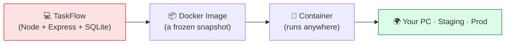
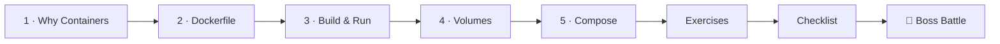

# 🐳 World 5 — Docker

> *"It works on your machine. Cool. Now make it work everywhere — staging, my laptop, prod, the new intern's PC. Containerize TaskFlow. — Priya, DevOps lead"*



---

## 📨 Your ticket

```
From:    Priya <priya@cloudforge.inc>
To:      You <new-hire@cloudforge.inc>
Subject: [TICKET-050] "Works on my machine" is not a deploy strategy

Hey! Saw your TaskFlow API working on your laptop — nice. But here's the
problem: when I cloned it, npm install broke on my Node version, and the
SQLite file landed somewhere weird. Marcus had the same issue last week.

We can't ship software that only runs on the exact machine it was built on.
The fix is **containers**: we package the app + its runtime + its deps into
one portable box that runs identically everywhere.

Your mission:
  1. Learn what containers actually are (and why)
  2. Write a Dockerfile for TaskFlow
  3. Build it, run it, and persist its data
  4. Use Docker Compose to run TaskFlow + a real PostgreSQL database together

Docker Desktop (or Engine on WSL2) is free. If you can't install it,
play-with-docker.com runs Docker in your browser for free. No excuses 😄

— Priya
```

This is the leap from *"my code runs"* to *"my code ships."* By the end, TaskFlow will run inside a container, keep its data across restarts, and talk to a Postgres database — all started with **one command**.

---

## 🎯 What you'll achieve in this world

- ✅ Explain the **"works on my machine"** problem and how containers solve it
- ✅ Install Docker (or use the free in-browser fallback) and run your first containers
- ✅ Write a real, valid **Dockerfile** for the Node TaskFlow app
- ✅ **Build** an image and **run** it, mapping ports so you can `curl` the API
- ✅ Persist data with **volumes** so restarts don't wipe your tasks
- ✅ Orchestrate **TaskFlow + PostgreSQL** with a single `docker compose up`

---

## 🗺️ Level map

| Level | Lesson | Difficulty | Time | XP |
|------:|--------|:----------:|:----:|---:|
| 1 | [Why Containers?](lessons/01-why-containers.md) | 🟢 Easy | 20 min | 125 |
| 2 | [Writing a Dockerfile](lessons/02-writing-a-dockerfile.md) | 🟡 Medium | 25 min | 125 |
| 3 | [Build & Run TaskFlow](lessons/03-build-and-run-taskflow.md) | 🟡 Medium | 25 min | 125 |
| 4 | [Volumes & Persisting Data](lessons/04-volumes-and-data.md) | 🟡 Medium | 20 min | 125 |
| 5 | [Multi-Container with Docker Compose](lessons/05-docker-compose.md) | 🟡 Medium | 25 min | 125 |
| 👹 | [Boss Battle — The "Works on My Machine" Incident](boss-battle.md) | 🟡 Medium | 30 min | 500 |

➕ Extra reps: [exercises.md](exercises.md) · ✅ Ready to advance? [checklist.md](checklist.md)

---

## 🧭 Recommended order



Go in order — each lesson builds the exact artifact the next one needs (Dockerfile → image → volume → compose stack).

---

## 📦 Project status

**Coming in:** TaskFlow is a working **Node.js + Express REST API** with **SQLite** storage and tests, living in `~/projects/taskflow` (built in World 4). It runs with `npm start` on your machine.

**Going out:** TaskFlow ships as a **Docker image**, runs in a container with its **data persisted in a volume**, and comes up as a two-container stack (**API + PostgreSQL**) via `docker compose up`. It now runs identically on any machine with Docker.

---

[↑ Back to README](../../README.md)  ·  [🗺️ Roadmap](../../ROADMAP.md)  ·  [▶️ Start Level 1 →](lessons/01-why-containers.md)
