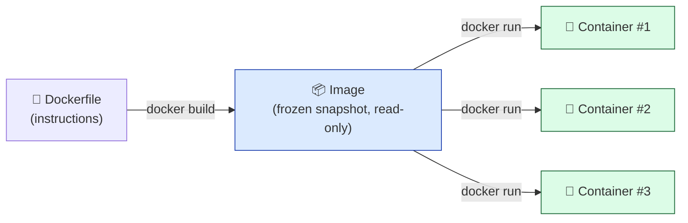
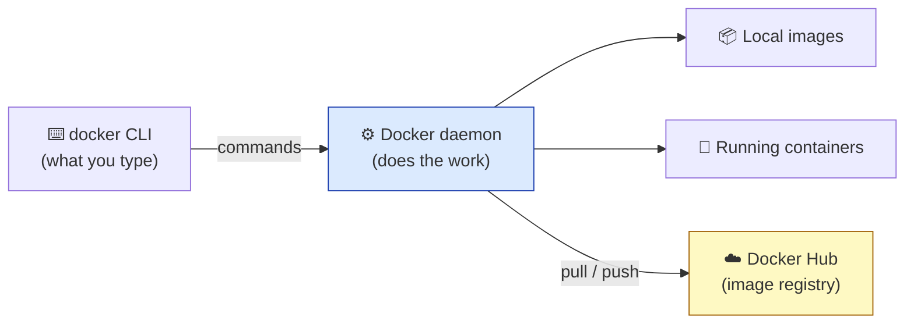

# Level 1 — Why Containers?

| | |
|---|---|
| 🎚️ **Difficulty** | 🟢 Easy |
| ⏱️ **Estimated time** | 20 minutes |
| ⭐ **XP reward** | 100 (Quest) + 25 (Quiz) |

[← World Home](../README.md) · [↑ Phase Home](../README.md) · [→ Next: Writing a Dockerfile](02-writing-a-dockerfile.md)

---

## 📖 Story

> *"Your TaskFlow API runs great — on your laptop. I cloned it and `npm install` blew up on my Node version, then the SQLite file showed up in a different folder than yours. Marcus hit the same wall. We can't ship something that only runs on the one machine it was born on. We need to put TaskFlow in a box that runs the same everywhere. That box is a **container**." — Priya*

You nod confidently. You have no idea what a container is yet. Let's fix that.

---

## 🎯 Goal

By the end of this lesson you will:
- Explain the **"works on my machine"** problem in plain words
- Know the difference between an **image** and a **container**
- Understand where Docker sits in your system (the architecture)
- Install Docker (or open the free in-browser fallback)
- Run `docker run hello-world` and a real **nginx** web server in a container

---

## 🧠 Concepts

### The "works on my machine" problem

Your app doesn't run in a vacuum. It needs a specific **Node version**, specific **npm packages**, certain **files in certain places**, and OS-level libraries. When you hand the code to a teammate, all of *that* environment is missing — so it breaks. "Works on my machine" 🤷 isn't a bug in your code; it's a packaging problem.

A **container** solves it by packaging the app *and* everything it needs to run — runtime, libraries, files — into one portable unit that behaves the same on any machine with Docker.

### Image vs Container

This is the single most important distinction in Docker:

- An **image** is a *frozen, read-only snapshot* — the app plus its environment, built once. Think of it as a **class** in code, or a **recipe**, or a `.iso` install disc.
- A **container** is a *running instance* of an image. Think of it as an **object**, the **cooked meal**, the **installed-and-running OS**.

You build an image once and run **many** containers from it.



### Docker architecture

When you type `docker run ...`, the **Docker CLI** (the command) talks to the **Docker daemon** (a background service that does the real work). The daemon builds/runs containers and, when an image is missing locally, pulls it from a **registry** like **Docker Hub** (a public library of images).



> 🆚 **Containers vs Virtual Machines:** A VM ships an entire guest operating system (gigabytes, slow to boot). A container shares the host's Linux kernel and ships only the app + its dependencies (megabytes, boots in milliseconds). That lightness is *why* containers won.

### Why this exists

Before containers, teams wrote pages of "setup instructions" that were always out of date, or shipped heavyweight VMs. Containers make the environment **part of the deliverable**: the same image that passes your tests is the exact one that runs in production. No drift, no "but it worked here." That reliability is the foundation everything in Worlds 6–10 builds on.

---

## 🛠️ Hands-on Lab

### Step 1 — Install Docker (or use the free fallback)

**Option A — Docker on WSL2 (recommended, free):**

1. Install **Docker Desktop for Windows** from <https://www.docker.com/products/docker-desktop/> (free for personal/small use).
2. During setup, ensure **"Use WSL 2 based engine"** is ticked.
3. Open **Docker Desktop → Settings → Resources → WSL Integration** and enable your **Ubuntu** distro.
4. Open your **Ubuntu** terminal and verify:
   ```bash
   docker --version
   docker info
   ```
   `docker --version` should print a version. `docker info` should show server details (proof the daemon is reachable).

> 💡 Prefer pure Linux? Inside Ubuntu you can instead install **Docker Engine** by following the official apt steps at <https://docs.docker.com/engine/install/ubuntu/>. Both are free.

**Option B — Free in-browser fallback (no install):**

If you can't install Docker, open <https://labs.play-with-docker.com>, sign in with a free Docker Hub account, and click **"Add new instance."** You get a real Docker terminal in your browser. Every command below works there too.

### Step 2 — Your first container

```bash
# Pull and run the official test image
docker run hello-world
```

Read the output. Docker says it (1) couldn't find the image locally, (2) **pulled** it from Docker Hub, (3) **created a container** from it, and (4) ran it — which printed the success message. You just watched the whole architecture work.

### Step 3 — Run a real web server

`hello-world` exits immediately. Let's run something that *stays up* — the **nginx** web server:

```bash
# -d = detached (runs in the background)
# -p 8080:80 = map your machine's port 8080 to the container's port 80
# --name = give the container a friendly name
docker run -d -p 8080:80 --name web nginx
```

Now visit <http://localhost:8080> in a browser, or:

```bash
curl http://localhost:8080
```

You should see nginx's welcome HTML. **A web server is running inside a container on your machine** — and you never installed nginx.

### Step 4 — See and stop it

```bash
# List running containers
docker ps

# Stop and remove the nginx container
docker stop web
docker rm web
```

> 💡 On Play with Docker, click the port `8080` badge at the top instead of using `localhost`.

---

## 🎮 Mini Challenge

Run the nginx container again, but on port **9000** instead of 8080, and name it `mychallenge`. Then prove it's serving on the new port.

<details>
<summary>💡 Reveal answer</summary>

```bash
docker run -d -p 9000:80 --name mychallenge nginx
curl http://localhost:9000      # serves nginx's welcome page
docker stop mychallenge && docker rm mychallenge
```

The left number (`9000`) is the **host** port you visit; the right number (`80`) is the port **inside** the container, which doesn't change. You can map any host port you like to it.
</details>

---

## 📦 Project Mission

You won't containerize TaskFlow yet — first, prove your Docker setup is healthy and record what you learned, so the next lessons go smoothly.

```bash
# 1. Confirm Docker is alive
docker --version
docker run hello-world

# 2. Note your incoming TaskFlow state
cd ~/projects/taskflow
ls            # you should see your Express app, package.json, and SQLite setup
npm test      # (optional) confirm the app still passes its tests on your machine

# 3. Capture a quick proof file
cd ~/projects
docker --version > docker-ready.txt
echo "hello-world ran successfully ✅" >> docker-ready.txt
cat docker-ready.txt
```

🎯 **Mission complete when:** `docker run hello-world` prints its success message, and `docker-ready.txt` exists in `~/projects` containing your Docker version. Your environment is ready to containerize TaskFlow.

---

## ⚠️ Common Mistakes

| Mistake | What happens | Fix |
|--------|--------------|-----|
| `Cannot connect to the Docker daemon` | The daemon isn't running | Start Docker Desktop (and enable WSL integration), or use Play with Docker |
| Forgetting `-p` on a server container | `localhost:8080` refuses to connect | Re-run with `-p HOST:CONTAINER`, e.g. `-p 8080:80` |
| Reusing a `--name` that's taken | `name already in use` error | `docker rm <name>` first, or pick a new name |
| Expecting `hello-world` to stay running | It exits instantly | That's normal — it's a one-shot demo, not a server |
| Confusing image and container | "Which one do I `stop`?" | You **run** an image to get a **container**; you **stop** containers |

---

## 🤔 Reflection Questions

1. In your own words, what exactly is the "works on my machine" problem, and how does a container fix it?
2. What's the relationship between an image and a container? Use the recipe/meal analogy.
3. Why are containers so much lighter than virtual machines?

---

## 📝 Quiz

1. **An image is…**
   - a) a running app you can stop
   - b) a frozen, read-only snapshot you run containers from
   - c) the Docker CLI
2. **`docker run -p 8080:80 nginx` means…**
   - a) run 8080 copies of nginx
   - b) map host port 8080 to container port 80
   - c) limit nginx to 80 MB
3. **When an image isn't on your machine, Docker…**
   - a) errors out
   - b) pulls it from a registry like Docker Hub
   - c) rebuilds it from scratch

<details>
<summary>✅ Answers</summary>

1: **b** · 2: **b** · 3: **b**
</details>

---

## ✅ Completion Checklist

- [ ] Docker is installed (or Play with Docker is open) and `docker --version` works
- [ ] `docker run hello-world` printed its success message
- [ ] I ran nginx in a container and reached it via `curl`/browser
- [ ] I completed the Mini Challenge on a different port
- [ ] `docker-ready.txt` exists in `~/projects` (Project Mission)
- [ ] I passed the quiz
- [ ] I added **+125 XP** to [PROGRESS.md](../../../PROGRESS.md)

---

[← World Home](../README.md) · [↑ Phase Home](../README.md) · [→ Next: Writing a Dockerfile](02-writing-a-dockerfile.md)
