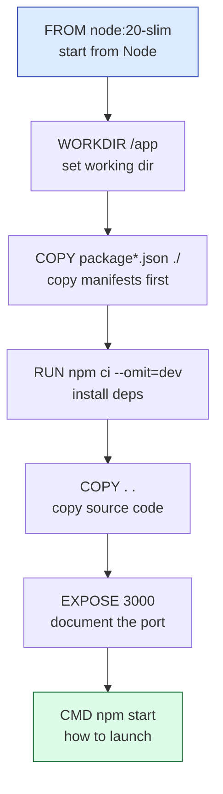

# Level 2 — Writing a Dockerfile

| | |
|---|---|
| 🎚️ **Difficulty** | 🟡 Medium |
| ⏱️ **Estimated time** | 25 minutes |
| ⭐ **XP reward** | 100 (Quest) + 25 (Quiz) |

[← Prev: Why Containers?](01-why-containers.md) · [↑ Phase Home](../README.md) · [→ Next: Build & Run TaskFlow](03-build-and-run-taskflow.md)

---

## 📖 Story

> *"You ran nginx — but that image already existed. TaskFlow doesn't. To get an image of OUR app, we write the recipe ourselves: a **Dockerfile**. It tells Docker which base to start from, what to copy in, what to install, and how to start the app. Write a good one and `docker build` does the rest. — Priya"*

Time to write the recipe that turns your code into a portable image.

---

## 🎯 Goal

- Understand what a **Dockerfile** is and the role of each core instruction: `FROM`, `WORKDIR`, `COPY`, `RUN`, `EXPOSE`, `CMD`
- Understand **layers** and why instruction order affects build speed
- Write a real, valid **Dockerfile** for the Node + Express TaskFlow app
- Add a **`.dockerignore`** so junk doesn't bloat your image

---

## 🧠 Concepts

A **Dockerfile** is a plain text file (literally named `Dockerfile`) with a list of instructions. Docker reads it top to bottom and builds an image step by step. The core instructions:

| Instruction | What it does |
|-------------|--------------|
| `FROM` | The **base image** to start from (e.g. an official Node image). Always first. |
| `WORKDIR` | Sets the working directory inside the image; later commands run there. |
| `COPY` | Copies files from your project into the image. |
| `RUN` | Runs a command **at build time** (e.g. `npm install`) and bakes the result in. |
| `EXPOSE` | Documents which port the app listens on (informational). |
| `CMD` | The default command **at run time** — what starts when the container launches. |



### Layers (the key mental model)

Each instruction creates a **layer** — a cached snapshot of the filesystem at that point. On rebuild, Docker **reuses** layers whose inputs didn't change and only rebuilds from the first changed instruction downward.

This is *why* we copy `package*.json` and run `npm ci` **before** copying the rest of the source. Your dependencies change rarely, but your code changes constantly. By installing deps in an earlier layer, editing a route file doesn't re-trigger a full `npm install` — Docker reuses the cached dependency layer and the build stays fast.

> 🧠 **Rule of thumb:** put the things that change *least* near the top, and the things that change *most* near the bottom.

### Why this exists

The Dockerfile makes your build **reproducible and reviewable**. Anyone (or any CI pipeline) can run `docker build` and get the *same* image — no tribal knowledge, no "did you remember to install X?" It's infrastructure-as-code for your app's environment, and it lives in your git repo right next to the code.

---

## 🛠️ Hands-on Lab

### Step 1 — Look at how TaskFlow starts today

```bash
cd ~/projects/taskflow
cat package.json
```

Confirm there's a **`start`** script (from World 4 it's `"start": "node index.js"`) and note the port your Express app listens on. We'll assume **3000** below — adjust if yours differs.

> 💡 If your `start` script is missing, add one to `package.json`:
> ```json
> "scripts": { "start": "node index.js" }
> ```

### Step 2 — Create the Dockerfile

In the **root of `~/projects/taskflow`**, create a file named exactly `Dockerfile` (no extension):

```dockerfile
# ---- Base image: official Node 20, slim variant (smaller) ----
FROM node:20-slim

# ---- Set the working directory inside the image ----
WORKDIR /app

# ---- Copy only dependency manifests first (better layer caching) ----
COPY package*.json ./

# ---- Install production dependencies, reproducibly ----
RUN npm ci --omit=dev

# ---- Now copy the rest of the application source ----
COPY . .

# ---- Document the port the Express app listens on ----
EXPOSE 3000

# ---- Default command that starts TaskFlow when the container runs ----
CMD ["npm", "start"]
```

Why each line:
- **`FROM node:20-slim`** — start from a trusted, prebuilt Node 20 environment. `-slim` is smaller than the default.
- **`COPY package*.json ./` then `RUN npm ci`** — install deps in their own cached layer. `npm ci` installs *exactly* what's in `package-lock.json` (reproducible); `--omit=dev` skips test/dev tooling in the image.
- **`COPY . .`** — bring in the rest of the source (`index.js`, `app.js`, `db.js`, routes, etc.).
- **`CMD ["npm", "start"]`** — the "exec form" (a JSON array). It's the recommended form and handles signals correctly.

### Step 3 — Add a `.dockerignore`

Without this, `COPY . .` would drag in `node_modules`, your local SQLite file, and `.git` — bloating the image and risking stale deps. Create `.dockerignore` next to the Dockerfile:

```dockerignore
node_modules
npm-debug.log
.git
.gitignore
Dockerfile
.dockerignore
*.sqlite
*.db
.env
```

> 💡 We *want* `npm ci` to build a clean `node_modules` **inside** the image — so we must ignore the host's `node_modules` to avoid copying a possibly-incompatible one.

### Step 4 — Sanity-check (no build yet)

```bash
ls -la ~/projects/taskflow/Dockerfile ~/projects/taskflow/.dockerignore
cat ~/projects/taskflow/Dockerfile
```

Both files should exist. We **build** the image in the next lesson.

---

## 🎮 Mini Challenge

Suppose you edit a single route file and rebuild. With our Dockerfile, will `npm ci` run again? Why or why not? Now imagine the Dockerfile had `COPY . .` **before** the `npm ci` line — what changes?

<details>
<summary>💡 Reveal answer</summary>

With our ordering, editing a route only changes the `COPY . .` layer and below — the `package*.json` layer is unchanged, so Docker **reuses the cached `npm ci` layer** and skips reinstalling. Fast. ✅

If `COPY . .` came *before* `npm ci`, then **any** code change would invalidate that copy layer, forcing `npm ci` to re-run on every rebuild. Slow. ❌ That's the whole point of copying manifests first.
</details>

---

## 📦 Project Mission

Commit the Dockerfile and `.dockerignore` to TaskFlow — they're part of the app now.

```bash
cd ~/projects/taskflow

# Make sure your start script and port are correct (Steps 1–3 above)
cat Dockerfile
cat .dockerignore

# These belong in version control
git add Dockerfile .dockerignore
git commit -m "Add Dockerfile and .dockerignore to containerize TaskFlow"
```

🎯 **Mission complete when:** `~/projects/taskflow/Dockerfile` and `.dockerignore` exist, the Dockerfile contains `FROM`, `WORKDIR`, `COPY`, `RUN`, `EXPOSE`, and `CMD` in a sensible order, and both files are committed to git.

---

## ⚠️ Common Mistakes

| Mistake | What happens | Fix |
|--------|--------------|-----|
| Naming it `dockerfile.txt` | `docker build` can't find it | Name it exactly `Dockerfile` (capital D, no extension) |
| `COPY . .` before installing deps | Every code change re-runs `npm install` | Copy `package*.json` and `RUN npm ci` **first** |
| No `.dockerignore` | Image bloats; host `node_modules` leaks in | Add `.dockerignore` excluding `node_modules`, `.git`, DB files |
| Using `npm install` instead of `npm ci` | Non-reproducible builds | Use `npm ci` with a committed `package-lock.json` |
| Wrong `EXPOSE`/port vs app | Confusion later when mapping ports | Match `EXPOSE` to the port your Express app actually listens on |

---

## 🤔 Reflection Questions

1. What's the difference between a `RUN` instruction and the `CMD` instruction (build time vs run time)?
2. Why do we copy `package*.json` and run `npm ci` *before* copying the rest of the source?
3. What problems does `.dockerignore` prevent?

---

## 📝 Quiz

1. **`FROM` in a Dockerfile specifies…**
   - a) the port to expose
   - b) the base image to build on top of
   - c) the command to run at startup
2. **Layer caching means Docker…**
   - a) reuses unchanged layers to speed up rebuilds
   - b) deletes old images automatically
   - c) compresses your code
3. **`CMD ["npm", "start"]` defines…**
   - a) a command run at build time
   - b) the default command run when the container starts
   - c) which files to copy

<details>
<summary>✅ Answers</summary>

1: **b** · 2: **a** · 3: **b**
</details>

---

## ✅ Completion Checklist

- [ ] I created a valid `Dockerfile` in `~/projects/taskflow`
- [ ] It uses `FROM`, `WORKDIR`, `COPY`, `RUN`, `EXPOSE`, `CMD` in a sensible order
- [ ] I added a `.dockerignore` excluding `node_modules`, `.git`, and DB files
- [ ] I can explain why deps are installed before copying source (layers)
- [ ] I committed both files to git (Project Mission)
- [ ] I passed the quiz
- [ ] I added **+125 XP** to [PROGRESS.md](../../../PROGRESS.md)

---

[← Prev: Why Containers?](01-why-containers.md) · [↑ Phase Home](../README.md) · [→ Next: Build & Run TaskFlow](03-build-and-run-taskflow.md)
