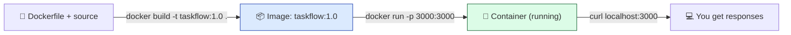

# Level 3 — Build & Run TaskFlow

| | |
|---|---|
| 🎚️ **Difficulty** | 🟡 Medium |
| ⏱️ **Estimated time** | 25 minutes |
| ⭐ **XP reward** | 100 (Quest) + 25 (Quiz) |

[← Prev: Writing a Dockerfile](02-writing-a-dockerfile.md) · [↑ Phase Home](../README.md) · [→ Next: Volumes & Persisting Data](04-volumes-and-data.md)

---

## 📖 Story

> *"Recipe's written. Now cook it. `docker build` turns your Dockerfile into an image; `docker run` launches it. Map the port, hit the API with curl, and when something's off — and it will be — you'll read the logs and step inside the container to look around. That's the daily loop. — Priya"*

---

## 🎯 Goal

- **Build** a TaskFlow image with `docker build -t`
- **Run** it with `docker run -p`, mapping ports correctly
- `curl` the containerized API and get real responses
- Use `docker ps`, `docker logs`, and `docker exec` to inspect and debug a container

---

## 🧠 Concepts

The build/run loop has two distinct phases:



Key ideas:
- **`-t name:tag`** *tags* the image with a human name (e.g. `taskflow:1.0`) so you can refer to it. The final `.` is the **build context** — the folder Docker sends to the daemon (where your Dockerfile lives).
- **Port mapping `-p HOST:CONTAINER`** — a container is isolated; its ports aren't reachable until you publish them. `-p 3000:3000` forwards your machine's port 3000 to the container's 3000.
- **Logs** — your app's `stdout`/`stderr` go to the container's logs, viewable with `docker logs`.
- **Exec** — `docker exec` runs a command *inside* a running container, e.g. a shell, so you can poke around like you would on a server.

### Why this exists

This loop is what "running software" means in a containerized world. In World 6 you'll push this exact image to a cloud server and run it the same way; in World 7 a CI pipeline will build and run it automatically. Master the loop locally now and the cloud is just a bigger version of it.

---

## 🛠️ Hands-on Lab

### Step 1 — Build the image

```bash
cd ~/projects/taskflow

# -t tags the image; the trailing . is the build context (this folder)
docker build -t taskflow:1.0 .
```

Watch the output: Docker runs each Dockerfile instruction as a **step**, caching layers. The last lines should say it tagged `taskflow:1.0`. Confirm:

```bash
docker images | grep taskflow
```

### Step 2 — Run the container

```bash
# -d detached, -p maps host:container, --name for easy reference
docker run -d -p 3000:3000 --name taskflow taskflow:1.0
```

Check it's up:

```bash
docker ps
```

You should see `taskflow` with status `Up ...` and a ports column like `0.0.0.0:3000->3000/tcp`.

### Step 3 — Hit the API

Use whatever real endpoints TaskFlow exposes. Examples (adjust paths to your World 4 routes):

```bash
# Health/root
curl http://localhost:3000/

# List tasks
curl http://localhost:3000/tasks

# Create a task
curl -X POST http://localhost:3000/tasks \
  -H "Content-Type: application/json" \
  -d '{"title":"Containerized!"}'

# List again — your new task should appear
curl http://localhost:3000/tasks
```

🎉 **Your API is responding from inside a container** — no Node installed on the host needed it.

### Step 4 — Read the logs

```bash
# Show what the app printed (startup messages, request logs)
docker logs taskflow

# Follow logs live (Ctrl+C to stop following — the container keeps running)
docker logs -f taskflow
```

This is your first stop whenever a container misbehaves.

### Step 5 — Step inside the container

```bash
# Open an interactive shell inside the running container
docker exec -it taskflow sh

# Now you're INSIDE. Look around:
ls            # see /app with your code
node --version
ls -la        # find the SQLite file the app created
exit          # leave the container (it keeps running)
```

> 💡 `-it` = interactive + a terminal. `sh` works on slim images; `bash` may not be installed.

### Step 6 — Stop and clean up (for now)

```bash
docker stop taskflow
docker rm taskflow
```

> ⚠️ Notice: when you removed the container, any tasks you created are **gone** — they lived inside the container's filesystem. That's the cliffhanger for the next lesson.

---

## 🎮 Mini Challenge

Run TaskFlow again, but expose it on host port **8000** while keeping the container on 3000. Verify with curl, then rebuild the image as tag `taskflow:1.1`.

<details>
<summary>💡 Reveal answer</summary>

```bash
docker run -d -p 8000:3000 --name taskflow taskflow:1.0
curl http://localhost:8000/tasks          # works on 8000 now
docker stop taskflow && docker rm taskflow

# Rebuild with a new tag (same Dockerfile, new version label)
docker build -t taskflow:1.1 .
docker images | grep taskflow             # both 1.0 and 1.1 listed
```

The container still listens on 3000 internally (set by the app/`EXPOSE`); only the **host** side of the mapping changed.
</details>

---

## 📦 Project Mission

Build, run, and verify the containerized TaskFlow end to end, capturing proof.

```bash
cd ~/projects/taskflow

# 1. Build
docker build -t taskflow:1.0 .

# 2. Run
docker run -d -p 3000:3000 --name taskflow taskflow:1.0

# 3. Prove it works (create + read a task)
curl -X POST http://localhost:3000/tasks \
  -H "Content-Type: application/json" \
  -d '{"title":"Built in a container"}'
curl http://localhost:3000/tasks

# 4. Inspect
docker ps
docker logs taskflow

# 5. Leave it running for now (the next lesson uses it)
```

🎯 **Mission complete when:** `docker ps` shows `taskflow` running, and a `curl` to `/tasks` returns a task you created through the containerized API. You've shipped TaskFlow as an image.

---

## ⚠️ Common Mistakes

| Mistake | What happens | Fix |
|--------|--------------|-----|
| Forgetting the trailing `.` in `docker build` | "no such file or directory" / no context | Run `docker build -t taskflow:1.0 .` from the project root |
| Mapping the wrong port | `curl` connection refused | Match `-p HOST:CONTAINER` to the port the app listens on |
| App crashes instantly, `docker ps` empty | Container exited on startup | `docker logs taskflow` to read the error; fix Dockerfile/app |
| `docker exec ... bash` fails | `bash` not in slim image | Use `sh` instead |
| Name already in use on re-run | `Conflict. The container name is already in use` | `docker rm taskflow` first, or use a new `--name` |

---

## 🤔 Reflection Questions

1. What does the trailing `.` in `docker build -t taskflow:1.0 .` mean?
2. Why can't you reach the app at `localhost:3000` until you pass `-p`?
3. When a container exits immediately, what's the first command you'd run to find out why?

---

## 📝 Quiz

1. **`docker build -t taskflow:1.0 .` — the `.` is…**
   - a) the image name
   - b) the build context (folder with the Dockerfile)
   - c) the port
2. **`-p 3000:3000` does what?**
   - a) runs 3000 containers
   - b) maps host port 3000 to container port 3000
   - c) sets a 3000 ms timeout
3. **To get a shell inside a running container you use…**
   - a) `docker logs`
   - b) `docker exec -it <name> sh`
   - c) `docker build`

<details>
<summary>✅ Answers</summary>

1: **b** · 2: **b** · 3: **b**
</details>

---

## ✅ Completion Checklist

- [ ] I built the image with `docker build -t taskflow:1.0 .`
- [ ] I ran it with `docker run -d -p 3000:3000 --name taskflow taskflow:1.0`
- [ ] I created and listed a task via `curl` against the container
- [ ] I used `docker ps`, `docker logs`, and `docker exec` successfully
- [ ] I noticed data disappears when the container is removed (Project Mission)
- [ ] I passed the quiz
- [ ] I added **+125 XP** to [PROGRESS.md](../../../PROGRESS.md)

---

[← Prev: Writing a Dockerfile](02-writing-a-dockerfile.md) · [↑ Phase Home](../README.md) · [→ Next: Volumes & Persisting Data](04-volumes-and-data.md)
