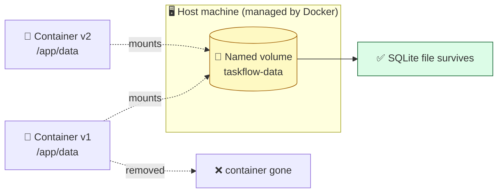

# Level 4 — Volumes & Persisting Data

| | |
|---|---|
| 🎚️ **Difficulty** | 🟡 Medium |
| ⏱️ **Estimated time** | 20 minutes |
| ⭐ **XP reward** | 100 (Quest) + 25 (Quiz) |

[← Prev: Build & Run TaskFlow](03-build-and-run-taskflow.md) · [↑ Phase Home](../README.md) · [→ Next: Docker Compose](05-docker-compose.md)

---

## 📖 Story

> *"You noticed it, right? You created tasks, removed the container, and they vanished. That's by design — containers are disposable. But our DATA can't be. We attach a **volume**: a storage area that lives outside the container, so the SQLite file survives restarts, rebuilds, and removals. Lose customer data once and you'll never forget this lesson. — Priya"*

---

## 🎯 Goal

- Understand why a container's filesystem is **ephemeral**
- Use a **named volume** to persist TaskFlow's SQLite database across container lifecycles
- Know the difference between a **named volume** and a **bind mount**, and when to use each
- Prove data survives `docker rm` + a fresh `docker run`

---

## 🧠 Concepts

Everything a container writes lands in its own writable layer — which is **destroyed** when the container is removed. Great for the app, fatal for data.

A **volume** is storage managed by Docker that lives **outside** any single container. Mount it at the path where your app writes data, and that data outlives the container.



**Two ways to mount storage:**

| Type | What it is | Best for |
|------|-----------|----------|
| **Named volume** | Storage Docker creates and manages by name (`taskflow-data`) | **Production data** — databases, uploads. Portable, Docker-managed. |
| **Bind mount** | Maps a specific **host folder** into the container | **Development** — editing source on the host and seeing it live inside. |

Mount syntax: `-v SOURCE:TARGET`. For a named volume, `SOURCE` is a name; for a bind mount, it's a host path.

### Why this exists

Containers being disposable is a *feature* — you can kill and replace them freely for upgrades and scaling. But that only works if state lives somewhere safe. Volumes draw the line between "the app" (rebuilt and replaced constantly) and "the data" (precious, persistent). Every stateful container — databases especially — relies on this. It's also why, next lesson, we move TaskFlow's data into a dedicated Postgres container with its own volume.

---

## 🛠️ Hands-on Lab

### Step 1 — Find where TaskFlow writes its SQLite file

Inside the app (from World 4), the SQLite database is the file `taskflow.db`. Decide on a stable in-container directory for it, e.g. `/app/data/taskflow.db`.

> 💡 In World 4 the app opens the database with `new Database("taskflow.db")` in the app root. Make it configurable so it's easy to mount: change that line to read `new Database(process.env.DB_PATH || "taskflow.db")`. We'll then pass `DB_PATH=/app/data/taskflow.db`.

Rebuild so the latest code is in the image:

```bash
cd ~/projects/taskflow
docker build -t taskflow:1.0 .
```

### Step 2 — Create a named volume

```bash
docker volume create taskflow-data
docker volume ls | grep taskflow-data
```

### Step 3 — Run with the volume mounted

```bash
# Remove any old container first
docker rm -f taskflow 2>/dev/null

# Mount the named volume at the directory where SQLite lives
docker run -d \
  -p 3000:3000 \
  --name taskflow \
  -v taskflow-data:/app/data \
  -e DB_PATH=/app/data/taskflow.db \
  taskflow:1.0
```

`-v taskflow-data:/app/data` mounts the volume; `-e DB_PATH=...` tells the app to put its database there.

### Step 4 — Create data, then destroy the container

```bash
# Add a task
curl -X POST http://localhost:3000/tasks \
  -H "Content-Type: application/json" \
  -d '{"title":"This should survive a restart"}'

curl http://localhost:3000/tasks      # see your task

# Now nuke the container completely
docker rm -f taskflow
```

### Step 5 — Prove the data survived

```bash
# Brand-new container, same volume
docker run -d \
  -p 3000:3000 \
  --name taskflow \
  -v taskflow-data:/app/data \
  -e DB_PATH=/app/data/taskflow.db \
  taskflow:1.0

# Your task should still be there 🎉
curl http://localhost:3000/tasks
```

The container was destroyed and recreated, yet the task remains — because it lives in `taskflow-data`, not in the container.

### Step 6 — (Optional) Bind mount for development

To edit source on the host and have it reflected inside a container (no rebuild), you'd bind-mount the project folder. This is a dev convenience, not for data:

```bash
# Mounts your live source over /app (dev only)
docker run --rm -p 3000:3000 \
  -v "$PWD":/app -v /app/node_modules \
  taskflow:1.0
```

> 💡 The extra `-v /app/node_modules` keeps the image's installed modules from being hidden by your host folder.

---

## 🎮 Mini Challenge

Without deleting the volume, inspect what's actually stored in `taskflow-data` from inside the container. Then explain what would happen if you ran `docker volume rm taskflow-data`.

<details>
<summary>💡 Reveal answer</summary>

```bash
docker exec -it taskflow sh
ls -la /app/data        # you'll see taskflow.db here
exit
```

The SQLite file lives in the volume, mounted at `/app/data`. Running `docker volume rm taskflow-data` (only possible when no container uses it) would **permanently delete** that database file — all tasks gone. Volumes persist data, but deleting the volume deletes the data. Treat production volumes with care (and back them up).
</details>

---

## 📦 Project Mission

Make TaskFlow's data durable and prove it.

```bash
cd ~/projects/taskflow

# 1. Ensure the app reads DB_PATH (commit that change if you made it)
# 2. Build, create volume, run with the volume mounted
docker build -t taskflow:1.0 .
docker volume create taskflow-data
docker rm -f taskflow 2>/dev/null
docker run -d -p 3000:3000 --name taskflow \
  -v taskflow-data:/app/data -e DB_PATH=/app/data/taskflow.db taskflow:1.0

# 3. Create a task, destroy the container, recreate, confirm it persists
curl -X POST http://localhost:3000/tasks -H "Content-Type: application/json" -d '{"title":"persist me"}'
docker rm -f taskflow
docker run -d -p 3000:3000 --name taskflow \
  -v taskflow-data:/app/data -e DB_PATH=/app/data/taskflow.db taskflow:1.0
curl http://localhost:3000/tasks
```

🎯 **Mission complete when:** after removing and recreating the container, `curl /tasks` still returns the task you created — your SQLite data now lives safely in the `taskflow-data` volume.

---

## ⚠️ Common Mistakes

| Mistake | What happens | Fix |
|--------|--------------|-----|
| Mounting the volume at the wrong path | Data still vanishes | Mount at the exact directory the app writes the DB (e.g. `/app/data`) |
| App writes DB to a non-mounted folder | Volume stays empty | Point the app at the mounted dir via `DB_PATH` (or config) |
| Confusing named volume with bind mount | Source vs data mix-ups | Named volume for **data**; bind mount for **live dev source** |
| `docker volume rm` while data matters | Permanent data loss | Only remove volumes you're sure are disposable; back up first |
| Expecting data in the image | New rebuild "loses" data | Images are stateless; data belongs in volumes, never baked into the image |

---

## 🤔 Reflection Questions

1. Why is a container's own filesystem the *wrong* place to keep important data?
2. When would you choose a bind mount over a named volume, and vice versa?
3. What's the relationship between "containers are disposable" and "volumes are persistent"?

---

## 📝 Quiz

1. **A container's writable layer is…**
   - a) permanent
   - b) destroyed when the container is removed
   - c) shared with all other containers
2. **A named volume is best for…**
   - a) editing source code live during development
   - b) persisting data like a database across container lifecycles
   - c) storing the Dockerfile
3. **`-v taskflow-data:/app/data` does what?**
   - a) copies `/app/data` into the image
   - b) mounts the named volume `taskflow-data` at `/app/data` in the container
   - c) deletes `/app/data`

<details>
<summary>✅ Answers</summary>

1: **b** · 2: **b** · 3: **b**
</details>

---

## ✅ Completion Checklist

- [ ] I understand why container filesystems are ephemeral
- [ ] I created a named volume `taskflow-data`
- [ ] I ran TaskFlow with the volume mounted at its data directory
- [ ] I destroyed the container and proved the data survived
- [ ] I can explain named volume vs bind mount
- [ ] I passed the quiz
- [ ] I added **+125 XP** to [PROGRESS.md](../../../PROGRESS.md)

---

[← Prev: Build & Run TaskFlow](03-build-and-run-taskflow.md) · [↑ Phase Home](../README.md) · [→ Next: Multi-Container with Docker Compose](05-docker-compose.md)
