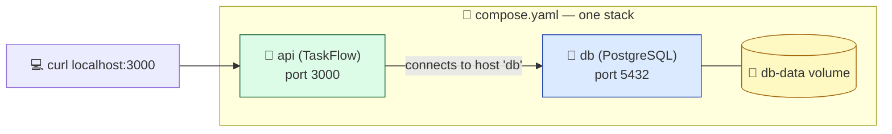

# Level 5 — Multi-Container with Docker Compose

| | |
|---|---|
| 🎚️ **Difficulty** | 🟡 Medium |
| ⏱️ **Estimated time** | 25 minutes |
| ⭐ **XP reward** | 100 (Quest) + 25 (Quiz) |

[← Prev: Volumes & Persisting Data](04-volumes-and-data.md) · [↑ Phase Home](../README.md) · [→ 👹 Boss Battle](../boss-battle.md)

---

## 📖 Story

> *"Real apps aren't one container. TaskFlow on SQLite was fine for a laptop, but production needs a real database — **PostgreSQL** — running as its own service. Typing long `docker run` commands for each one and wiring them together by hand is misery. **Docker Compose** defines the whole stack in one file and brings it up with one command. This is how we'll run TaskFlow from now on. — Priya"*

---

## 🎯 Goal

- Understand what **Docker Compose** is and why multi-container apps need it
- Write a real `compose.yaml` running **TaskFlow + PostgreSQL** together
- Wire the app to Postgres with **environment variables** and service networking
- Bring the whole stack up/down with `docker compose up` / `down`
- Understand the move from **SQLite → PostgreSQL**

---

## 🧠 Concepts

**Docker Compose** lets you declare multiple containers (called **services**), their config, networks, and volumes in a single YAML file, then manage them as one unit. Compose automatically puts services on a shared network where they can reach each other **by service name**.



Key ideas:
- **Services** — each container is a named service (`api`, `db`). The app reaches Postgres at hostname **`db`** (the service name) — Compose's built-in DNS handles it. No IP addresses.
- **`depends_on`** — controls start order so the database starts before the app.
- **Environment variables** — how the app learns the DB connection (host, user, password, db name) without hardcoding.
- **Volumes** — Postgres stores its data in a named volume so it survives `down`/`up`.
- **`docker compose up`** — builds (if needed) and starts everything; **`down`** stops and removes the containers.

### SQLite → PostgreSQL

SQLite is a single file — perfect for getting started, but it doesn't handle many concurrent writers or run as a separate networked service. **PostgreSQL** is a full client-server database: it runs in its own container, and the app connects over the network. Moving to Postgres is the standard step toward a production-grade, horizontally scalable backend (which matters once we deploy to AWS in World 6).

> 💡 To actually talk to Postgres, the app needs a Postgres client library (e.g. `pg`) and code that reads the connection from environment variables. We outline that below; the headline skill here is wiring the **stack** with Compose.

### Why this exists

One command to start a faithful copy of production — app, database, network, volumes — on any machine. New teammates run `docker compose up` and have a working TaskFlow in seconds. CI uses the same file to spin up a database for tests. Compose is the bridge between "a container" and "a system."

---

## 🛠️ Hands-on Lab

### Step 1 — Add the Postgres client to TaskFlow

```bash
cd ~/projects/taskflow
npm install pg
```

Make the app read its database config from environment variables (so the same image works locally and in Compose). For example, a `db.js` using the `pg` Pool:

```js
// db.js — connects to Postgres via environment variables
const { Pool } = require("pg");

const pool = new Pool({
  host: process.env.DB_HOST || "localhost",
  port: process.env.DB_PORT || 5432,
  user: process.env.DB_USER || "taskflow",
  password: process.env.DB_PASSWORD || "taskflow_pw",
  database: process.env.DB_NAME || "taskflow",
});

module.exports = pool;
```

> 💡 Swapping your task queries from SQLite to `pool.query(...)` is the app-level migration. Keep the route logic the same; only the data layer changes. For this lesson, the focus is getting the two containers talking.

### Step 2 — Write `compose.yaml`

In the root of `~/projects/taskflow`, create `compose.yaml`:

```yaml
services:
  api:
    build: .                 # build the image from the Dockerfile in this folder
    ports:
      - "3000:3000"          # host:container
    environment:
      DB_HOST: db            # the service name below — Compose DNS resolves it
      DB_PORT: 5432
      DB_USER: taskflow
      DB_PASSWORD: taskflow_pw
      DB_NAME: taskflow
    depends_on:
      db:
        condition: service_healthy   # wait until Postgres is ready
    restart: unless-stopped

  db:
    image: postgres:16        # official PostgreSQL image
    environment:
      POSTGRES_USER: taskflow
      POSTGRES_PASSWORD: taskflow_pw
      POSTGRES_DB: taskflow
    volumes:
      - db-data:/var/lib/postgresql/data   # persist the database
    healthcheck:
      test: ["CMD-SHELL", "pg_isready -U taskflow"]
      interval: 5s
      timeout: 5s
      retries: 5

volumes:
  db-data:
```

What's happening:
- **`api`** builds from your Dockerfile and gets DB connection details via `environment`. It connects to host **`db`** — the other service's name.
- **`db`** uses the official `postgres:16` image, sets up the user/password/database, and stores data in the **`db-data`** named volume.
- **`healthcheck` + `depends_on: condition: service_healthy`** make the API wait until Postgres can actually accept connections (not just "started").

### Step 3 — Bring the stack up

```bash
cd ~/projects/taskflow

# Build + start everything in the background
docker compose up -d --build

# Watch the services
docker compose ps
```

Both `api` and `db` should be `running`/`healthy`.

### Step 4 — Use it and inspect it

```bash
# Hit the API (now backed by Postgres)
curl -X POST http://localhost:3000/tasks \
  -H "Content-Type: application/json" \
  -d '{"title":"Stored in Postgres"}'
curl http://localhost:3000/tasks

# Tail logs for both services
docker compose logs -f

# Open a psql shell inside the db container to see real rows
docker compose exec db psql -U taskflow -d taskflow -c "\dt"
```

### Step 5 — Prove persistence, then tear down

```bash
# Restart the whole stack — data should remain (it's in db-data)
docker compose down
docker compose up -d
curl http://localhost:3000/tasks      # your task is still there 🎉

# Full stop when you're done (containers removed; volume kept)
docker compose down
```

> ⚠️ `docker compose down -v` also deletes the **volumes** (wipes the database). Use it only when you intend to start fresh.

---

## 🎮 Mini Challenge

In `compose.yaml`, why does `api` use `DB_HOST: db` instead of `localhost`? What would break if you set it to `localhost`?

<details>
<summary>💡 Reveal answer</summary>

Each service runs in its **own** container with its own `localhost`. From inside the `api` container, `localhost` means *the api container itself*, where no database is running — so the connection would fail. Compose gives every service a DNS name equal to its **service name**, so `db` resolves to the Postgres container across the shared network. Always connect by service name between containers.
</details>

---

## 📦 Project Mission

Turn TaskFlow into a one-command, two-container stack backed by PostgreSQL.

```bash
cd ~/projects/taskflow

# 1. Add pg + env-based DB config (Steps 1) and commit
git add package.json package-lock.json db.js compose.yaml
git commit -m "Add docker compose stack with PostgreSQL"

# 2. Bring it up
docker compose up -d --build
docker compose ps

# 3. Verify end to end
curl -X POST http://localhost:3000/tasks -H "Content-Type: application/json" -d '{"title":"compose works"}'
curl http://localhost:3000/tasks

# 4. Prove persistence across a restart
docker compose down && docker compose up -d
curl http://localhost:3000/tasks
```

🎯 **Mission complete when:** `docker compose up -d` brings up both `api` and `db`, `curl /tasks` works against the Postgres-backed API, and your tasks survive a `docker compose down` + `up`. TaskFlow now runs as a real multi-container system.

---

## ⚠️ Common Mistakes

| Mistake | What happens | Fix |
|--------|--------------|-----|
| Setting `DB_HOST: localhost` | API can't reach the DB | Use the **service name** (`db`) as the host |
| No `depends_on` / healthcheck | API starts before Postgres is ready and crashes | Add `depends_on: { db: { condition: service_healthy } }` + a healthcheck |
| Forgetting the Postgres volume | DB data wiped on `down`/`up` | Mount `db-data:/var/lib/postgresql/data` |
| `docker compose down -v` by habit | Database deleted | Use plain `down`; only add `-v` to intentionally wipe |
| Mismatched DB credentials | Auth failures in logs | Keep `POSTGRES_*` (db) and `DB_*` (api) values in sync |

---

## 🤔 Reflection Questions

1. What does Docker Compose give you over running several `docker run` commands by hand?
2. How does the `api` service find the `db` service without an IP address?
3. Why move TaskFlow from SQLite to PostgreSQL as it heads toward production?

---

## 📝 Quiz

1. **In Compose, one container is called a…**
   - a) service
   - b) volume
   - c) registry
2. **The `api` service reaches Postgres using…**
   - a) `localhost`
   - b) the service name `db`
   - c) a hardcoded IP
3. **`docker compose down -v` additionally…**
   - a) restarts the stack
   - b) deletes the named volumes (wiping data)
   - c) rebuilds the image

<details>
<summary>✅ Answers</summary>

1: **a** · 2: **b** · 3: **b**
</details>

---

## ✅ Completion Checklist

- [ ] I added the `pg` client and env-based DB config to TaskFlow
- [ ] I wrote a valid `compose.yaml` with `api` + `db` services
- [ ] `docker compose up -d --build` starts both services healthy
- [ ] `curl /tasks` works against the Postgres-backed API
- [ ] Data survives a `docker compose down` + `up` (volume persists)
- [ ] I passed the quiz
- [ ] I added **+125 XP** to [PROGRESS.md](../../../PROGRESS.md)

---

[← Prev: Volumes & Persisting Data](04-volumes-and-data.md) · [↑ Phase Home](../README.md) · [→ 👹 Boss Battle: The "Works on My Machine" Incident](../boss-battle.md)
