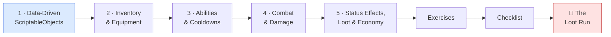
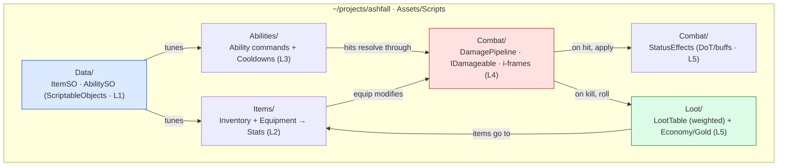

# ⚔️ World 5 — Gameplay Systems

> Ashfall is an *infinite, navigable* world now (World 4): dungeons generate, they're connected, and enemies can A\*-path to you. But there's nothing to *do* in those dungeons — no items, no abilities, no hits that hurt, no loot worth grabbing. This world makes Ashfall a **game**: data-driven items and abilities (so designers tune without recompiling), an inventory + equipment that changes your stats, abilities on cooldowns, a real damage pipeline, status effects that tick, and weighted loot tables dropping gold and gear. By the end, you can walk into a generated room, cast an ability, take a hit, poison an enemy, kill it, and grab the loot it drops.

[↑ Home](../../README.md) · [🗺️ Roadmap](../../ROADMAP.md) · [📊 Progress](../../PROGRESS.md)

---

## 📨 Your ticket

```
From:    Maya <maya@pixelforge.studio>
To:      You <new-hire@pixelforge.studio>
Cc:      Kenji <kenji@pixelforge.studio>

Subject: [W5-GAMEPLAY] The dungeons are gorgeous and EMPTY

The procedural world is genuinely great — different every run, fully
connected, enemies that path to the player. And it's hollow. You walk in,
you walk out. There's no game in the game yet.

Here's what "depth" means, and none of it is art — it's all systems:

  - ITEMS & ABILITIES as DATA, not code. I want to tune a sword's damage or
    a dash's cooldown in the Inspector at 2am without pinging you for a
    recompile. Designers touch data; programmers own behavior.
  - An INVENTORY that stacks potions, and EQUIPMENT slots that actually
    change the player's stats when I equip a better sword.
  - ABILITIES with COOLDOWNS and costs — a dash, a projectile — so combat
    has rhythm and decisions, not button-mashing.
  - Hits that HURT. A real damage pipeline: hit detection, i-frames so you
    don't die in one frame, knockback. Enemies and the player both take it.
  - POISON that ticks. BURN that stacks. A modular status-effect system, not
    a hard-coded "if poisoned" hack everywhere.
  - LOOT worth grabbing. Weighted drop tables (commons fall, legendaries are
    rare), gold, and an economy — so clearing a room actually pays off.

Boss check ("The Loot Run"): clear a generated room — cast an ability, take
damage, poison an enemy, kill it, watch it drop weighted loot + gold, pick it
up, equip it, see your stats change — and have all of it persist. Make it
data-driven so I can balance the whole game without touching your code.

Ship that and World 6 — the enemy AI that USES all this combat against the
player — is yours.

— Maya
```

This is World 5 of 13. Everything you build advances the **one growing Ashfall project** in `~/projects/ashfall`. You arrive with combat-ready, navigable dungeons (W4); you leave with the *game* inside them — items, abilities, combat, status effects, and loot.

---

## 🎯 What you'll achieve in this world

- 🧩 Separate **data from code** with **ScriptableObjects** — `ItemSO` / `AbilitySO` assets a designer tunes in the Inspector, consumed by systems you own (no recompile to rebalance)
- 🎒 Build an **inventory** (stacking, item events) and **equipment slots** that modify the player's **`Stats`** when geared up
- ✨ Implement an **ability pattern** (command objects) with **cooldowns**, **costs**, and casting — a dash and a projectile, both driven by `AbilitySO`
- 💥 Build a **damage pipeline** on the `IDamageable` contract from W1 — hit detection, **i-frames**, knockback — applied to player *and* enemies
- ☠️ Build a **modular status-effect system** (DoT/buffs like poison & burn), **weighted loot tables** with drop rates, and a **gold/economy** — all persisted by the W3 save system

---

## 🗺️ Level map

| Level | Lesson | Difficulty | XP |
|------:|--------|:----------:|---:|
| 1 | [Data-Driven Design with ScriptableObjects](lessons/01-data-driven-design-with-scriptableobjects.md) | 🟢 Easy | 125 |
| 2 | [Inventory & Equipment](lessons/02-inventory-and-equipment.md) | 🟡 Medium | 125 |
| 3 | [Abilities & Cooldowns](lessons/03-abilities-and-cooldowns.md) | 🟡 Medium | 125 |
| 4 | [Combat & Damage](lessons/04-combat-and-damage.md) | 🔴 Hard | 125 |
| 5 | [Status Effects, Loot & Economy](lessons/05-status-effects-loot-and-economy.md) | 🔴 Hard | 125 |
| 👹 | [Boss Battle — The Loot Run](boss-battle.md) | 🔴 Hard | 500 |

➕ Extra reps: [exercises.md](exercises.md) · ✅ Ready to advance? [checklist.md](checklist.md)

---

## 🧭 Recommended order



Go in order — each lesson is the data or contract the next one consumes. Data-driven design (L1) gives you `ItemSO`/`AbilitySO` — the assets *every* later system reads, so a designer tunes the game without a recompile. Inventory & equipment (L2) holds those items and lets equipment modify `Stats`. Abilities (L3) are command objects driven by `AbilitySO`, gated by cooldowns and costs. Combat (L4) is the damage pipeline those abilities feed into — hit detection, i-frames, knockback on the W1 `IDamageable` contract. Status effects, loot & economy (L5) layer *on top* of combat: effects that tick, weighted drops, and gold. The boss **fuses all five** into one full loot run.

---

## 📦 Ashfall project status

**Entering World 5:** an infinite, navigable world (W4) — procedurally generated, fully connected dungeons; a reusable A\* `Pathfinder`; a spatial hash grid for fast neighbor queries — all persisted by the W3 save system. But the dungeons are empty: no items, no abilities, no damage, no loot.

**Leaving World 5:** a **data-driven gameplay layer** — `ItemSO`/`AbilitySO` assets a designer tunes in the Inspector; an **inventory + equipment** that changes the player's `Stats`; **abilities on cooldowns** (dash + projectile); a **damage pipeline** with i-frames and knockback on `IDamageable`; a modular **status-effect** system (poison/burn); **weighted loot tables** + **gold**; and all of it persisted (inventory, gold, equipped gear) by the W3 save system.



You hand this to **World 6 — Artificial Intelligence**, where enemies get smart enough to *use* all this combat against the player: state machines, behavior trees, perception, and a real boss fight.

---

## 👹 Boss teaser

**"The Loot Run"** — Maya wants proof Ashfall is a *game*, not a tech demo: walk into a generated room, **cast an ability** on cooldown, **take damage** (and survive thanks to i-frames), **poison an enemy** with a status effect, **kill it**, watch it drop **weighted loot + gold**, **pick it up and equip it**, and **see your stats change** — with the whole run **persisted**. No tutorial — you'll fuse all five lessons into one loot run, data-driven end to end. Beat it to earn the **⚔️ Gameplay Engineer** badge, a +250 world-complete bonus, and unlock World 6.

---

## 📚 Resources

Don't go link-hunting — the curated free list lives in [RESOURCES.md](../../RESOURCES.md). For this world, the standouts are the **Unity ScriptableObject** talks (Ryan Hipple's "Game Architecture with ScriptableObjects" is the canonical one), the **Game Programming Patterns** book (free online — Command, Observer, and Component chapters map straight onto abilities, item events, and combat), and **Kenney.nl** for free item/loot icons to make your inventory readable. Watch *why* data-driven design wins before you wire it — it's the spine of this whole world.

---

[↑ Home](../../README.md) · [🗺️ Roadmap](../../ROADMAP.md) · [📊 Progress](../../PROGRESS.md) · [➡️ Next World: Artificial Intelligence](../phase-06-artificial-intelligence/README.md) · [▶️ Start Level 1 →](lessons/01-data-driven-design-with-scriptableobjects.md)
