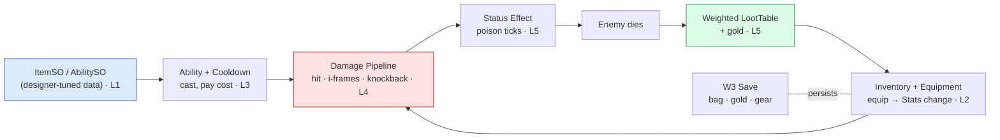

# 👹 Boss Battle — The Loot Run

| | |
|---|---|
| 🎚️ **Difficulty** | 🔴 Hard |
| ⏱️ **Estimated time** | 100 minutes |
| ⭐ **XP reward** | 500 |
| 🔓 **Unlocks** | World 6 — Artificial Intelligence |

[← Checklist](checklist.md) · [↑ Phase Home](README.md) · [↑ Home](../../README.md)

---

## 📨 The incident

```
From:    Maya <maya@pixelforge.studio>
To:      You <new-hire@pixelforge.studio>
Cc:      Kenji <kenji@pixelforge.studio>, Theo <theo@pixelforge.studio>

Subject: [W5-BOSS] Make a LOOT RUN feel like a loot run

The dungeons are alive and the systems are in — now make them sing together.
Theo wants to demo a real "clear a room, grab the loot" loop in the next
build, not five disconnected features. I want to feel the whole game in one
run.

Here's the bar. I drop into a generated room and:

  - I CAST AN ABILITY — a dash or a projectile — and it goes on COOLDOWN and
    costs me something. No spamming.
  - The enemy hits back and I TAKE DAMAGE — but i-frames mean one touch
    doesn't delete me. Combat has give and take.
  - I land a hit that POISONS the enemy, and it TICKS it down over time — not
    a one-shot, a status effect doing its job.
  - The enemy DIES and DROPS LOOT — weighted, so most runs it's a common and
    once in a while it's something great — plus some GOLD.
  - I PICK UP the drop, EQUIP it, and my STATS actually CHANGE. The new sword
    makes the next fight measurably different.
  - I save, reload, and it's all still there — bag, gold, gear.

And the whole thing is DATA-DRIVEN: I can retune the ability, the loot odds,
the poison damage — all in the Inspector, without pinging you for a build.

No tutorial this time — you've got all five lessons. Wire them into ONE loot
run. Nail it and World 6 — enemies smart enough to USE this combat against the
player — is yours.

— Maya
```

> ⚔️ **Boss Battle rules:** No tutorials, no copying lesson files wholesale. **Apply** World 5: build the `ItemSO`/`AbilitySO` data, the inventory + equipment, the ability system with cooldowns, the damage pipeline with i-frames, the status-effect system, and the weighted loot table + economy yourself, and wire them into one run. You win when every victory condition is met **and you can explain which system owns each behavior** (data → inventory → abilities → combat → status/loot).

---

## 🎯 Your mission

Build a complete **loot run** in a W4 generated room: cast an ability, trade damage, poison and kill an enemy, collect weighted loot + gold, equip a drop that changes your stats — all data-driven and all persisted. This is the capstone that fuses every lesson:



Build it from these pieces (at minimum):

1. **Data (L1):** `ItemSO` (name, icon, stat modifiers, max stack, rarity) and `AbilitySO` (cooldown, cost, effect params) — assets a designer tunes in the Inspector, no recompile.
2. **Abilities (L3):** an ability runtime that casts from an `AbilitySO`, enforces a **per-caster cooldown** and a **cost** — a dash and a projectile.
3. **Combat (L4):** a damage pipeline on `IDamageable` (W1) with **hit detection**, **i-frames**, and **knockback**, applied to player *and* enemy.
4. **Status (L5):** a modular status effect (e.g. poison) with **duration + tick** that the combat hit can apply, ticking damage over time.
5. **Loot + economy (L5):** a **weighted `LootTable`** rolled on enemy death dropping an item + **gold** the player picks up.
6. **Inventory + equipment (L2):** picked-up items stack in an `Inventory`; **equipping** one applies its modifiers so the final stat is **`base + sum(modifiers)`**.
7. **Persistence (W3):** inventory, gold, and equipped gear survive a save/reload.

---

## 🏆 Victory conditions

- [ ] I **clear a generated W4 room** as one continuous run (not five isolated test scenes)
- [ ] I **cast an ability** (dash or projectile) that goes on a **per-caster cooldown** and **pays a cost** — no spamming
- [ ] The player **takes damage** through the pipeline and **survives a touch** because of **i-frames** (no per-frame instant death)
- [ ] A hit **applies a status effect** (poison/burn) that **ticks damage over time**, not a one-shot
- [ ] Killing the enemy **rolls weighted loot** (commons frequent, legendaries rare) **+ gold** that I can **pick up**
- [ ] I **equip a dropped item** and my **stats change** — final stat is **`base + sum(modifiers)`**, and unequipping reverts cleanly
- [ ] The whole run is **persisted** — save, reload, and bag + gold + equipped gear are intact
- [ ] It's **data-driven** — I can retune the ability, loot odds, and poison via `AbilitySO`/`ItemSO`/loot weights **without editing code**
- [ ] I can explain which system owns each behavior (data → abilities → combat → status → loot → inventory)

---

## 🧪 How you'll know you won

```bash
cd ~/projects/ashfall
ls Assets/Scripts/Data Assets/Scripts/Items Assets/Scripts/Abilities Assets/Scripts/Combat Assets/Scripts/Loot
# → ItemSO.cs, AbilitySO.cs, Inventory.cs, Equipment.cs, Ability.cs, DamagePipeline.cs, StatusEffect.cs, LootTable.cs ...
```

Then in the Editor / a build, do one run start to finish:
- **Cast** the dash twice in a row — the second is **blocked while on cooldown** (and the cost was spent). Bump the cooldown in the `AbilitySO` Inspector — the change takes effect with **no recompile**.
- **Run into the enemy** — you take damage *once*, then a visible **i-frame** window where repeated contact does nothing.
- **Hit the enemy** so it gets **poisoned** — watch its HP tick down over several seconds after the hit lands.
- **Kill it** — it drops an item + gold. Reroll the kill a dozen times: mostly commons, the rare legendary. Edit a loot **weight** → the odds shift, no recompile.
- **Pick up and equip** the dropped sword — your attack stat visibly **goes up**; unequip → it goes back down exactly.
- **Save, quit, reload** — bag, gold, and equipped gear are exactly as you left them.

If all that holds in one continuous run, Ashfall is a *game*. You've won.

<details>
<summary>🔎 Reference solution — only after you've tried! (high-level sketch + key code)</summary>

**The shape of it (each piece owns one job):**

| Piece | Job | Lesson |
|---|---|---|
| `ItemSO` / `AbilitySO` | designer-tuned data (no recompile) | L1 |
| `Inventory` / `Equipment` | stack items, equip → `base + modifiers` | L2 |
| `Ability` + cooldown map | cast from data, gate by cooldown & cost | L3 |
| `DamagePipeline` (`IDamageable`) | hit detection, i-frames, knockback | L4 |
| `StatusEffect` | duration + tick (poison/burn) | L5 |
| `LootTable` + economy | weighted drop roll + gold | L5 |

**Data: the tunable assets a designer owns (L1):**

```csharp
[CreateAssetMenu(menuName = "Ashfall/Item")]
public class ItemSO : ScriptableObject
{
    public string displayName;
    public Sprite icon;
    public int maxStack = 1;
    public Rarity rarity;
    public List<StatModifier> modifiers;   // e.g. (+5 Attack), (+2 Crit) — equipment reads these
}

[CreateAssetMenu(menuName = "Ashfall/Ability")]
public class AbilitySO : ScriptableObject
{
    public string displayName;
    public float cooldown;                  // DATA: shared duration
    public int   cost;                      // resource spent per cast
    public float power;                     // ability-specific tuning
}
```

**Abilities: cast from data, cooldown is per-caster runtime (L3):**

```csharp
public class AbilityRunner : MonoBehaviour
{
    readonly Dictionary<AbilitySO, float> readyAt = new();   // per-CASTER cooldown STATE

    public bool TryCast(AbilitySO ability, Resources res)
    {
        if (Time.time < readyAt.GetValueOrDefault(ability)) return false;  // still cooling down
        if (!res.TrySpend(ability.cost)) return false;                     // can't afford
        readyAt[ability] = Time.time + ability.cooldown;                   // start cooldown
        Execute(ability);                                                  // dash / projectile
        return true;
    }
}
```

**Combat: one pipeline for anything damageable, with i-frames (L4):**

```csharp
public class Health : MonoBehaviour, IDamageable   // IDamageable is the W1 contract
{
    public int max = 100; int current; float invulnUntil;
    public event System.Action OnDied;

    public void TakeDamage(int amount, Vector2 from)
    {
        if (Time.time < invulnUntil) return;            // I-FRAMES: ignore during the window
        current -= amount;
        invulnUntil = Time.time + 0.5f;                 // open the i-frame window
        ApplyKnockback(from);
        if (current <= 0) OnDied?.Invoke();             // death → loot roll subscribes here
    }
}
```

**Status effect: duration + tick (poison), applied by a hit (L5):**

```csharp
public class PoisonEffect : StatusEffect
{
    public override float Duration => 5f;
    float nextTick; readonly int dps = 2;

    public override void Tick(IDamageable target, Vector2 src)
    {
        if (Time.time < nextTick) return;
        nextTick = Time.time + 1f;                       // tick once per second
        target.TakeDamage(dps, src);                     // DoT routes through the SAME pipeline
    }
}
// EffectHolder holds a List<StatusEffect>, calls Tick() each frame, removes when expired.
```

**Loot: weighted roll on death + gold (L5):**

```csharp
[CreateAssetMenu(menuName = "Ashfall/Loot Table")]
public class LootTable : ScriptableObject
{
    [System.Serializable] public struct Drop { public ItemSO item; public int weight; }
    public List<Drop> drops; public Vector2Int goldRange;

    public ItemSO Roll(System.Random rng)
    {
        int total = drops.Sum(d => d.weight);            // weights are DATA — tune odds in Inspector
        int r = rng.Next(total);
        foreach (var d in drops) { if (r < d.weight) return d.item; r -= d.weight; }
        return null;
    }
}
// On OnDied: spawn pickup of table.Roll(rng) + Random gold in goldRange.
```

**Equipment: equip modifies stats as base + modifiers, reversibly (L2):**

```csharp
public void Equip(ItemSO item, EquipSlot slot)
{
    if (equipped[slot] != null) stats.RemoveModifiers(equipped[slot].modifiers);  // clean swap
    equipped[slot] = item;
    stats.AddModifiers(item.modifiers);     // final stat = base + sum(modifiers)
    Save();                                 // W3: persist bag + gold + gear
}
```

**Why each piece is the right tool:**
- **ScriptableObjects** make the whole game tunable as data — a designer rebalances abilities, items, and loot odds with **zero recompiles** (L1).
- Splitting **base stats from modifiers** makes equip/unequip *reversible* — you never lose the base value (L2).
- Cooldown **duration is shared data**, but **remaining time is per-caster state** — so two entities using the same ability don't share one timer (L3).
- Coding to **`IDamageable`** means one pipeline damages player, enemies, and barrels alike; **i-frames** stop per-frame instant death (L4).
- A **status effect** routes its DoT through the *same* damage pipeline, so poison, hits, and burns all behave consistently (L5).
- A **weighted table** turns "what drops?" into tunable odds — commons frequent, legendaries rare — the heartbeat of a loot game (L5).

One run, five lessons, a real game loop. That's all of World 5 in a single loot run.
</details>

---

## 🎁 Rewards

- 🏆 **+500 XP**
- 🏅 Achievement unlocked: **⚔️ Gameplay Engineer** — you turned empty dungeons into a real game: data-driven items and abilities, combat that gives and takes, status effects, and loot worth grabbing
- 🔓 **World 6 — Artificial Intelligence** unlocks
- 📈 Update [PROGRESS.md](../../PROGRESS.md): mark World 5 ✅ and add the **+250 World Complete bonus**

> 🗒️ Reflection: gameplay systems aren't five separate features — they're one machine. Data feeds abilities, abilities feed combat, combat triggers status effects and loot, loot fills your inventory, equipment loops back into combat — and keeping it all data-driven means the *design* of the game lives in assets, not in your code. World 6 makes the enemies *smart*: they'll perceive, decide, and use this exact combat against the player, building up to a real boss fight.

---

[← Checklist](checklist.md) · [↑ Phase Home](README.md) · [↑ Home](../../README.md) · [🤖 Enter World 6 →](../phase-06-artificial-intelligence/README.md)
