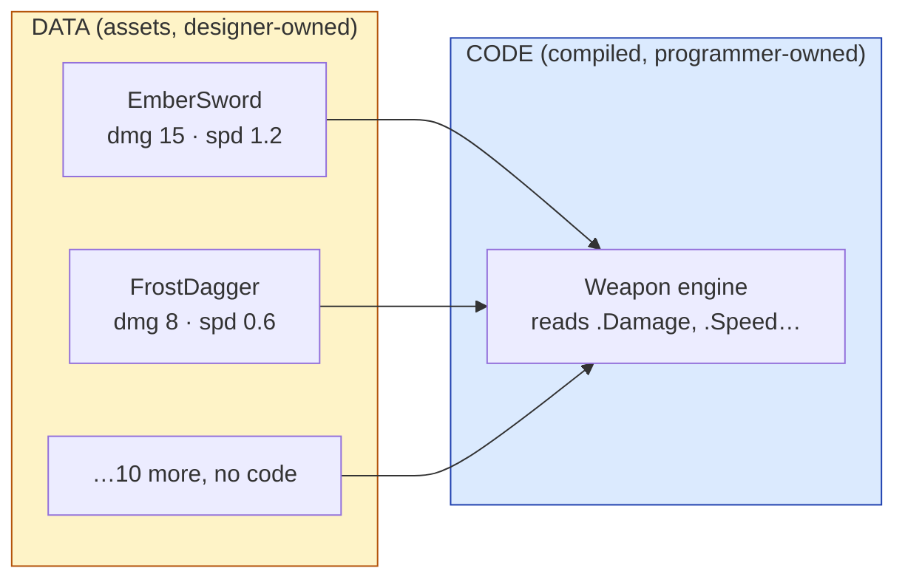
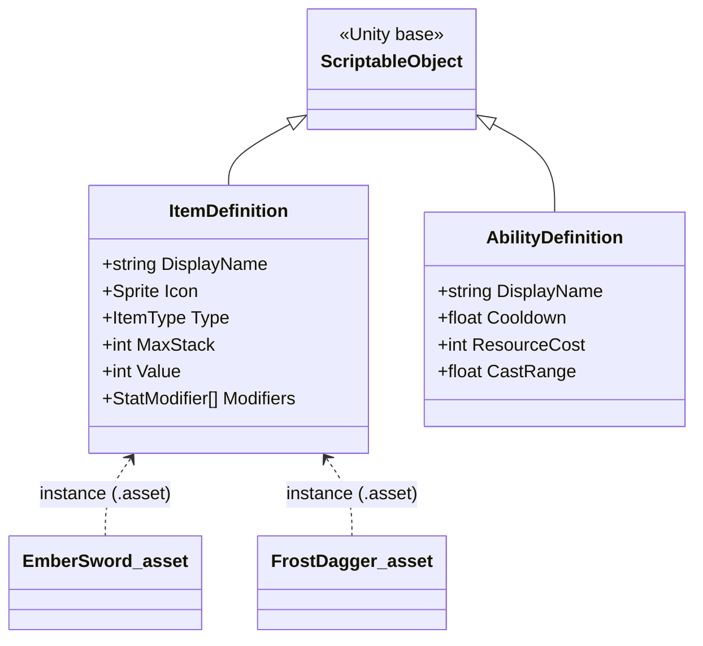

# Level 1 — Data-Driven Design with ScriptableObjects

| | |
|---|---|
| 🎚️ **Difficulty** | 🟡 Medium |
| ⏱️ **Estimated time** | 30 minutes |
| ⭐ **XP reward** | 100 (Quest) + 25 (Quiz) |

[← Prev](../README.md) · [↑ Phase Home](../README.md) · [→ Next](02-inventory-and-equipment.md)

---

## 📖 Story

> *"Welcome to World 5 — the part where Ashfall actually becomes a **game**. But before we write a single line of combat, we settle one fight: **who owns the numbers?** Maya pinged me this morning — she wants to add ten new items and rebalance the Ember Sword's damage from 12 to 15. If those numbers live inside our C# code, that's a code change, a recompile, a code review, and a build — for **one number**. That's insane. Designers must be able to tune content without touching code, without a programmer, without a rebuild. The answer is **data-driven design**: code becomes a generic *engine*, and content lives in *data assets* a designer edits like a spreadsheet. In Unity those are **ScriptableObjects**. Get this right and every system we build this world — inventory, abilities, combat, loot — gets cheap to extend. Get it wrong and you'll be a content-entry bottleneck forever. — Kenji"*

---

## 🎯 Goal

- Understand the **data vs code** split: why content should live outside compiled logic
- Learn why **designers** need data-driven content (iteration speed, no recompiles)
- Understand **ScriptableObjects** as Unity's data-asset format — and the engine-agnostic idea (data assets / blueprints / definitions)
- Build Ashfall's `ItemDefinition` and `AbilityDefinition` ScriptableObjects that every later system reads
- Know when *not* to use a ScriptableObject (runtime mutable state)

---

## 🧠 Concepts

### Data vs code: two very different things

Your game has two kinds of stuff:

- **Code** — the *rules* and *behavior*: how an attack resolves, how a cooldown ticks, how an inventory stacks. This is logic. It compiles. Programmers own it.
- **Data** — the *content* and *numbers*: the Ember Sword does 15 damage, costs 50 gold, has a fire icon; Fireball costs 20 mana, 3s cooldown. This is values. It should **not** require a recompile to change.

The mistake juniors make is hard-coding data *into* code:

```csharp
// ❌ Data trapped inside code. Every balance tweak = code change + recompile + build.
if (weapon == "EmberSword") { damage = 12; speed = 1.2f; }
else if (weapon == "FrostDagger") { damage = 8; speed = 0.6f; }
```

Add a weapon? Edit code. Rebalance? Edit code. Want a designer to do it? They can't — they don't write C#, and even if they did, a recompile breaks their flow. **Data-driven design** flips it: write *one* generic weapon engine that reads its numbers from a **data asset**, then make as many assets as you want.



### ScriptableObjects: data that lives as an asset

A **ScriptableObject** is a Unity class that holds data and lives as an **asset file** in your project (a `.asset`), *not* on a GameObject in a scene. Think of it as a designer-editable record — a row in a spreadsheet that happens to live in the Project window.

A `MonoBehaviour` is *per-instance, per-scene* (every enemy has its own `Health` component). A `ScriptableObject` is *shared, project-wide* (there is **one** Ember Sword definition that 50 dropped swords all point at). That sharing is the whole point: one asset, one source of truth, edited in the Inspector like a form.



### The golden rule: definitions are read-only at runtime

A ScriptableObject is **shared** — every dropped Ember Sword references the *same* asset. So if you change a field on it at runtime, **every** instance changes, and (in the editor) your change can even persist into the asset file. That's a classic, baffling bug.

Rule of thumb:
- **Definition data that never changes during play** (base damage, icon, max stack) → ScriptableObject. ✅
- **Per-instance state that changes during play** (this sword's current durability, this enemy's current HP, how many potions are in *your* stack) → a plain runtime class/struct that *references* the definition. ✅

You'll see this pairing all world: an `ItemDefinition` (shared asset) plus an `ItemStack` (runtime instance holding a count). Definition = the blueprint; instance = a thing built from it.

### Why this exists

Hard-coding content into logic is the single biggest reason game projects calcify: every balance pass becomes an engineering ticket, designers wait on programmers, and iteration — the thing that makes games *fun* — grinds to a halt. Separating data from code lets the people who tune the game (designers) work at the speed of a spreadsheet while programmers build generic systems once. It also unlocks modding, localization, and live content drops without patching the executable.

This is **engine-agnostic**. The name changes — Unity calls them **ScriptableObjects**, Unreal calls them **Data Assets** and **DataTables**, Godot uses **Resources**, and a custom engine would load **JSON/YAML definitions**. The *idea* is identical everywhere: **content is data, loaded by generic code.** Every system you build the rest of this world — inventory, abilities, combat, loot — will be a generic engine reading these definitions, which is exactly why this lesson comes first. See **RESOURCES.md** for this world (Unity ScriptableObject docs and Ryan Hipple's "Game Architecture with ScriptableObjects" talk).

---

## 🛠️ Hands-on Lab

> 💻 Real Unity C#. The `[CreateAssetMenu]` attribute adds a right-click menu so designers can make new assets with no code.

### Step 1 — A reusable stat modifier (data, not code)

We'll let items and abilities modify stats. Define *which* stat and *how much* as plain data so a designer picks it from a dropdown.

```csharp
using System;

public enum StatType { MaxHealth, Damage, MoveSpeed, Armor }

[Serializable]                 // shows up in the Inspector
public struct StatModifier
{
    public StatType Stat;
    public float Amount;       // e.g. +15 Damage, +0.5 MoveSpeed
}
```

### Step 2 — The `ItemDefinition` ScriptableObject

```csharp
using UnityEngine;

public enum ItemType { Weapon, Armor, Consumable, Material }

// Right-click in Project window → Create → Ashfall → Item Definition
[CreateAssetMenu(fileName = "NewItem", menuName = "Ashfall/Item Definition")]
public class ItemDefinition : ScriptableObject
{
    [Header("Identity")]
    public string id;                  // stable key for saves (e.g. "ember_sword")
    public string displayName;
    [TextArea] public string description;
    public Sprite icon;

    [Header("Rules")]
    public ItemType type;
    public int maxStack = 1;           // weapons stack to 1; potions to 99
    public int value = 10;             // gold price (used by the shop in Lesson 5)

    [Header("Stats (applied when equipped)")]
    public StatModifier[] modifiers;   // a designer fills this in the Inspector
}
```

### Step 3 — The `AbilityDefinition` ScriptableObject

```csharp
using UnityEngine;

[CreateAssetMenu(fileName = "NewAbility", menuName = "Ashfall/Ability Definition")]
public class AbilityDefinition : ScriptableObject
{
    [Header("Identity")]
    public string id;                  // "dash", "fireball"
    public string displayName;
    public Sprite icon;

    [Header("Rules (tuned by designers, no recompile)")]
    public float cooldown = 1f;        // seconds
    public int resourceCost = 0;       // mana/energy — Lesson 3 spends it
    public float castRange = 8f;
    public float power = 10f;          // generic magnitude (damage, dash distance…)
}
```

### Step 4 — Generic code that *reads* the data

Notice this code never mentions "Ember Sword." It works for **any** item asset — that's the payoff.

```csharp
using UnityEngine;

public static class ItemTooltip
{
    // One function, every item ever made. No item-specific branches.
    public static string Build(ItemDefinition def)
    {
        string text = $"<b>{def.displayName}</b>\n{def.description}\nValue: {def.value}g";
        foreach (var m in def.modifiers)
        {
            string sign = m.Amount >= 0 ? "+" : "";
            text += $"\n{sign}{m.Amount} {m.Stat}";
        }
        return text;
    }
}
```

### Step 5 — Make the assets (designer workflow)

1. In the **Project** window, right-click → **Create → Ashfall → Item Definition**. Name it `EmberSword`.
2. In the Inspector, set `id = ember_sword`, `displayName = Ember Sword`, `type = Weapon`, `maxStack = 1`, `value = 50`, and add one `StatModifier`: `Damage, +15`.
3. Repeat for `HealthPotion` (`type = Consumable`, `maxStack = 99`, no modifiers).
4. Create an **Ability Definition** named `Dash` (`cooldown = 2`, `power = 5` as dash distance).

You just authored content with **zero code changes**. That's the whole idea.

---

## 🎮 Mini Challenge

Maya playtests, then edits the Ember Sword's damage from +15 to +20 **in the Inspector while the game is running** — and notices the change *stuck* in the asset after she stopped playing. She's worried about the opposite case: a programmer wrote `equippedDef.value -= 10;` to "apply a discount" at runtime. What will that do, and what's the rule?

<details>
<summary>💡 Reveal answer</summary>

`equippedDef` points at the **shared** `ItemDefinition` asset — there's only one. `equippedDef.value -= 10;` mutates that single source of truth, so **every** Ember Sword (and the saved asset, in the editor) now costs 10 less, permanently. **Rule: never mutate a ScriptableObject at runtime.** Definitions are read-only blueprints. Per-instance changes belong on a runtime object (an `ItemStack`/instance) that *references* the definition — which is exactly what we build next lesson.
</details>

---

## 📦 Project Mission

Lay Ashfall's data-driven foundation so every system this world reads from designer-editable assets.

1. Create `Assets/Scripts/Data/StatModifier.cs` (Step 1) and `Assets/Scripts/Data/ItemDefinition.cs` (Step 2).
2. Create `Assets/Scripts/Data/AbilityDefinition.cs` (Step 3).
3. Make an `Assets/Data/Items/` folder and author **at least 4** item assets: `EmberSword`, `IronArmor` (`+5 Armor`), `HealthPotion`, and one material (`AshShard`).
4. Make an `Assets/Data/Abilities/` folder and author `Dash` and `Fireball` (`cooldown = 5`, `resourceCost = 20`, `power = 25`).
5. Add a tiny test `MonoBehaviour` that holds an `ItemDefinition` field, and on `Start()` logs `ItemTooltip.Build(def)` — drag `EmberSword` into the field and confirm the tooltip prints its name, value, and `+15 Damage`.
6. Prove the win: change Ember Sword's damage to `+18` **in the Inspector** (no recompile) and re-run — the new number prints. That's data-driven design working.
7. Commit:
   ```bash
   cd ~/projects/ashfall
   git switch -c feature/data-driven-design
   git add Assets/Scripts/Data Assets/Data
   git commit -m "feat: ScriptableObject item & ability definitions (data-driven content)"
   git switch main && git merge feature/data-driven-design && git push
   ```

🎯 **Mission complete when:** Ashfall has `ItemDefinition` and `AbilityDefinition` ScriptableObjects, at least 4 item assets and 2 ability assets authored entirely in the Inspector, and you can change an item's numbers **without editing or recompiling code**.

---

## ⚠️ Common Mistakes

| Mistake | What happens | Fix |
|--------|--------------|-----|
| Hard-coding item/ability numbers in C# | Every tweak = recompile; designers blocked | Put numbers in ScriptableObject assets |
| Mutating a ScriptableObject at runtime | Change leaks to **all** instances (and the saved asset) | Definitions are read-only; mutate a runtime instance that references them |
| Storing per-instance state (current HP, stack count) on the SO | Shared state corrupts across instances | Keep instance state in a plain runtime class/struct |
| Forgetting `[CreateAssetMenu]` | Designers can't create the asset from the menu | Add the attribute with a clear `menuName` |
| Referencing items by raw object, not a stable `id` | Saves break when assets are renamed/moved | Give each definition a stable string `id` for serialization |

---

## 🤔 Reflection Questions

1. Why does separating data from code speed up a *designer's* iteration loop specifically — what step disappears compared to hard-coded numbers?
2. A `MonoBehaviour` lives on a GameObject in a scene; a `ScriptableObject` is a shared project asset. Given that difference, why is "current health" wrong on a ScriptableObject but "max health" fine?
3. Unity calls them ScriptableObjects, Unreal calls them Data Assets, a custom engine loads JSON. What single idea are all three implementing, and why does naming it that way help you switch engines?

---

## 📝 Quiz

1. **Data-driven design exists primarily so that…**
   - a) the game runs faster at runtime
   - b) designers can change content/numbers without a recompile or a programmer
   - c) you write less total code
2. **A ScriptableObject in Unity is…**
   - a) a component you attach to every enemy GameObject
   - b) a shared data asset stored in the project, edited in the Inspector
   - c) a runtime-only object that is destroyed each frame
3. **Why must you NOT mutate an `ItemDefinition` at runtime?**
   - a) it's slower than a struct
   - b) it's shared — the change affects every instance and can persist into the asset
   - c) Unity forbids reading SO fields during play

<details>
<summary>✅ Answers</summary>

1: **b** · 2: **b** · 3: **b**
</details>

---

## ✅ Completion Checklist

- [ ] I can explain the data-vs-code split and why designers need data-driven content
- [ ] I understand ScriptableObjects as shared data assets (and the engine-agnostic equivalent)
- [ ] I built `ItemDefinition` and `AbilityDefinition` SOs with `[CreateAssetMenu]`
- [ ] I authored item & ability assets entirely in the Inspector (no code change)
- [ ] I never mutate a definition at runtime; instance state lives elsewhere
- [ ] I passed the quiz
- [ ] Added **+125 XP** to [PROGRESS.md](../../../PROGRESS.md)

---

[← Prev](../README.md) · [↑ Phase Home](../README.md) · [→ Next](02-inventory-and-equipment.md)
