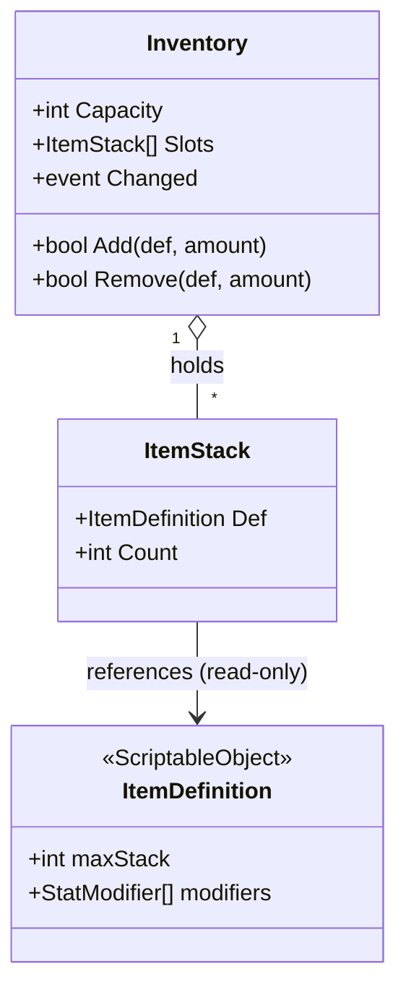
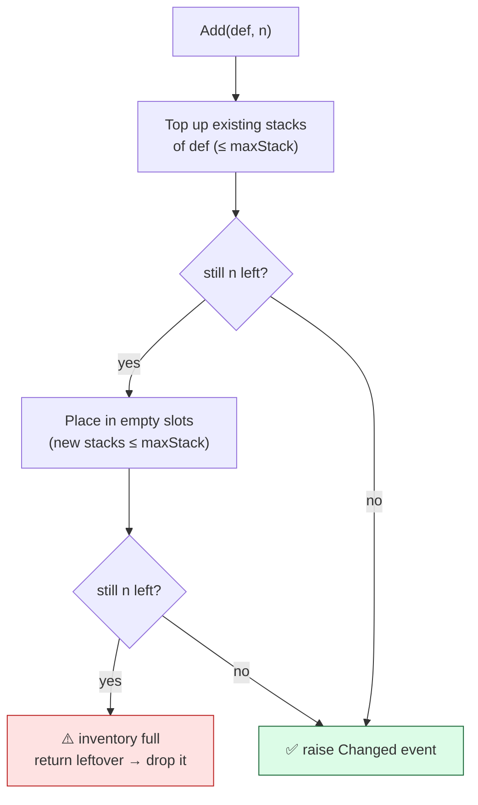
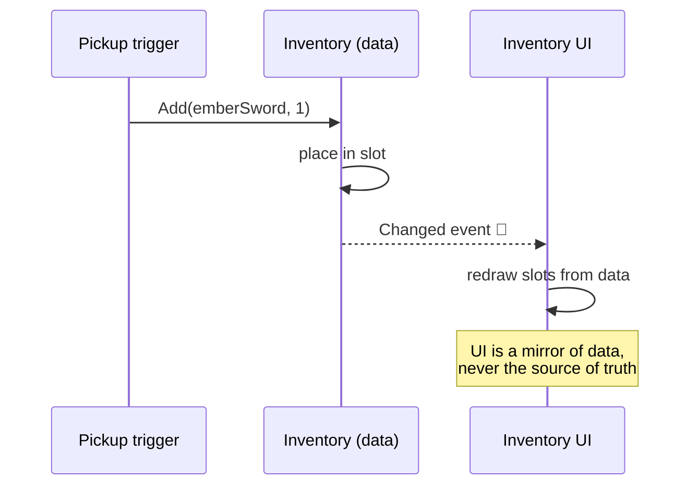

# Level 2 — Inventory & Equipment

| | |
|---|---|
| 🎚️ **Difficulty** | 🟡 Medium |
| ⏱️ **Estimated time** | 35 minutes |
| ⭐ **XP reward** | 100 (Quest) + 25 (Quiz) |

[← Prev](01-data-driven-design-with-scriptableobjects.md) · [↑ Phase Home](../README.md) · [→ Next](03-abilities-and-cooldowns.md)

---

## 📖 Story

> *"Great — items exist as data now. But a player can't *hold* anything. Maya's ticket: 'I want to pick up that Ember Sword, see it in a bag, equip it, and watch my damage go up.' That's three jobs in a trench coat: a **bag** (the inventory — slots and stacks), an **equip system** (slots that change your stats), and a **UI** that always shows the truth. The trap juniors fall into: they let the UI *be* the data — counts live in `Text` labels, and the moment something else touches the bag, the screen lies. We won't do that. The **data model is the single source of truth**; the UI just *listens* and redraws (remember the observer pattern from World 1?). And when you equip the sword, it must actually feed your `Stats`, and survive a restart through World 3's save system. Let's give the player a backpack. — Kenji"*

---

## 🎯 Goal

- Design an **inventory data model**: slots, stacks, and capacity — separate from any UI
- Implement **add / remove** with correct stacking and overflow rules
- Build **equipment slots** that apply an item's `StatModifier`s to the player's `Stats`
- Use **events** so the UI updates itself (data is the source of truth, UI just listens)
- Persist inventory + equipped items via World 3's save system

---

## 🧠 Concepts

### Inventory = data, not UI

An inventory is a **data structure**, full stop. It's a list of **slots**; each slot is either empty or holds an `ItemStack` — a *reference to an `ItemDefinition`* plus a **count**. (There's the definition/instance split from Lesson 1: the SO is shared and read-only; the *count* is per-player runtime state, so it lives here, not on the SO.)



### Stacking and overflow: the add/remove rules

**Stacking** = identical items share a slot up to `maxStack`. Add 30 potions to a slot of 80 (`maxStack 99`) → that slot becomes 99 and **11 overflow** into the next free slot. The rules:

1. **Add(def, n):** first top up existing stacks of `def` (up to `maxStack`), then fill empty slots, until `n` runs out. If you run out of room with items left over, the add **fails / partially fails** — return what couldn't fit so the caller can drop it on the ground.
2. **Remove(def, n):** subtract from stacks until `n` is satisfied; empty slots that hit 0.



### Equipment: slots that change your Stats

Equipment is a small set of named **slots** (Weapon, Armor, …), each holding one `ItemDefinition`. Equipping does two things: it places the item in the slot **and** re-applies stat modifiers to the player. The clean way to handle stats is **recompute from scratch**, never incrementally patch:

> `finalStats = baseStats + sum(modifiers of every equipped item)`

Why recompute instead of "on equip add, on unequip subtract"? Because incremental math drifts — a missed unequip, a double-apply, a reload — and you get permanent +50 armor ghosts. Recomputing from base every time an equip changes is **idempotent**: it's always correct regardless of history. (You used the same "rebuild, don't patch" instinct on the spatial grid in World 4.)

### Events: the UI must never own the truth

The inventory raises a `Changed` event whenever it mutates. The UI **subscribes** and redraws. Nothing else. This means *anything* — a pickup, a shop purchase (Lesson 5), a loot drop, a save-load — that changes the bag updates the screen for free, with zero UI-specific code in those systems. This is the **observer pattern** from World 1, applied to gameplay state.



### Why this exists

Every game with items hits the same fork: is the inventory a *data model* the UI reflects, or a pile of UI widgets pretending to be data? Pick the second and you get desync bugs forever — the classic "I have 3 potions on screen but the game thinks I have 0." Modeling inventory as pure data with an event-driven UI is how shipped games stay consistent across pickups, trades, saves, and networking later. The equipment-recompute pattern is the same discipline that keeps RPG stat math from drifting into nonsense.

This is **engine-agnostic**: the data model (slots + stacks + events) is plain C# that would be identical in Unreal, Godot, or a custom engine — only the UI binding layer differs. See **RESOURCES.md** for this world for inventory-system references.

---

## 🛠️ Hands-on Lab

> 💻 Builds on Lesson 1's `ItemDefinition` and `StatModifier`, plus World 3's save system and World 1's `Stats`.

### Step 1 — The runtime `ItemStack`

```csharp
[System.Serializable]
public class ItemStack
{
    public ItemDefinition Def;
    public int Count;
    public ItemStack(ItemDefinition def, int count) { Def = def; Count = count; }
    public bool IsFull => Count >= Def.maxStack;
    public int SpaceLeft => Def.maxStack - Count;
}
```

### Step 2 — The inventory data model (with stacking + events)

```csharp
using System;
using System.Collections.Generic;

public class Inventory
{
    public readonly ItemStack[] Slots;
    public event Action Changed;                  // UI subscribes to this

    public Inventory(int capacity) => Slots = new ItemStack[capacity];

    // Returns the amount that did NOT fit (0 = everything added).
    public int Add(ItemDefinition def, int amount)
    {
        // 1) Top up existing stacks of this item.
        for (int i = 0; i < Slots.Length && amount > 0; i++)
        {
            var s = Slots[i];
            if (s != null && s.Def == def && !s.IsFull)
            {
                int move = Math.Min(s.SpaceLeft, amount);
                s.Count += move; amount -= move;
            }
        }
        // 2) Fill empty slots with new stacks.
        for (int i = 0; i < Slots.Length && amount > 0; i++)
        {
            if (Slots[i] == null)
            {
                int move = Math.Min(def.maxStack, amount);
                Slots[i] = new ItemStack(def, move); amount -= move;
            }
        }
        Changed?.Invoke();                        // tell the UI to redraw
        return amount;                            // leftover → caller drops it
    }

    public bool Remove(ItemDefinition def, int amount)
    {
        if (Count(def) < amount) return false;    // don't partially remove
        for (int i = 0; i < Slots.Length && amount > 0; i++)
        {
            var s = Slots[i];
            if (s != null && s.Def == def)
            {
                int take = Math.Min(s.Count, amount);
                s.Count -= amount = amount - take >= 0 ? amount - take : 0;
                if (s.Count <= 0) Slots[i] = null;
            }
        }
        Changed?.Invoke();
        return true;
    }

    public int Count(ItemDefinition def)
    {
        int total = 0;
        foreach (var s in Slots) if (s != null && s.Def == def) total += s.Count;
        return total;
    }
}
```

> 💡 The `Remove` inner line is fiddly on purpose-spotting; the simplest correct form is: `int take = Math.Min(s.Count, amount); s.Count -= take; amount -= take;`. Use that.

### Step 3 — Equipment that recomputes Stats

```csharp
using System;
using System.Collections.Generic;

public enum EquipSlot { Weapon, Armor, Trinket }

public class Equipment
{
    private readonly Dictionary<EquipSlot, ItemDefinition> _slots = new();
    public event Action Changed;

    public void Equip(EquipSlot slot, ItemDefinition def)
    {
        _slots[slot] = def;
        Changed?.Invoke();          // triggers a stat recompute
    }

    public ItemDefinition Unequip(EquipSlot slot)
    {
        _slots.TryGetValue(slot, out var def);
        _slots.Remove(slot);
        Changed?.Invoke();
        return def;                 // hand it back so caller returns it to the bag
    }

    // Recompute from base every time — idempotent, never drifts.
    public Stats ApplyTo(Stats baseStats)
    {
        var result = baseStats;     // Stats is a struct from World 1 (value copy)
        foreach (var def in _slots.Values)
            foreach (var m in def.modifiers)
                result = result.With(m.Stat, m.Amount);   // helper that adds to a field
        return result;
    }
}
```

### Step 4 — Wire it to the player (recompute on change)

```csharp
using UnityEngine;

public class PlayerInventory : MonoBehaviour
{
    public Stats baseStats;                       // World 1 base stats
    public Stats CurrentStats { get; private set; }

    public Inventory Bag = new Inventory(20);
    public Equipment Gear = new Equipment();

    void Awake()
    {
        Gear.Changed += Recompute;                // any equip change → recompute
        Recompute();
    }

    void Recompute() => CurrentStats = Gear.ApplyTo(baseStats);

    // Move an item from the bag into a gear slot.
    public void EquipFromBag(ItemDefinition def, EquipSlot slot)
    {
        if (Bag.Remove(def, 1))
        {
            var old = Gear.Unequip(slot);         // swap out whatever was there
            if (old != null) Bag.Add(old, 1);
            Gear.Equip(slot, def);
        }
    }
}
```

### Step 5 — A UI that only listens

```csharp
using UnityEngine;

public class InventoryUI : MonoBehaviour
{
    public PlayerInventory player;

    void OnEnable()  => player.Bag.Changed += Redraw;
    void OnDisable() => player.Bag.Changed -= Redraw;   // ALWAYS unsubscribe

    void Redraw()
    {
        foreach (var s in player.Bag.Slots)
            // draw each slot's icon + count from the DATA (the source of truth)
            Debug.Log(s == null ? "[empty]" : $"{s.Def.displayName} x{s.Count}");
    }
}
```

### Step 6 — Save & load (World 3)

Save the **stable `id`s** and counts, not object references (assets can be renamed/moved). On load, look each `id` up in a registry of `ItemDefinition`s and rebuild the stacks.

```csharp
[System.Serializable]
public class InventorySaveData
{
    public string[] slotItemIds;   // null/"" for empty slots
    public int[] slotCounts;
    public string weaponId, armorId, trinketId;
}
```

---

## 🎮 Mini Challenge

A player has 95/99 potions in one slot and an empty bag otherwise. They pick up 30 potions. The on-screen label still says **95** even though the data is correct. Separately, QA finds the *stats* panel sometimes keeps an old weapon's +15 damage after unequipping. Diagnose both.

<details>
<summary>💡 Reveal answer</summary>

**Label stuck at 95:** the UI isn't subscribed to `Inventory.Changed` (or the add path didn't raise it). The data correctly became 99 + a new stack of 26 overflow, but the UI never got told to redraw. Fix: ensure `Add` calls `Changed?.Invoke()` and the UI subscribes in `OnEnable`/unsubscribes in `OnDisable`.

**Ghost +15 damage:** stats are being *incrementally patched* (add on equip, subtract on unequip) and an unequip path missed its subtraction. Fix: **recompute from base** every time gear changes (`Gear.ApplyTo(baseStats)`) — idempotent, so a missed step can't leave a ghost. Never patch stats incrementally.
</details>

---

## 📦 Project Mission

Give the Ashfall player a working bag and gear that changes their stats and survives a restart.

1. Create `Assets/Scripts/Items/ItemStack.cs`, `Inventory.cs`, and `Equipment.cs` (Steps 1–3). Use the corrected `Remove` from the Step 2 note.
2. Create `PlayerInventory` (Step 4) on the player; set `baseStats`, and confirm `CurrentStats` recomputes when gear changes.
3. Turn World 3's pickup trigger into a real pickup: on trigger, call `Bag.Add(def, n)`; if it returns leftover > 0, spawn the leftover back on the ground.
4. Build a minimal inventory UI (Step 5) that redraws **only** from `Changed`. Verify stacking: drop 30 potions onto a 95-stack and watch it become 99 + 26.
5. Equip the Ember Sword from the bag and confirm `CurrentStats.Damage` rises by 15; unequip and confirm it returns **exactly** to base (no ghost).
6. Persist bag + gear via World 3's save (Step 6) using stable `id`s; restart and confirm everything (and the recomputed stats) comes back.
7. Commit:
   ```bash
   cd ~/projects/ashfall
   git switch -c feature/inventory-equipment
   git add Assets/Scripts/Items
   git commit -m "feat: data-model inventory (stacking) + equipment that recomputes stats, event-driven UI, saved"
   git switch main && git merge feature/inventory-equipment && git push
   ```

🎯 **Mission complete when:** the player can pick up items into a stacking inventory, equip an item that **changes their stats** (and unequipping returns to base exactly), the UI updates purely by listening to `Changed`, and the whole inventory + equipment **survives a save/load**.

---

## ⚠️ Common Mistakes

| Mistake | What happens | Fix |
|--------|--------------|-----|
| Storing counts in UI labels | UI and data desync ("3 on screen, 0 in game") | Data model is the source of truth; UI listens to `Changed` |
| Patching stats incrementally on equip/unequip | Ghost/leftover modifiers drift over time | Recompute `final = base + Σ modifiers` every change |
| Ignoring `Add`'s leftover return | Picked-up items silently vanish when bag is full | Use the return value; drop overflow on the ground |
| Saving object references instead of `id`s | Saves break when an asset is renamed/moved | Serialize stable string `id`s; resolve via a registry |
| Forgetting to unsubscribe UI events | Null refs / leaks when UI is destroyed | Subscribe in `OnEnable`, unsubscribe in `OnDisable` |
| Not enforcing `maxStack` on add | One slot holds 9999 potions | Cap each stack at `def.maxStack`, overflow to new slots |

---

## 🤔 Reflection Questions

1. Why is "the data model is the single source of truth, the UI just listens" more robust than letting the UI hold the counts? Name two systems that get correct UI updates for *free* under this rule.
2. Equipment recomputes `final = base + Σ modifiers` instead of adding on equip and subtracting on unequip. What class of bug does recomputing eliminate, and why is "idempotent" the key word?
3. The save stores item `id`s, not references to the assets. What real-world project event would silently corrupt saves if you stored references instead?

---

## 📝 Quiz

1. **In a well-designed inventory, the on-screen count comes from…**
   - a) a `Text` label that other systems write into directly
   - b) the data model, with the UI redrawing on a `Changed` event
   - c) recounting the scene's pickup GameObjects each frame
2. **Equipping/unequipping should update player stats by…**
   - a) adding modifiers on equip and subtracting them on unequip
   - b) recomputing `final = base + Σ(equipped modifiers)` every change
   - c) editing the base Stats struct in place
3. **When `Add` can't fit everything, the right behavior is to…**
   - a) silently discard the extra items
   - b) overfill one slot past `maxStack`
   - c) return the leftover so the caller can drop it

<details>
<summary>✅ Answers</summary>

1: **b** · 2: **b** · 3: **c**
</details>

---

## ✅ Completion Checklist

- [ ] I modeled the inventory as data (slots + stacks), separate from UI
- [ ] Add/Remove respect `maxStack`, overflow correctly, and return leftovers
- [ ] Equipping changes stats via recompute-from-base (no drift on unequip)
- [ ] The UI updates only by subscribing to a `Changed` event
- [ ] Inventory + equipment persist via World 3's save (stable `id`s)
- [ ] I passed the quiz
- [ ] Added **+125 XP** to [PROGRESS.md](../../../PROGRESS.md)

---

[← Prev](01-data-driven-design-with-scriptableobjects.md) · [↑ Phase Home](../README.md) · [→ Next](03-abilities-and-cooldowns.md)
