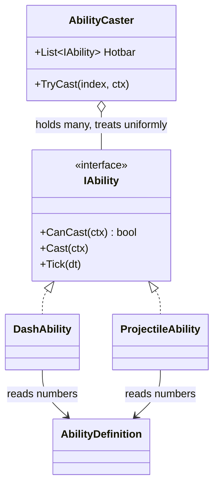
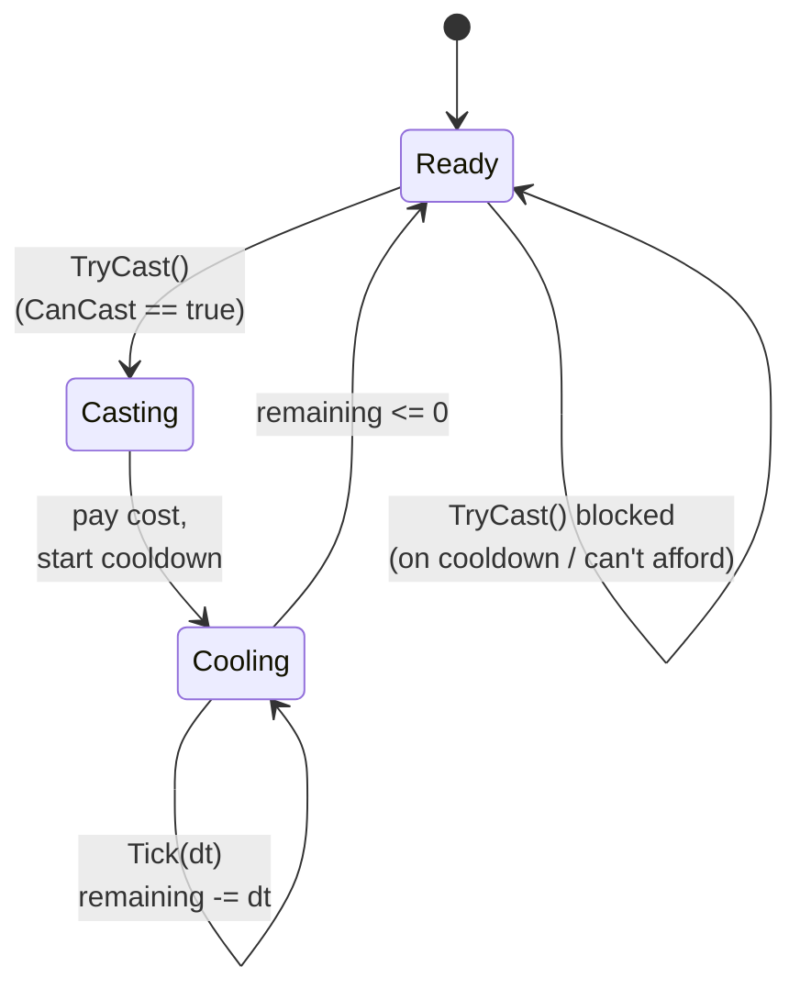

# Level 3 — Abilities & Cooldowns

| | |
|---|---|
| 🎚️ **Difficulty** | 🟡 Medium |
| ⏱️ **Estimated time** | 35 minutes |
| ⭐ **XP reward** | 100 (Quest) + 25 (Quiz) |

[← Prev](02-inventory-and-equipment.md) · [↑ Phase Home](../README.md) · [→ Next](04-combat-and-damage.md)

---

## 📖 Story

> *"The player can hold a sword now — let's make them *do* something. Maya wants a **dash** (tap to blink forward) and a **projectile** (fire an ember bolt), both on **cooldowns** with little UI dials that sweep as they recharge. Easy to hack in: `if (Input.dash && Time.time > nextDash) Dash();` copy-pasted per ability. Don't. Three abilities later that's a swamp of timers and special cases, and Maya still can't add a fourth without you. We'll build an **ability system**: each ability is a **data-driven object** (its numbers come from the `AbilityDefinition` you made in Lesson 1) wrapped in a small **command** with a uniform `CanCast / Cast` interface. The caster doesn't know or care what the ability *does* — it just checks cost and cooldown and fires. That's the **command pattern**, and it's how every action game keeps a hotbar sane. — Kenji"*

---

## 🎯 Goal

- Understand an **ability** as a self-contained action: cost + cooldown + an effect
- Model abilities with the **command pattern** (uniform `CanCast`/`Cast`) so the caster is generic
- Drive ability numbers from `AbilityDefinition` SOs (data-driven, designer-tunable)
- Implement **cooldown timers** correctly (framerate-independent) and **resource cost**
- Build Ashfall's **dash** + a **projectile** ability with a cooldown UI

---

## 🧠 Concepts

### An ability is a command, not an `if`

The naive approach scatters per-ability state and `if`-chains across the player controller. The clean approach makes each ability an **object** with a tiny, uniform contract — the **command pattern**:

```csharp
public interface IAbility
{
    AbilityDefinition Def { get; }
    bool CanCast(AbilityContext ctx);   // off cooldown AND can afford?
    void Cast(AbilityContext ctx);      // do the thing, start cooldown, pay cost
    void Tick(float dt);                // advance the cooldown timer
}
```

Now a single **caster** can hold *any* abilities in a list/hotbar and treat them identically — it never branches on "is this dash or fireball?" Adding a new ability is writing one new class + one new SO asset, with zero changes to the caster. That's the payoff of the command pattern: **decouple the invoker from the action.**



### Cooldowns: a timer, done framerate-independently

A cooldown is just "you can't cast again until N seconds pass." Two ways to track it, one right:

- **Count down a remaining timer** each frame: `remaining -= dt`. Castable when `remaining <= 0`.
- **Store the timestamp** it'll be ready: `readyAt = Time.time + cooldown`. Castable when `Time.time >= readyAt`.

Both work; the remaining-timer version makes the **UI fill** trivial (`fill = remaining / cooldown`). The non-negotiable rule from World 2: **multiply by `deltaTime`**, never assume a fixed framerate. A cooldown counted in *frames* runs twice as fast at 120fps as at 60fps.



### Cost: spend a resource, gate the cast

Many abilities cost a resource (mana/energy — `resourceCost` on the SO). `CanCast` must check **both** gates: off cooldown **and** affordable. `Cast` pays the cost and starts the cooldown. Keep these in one place so you never get the "fired but didn't pay" or "paid but on cooldown" half-states.

### Data-driven, again

Every number — cooldown, cost, range, power — lives on the `AbilityDefinition` asset (Lesson 1), not in the class. The `DashAbility` class encodes *how a dash behaves*; the `Dash` asset encodes *this dash's numbers*. Maya retunes the dash cooldown from 2s to 1.5s in the Inspector, no recompile. Same class could even back multiple assets (a short dash and a long dash) — behavior is code, magnitude is data.

### Why this exists

Action games live or die on their ability layer, and it's where junior code rots fastest: each new spell adds another timer field and another `if` until the controller is unmaintainable and only one programmer dares touch it. The command pattern turns abilities into interchangeable, data-driven units — a designer composes hotbars from assets, and the engine fires them through one code path. This is exactly how Unreal's Gameplay Ability System and most commercial action frameworks are structured.

It's **engine-agnostic**: the `IAbility` contract, the cooldown timer, and the cost gate are plain logic identical in any engine; only spawning the projectile or moving the body uses Unity calls. The command pattern itself is a classic from outside games entirely (undo systems, job queues). See **RESOURCES.md** for this world (Game Programming Patterns — Command).

---

## 🛠️ Hands-on Lab

> 💻 Builds on Lesson 1's `AbilityDefinition` and World 2's delta-time discipline.

### Step 1 — The context passed to every ability

Abilities need to know *who* is casting and *where/which way*. Bundle that into a context so the `Cast` signature stays uniform.

```csharp
using UnityEngine;

public struct AbilityContext
{
    public Transform Caster;     // the player transform
    public Vector2 AimDir;       // normalized aim direction (World 2)
    public IResourcePool Mana;   // something we can Spend/CanAfford against
}

public interface IResourcePool
{
    bool CanAfford(int cost);
    void Spend(int cost);
}
```

### Step 2 — A base ability that handles cost + cooldown

Put the shared timer/cost logic in one place; concrete abilities only implement `Execute`.

```csharp
public abstract class AbilityBase : IAbility
{
    public AbilityDefinition Def { get; }
    private float _remaining;                       // seconds left on cooldown

    protected AbilityBase(AbilityDefinition def) => Def = def;

    public bool IsReady => _remaining <= 0f;
    public float CooldownFraction =>               // 1 = just cast, 0 = ready (for UI)
        Def.cooldown <= 0 ? 0 : Mathf.Clamp01(_remaining / Def.cooldown);

    public bool CanCast(AbilityContext ctx)
        => IsReady && ctx.Mana.CanAfford(Def.resourceCost);

    public void Cast(AbilityContext ctx)
    {
        if (!CanCast(ctx)) return;                 // guard: both gates
        ctx.Mana.Spend(Def.resourceCost);          // pay
        _remaining = Def.cooldown;                  // start cooldown
        Execute(ctx);                               // do the actual effect
    }

    public void Tick(float dt)                      // call every frame
    {
        if (_remaining > 0f) _remaining -= dt;      // framerate-independent
    }

    protected abstract void Execute(AbilityContext ctx);   // subclass effect
}
```

### Step 3 — Concrete abilities (behavior in code, numbers in data)

```csharp
using UnityEngine;

// Blink the caster forward by Def.power units.
public class DashAbility : AbilityBase
{
    public DashAbility(AbilityDefinition def) : base(def) { }

    protected override void Execute(AbilityContext ctx)
    {
        Vector2 from = ctx.Caster.position;
        Vector2 to = from + ctx.AimDir * Def.power;     // power = dash distance
        ctx.Caster.position = to;                        // (raycast first in real combat)
    }
}

// Spawn an ember bolt flying in the aim direction.
public class ProjectileAbility : AbilityBase
{
    private readonly GameObject _projectilePrefab;

    public ProjectileAbility(AbilityDefinition def, GameObject prefab) : base(def)
        => _projectilePrefab = prefab;

    protected override void Execute(AbilityContext ctx)
    {
        var go = Object.Instantiate(_projectilePrefab,
                                    ctx.Caster.position, Quaternion.identity);
        var rb = go.GetComponent<Rigidbody2D>();
        rb.linearVelocity = ctx.AimDir * Def.power;      // power = projectile speed
        // (Lesson 4 will make this projectile actually deal damage on hit.)
    }
}
```

### Step 4 — The caster: one generic invoker

```csharp
using System.Collections.Generic;
using UnityEngine;

public class AbilityCaster : MonoBehaviour
{
    public List<IAbility> Hotbar = new();           // filled at setup (see Step 5)
    public IResourcePool mana;

    void Update()
    {
        float dt = Time.deltaTime;
        foreach (var a in Hotbar) a.Tick(dt);        // every ability cools down
    }

    // Called by the input layer (World 3) with a hotbar index.
    public bool TryCast(int index, Vector2 aimDir)
    {
        if (index < 0 || index >= Hotbar.Count) return false;
        var ctx = new AbilityContext { Caster = transform, AimDir = aimDir, Mana = mana };
        var a = Hotbar[index];
        if (!a.CanCast(ctx)) return false;           // on cooldown or can't afford
        a.Cast(ctx);
        return true;
    }
}
```

### Step 5 — Build the hotbar from data + a cooldown UI

```csharp
using UnityEngine;
using UnityEngine.UI;

public class AbilitySetup : MonoBehaviour
{
    public AbilityCaster caster;
    public AbilityDefinition dashDef, fireballDef;
    public GameObject emberBoltPrefab;

    void Start()
    {
        caster.Hotbar.Add(new DashAbility(dashDef));
        caster.Hotbar.Add(new ProjectileAbility(fireballDef, emberBoltPrefab));
    }
}

// Sweep a radial fill image as the ability recharges.
public class CooldownDial : MonoBehaviour
{
    public AbilityCaster caster;
    public int hotbarIndex;
    public Image fillImage;        // Image type = Filled, Radial

    void Update()
    {
        if (hotbarIndex < caster.Hotbar.Count
            && caster.Hotbar[hotbarIndex] is AbilityBase a)
            fillImage.fillAmount = a.CooldownFraction;   // 1 → sweeps to 0
    }
}
```

---

## 🎮 Mini Challenge

A teammate ships abilities that work great on their 60fps machine, but testers on a 144Hz monitor report the dash "recharges way too fast." The cooldown code reads: `_remaining -= 1;` once per `Update`. What's wrong, and what's the one-character-class fix?

<details>
<summary>💡 Reveal answer</summary>

`_remaining -= 1;` subtracts **one per frame**, so the cooldown is measured in *frames*, not seconds — at 144fps it drains 2.4× faster than at 60fps. The fix is the World 2 rule: subtract **elapsed time**, not a constant: `_remaining -= Time.deltaTime;` (i.e. `Tick(dt)` with `dt = Time.deltaTime`). Now a 2-second cooldown is 2 seconds on any framerate. Any timer in a game loop must be deltaTime-scaled.
</details>

---

## 📦 Project Mission

Give the Ashfall player a real, data-driven ability layer with cooldown dials.

1. Create `Assets/Scripts/Abilities/IAbility.cs`, `AbilityContext.cs`, and `AbilityBase.cs` (Steps 1–2).
2. Implement `DashAbility` and `ProjectileAbility` (Step 3). Make an `EmberBolt` prefab (a sprite + `Rigidbody2D`, gravity 0, + a `Collider2D` set as trigger for Lesson 4).
3. Add a simple `ManaPool : IResourcePool` (current/max, `CanAfford`, `Spend`, plus a slow regen in `Update` using `deltaTime`).
4. Add `AbilityCaster` + `AbilitySetup` to the player; wire your `Dash` and `Fireball` SO assets (from Lesson 1) and the prefab.
5. Bind World 3's input: a key/button → `caster.TryCast(0, aimDir)` (dash) and another → `TryCast(1, aimDir)` (fireball), using the aim direction from World 2.
6. Add two `CooldownDial`s (radial fill Images) and confirm each sweeps from full to empty exactly over the SO's cooldown — and that fireball won't fire when mana is insufficient.
7. Retune in the Inspector: change Dash's cooldown to 1.5s and Fireball's cost to 30 — confirm the change takes effect with **no recompile**.
8. Commit:
   ```bash
   cd ~/projects/ashfall
   git switch -c feature/abilities-cooldowns
   git add Assets/Scripts/Abilities Assets/Prefabs/EmberBolt.prefab
   git commit -m "feat: command-pattern ability system (data-driven) with dash, projectile, cooldown UI"
   git switch main && git merge feature/abilities-cooldowns && git push
   ```

🎯 **Mission complete when:** the player can **dash** and **fire an ember bolt**, both gated by **framerate-independent cooldowns** and **mana cost**, driven entirely by `AbilityDefinition` assets, with on-screen **cooldown dials** that sweep correctly — and you can retune the numbers in the Inspector without recompiling.

---

## ⚠️ Common Mistakes

| Mistake | What happens | Fix |
|--------|--------------|-----|
| `if`-chain per ability in the controller | Unmaintainable swamp of timers/special cases | Command pattern: uniform `IAbility`, one generic caster |
| Counting cooldowns in frames (`-= 1`) | Recharges faster on high-refresh displays | Subtract `Time.deltaTime` every frame |
| Checking only cooldown, not cost (or vice versa) | "Fired but didn't pay" / "paid but blocked" half-states | `CanCast` checks **both**; `Cast` pays **and** starts cooldown |
| Hard-coding cooldown/cost/range in the class | Designers can't tune; recompile per tweak | Read all numbers from the `AbilityDefinition` SO |
| Not ticking abilities every frame | Cooldowns never recover | `Tick(dt)` all hotbar abilities in `Update` |
| Casting without a guard in `Cast` | Bypasses cooldown/cost if called directly | `Cast` re-checks `CanCast` before acting |

---

## 🤔 Reflection Questions

1. The command pattern lets the caster hold many abilities and "treat them identically." What concrete change does that make trivial that an `if`-chain controller makes painful?
2. `CooldownFraction = remaining / cooldown` makes the UI dial free. Why is the *remaining-timer* representation more convenient for UI than storing a "ready-at timestamp"? When might you still prefer the timestamp?
3. Behavior lives in the `DashAbility` class; numbers live in the `Dash` asset. Why could a single `ProjectileAbility` class back five different spell assets — and what does that tell you about where the "fun tuning" actually happens?

---

## 📝 Quiz

1. **The command pattern helps the ability system by…**
   - a) making abilities run faster on the GPU
   - b) giving every ability a uniform interface so one generic caster fires them all
   - c) removing the need for cooldowns
2. **A cooldown timer must use `Time.deltaTime` because…**
   - a) it looks cleaner
   - b) otherwise the cooldown speed depends on the framerate
   - c) Unity requires it for all timers
3. **`CanCast` should return true only when…**
   - a) the ability is off cooldown
   - b) the player can afford the cost
   - c) the ability is off cooldown AND the cost is affordable

<details>
<summary>✅ Answers</summary>

1: **b** · 2: **b** · 3: **c**
</details>

---

## ✅ Completion Checklist

- [ ] I model abilities as command objects behind a uniform `IAbility` interface
- [ ] One generic caster fires any ability without branching on its type
- [ ] Cooldowns are framerate-independent (`-= deltaTime`) and drive the UI dial
- [ ] `CanCast` gates on both cooldown and resource cost; `Cast` pays and starts cooldown
- [ ] All ability numbers come from `AbilityDefinition` assets (retunable, no recompile)
- [ ] I passed the quiz
- [ ] Added **+125 XP** to [PROGRESS.md](../../../PROGRESS.md)

---

[← Prev](02-inventory-and-equipment.md) · [↑ Phase Home](../README.md) · [→ Next](04-combat-and-damage.md)
