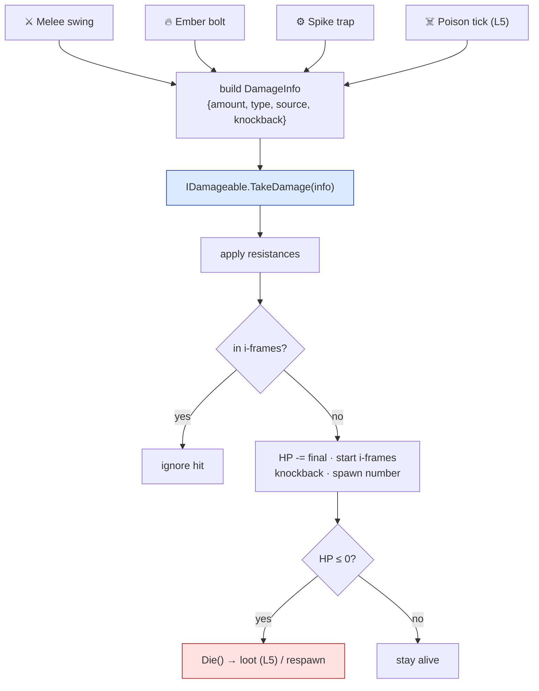

# Level 4 — Combat & Damage

| | |
|---|---|
| 🎚️ **Difficulty** | 🔴 Hard |
| ⏱️ **Estimated time** | 35 minutes |
| ⭐ **XP reward** | 100 (Quest) + 25 (Quiz) |

[← Prev](03-abilities-and-cooldowns.md) · [↑ Phase Home](../README.md) · [→ Next](05-status-effects-loot-and-economy.md)

---

## 📖 Story

> *"Abilities fire, but nothing *bleeds*. Time for the heart of an action game: **combat**. Maya wants the ember bolt and a melee swing to actually hurt enemies, enemies to hurt the player, hits to feel chunky (numbers popping off heads), and death to mean something (enemies die, player respawns). Here's the discipline that separates shippable combat from a buggy mess: **everything that can be hurt goes through ONE pipeline.** Remember `IDamageable` from World 1? That interface is about to earn its keep. A sword, a fireball, a spike trap, lava — they all build a `DamageInfo` packet and call `TakeDamage` on whatever they hit. One path means resistances, i-frames, death, and damage numbers are handled in exactly one place — not re-implemented (wrong) by every attack. Build the pipeline; everything else plugs in. — Kenji"*

---

## 🎯 Goal

- Build a **damage pipeline**: every attack → a `DamageInfo` packet → `IDamageable.TakeDamage` (World 1)
- Support **damage types** and **resistances** (fire/physical/etc.)
- Do **hit detection** for melee (overlap) and ranged (projectile trigger)
- Add **i-frames** (invulnerability after a hit) and **knockback** so combat reads well
- Handle **death & respawn**, and spawn floating **damage numbers**
- Wire Ashfall's melee + ranged combat against enemies (and enemies vs the player)

---

## 🧠 Concepts

### One pipeline, many sources

The cardinal rule of combat code: **there is exactly one function that reduces health.** Every source of harm — melee, projectile, trap, DoT (next lesson) — does the same thing: package the hit into a `DamageInfo` and call `TakeDamage` on the target's `IDamageable`. The target decides what the hit *means* (resistances, i-frames, death). Sources never touch health directly.



### `DamageInfo`: a hit as data

Don't pass a bare `int`. Pass a **packet** describing the hit, so the pipeline can reason about type, source (who gets the kill / loot credit), and feel (knockback). It's the same "model the thing as data" instinct from the whole world.

### Damage types & resistances

A hit has a **type** (Physical, Fire, …). A target has **resistances** — a multiplier per type. `final = amount × (1 − resistance[type])`. An ice golem with `Fire resistance 0.75` takes 25% of fire damage; a `−0.5` resistance is a **weakness** (takes 150%). This single multiply, in one place, gives designers a whole rock-paper-scissors layer to tune from data — no special-case code per matchup.

### Hit detection: melee vs ranged

- **Melee** = an instantaneous **overlap** query: when you swing, ask "what `IDamageable`s are inside this arc/box in front of me right now?" (`Physics2D.OverlapBox/Circle`), and damage each. No projectile exists.
- **Ranged** = a **projectile** that travels (Lesson 3's bolt) and damages whatever its trigger collider hits (`OnTriggerEnter2D`), then destroys itself.

Both end at the *same* `TakeDamage` call — only the "who did I hit?" step differs.

### I-frames: stop multi-hit spam

Without protection, a target sitting in a melee arc or a fast projectile stream takes damage **every frame** — instant death. **Invulnerability frames (i-frames)** are a short window after a hit during which further damage is ignored. It's a tiny timer on the target (deltaTime-counted, of course). It also gives the player a fair "I got hit, I have a beat to react" feel and enables dodge-through-attack design.

### Death, respawn, and damage numbers

When HP hits 0, the target **dies** — fire an event (so loot in Lesson 5, score, and VFX can react), then despawn the enemy or respawn the player at a checkpoint. **Floating damage numbers** are pure *juice*: spawn a small world-space text at the hit point showing the final amount (crit/weakness in a different color), drifting up and fading. Cheap to add, huge for readability — players *feel* their damage.

### Why this exists

Combat is where bugs are most visible and most punishing: a second health-reduction path that forgets resistances, or i-frames implemented per-attack instead of per-target, produces "why did that hit twice?" and "why is the ice golem dying to fire?" bugs that are miserable to chase. Funneling **every** hit through one `IDamageable.TakeDamage` makes combat *auditable* — one place to read, one place to fix, one place that's correct. The `DamageInfo` packet is how shipped engines decouple "I hit you" from "here's what that means to me."

This is **engine-agnostic**: `IDamageable`, `DamageInfo`, resistance math, i-frame timers, and death events are plain logic that ports directly to Unreal/Godot/custom; only overlap queries and triggers use Unity's physics API. See **RESOURCES.md** for this world for combat/game-feel references.

---

## 🛠️ Hands-on Lab

> 💻 Builds on World 1's `IDamageable`, Lesson 3's projectile, and World 2's vectors.

### Step 1 — The damage packet and types

```csharp
using UnityEngine;

public enum DamageType { Physical, Fire, Ice, Poison }

public struct DamageInfo
{
    public float Amount;
    public DamageType Type;
    public GameObject Source;     // who dealt it (kill credit / loot ownership)
    public Vector2 HitPoint;      // where to pop the number
    public Vector2 Knockback;     // impulse direction × force
}
```

### Step 2 — `IDamageable` (World 1) and the one-and-only pipeline

```csharp
using UnityEngine;

public interface IDamageable
{
    void TakeDamage(DamageInfo info);     // the SINGLE entry point for harm
    bool IsAlive { get; }
}

[RequireComponent(typeof(Rigidbody2D))]
public class Health : MonoBehaviour, IDamageable
{
    public float maxHealth = 30f;
    public float current;
    public float iFrameDuration = 0.4f;

    [Header("Resistances 0..1 (negative = weakness)")]
    public float fireResist, iceResist, physicalResist, poisonResist;

    private float _iFrameTimer;
    private Rigidbody2D _rb;

    public bool IsAlive => current > 0f;

    public System.Action<DamageInfo> Died;   // fired once on death (loot/score/VFX)

    void Awake() { current = maxHealth; _rb = GetComponent<Rigidbody2D>(); }
    void Update() { if (_iFrameTimer > 0f) _iFrameTimer -= Time.deltaTime; }

    public void TakeDamage(DamageInfo info)
    {
        if (!IsAlive || _iFrameTimer > 0f) return;        // dead or invulnerable → ignore

        float final = info.Amount * (1f - ResistFor(info.Type));   // resistances
        final = Mathf.Max(0f, final);
        current -= final;
        _iFrameTimer = iFrameDuration;                     // start i-frames

        _rb.AddForce(info.Knockback, ForceMode2D.Impulse); // feel
        DamageNumbers.Spawn(info.HitPoint, final, info.Type);

        if (current <= 0f) Die(info);
    }

    private float ResistFor(DamageType t) => t switch
    {
        DamageType.Fire     => fireResist,
        DamageType.Ice      => iceResist,
        DamageType.Poison   => poisonResist,
        _                   => physicalResist,
    };

    private void Die(DamageInfo killingBlow)
    {
        Died?.Invoke(killingBlow);          // Lesson 5 listens here to drop loot
        Destroy(gameObject);                // enemies despawn; player overrides to respawn
    }
}
```

### Step 3 — Melee: an overlap query

```csharp
using UnityEngine;

public class MeleeAttack : MonoBehaviour
{
    public float damage = 12f;
    public float range = 1.2f;
    public float knockback = 6f;
    public LayerMask hittable;          // set to the Enemy layer (or Player for enemies)

    // Call this when the swing input fires.
    public void Swing(Vector2 aimDir)
    {
        Vector2 center = (Vector2)transform.position + aimDir * (range * 0.5f);
        var hits = Physics2D.OverlapCircleAll(center, range * 0.5f, hittable);
        foreach (var col in hits)
        {
            if (col.TryGetComponent<IDamageable>(out var target))
                target.TakeDamage(new DamageInfo {
                    Amount = damage, Type = DamageType.Physical, Source = gameObject,
                    HitPoint = col.transform.position,
                    Knockback = aimDir * knockback
                });
        }
    }
}
```

### Step 4 — Ranged: the projectile deals damage on trigger

```csharp
using UnityEngine;

[RequireComponent(typeof(Rigidbody2D), typeof(Collider2D))]
public class Projectile : MonoBehaviour
{
    public float damage = 10f;
    public DamageType type = DamageType.Fire;
    public float knockback = 4f;
    public GameObject owner;            // set on spawn so we don't hit ourselves
    public float lifetime = 3f;

    void Start() => Destroy(gameObject, lifetime);   // never live forever

    void OnTriggerEnter2D(Collider2D other)
    {
        if (other.gameObject == owner) return;                  // ignore the caster
        if (other.TryGetComponent<IDamageable>(out var target))
        {
            Vector2 dir = GetComponent<Rigidbody2D>().linearVelocity.normalized;
            target.TakeDamage(new DamageInfo {
                Amount = damage, Type = type, Source = owner,
                HitPoint = transform.position, Knockback = dir * knockback
            });
        }
        Destroy(gameObject);            // bolt is consumed on any solid hit
    }
}
```

> 💻 In Lesson 3's `ProjectileAbility`, set `proj.owner = ctx.Caster.gameObject` and `proj.damage = Def.power`-derived value so the ember bolt now actually hurts.

### Step 5 — Floating damage numbers (juice)

```csharp
using UnityEngine;

public static class DamageNumbers
{
    public static GameObject Prefab;    // a world-space TMP text, assigned at boot

    public static void Spawn(Vector2 at, float amount, DamageType type)
    {
        if (Prefab == null) return;
        var go = Object.Instantiate(Prefab, at, Quaternion.identity);
        var txt = go.GetComponentInChildren<TMPro.TextMeshPro>();
        txt.text = Mathf.RoundToInt(amount).ToString();
        txt.color = type == DamageType.Fire ? Color.red : Color.white;
        // a small script on the prefab drifts it up and fades, then self-destructs
    }
}
```

### Step 6 — Player death = respawn (override the despawn)

```csharp
using UnityEngine;

public class PlayerHealth : MonoBehaviour, IDamageable
{
    public Health health;               // reuse the same pipeline
    public Vector2 checkpoint;

    void Awake() => health.Died += _ => Respawn();

    public void TakeDamage(DamageInfo info) => health.TakeDamage(info);  // same path
    public bool IsAlive => health.IsAlive;

    void Respawn()
    {
        transform.position = checkpoint;
        health.current = health.maxHealth;     // reset; don't Destroy the player
    }
}
```

> 💡 For the player, make `Health.Die` *not* `Destroy` (e.g. a `destroyOnDeath` flag) so the respawn logic runs. Same pipeline, different death policy.

---

## 🎮 Mini Challenge

Two bugs from QA: (1) Standing in a melee arc, the boss "dies instantly" — it's taking the swing's damage many times. (2) The ice golem (`fireResist = 0.75`) takes **full** fire damage from the ember bolt. Diagnose both, given everything routes through `TakeDamage`.

<details>
<summary>💡 Reveal answer</summary>

**(1) Instant death:** no **i-frames** are taking effect — either `iFrameDuration` is 0, or the swing is applying damage every frame it overlaps. The pipeline already guards with `_iFrameTimer > 0f`; ensure a non-zero duration and that the timer is set on every successful hit. I-frames are what stop continuous-overlap multi-hits.

**(2) Golem ignores resistance:** the bolt's `DamageInfo.Type` is wrong (e.g. left as `Physical`), so `ResistFor(Type)` returns the *physical* resist, not fire. The resistance code is correct and central — the bug is the **packet**. Set the projectile's `type = DamageType.Fire`. One pipeline means the fix is one field, not a hunt across attacks.
</details>

---

## 📦 Project Mission

Make Ashfall's combat real: hits hurt, types matter, death happens, numbers pop.

1. Create `Assets/Scripts/Combat/DamageInfo.cs`, `IDamageable.cs` (or reuse World 1's), and `Health.cs` (Steps 1–2).
2. Put `Health` on the enemy prefab with `maxHealth`, `iFrameDuration`, and a `fireResist` (make one enemy fire-resistant, one fire-weak).
3. Add `MeleeAttack` to the player; bind a swing input that calls `Swing(aimDir)` and damages enemies in front (overlap on the Enemy layer).
4. Upgrade Lesson 3's ember bolt with `Projectile` (Step 4): set `owner`, `damage`, `type = Fire`; confirm it hurts enemies, ignores the caster, and self-destructs.
5. Add i-frames: verify an enemy parked in your arc takes one hit per `iFrameDuration`, not per frame. Add knockback and confirm it reads well.
6. Add `DamageNumbers` (Step 5): floating numbers pop at hit points, fire in red. Confirm the fire-resistant enemy shows a **smaller** number than the fire-weak one for the same bolt.
7. Give the enemy a `MeleeAttack`/contact damage vs the player; implement `PlayerHealth` death = **respawn** at a checkpoint (Step 6), not destroy.
8. Commit:
   ```bash
   cd ~/projects/ashfall
   git switch -c feature/combat-damage
   git add Assets/Scripts/Combat
   git commit -m "feat: single-pipeline damage (IDamageable) with types/resistances, i-frames, knockback, death/respawn, damage numbers"
   git switch main && git merge feature/combat-damage && git push
   ```

🎯 **Mission complete when:** melee and the ember bolt both route through **one** `IDamageable.TakeDamage`; **resistances** make a fire-resistant enemy take less and a fire-weak enemy take more from the same hit; **i-frames** prevent multi-hit spam; enemies **die** (firing a death event) and the player **respawns**; and **damage numbers** pop on every hit.

---

## ⚠️ Common Mistakes

| Mistake | What happens | Fix |
|--------|--------------|-----|
| Multiple code paths that reduce HP | Resistances/i-frames forgotten in some; "double hit" bugs | One pipeline: every hit → `TakeDamage(DamageInfo)` |
| No i-frames | Overlap/fast projectiles deal damage every frame → instant death | Short invuln timer on the target, set on each hit |
| Wrong `DamageType` on the packet | Resistances apply to the wrong type (golem eats fire) | Set the correct `Type` on `DamageInfo` |
| Projectile hits its own caster | Self-damage on spawn | Store `owner`; ignore it in `OnTriggerEnter2D` |
| Projectiles with no lifetime | Bolts fly forever, leak, hit stuff offscreen | `Destroy(go, lifetime)` and destroy on hit |
| `Destroy`-ing the player on death | Player vanishes, no respawn, refs break | Player death policy = respawn/reset, not destroy |

---

## 🤔 Reflection Questions

1. Why does routing *every* harm source through a single `TakeDamage` make combat bugs easier to find than letting each attack subtract HP itself? Give a concrete bug that disappears.
2. I-frames are a timer on the *target*, not on the attack. Why is target-side the right place — what breaks if each attack tries to enforce its own "don't hit twice" rule?
3. `DamageInfo` carries a `Source`. Name two systems (this world and next) that need to know *who* dealt the killing blow, and why a bare `int amount` couldn't support them.

---

## 📝 Quiz

1. **The most important property of a combat damage pipeline is that…**
   - a) it uses the fastest math
   - b) every harm source goes through one `TakeDamage` entry point
   - c) it spawns the prettiest damage numbers
2. **I-frames (invulnerability frames) exist to…**
   - a) make the player faster
   - b) prevent a single overlap/projectile from dealing damage every frame
   - c) increase damage on consecutive hits
3. **An ice golem takes 25% fire damage because…**
   - a) fire is weak in general
   - b) `final = amount × (1 − fireResist)` with `fireResist = 0.75`
   - c) the projectile missed three out of four times

<details>
<summary>✅ Answers</summary>

1: **b** · 2: **b** · 3: **b**
</details>

---

## ✅ Completion Checklist

- [ ] All damage routes through one `IDamageable.TakeDamage(DamageInfo)`
- [ ] Damage types + resistances change final damage (resist and weakness both work)
- [ ] Melee uses overlap; ranged uses a projectile trigger; both end at the same call
- [ ] I-frames stop multi-hit spam; knockback adds feel
- [ ] Enemies die (fire a death event); the player respawns instead of being destroyed
- [ ] Floating damage numbers pop on hits
- [ ] I passed the quiz
- [ ] Added **+125 XP** to [PROGRESS.md](../../../PROGRESS.md)

---

[← Prev](03-abilities-and-cooldowns.md) · [↑ Phase Home](../README.md) · [→ Next](05-status-effects-loot-and-economy.md)
