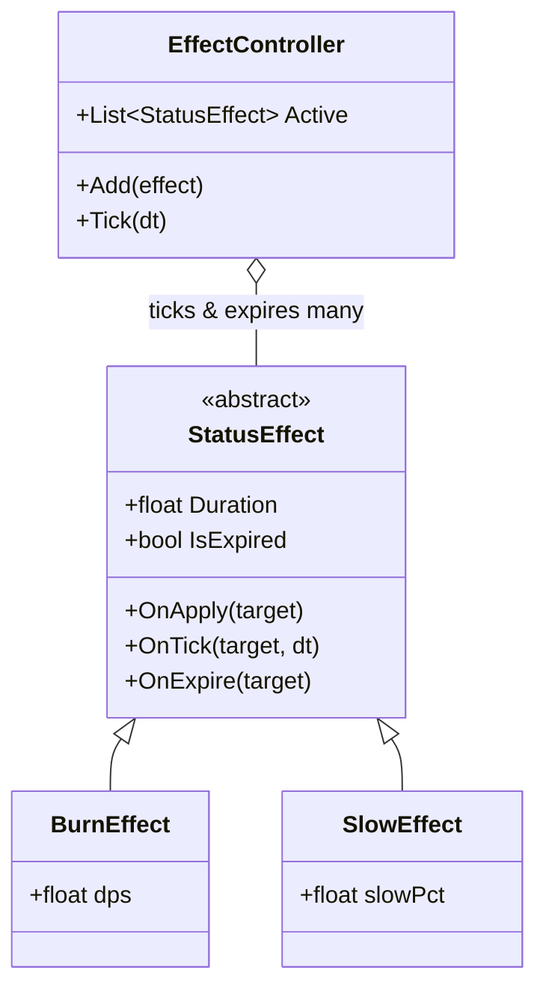
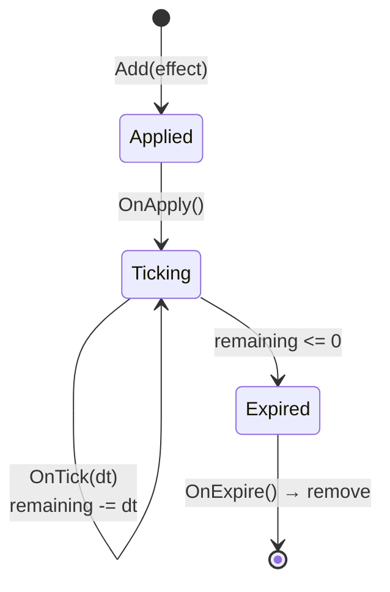
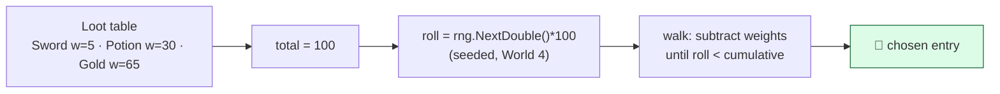

# Level 5 — Status Effects, Loot & Economy

| | |
|---|---|
| 🎚️ **Difficulty** | 🔴 Hard |
| ⏱️ **Estimated time** | 35 minutes |
| ⭐ **XP reward** | 100 (Quest) + 25 (Quiz) |

[← Prev](04-combat-and-damage.md) · [↑ Phase Home](../README.md) · [→ Next](../boss-battle.md)

---

## 📖 Story

> *"Last lesson of the world — and it's the one that makes a *fight* into a *loop*. Maya's wishlist: 'Burning that ticks, slow that lingers, enemies that drop loot worth grabbing, and gold to spend.' Three systems, one theme: **composable, timed, data-driven**. **Status effects** are timed modifiers that stack onto an entity — burn (damage over time), slow (move-speed debuff), and we want *any number* of them at once without spaghetti. **Loot** is a weighted table — when an enemy dies, roll its drops using the seeded RNG from World 4 (so a daily run drops the same loot). **Economy** is gold + a shop, closing the loop: kill → loot → sell/buy → get stronger. Wire these in and you have the boss-battle's whole 'Loot Run' — clear a room, get poisoned, kill an enemy, grab its drop, equip it. Then World 6 makes the enemies smart enough to fight back. — Kenji"*

---

## 🎯 Goal

- Model **status effects** as composable, **timed modifiers** (buffs/debuffs/DoT) that stack
- Implement **burn** (damage-over-time via Lesson 4's pipeline) and **slow** (stat debuff)
- Build a **loot table** with **weighted** drop chances using World 4's seeded RNG
- Add a **currency/economy**: gold, and a simple **shop** that buys/sells using Lesson 2's inventory
- Wire Ashfall's burning/slow effects + loot drops + gold — completing World 5

---

## 🧠 Concepts

### Status effects: composable timed modifiers

A status effect is a small object that lives on an entity for a **duration**, does something **over time** or **while active**, then expires. The design that scales: each entity owns a **list of active effects**, and an `EffectController` ticks them every frame — applying, expiring, and removing. New effect = new small class, never a new `if` in the player.



Two flavors:
- **Over-time (DoT/HoT):** burn/poison call Lesson 4's `TakeDamage` on each tick (one pipeline — DoT is just another source). A heal-over-time does the reverse.
- **Stateful modifier:** slow reduces move speed *while active*. The clean approach mirrors Lesson 2's equipment: **recompute** the entity's effective stats from base + active modifiers, so when the effect expires the value snaps back correctly with no drift.



**Stacking policy** is a design choice you must make explicit: do two burns *refresh* the duration, *stack* intensity, or *coexist* independently? Decide per effect (a flag) — silence here is a bug.

### Loot tables: weighted randomness

Loot is a list of `(item, weight)` entries. Higher weight = more likely. To roll: sum all weights, pick a random number in `[0, total)`, walk the list subtracting weights until you cross the threshold — that's your drop. Use **World 4's seeded `Rng`**, not global random, so a seeded run drops reproducible loot (and you can test drop rates deterministically).



A "nothing" entry (or a roll chance) lets you tune *how often* anything drops vs *what* drops — keep those two knobs separate so designers can tune drop frequency independently of the loot mix.

### Economy: closing the loop

Currency is just an `int` with `Add`/`TrySpend` and an event so the UI updates (same observer discipline as inventory). A **shop** is a list of `ItemDefinition`s for sale at `def.value` (Lesson 1) — **buy** = `gold.TrySpend(price)` then `inventory.Add`; **sell** = `inventory.Remove` then `gold.Add(price/2)`. Notice the shop is *pure composition* of systems you already built: it owns no new "item" concept, it just moves data between inventory and gold. That's the reward for building data-driven, event-driven foundations all world.

### Why this exists

These three systems are the **engagement loop** of an action-roguelite — the reason a player clears one more room. Built ad hoc, they metastasize: status effects become a forest of boolean flags on the player (`isBurning`, `isSlowed`, `isPoisoned`…) that interact in undefined ways; loot becomes hard-coded `Random.value < 0.1f` checks impossible to balance; economy desyncs from the UI. Built as composable timed modifiers + a weighted table + an event-driven wallet, they stay tunable from data and correct under stacking. Weighted random selection in particular is one of the most reused algorithms in games (drops, spawn tables, random encounters, gacha).

This is **engine-agnostic**: effect controllers, weighted rolls, and currency are plain logic identical in any engine; only the `TakeDamage` call and VFX touch Unity. See **RESOURCES.md** for this world for loot-table and game-economy references.

---

## 🛠️ Hands-on Lab

> 💻 Builds on Lesson 4's damage pipeline, Lesson 2's inventory, Lesson 1's `ItemDefinition`, and World 4's seeded `Rng`.

### Step 1 — The status-effect base + controller

```csharp
using System.Collections.Generic;
using UnityEngine;

public abstract class StatusEffect
{
    public float Remaining;             // seconds left
    public bool IsExpired => Remaining <= 0f;
    public virtual bool RefreshOnReapply => true;   // stacking policy (per effect)

    public virtual void OnApply(GameObject target) { }
    public abstract void OnTick(GameObject target, float dt);
    public virtual void OnExpire(GameObject target) { }
}

public class EffectController : MonoBehaviour
{
    private readonly List<StatusEffect> _active = new();

    public void Add(StatusEffect effect)
    {
        // Stacking policy: refresh an existing same-type effect, or add anew.
        foreach (var e in _active)
            if (e.GetType() == effect.GetType() && e.RefreshOnReapply)
            { e.Remaining = Mathf.Max(e.Remaining, effect.Remaining); return; }

        _active.Add(effect);
        effect.OnApply(gameObject);
    }

    void Update()
    {
        float dt = Time.deltaTime;
        for (int i = _active.Count - 1; i >= 0; i--)   // reverse: safe to remove
        {
            var e = _active[i];
            e.OnTick(gameObject, dt);
            e.Remaining -= dt;
            if (e.IsExpired) { e.OnExpire(gameObject); _active.RemoveAt(i); }
        }
    }

    public bool Has<T>() where T : StatusEffect
    { foreach (var e in _active) if (e is T) return true; return false; }
}
```

### Step 2 — Burn (DoT) routes through Lesson 4's pipeline

```csharp
using UnityEngine;

public class BurnEffect : StatusEffect
{
    private readonly float _dps;
    private float _tickAccumulator;

    public BurnEffect(float duration, float dps) { Remaining = duration; _dps = dps; }

    public override void OnTick(GameObject target, float dt)
    {
        _tickAccumulator += dt;
        if (_tickAccumulator >= 0.5f)               // tick twice a second
        {
            _tickAccumulator -= 0.5f;
            if (target.TryGetComponent<IDamageable>(out var dmg))
                dmg.TakeDamage(new DamageInfo {     // DoT is just another damage source
                    Amount = _dps * 0.5f, Type = DamageType.Fire,
                    HitPoint = target.transform.position
                });
        }
    }
}
```

### Step 3 — Slow (stateful modifier) recomputes speed

```csharp
using UnityEngine;

public class SlowEffect : StatusEffect
{
    public readonly float SlowPct;     // 0.4 = 40% slower; controller reads this

    public SlowEffect(float duration, float slowPct) { Remaining = duration; SlowPct = slowPct; }

    public override void OnTick(GameObject target, float dt) { /* nothing per-tick */ }
}
```

```csharp
using UnityEngine;

// Recompute effective speed from base + the strongest active slow (no drift).
public class MoverSpeedModifier : MonoBehaviour
{
    public float baseSpeed = 5f;
    public float CurrentSpeed { get; private set; }
    private EffectController _effects;

    void Awake() => _effects = GetComponent<EffectController>();

    void Update()
    {
        float slow = _effects.MaxSlow();            // add a helper returning the biggest SlowPct
        CurrentSpeed = baseSpeed * (1f - slow);     // base every frame → snaps back on expire
    }
}
```

> 💡 Add `public float MaxSlow()` to `EffectController` that loops active effects and returns the largest `SlowEffect.SlowPct` (or 0). Recompute-from-base is the same idempotent trick as Lesson 2's equipment.

### Step 4 — A weighted loot table (seeded, World 4)

```csharp
using System.Collections.Generic;
using UnityEngine;

[System.Serializable]
public class LootEntry
{
    public ItemDefinition item;     // null = "nothing"
    public int weight = 1;          // relative chance
    public int minCount = 1, maxCount = 1;
}

[CreateAssetMenu(fileName = "LootTable", menuName = "Ashfall/Loot Table")]
public class LootTable : ScriptableObject
{
    public List<LootEntry> entries = new();

    // Roll one drop using World 4's seeded Rng (reproducible loot).
    public (ItemDefinition item, int count) Roll(Rng rng)
    {
        int total = 0;
        foreach (var e in entries) total += e.weight;
        if (total <= 0) return (null, 0);

        int roll = rng.Range(0, total);             // [0, total)
        foreach (var e in entries)
        {
            if (roll < e.weight)
                return (e.item, rng.Range(e.minCount, e.maxCount + 1));
            roll -= e.weight;
        }
        return (null, 0);
    }
}
```

### Step 5 — Drop loot when an enemy dies (hook Lesson 4's death event)

```csharp
using UnityEngine;

[RequireComponent(typeof(Health))]
public class LootDropper : MonoBehaviour
{
    public LootTable table;
    public GameObject pickupPrefab;     // a world pickup that carries an ItemDefinition
    public int goldDrop = 5;

    void Awake() => GetComponent<Health>().Died += OnDied;   // Lesson 4 fired this

    void OnDied(DamageInfo _)
    {
        var (item, count) = table.Roll(RunRng.Current);     // shared seeded Rng for the run
        if (item != null)
        {
            var go = Instantiate(pickupPrefab, transform.position, Quaternion.identity);
            go.GetComponent<ItemPickup>().Set(item, count);  // pick-up adds to inventory (L2)
        }
        Wallet.Instance.Add(goldDrop);                       // currency
    }
}
```

### Step 6 — Wallet + a simple shop (pure composition of L1/L2)

```csharp
using System;
using UnityEngine;

public class Wallet : MonoBehaviour
{
    public static Wallet Instance;
    public int Gold { get; private set; }
    public event Action Changed;                    // UI listens (observer pattern)

    void Awake() => Instance = this;
    public void Add(int amount) { Gold += amount; Changed?.Invoke(); }
    public bool TrySpend(int amount)
    {
        if (Gold < amount) return false;
        Gold -= amount; Changed?.Invoke(); return true;
    }
}
```

```csharp
using UnityEngine;

public class Shop : MonoBehaviour
{
    public ItemDefinition[] stock;       // for sale at def.value
    public PlayerInventory player;       // Lesson 2

    public bool Buy(ItemDefinition def)
    {
        if (!Wallet.Instance.TrySpend(def.value)) return false;   // can't afford
        if (player.Bag.Add(def, 1) > 0)                            // bag full → refund
        { Wallet.Instance.Add(def.value); return false; }
        return true;
    }

    public bool Sell(ItemDefinition def)
    {
        if (!player.Bag.Remove(def, 1)) return false;
        Wallet.Instance.Add(def.value / 2);                       // sell for half
        return true;
    }
}
```

### Step 7 — Apply burn/slow from an attack

In a fire attack (e.g. the ember bolt from Lesson 4), after dealing damage, grab the target's `EffectController` and apply an effect:

```csharp
if (other.TryGetComponent<EffectController>(out var fx))
    fx.Add(new BurnEffect(duration: 3f, dps: 4f));    // 3s of burning, ticks via the pipeline
```

---

## 🎮 Mini Challenge

Maya sets a loot table — Sword `weight 5`, Potion `weight 30`, Gold `weight 65` — and complains "the sword *never* drops, and on the daily seed everyone gets *different* loot." Two issues. Diagnose both.

<details>
<summary>💡 Reveal answer</summary>

**Sword feels like it never drops:** that's *working as designed* — weight 5 of 100 is a 5% chance, so it's rare, not broken. If she wants it more common, raise its weight (it's a pure data tweak, no code). The weighting is correct; the expectation isn't.

**Different loot on the same seed:** the roll is using **global** `UnityEngine.Random`, not the run's **seeded** `Rng` from World 4 — so it diverges per machine, breaking daily-run reproducibility (exactly the World 4 lesson's warning). Fix: roll with the shared seeded `Rng` (`RunRng.Current`) threaded through the run. Seeded loot = reproducible, testable drop rates.
</details>

---

## 📦 Project Mission

Add the engagement loop to Ashfall — effects, loot, gold — completing World 5 and arming the boss battle.

1. Create `Assets/Scripts/Effects/StatusEffect.cs` + `EffectController.cs` (Step 1), then `BurnEffect` and `SlowEffect` (Steps 2–3). Add `EffectController` to the player and enemies.
2. Make slow actually slow: feed `MoverSpeedModifier.CurrentSpeed` into the World 3 player controller; verify speed snaps back when the slow expires (recompute-from-base).
3. Make the ember bolt **apply burn** on hit (Step 7); confirm burn ticks damage through Lesson 4's pipeline and the number pops twice a second.
4. Create a `LootTable` SO (Step 4) with weighted entries (Ember Sword rare, Health Potion common, plus a "nothing" entry). Author it in the Inspector.
5. Add `LootDropper` to the enemy hooked to Lesson 4's `Died` event (Step 5); on death it rolls the table with the **seeded run Rng** and spawns a pickup + gold.
6. Add a `Wallet` and a simple `Shop` (Step 6); buy/sell items, confirm gold + inventory + their UIs stay in sync via events, and that a full bag refunds a purchase.
7. Prove the loop: clear a room → get burned/slowed → kill an enemy → grab its drop → equip it (Lesson 2) → spend gold at the shop. Persist gold + effects state via World 3's save if desired.
8. Commit:
   ```bash
   cd ~/projects/ashfall
   git switch -c feature/status-loot-economy
   git add Assets/Scripts/Effects Assets/Scripts/Economy Assets/Data/Loot
   git commit -m "feat: composable status effects (burn/slow), weighted seeded loot tables, gold + shop economy"
   git switch main && git merge feature/status-loot-economy && git push
   ```

🎯 **Mission complete when:** the player can be **burned** (DoT through the damage pipeline) and **slowed** (stat that snaps back on expiry), enemies **drop weighted loot** rolled from a **seeded** table on death, and a **gold + shop** economy lets you buy/sell with event-synced UI — the full kill → loot → equip → spend loop runs end to end.

---

## ⚠️ Common Mistakes

| Mistake | What happens | Fix |
|--------|--------------|-----|
| Boolean flags per effect (`isBurning`, `isSlowed`…) | Combinatorial spaghetti; effects don't compose | A list of `StatusEffect` objects ticked by one controller |
| DoT subtracts HP directly | Skips resistances/i-frames/death event | Route DoT through `TakeDamage` (one pipeline) |
| Slow patches speed incrementally | Speed drifts; doesn't snap back on expire | Recompute speed from base + active effects each frame |
| Undefined stacking policy | Two burns behave randomly (refresh? stack? both?) | Decide per effect (`RefreshOnReapply` etc.) explicitly |
| Loot rolled with global `UnityEngine.Random` | Non-reproducible drops; daily runs diverge | Roll with World 4's seeded `Rng` |
| Buying without refund on full bag | Gold spent, item lost | `Add` returns leftover → refund if it didn't fit |
| Economy UI reads gold directly | Stale displays after a purchase | Wallet raises `Changed`; UI subscribes |

---

## 🤔 Reflection Questions

1. Burn deals damage by calling `TakeDamage`, the same entry point a sword uses. What does treating DoT as "just another damage source" buy you for free (think resistances, death credit, numbers)?
2. Slow recomputes effective speed from base every frame instead of subtracting on apply and adding back on expire. Which earlier lesson used the identical pattern, and what bug does "recompute from base" prevent?
3. The shop introduces **no new item concept** — it only moves data between the inventory and the wallet. Why is that a sign your World 5 foundations (data-driven, event-driven) were built right?

---

## 📝 Quiz

1. **Status effects scale best when modeled as…**
   - a) one boolean flag per possible effect on the entity
   - b) a list of effect objects ticked and expired by one controller
   - c) hard-coded branches inside the player update loop
2. **A weighted loot table picks a drop by…**
   - a) giving every item an equal chance
   - b) summing weights, rolling in `[0,total)`, and walking until the roll is crossed
   - c) always dropping the highest-weight item
3. **Loot should be rolled with World 4's seeded `Rng` so that…**
   - a) it runs faster
   - b) drops are reproducible (daily/shared runs match) and testable
   - c) rare items drop more often

<details>
<summary>✅ Answers</summary>

1: **b** · 2: **b** · 3: **b**
</details>

---

## ✅ Completion Checklist

- [ ] Status effects are composable timed objects ticked by one `EffectController`
- [ ] Burn deals DoT through the Lesson 4 pipeline; slow recomputes speed from base
- [ ] I chose an explicit stacking policy per effect
- [ ] Loot drops from a weighted `LootTable` rolled with World 4's **seeded** `Rng`
- [ ] Enemies drop loot + gold on death (via the Lesson 4 death event)
- [ ] A wallet + shop buy/sell with event-synced UI and refund-on-full-bag
- [ ] I passed the quiz
- [ ] Added **+125 XP** to [PROGRESS.md](../../../PROGRESS.md)

---

[← Prev](04-combat-and-damage.md) · [↑ Phase Home](../README.md) · [→ Next](../boss-battle.md)
