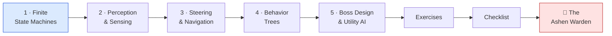
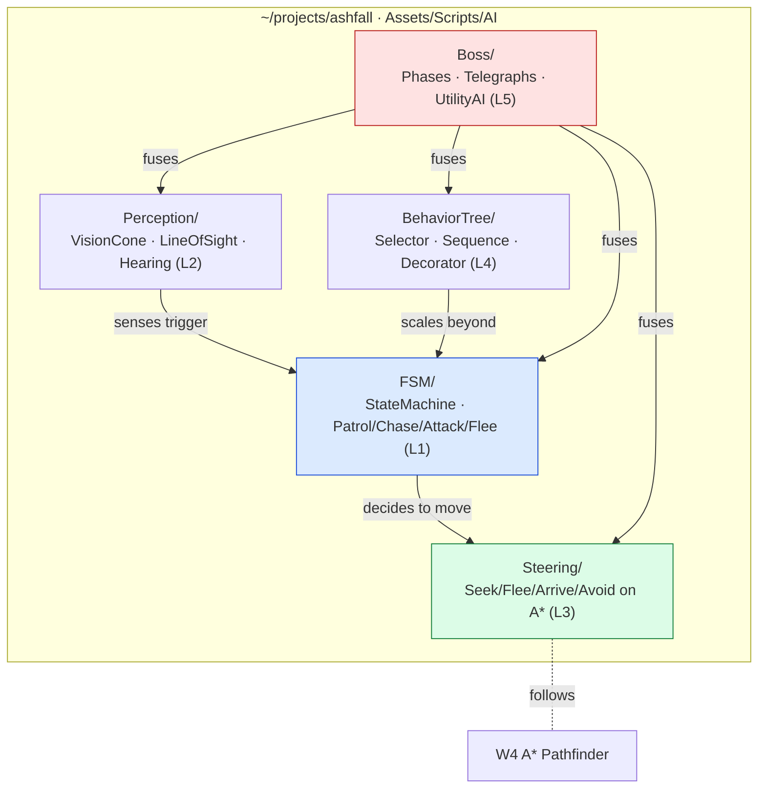

# 🤖 World 6 — Artificial Intelligence

> Ashfall is a *game* now (World 5): you cast abilities, trade damage, poison enemies, kill them, and grab weighted loot — all data-driven and persisted. But the enemies are bricks. They stand still, or worse, they walk straight into a wall while you plink them to death. There's no fight in the fight. This world makes Ashfall's enemies *think*: a clean state machine so they patrol/chase/attack, perception so they actually **notice** you (vision cones, line-of-sight, hearing), steering so they follow A\* paths *and* dodge obstacles instead of face-planting into geometry, behavior trees so an elite makes composable, designer-readable decisions — and a multi-phase **boss** that perceives you, paths and steers, switches behaviors through a tree, and uses utility AI to pick telegraphed attacks that escalate as it loses HP. By the end, the dungeons fight back.

[↑ Home](../../README.md) · [🗺️ Roadmap](../../ROADMAP.md) · [📊 Progress](../../PROGRESS.md)

---

## 📨 Your ticket

```
From:    Kenji <kenji@pixelforge.studio>
To:      You <new-hire@pixelforge.studio>
Cc:      Maya <maya@pixelforge.studio>, Theo <theo@pixelforge.studio>

Subject: [W6-AI] Our enemies are stupid — they just walk into walls

Loved the loot run. Combat finally feels like combat. One problem: the
enemies. Maya watched a playtest yesterday and her exact words were
"they just walk into walls." She's right. We have a beautiful damage
pipeline and nothing worth pointing it at.

Right now an enemy either stands there or beelines at you through solid
rock. It doesn't notice you, doesn't lose you, doesn't react when it's
about to die. There's no game in the encounter.

Here's what "smart" means — and none of it is more art, it's all systems:

  - A real STATE MACHINE, not if-soup. Patrol when calm, Chase when it
    sees you, Attack in range, Flee when hurt — with clean transitions.
  - PERCEPTION. It should NOTICE you — a vision cone (use that dot-product
    math from W2), a line-of-sight raycast so walls actually block sight,
    and hearing/aggro. And it should LOSE you when you break line of sight.
  - MOVEMENT THAT ISN'T DUMB. Layer steering (seek/flee/arrive/avoid) on
    the W4 A* paths so it follows the route AND stops clipping corners.
  - BEHAVIOR TREES for the elites — selectors, sequences, decorators — so
    Maya can read and retune the AI without spelunking a 400-line FSM.
  - And ONE real BOSS. Multiple phases, telegraphed attack patterns, and
    UTILITY AI scoring which attack to throw. It should feel authored, not
    random — and it should change how it fights as its HP drops.

Boss check ("The Ashen Warden"): a multi-phase boss that perceives the
player, paths and steers to them, switches behaviors via a tree, and uses
utility scoring to choose telegraphed attacks that escalate across phases.
Beat your own boss in a fair fight.

Nail this and World 7 — making all of it LOOK like a real game (lighting,
shaders, particles) — is yours.

— Kenji
```

This is World 6 of 13. Everything you build advances the **one growing Ashfall project** in `~/projects/ashfall`. You arrive with a real combat game (W5); you leave with enemies that perceive, decide, path, steer, and a boss worth fearing.

---

## 🎯 What you'll achieve in this world

- 🧠 Build an enemy **finite state machine** from first principles — states, transitions, a clean state pattern (Patrol / Chase / Attack / Flee) instead of nested-`if` soup
- 👁️ Give enemies **perception** — a **vision cone** (reusing the W2 dot product), **line-of-sight** raycasts so walls block sight, and hearing/aggro that drives FSM transitions
- 🧭 Add **steering behaviors** (seek / flee / arrive / avoid) layered on **W4 A\*** paths, so enemies follow routes *and* dodge obstacles instead of clipping corners
- 🌳 Build a **behavior tree** (selectors / sequences / decorators) for a composable, designer-readable **elite** enemy — the paradigm that scales where FSMs sprawl
- 👹 Design a **multi-phase boss** — phases, **telegraphed** attack patterns, and **utility AI** (scoring actions) — that fuses FSM + perception + steering + tree into the Ashen Warden

---

## 🗺️ Level map

| Level | Lesson | Difficulty | XP |
|------:|--------|:----------:|---:|
| 1 | [Finite State Machines](lessons/01-finite-state-machines.md) | 🟢 Easy | 125 |
| 2 | [Perception & Sensing](lessons/02-perception-and-sensing.md) | 🟡 Medium | 125 |
| 3 | [Steering & Navigation](lessons/03-steering-and-navigation.md) | 🟡 Medium | 125 |
| 4 | [Behavior Trees](lessons/04-behavior-trees.md) | 🔴 Hard | 125 |
| 5 | [Boss Design & Utility AI](lessons/05-boss-design-and-utility-ai.md) | 🔴 Hard | 125 |
| 👹 | [Boss Battle — The Ashen Warden](boss-battle.md) | 🔴 Hard | 500 |

➕ Extra reps: [exercises.md](exercises.md) · ✅ Ready to advance? [checklist.md](checklist.md)

---

## 🧭 Recommended order



Go in order — each lesson is the brain or the limbs the next one needs. The **FSM** (L1) is the enemy's decision skeleton: Patrol/Chase/Attack/Flee with clean transitions, no `if`-soup. **Perception** (L2) gives it senses — a vision cone, line-of-sight, hearing — and those senses are exactly what *trigger* the FSM's transitions. **Steering** (L3) gives it legs: seek/flee/arrive/avoid layered on the W4 A\* path, so once it decides to chase, it actually moves well. **Behavior trees** (L4) are the scalable alternative to a sprawling FSM — composable, designer-readable decision-making for an elite. The **boss** (L5) fuses all four — FSM phases, perception, steering, a tree — and adds **utility AI** to score and pick telegraphed attacks. The boss battle is all five at once.

---

## 📦 Ashfall project status

**Entering World 6:** a real combat game (W5) — data-driven `ItemSO`/`AbilitySO`, an inventory + equipment that changes `Stats`, abilities on cooldowns, a damage pipeline with i-frames and knockback on `IDamageable`, status effects, weighted loot, and gold — all on top of W4's procedurally generated, navigable dungeons with a reusable A\* `Pathfinder`, and all persisted by the W3 save system. But the enemies are dumb: they don't perceive, decide, or move intelligently.

**Leaving World 6:** **enemies that think** — a clean FSM (Patrol/Chase/Attack/Flee), perception (vision cone + line-of-sight + hearing) that drives transitions, steering (seek/flee/arrive/avoid) layered on A\* paths so they path *and* dodge, a behavior-tree-driven elite, and a multi-phase **boss** (the Ashen Warden) that perceives, paths, steers, switches behaviors via a tree, and uses utility AI to pick telegraphed attacks that escalate per phase. The enemies now *use* all of W5's combat against the player.



You hand this to **World 7 — Rendering & Graphics**, where Lena makes all of it *look* like a real game: dynamic 2D lighting, shaders (hit-flash, dissolve), particles, and a post-processing stack — so the smart fights you just built finally read as cinematic.

---

## 👹 Boss teaser

**"The Ashen Warden"** — Kenji wants proof your enemies can actually *fight*: design and build a **multi-phase boss** that **perceives** the player (vision + line-of-sight), **paths and steers** to them (A\* + seek/avoid), **switches behaviors through a tree**, and uses **utility AI** to score and choose **telegraphed** attacks that escalate as its HP drops across phases. No tutorial — you'll fuse all five lessons into one boss encounter and then beat it in a fair fight. Win to earn the **🤖 AI Engineer** badge, a +250 world-complete bonus, and unlock World 7.

---

## 📚 Resources

Don't go link-hunting — the curated free list lives in [RESOURCES.md](../../RESOURCES.md). For this world, the standouts are the **Game Programming Patterns** book (free online — the *State* chapter is the cleanest FSM explanation you'll find, and it maps straight onto L1), the classic **Craig Reynolds "Steering Behaviors For Autonomous Characters"** paper (seek/flee/arrive/avoid come from here, L3), and any solid **behavior tree** primer (the selector/sequence/decorator model is universal across Unreal, Godot, and custom engines, L4). Watch *why* an FSM beats `if`-soup and *why* a behavior tree beats a giant FSM before you wire them — those two "why"s are the spine of this world.

---

[↑ Home](../../README.md) · [🗺️ Roadmap](../../ROADMAP.md) · [📊 Progress](../../PROGRESS.md) · [➡️ Next World: Rendering & Graphics](../phase-07-rendering-graphics/README.md) · [▶️ Start Level 1 →](lessons/01-finite-state-machines.md)
