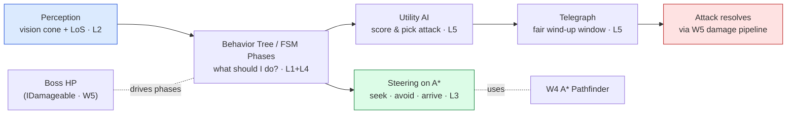

# 👹 Boss Battle — The Ashen Warden

| | |
|---|---|
| 🎚️ **Difficulty** | 🔴 Hard |
| ⏱️ **Estimated time** | 120 minutes |
| ⭐ **XP reward** | 500 |
| 🔓 **Unlocks** | World 7 — Rendering & Graphics |

[← Checklist](checklist.md) · [↑ Phase Home](README.md) · [↑ Home](../../README.md)

---

## 📨 The incident

```
From:    Kenji <kenji@pixelforge.studio>
To:      You <new-hire@pixelforge.studio>
Cc:      Maya <maya@pixelforge.studio>, Theo <theo@pixelforge.studio>

Subject: [W6-BOSS] Give us a boss we'd actually screenshot

The grunts think now. They patrol, they spot you, they path around the
pillars, the elites run a behavior tree. Maya's happy. Theo is not yet —
he wants ONE encounter that sells the whole game in a trailer. A boss.

Meet the Ashen Warden. It guards the deepest room. Here's the bar, and
there's no tutorial this time — you've got all five lessons:

  - It PERCEIVES the player. Vision cone + line of sight. It reacts when it
    sees you and when you slip out of sight — it doesn't cheat with omniscience.
  - It PATHS AND STEERS to you. A* route through the room, steering so it
    never clips a pillar or freezes on a corner.
  - It SWITCHES BEHAVIORS through a TREE. Not a fixed script — a readable
    decision structure Maya can retune.
  - It picks attacks with UTILITY AI. Slam up close, dash to close distance,
    a ranged volley when you kite. It scores the situation and chooses — and
    every attack is TELEGRAPHED so a good player can dodge or i-frame it.
  - It has PHASES. As its HP drops it escalates — new attacks, faster cadence,
    a meaner decision profile. Phase 3 should make me sweat.

Then the real test: beat your OWN boss, in a fair fight, with W5 combat.
If you can't beat it, it's unfair. If it never threatens you, it's boring.
Land it in the middle.

Nail this and World 7 — making all of it LOOK incredible (lighting, shaders,
particles) — is yours.

— Kenji
```

> 🤖 **Boss Battle rules:** No tutorials, no copying lesson files wholesale. **Apply** World 6: build the FSM phases, the perception (cone + line-of-sight), the steering-on-A\* movement, the behavior tree, and the utility-AI attack selection yourself, and fuse them into one encounter. You win when every victory condition is met **and you can explain which system owns each behavior** (perception senses → tree/FSM decides → utility scores the attack → steering moves → combat resolves).

---

## 🎯 Your mission

Design and build the **Ashen Warden** — a multi-phase boss in a W4 generated room that **perceives** the player, **paths and steers** to them, **switches behaviors via a tree**, and uses **utility AI** to choose **telegraphed** attacks that **escalate across phases** — then beat it in a fair fight using W5 combat. This is the capstone that fuses every lesson:



Build it from these pieces (at minimum):

1. **Perception (L2):** a vision cone (W2 dot product) + line-of-sight raycast so the Warden detects the player honestly and loses them when sight breaks.
2. **Decision (L1 + L4):** **phases** as an FSM (Phase 1/2/3 keyed to HP thresholds) and a **behavior tree** *within* a phase choosing what to do (approach / attack / reposition).
3. **Movement (L3):** A\* path to the player (W4 `Pathfinder`) + **steering** (seek/arrive to close, avoid to dodge pillars) so it never clips geometry.
4. **Attack selection (L5):** **utility AI** — each attack (slam / dash / volley) has a score over distance, HP, cooldown, and player position; the Warden evaluates all and picks the best.
5. **Telegraphs (L5):** every attack has a readable **wind-up** (delay + marker) the player can dodge or i-frame (W5) through — fairness is the contract.
6. **Combat (W5):** the Warden is `IDamageable`; its attacks route through the W5 damage pipeline; the player survives via i-frames.
7. **Escalation:** each phase adds an attack / tightens cadence / shifts the utility weights so Phase 3 genuinely threatens a skilled player.

---

## 🏆 Victory conditions

- [ ] The Warden **perceives** the player via a **vision cone + line-of-sight** — it reacts on sight gained and stops chasing (or searches last-known) on sight lost; **no omniscience**
- [ ] The Warden **paths to the player** on a **W4 A\* route** and **steers** (seek/arrive/avoid) so it **never clips a pillar** or freezes on a corner
- [ ] The Warden **switches behaviors via a tree** (selector/sequence/decorator) — and its conduct is readable, not a hard-coded script
- [ ] The Warden uses **utility AI** to **score and choose** among **multiple attacks** (e.g. slam / dash / volley) by situation — not a fixed rotation
- [ ] **Every attack is telegraphed** with a fair wind-up the player can **dodge or i-frame** (W5) through
- [ ] The fight has **multiple phases** tied to HP thresholds that **escalate** (new attack / faster / meaner) — Phase 3 is clearly the hardest
- [ ] The Warden is **`IDamageable`** and its damage routes through the **W5 pipeline**; the player **survives touches via i-frames**
- [ ] Key knobs are **data** (cone angle, attack scores/weights, phase thresholds, telegraph durations) — I can retune balance **without editing code**
- [ ] **I beat my own boss in a fair fight** — it threatens me but is winnable
- [ ] I can explain which system owns each behavior (perception → decide → score → steer → resolve)

---

## 🧪 How you'll know you won

```bash
cd ~/projects/ashfall
ls Assets/Scripts/AI/Perception Assets/Scripts/AI/Steering Assets/Scripts/AI/BehaviorTree Assets/Scripts/AI/Boss
# → VisionCone.cs, LineOfSight.cs, SteeringAgent.cs, BTNode.cs, Selector.cs, AshenWarden.cs, UtilitySelector.cs ...
```

Then in the Editor / a build, fight the Warden start to finish:
- **Walk into its cone** — it detects you and engages. **Duck behind a pillar** to break line of sight — it stops chasing and moves to your last-known position instead of magically tracking you.
- **Kite it across the room** — it **A\* paths** around the pillars and **steers** smoothly, never clipping a corner or stalling.
- **Watch its attacks** — at melee range it **slams**, from afar it **dashes in** or fires a **volley**; the choice **changes with distance and HP**, not a fixed loop. Each attack has a clear **telegraph** you can **dodge or i-frame** through.
- **Burn it down** — at the **phase thresholds** the fight visibly **escalates** (a new attack, faster cadence, a meaner profile). Phase 3 makes you work.
- **Retune in the Inspector** — widen the cone, reweight the slam's score, move a phase threshold → behavior shifts with **no recompile**.
- **Win the fight** — fair, tense, winnable. If it's unbeatable it's broken; if it never threatens you it's boring.

If all that holds in one continuous fight, the dungeons fight back. You've won.

<details>
<summary>🔎 Reference solution — only after you've tried! (high-level sketch + key code)</summary>

**The shape of it (each piece owns one job):**

| Piece | Job | Lesson |
|---|---|---|
| `VisionCone` + `LineOfSight` | detect the player honestly (cone + raycast) | L2 |
| Phase FSM | gate behavior by HP threshold (Phase 1/2/3) | L1 |
| `BehaviorTree` (selector/sequence) | decide what to do *within* a phase | L4 |
| `UtilitySelector` | score candidate attacks, pick the best | L5 |
| `SteeringAgent` on A\* | path + seek/arrive/avoid to the player | L3 |
| W5 damage pipeline | resolve telegraphed attacks, i-frames | W5 |

**Perception: cone (W2 dot) + line-of-sight (L2):**

```csharp
public bool CanSee(Transform player)
{
    Vector2 toPlayer = (Vector2)(player.position - transform.position);
    if (toPlayer.magnitude > viewDistance) return false;

    // CONE: dot of unit vectors = cosine of the angle (W2 math)
    float dot = Vector2.Dot(facing.normalized, toPlayer.normalized);
    if (dot < Mathf.Cos(halfAngle * Mathf.Deg2Rad)) return false;   // outside the cone

    // LINE OF SIGHT: a wall in between blocks it — no omniscience
    var hit = Physics2D.Raycast(transform.position, toPlayer.normalized,
                                toPlayer.magnitude, wallMask);
    return hit.collider == null;
}
```

**Phases: an FSM keyed to HP, each phase swaps the decision profile (L1):**

```csharp
void UpdatePhase()
{
    float pct = health.Current / (float)health.Max;
    var next = pct > phase2At ? Phase.One : pct > phase3At ? Phase.Two : Phase.Three;
    if (next != phase) { phase = next; profile = profiles[phase]; OnPhaseEnter(); } // new attacks/weights
}
```

**Decision: a behavior tree picks the high-level action (L4):**

```csharp
// Selector = OR (first that succeeds) · Sequence = AND (all in order)
root = new Selector(
    new Sequence(new IsPlayerVisible(perc), new InAttackRange(self), new ChooseAndAttack(utility)),
    new Sequence(new IsPlayerVisible(perc), new ApproachPlayer(steering)),  // seen but far → close in
    new SearchLastKnown(steering)                                          // lost sight → investigate
);
// tick root each frame; decorators (Cooldown, Inverter) wrap leaves without new states
```

**Attack selection: utility AI scores each candidate, picks the best (L5):**

```csharp
public Attack Choose(Context ctx)
{
    Attack best = null; float bestScore = float.MinValue;
    foreach (var atk in profile.attacks)        // attacks + weights are DATA per phase
    {
        if (!atk.OffCooldown(ctx.time)) continue;
        float score = atk.Score(ctx);           // f(distance, bossHp, playerExposed, ...)
        if (score > bestScore) { bestScore = score; best = atk; }
    }
    return best;                                 // highest utility, not a fixed rotation
}
// e.g. Slam.Score = high when ctx.distance < 2; Volley.Score = high when distance > 6; Dash closes the gap.
```

**Telegraph: a fair wind-up before damage, dodgeable via W5 i-frames (L5):**

```csharp
IEnumerator Execute(Attack atk)
{
    ShowTelegraph(atk);                          // marker + wind-up — the fairness contract
    yield return new WaitForSeconds(atk.telegraph); // DATA: tune the dodge window
    ResolveHit(atk);                             // routes through the W5 damage pipeline (IDamageable)
}
```

**Movement: A\* route + steering so it never clips a pillar (L3):**

```csharp
void MoveToward(Vector2 target)
{
    var path = pathfinder.FindPath(transform.position, target);   // W4 A*
    Vector2 seek   = Steering.Arrive(transform.position, path.NextWaypoint, velocity, maxSpeed);
    Vector2 avoid  = Steering.AvoidObstacles(transform.position, velocity, obstacleMask);
    velocity = Vector2.ClampMagnitude(velocity + seek + avoid, maxSpeed); // combined steering forces
    transform.position += (Vector3)(velocity * Time.deltaTime);
}
```

**Why each piece is the right tool:**
- **Perception** (cone + raycast) keeps the boss *fair* — it earns its knowledge of you instead of cheating, and losing line of sight gives the player a real escape (L2).
- **Phases as an FSM** make escalation explicit and tunable — each phase is a clean profile swap, not a tangle of HP-check `if`s (L1).
- A **behavior tree** keeps the moment-to-moment decision readable and composable — Maya can retune a branch without you (L4).
- **Utility AI** makes the boss feel *authored but reactive* — it picks the right tool for the range and the HP, not a memorizable loop (L5).
- **Telegraphs + steering on A\*** are what separate a hard boss from a cheap one: a readable wind-up the player's i-frames (W5) can beat, and movement that never clips geometry (L3/L5).

One fight, five lessons, a boss worth a screenshot. That's all of World 6 in a single encounter.
</details>

---

## 🎁 Rewards

- 🏆 **+500 XP**
- 🏅 Achievement unlocked: **🤖 AI Engineer** — you taught the dungeons to fight back: enemies that perceive, decide, path, steer, and a multi-phase boss that scores and telegraphs its attacks
- 🔓 **World 7 — Rendering & Graphics** unlocks
- 📈 Update [PROGRESS.md](../../PROGRESS.md): mark World 6 ✅ and add the **+250 World Complete bonus**

> 🗒️ Reflection: a boss isn't one big script — it's a stack of small systems cooperating. Perception senses, an FSM gates the phase, a behavior tree decides the action, utility AI scores the attack, steering on A\* does the moving, and the W5 pipeline resolves the hit — and keeping the knobs as data means the *design* of the fight lives in assets, not in your code. World 7 makes all of it *look* the part: dynamic lighting, a hit-flash and dissolve shader, particles on impact, and post-processing — so the smart fights you just built finally read as a real game.

---

[← Checklist](checklist.md) · [↑ Phase Home](README.md) · [↑ Home](../../README.md) · [🎨 Enter World 7 →](../phase-07-rendering-graphics/README.md)
