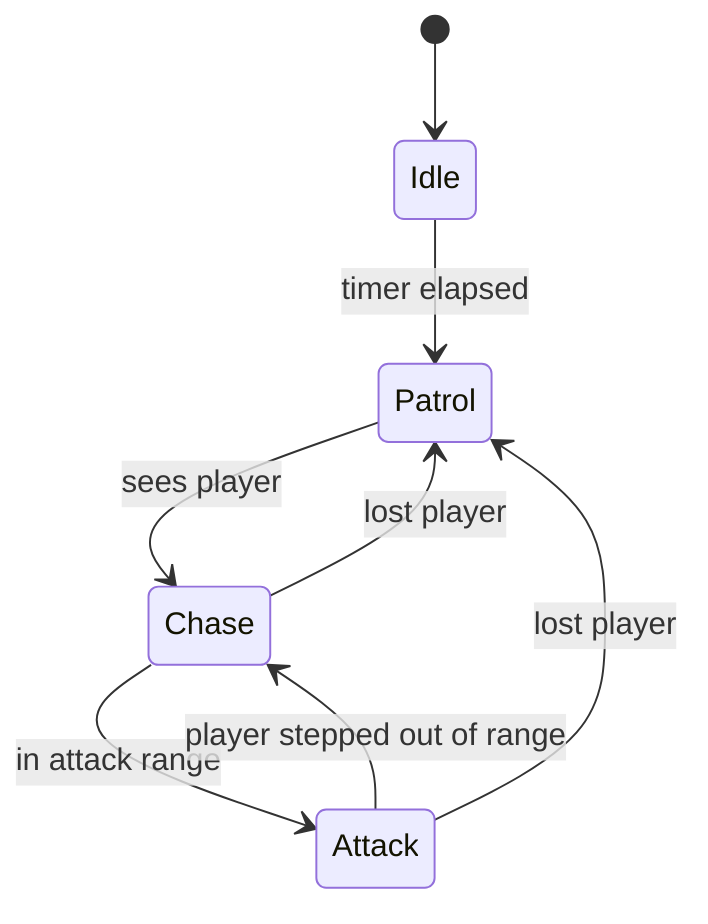
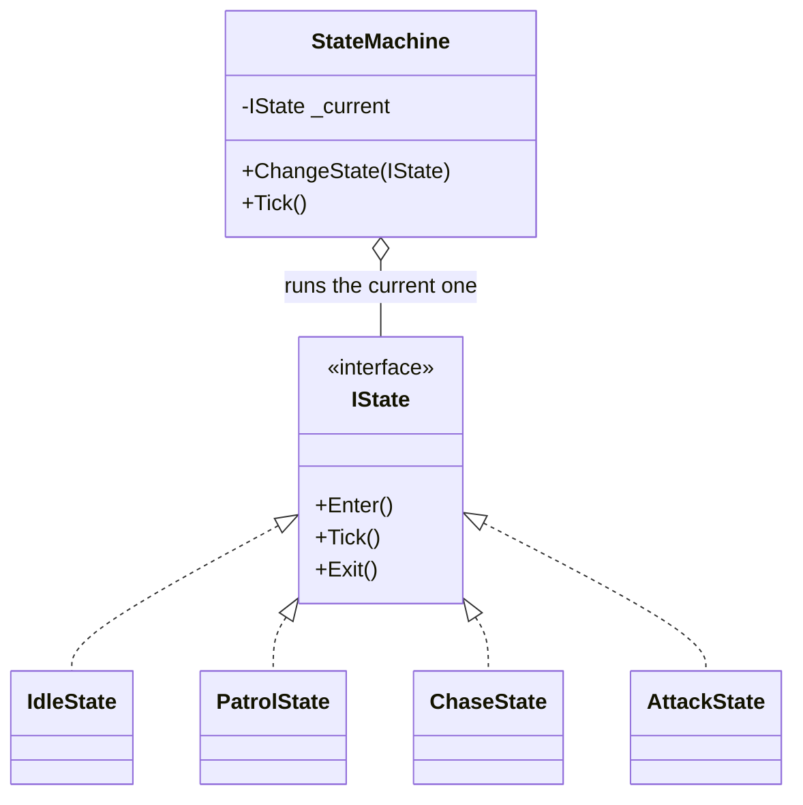

# Level 1 — Finite State Machines

| | |
|---|---|
| 🎚️ **Difficulty** | 🟡 Medium |
| ⏱️ **Estimated time** | 30 minutes |
| ⭐ **XP reward** | 100 (Quest) + 25 (Quiz) |

[← Prev](../README.md) · [↑ Phase Home](../README.md) · [→ Next](02-perception-and-sensing.md)

---

## 📖 Story

> *"Welcome to the brain world. Your enemies right now are bricks — they path to the player (World 4) and they can be hurt (World 5), but they have no *behavior*. They don't wait, they don't wander, they don't decide. Maya's ticket says it best: 'Enemies are dumb.' So we start with the single most-used tool in all of game AI: the **finite state machine**. An enemy is *in one mode at a time* — idling, patrolling, chasing, attacking — and it *switches* modes when something changes. That's an FSM. You already shipped one in World 1 for the game's Menu/Playing/Paused flow; today you build the enemy version. Resist the urge to write it as a pile of `if`s and booleans — `isChasing && !isAttacking && sawPlayer` is how AI code rots. One clean pattern, and every enemy in Ashfall (and the boss) is built on it. Let me show you. — Kenji"*

---

## 🎯 Goal

- Understand an **FSM** from first principles: a set of **states**, one **active** at a time, and **transitions** between them
- See why an FSM beats a tangle of boolean flags (`if`-soup) for behavior
- Build a clean, reusable **state pattern** (`IState` + a tiny runner)
- Implement four enemy states — **Idle**, **Patrol**, **Chase**, **Attack** — and the transitions between them
- Drop an FSM-driven enemy into Ashfall, ready for real senses next lesson

---

## 🧠 Concepts

### A machine that is in exactly one mode

A **finite state machine** is three things:

1. A finite set of **states** (Idle, Patrol, Chase, Attack).
2. Exactly **one active state** at any moment.
3. **Transitions** — rules that move you from one state to another when a condition is met.

That's the whole idea. An enemy in `Patrol` walks its route; *if it spots the player*, it transitions to `Chase`; *if the player gets close enough*, it transitions to `Attack`; *if the player escapes*, back to `Patrol`. Each state has three lifecycle hooks: something on **enter** (play the alert animation), something **every tick** (the behavior itself), and something on **exit** (cleanup).



Notice the diagram *is* the design. You can hand this picture to Maya and she understands the enemy completely — that readability is the FSM's superpower.

### The clean pattern: `IState`

The naive way is one giant `Update()` full of flags:

```csharp
// ❌ The trap: every new behavior adds another flag and another && to every branch.
if (sawPlayer && !inRange && !isDead) { /* chase */ }
else if (sawPlayer && inRange && !isAttacking && cooldownReady) { /* attack */ }
else if (!sawPlayer && patrolling) { /* patrol */ }
// ...this grows quadratically and nobody can read it after 5 states.
```

The clean way makes **each state its own object** implementing a common interface. The machine just holds the *current* state, ticks it, and lets states request a switch. Adding a state never touches the others.



### Where the transition logic lives

There are two schools, and both are valid:

- **States decide** (used here): each state checks its own exit conditions and calls `ChangeState`. Simple, local, great for a handful of states.
- **The machine decides** (a transition table): a central list of `(from, condition, to)` rules. Scales to many states but is more machinery.

We use "states decide" — it's the right tool until an enemy has ~6+ states, at which point you reach for **behavior trees** (Lesson 4). Knowing *when* the FSM stops scaling is half of why this world exists.

### Why this exists

The FSM is the **workhorse of game AI** because behavior is naturally modal: a thing is *doing one thing at a time*. Modeling that directly — one active state, explicit transitions — keeps AI code readable, debuggable ("what state is it in?" is a single field you can log), and extendable. The alternative, a thicket of booleans, has an exponential number of *implicit* states (every combination of flags), most of which are nonsense (`isDead && isAttacking`) and become bugs.

This is **completely engine-agnostic**. Unity's old Mecanim animation system, Unreal's AnimGraph, every RTS unit, every traffic light, every TCP connection, the React component lifecycle — all FSMs. The `IState` pattern you write today is the same pattern in any language or engine; only `Update`/`Time.deltaTime` are Unity. See **RESOURCES.md** for this world for state-machine and game-AI references.

---

## 🛠️ Hands-on Lab

> 💻 Builds on World 1's `IState` thinking (the app-flow FSM), World 4's `Pathfinder`/movement, and World 5's `Health`. Pure-logic core; only movement touches Unity.

### Step 1 — The state interface and the runner

```csharp
public interface IState
{
    void Enter();   // called once when this state becomes active
    void Tick();    // called every frame while active
    void Exit();    // called once when leaving this state
}

public class StateMachine
{
    public IState Current { get; private set; }

    public void ChangeState(IState next)
    {
        if (next == Current) return;     // no-op: don't re-Enter the same state
        Current?.Exit();                 // clean up the old one
        Current = next;
        Current.Enter();                 // set up the new one
    }

    public void Tick() => Current?.Tick();   // drive the active state
}
```

That's the entire engine. Everything else is *content*.

### Step 2 — A shared "brain" the states can read and act on

States need a common context: the enemy's transform, its target, its speed, and a handle back to the machine so they can request switches.

```csharp
using UnityEngine;

public class EnemyBrain : MonoBehaviour
{
    [Header("Tuning (designers edit these)")]
    public float moveSpeed = 3f;
    public float attackRange = 1.2f;
    public float chaseRange = 6f;        // (next lesson, real perception replaces this)
    public float idleTime = 2f;

    public Transform Player { get; private set; }
    public readonly StateMachine Fsm = new();

    // States are created once and reused — no per-frame allocation.
    public IdleState   Idle   { get; private set; }
    public PatrolState Patrol { get; private set; }
    public ChaseState  Chase  { get; private set; }
    public AttackState Attack { get; private set; }

    void Awake()
    {
        Player = GameObject.FindWithTag("Player")?.transform;
        Idle   = new IdleState(this);
        Patrol = new PatrolState(this);
        Chase  = new ChaseState(this);
        Attack = new AttackState(this);
    }

    void Start() => Fsm.ChangeState(Idle);   // boot into Idle
    void Update() => Fsm.Tick();             // one line drives all behavior

    // Helper every state uses (placeholder distance check until Lesson 2's senses)
    public bool CanSeePlayer() =>
        Player && Vector2.Distance(transform.position, Player.position) <= chaseRange;

    public float DistanceToPlayer() =>
        Player ? Vector2.Distance(transform.position, Player.position) : float.MaxValue;
}
```

### Step 3 — Idle: wait, then patrol

```csharp
using UnityEngine;

public class IdleState : IState
{
    private readonly EnemyBrain _b;
    private float _timer;
    public IdleState(EnemyBrain b) => _b = b;

    public void Enter() => _timer = _b.idleTime;

    public void Tick()
    {
        if (_b.CanSeePlayer()) { _b.Fsm.ChangeState(_b.Chase); return; }  // alert!

        _timer -= Time.deltaTime;
        if (_timer <= 0f) _b.Fsm.ChangeState(_b.Patrol);                  // bored → wander
    }

    public void Exit() { }
}
```

### Step 4 — Patrol: walk a route, watch for the player

```csharp
using UnityEngine;

public class PatrolState : IState
{
    private readonly EnemyBrain _b;
    private Vector2 _waypoint;
    public PatrolState(EnemyBrain b) => _b = b;

    public void Enter() => _waypoint = PickNearbyPoint();

    public void Tick()
    {
        if (_b.CanSeePlayer()) { _b.Fsm.ChangeState(_b.Chase); return; }

        // Move toward the current waypoint (Lesson 3 makes this smooth steering).
        _b.transform.position = Vector2.MoveTowards(
            _b.transform.position, _waypoint, _b.moveSpeed * Time.deltaTime);

        if (Vector2.Distance(_b.transform.position, _waypoint) < 0.1f)
            _waypoint = PickNearbyPoint();   // reached → pick the next
    }

    public void Exit() { }

    private Vector2 PickNearbyPoint() =>
        (Vector2)_b.transform.position + Random.insideUnitCircle * 3f;
}
```

### Step 5 — Chase: hunt the player (will use A* in Lesson 3)

```csharp
using UnityEngine;

public class ChaseState : IState
{
    private readonly EnemyBrain _b;
    public ChaseState(EnemyBrain b) => _b = b;

    public void Enter() { /* play alert "!" VFX here */ }

    public void Tick()
    {
        if (!_b.CanSeePlayer()) { _b.Fsm.ChangeState(_b.Patrol); return; } // lost them

        float d = _b.DistanceToPlayer();
        if (d <= _b.attackRange) { _b.Fsm.ChangeState(_b.Attack); return; } // in range

        // Beeline for now; Lesson 3 swaps in Pathfinder.FindPath for real navigation.
        _b.transform.position = Vector2.MoveTowards(
            _b.transform.position, _b.Player.position, _b.moveSpeed * Time.deltaTime);
    }

    public void Exit() { }
}
```

### Step 6 — Attack: strike on a cooldown

```csharp
using UnityEngine;

public class AttackState : IState
{
    private readonly EnemyBrain _b;
    private float _cooldown;
    public AttackState(EnemyBrain b) => _b = b;

    public void Enter() => _cooldown = 0f;   // can swing immediately on entry

    public void Tick()
    {
        if (_b.DistanceToPlayer() > _b.attackRange)  // player escaped the swing
        { _b.Fsm.ChangeState(_b.Chase); return; }

        _cooldown -= Time.deltaTime;
        if (_cooldown <= 0f)
        {
            Swing();
            _cooldown = 1f;                  // one hit per second
        }
    }

    public void Exit() { }

    private void Swing()
    {
        // Reuse World 5's damage pipeline — overlap the player, send a DamageInfo.
        if (_b.Player.TryGetComponent<IDamageable>(out var target))
            target.TakeDamage(new DamageInfo {
                Amount = 5f, Type = DamageType.Physical, Source = _b.gameObject
            });
    }
}
```

> 💡 Every state is small, single-purpose, and only knows its *own* exit conditions. Adding a `FleeState` (when low HP) means writing one class and one transition — zero edits to the others. That's the payoff.

---

## 🎮 Mini Challenge

A teammate's enemy "flickers" — its alert sound plays dozens of times a second, and the attack animation restarts every frame. They wrote the FSM correctly, but one method is being abused. Which one, and what rule did they break?

<details>
<summary>💡 Reveal answer</summary>

They're putting **per-frame work in `Enter()` by re-changing into the same state every tick** — e.g. `Tick()` calls `ChangeState(_b.Attack)` unconditionally while already in Attack. Each `ChangeState` runs `Exit()`+`Enter()` again, so the alert sound (in `Enter`) fires every frame.

Two fixes, both important: (1) the `StateMachine.ChangeState` guard `if (next == Current) return;` prevents re-entering the active state — make sure it's there; (2) **one-shot actions go in `Enter()`, continuous behavior goes in `Tick()`**. A sound or animation *trigger* belongs in `Enter` precisely because `Enter` should fire once per transition. If it's firing constantly, you're transitioning constantly — that's the real bug.
</details>

---

## 📦 Project Mission

Give Ashfall's basic enemy a real brain: an FSM that idles, patrols, chases, and attacks.

1. Create `Assets/Scripts/AI/IState.cs` + `StateMachine.cs` (Step 1). This is reused by **every** AI in the world, including the boss.
2. Create `EnemyBrain.cs` (Step 2) and the four states (Steps 3–6) under `Assets/Scripts/AI/States/`. Add `EnemyBrain` to your World 4 enemy prefab.
3. Tag the player `Player` so `EnemyBrain` can find it. Confirm the enemy boots into **Idle**.
4. Verify the full cycle by watching the active state: Idle → (timer) → Patrol → (walk near it) → Chase → (corner it) → Attack → (run away) → Chase → Patrol. Log `Fsm.Current.GetType().Name` to a label or the console.
5. Confirm the attack actually routes through **World 5's `TakeDamage`** (the player's HP drops, damage numbers pop) — no second health path.
6. Sanity-check the no-flicker rule: the alert VFX/sound fires **once** per Chase entry, not every frame.
7. Commit:
   ```bash
   cd ~/projects/ashfall
   git switch -c feature/enemy-fsm
   git add Assets/Scripts/AI
   git commit -m "feat: enemy FSM (IState pattern) with Idle/Patrol/Chase/Attack states"
   git switch main && git merge feature/enemy-fsm && git push
   ```

🎯 **Mission complete when:** an Ashfall enemy runs a clean `IState` FSM — it idles, patrols a route, transitions to **chase** when it detects the player, switches to **attack** in range (dealing damage through World 5's pipeline), and falls back to patrol when it loses the player — with each transition firing its enter/exit hooks exactly once.

---

## ⚠️ Common Mistakes

| Mistake | What happens | Fix |
|--------|--------------|-----|
| Booleans instead of states (`isChasing`, `sawPlayer`…) | Exponential implicit states, unreadable `&&` soup | One active `IState`; transitions are explicit |
| No "same state" guard in `ChangeState` | `Enter`/`Exit` re-fire every frame; sounds/anims flicker | `if (next == Current) return;` |
| One-shot logic in `Tick()` instead of `Enter()` | Alert sound/animation restarts every frame | One-time actions belong in `Enter()` |
| Allocating `new ChaseState()` every transition | GC pressure → frame hitches (World 1) | Create states once in `Awake`, reuse them |
| State reaches into another state's internals | States become coupled; defeats the pattern | States talk only through the shared `EnemyBrain` + the machine |
| Forgetting `Exit()` cleanup | Stale timers/effects leak into the next state | Reset/clean up in `Exit()` (or re-init in `Enter()`) |

---

## 🤔 Reflection Questions

1. An FSM has *N* explicit states. A flag-based version with *N* booleans has how many *implicit* states, and why are most of them bugs waiting to happen?
2. Why does putting the alert sound in `Enter()` (not `Tick()`) make it fire exactly once per detection? What does that tell you about which lifecycle hook to use for any one-shot action?
3. The Chase state currently beelines toward the player. Lesson 3 will swap in the World 4 `Pathfinder`. Why is it good design that *only the Chase state's `Tick` body* needs to change — and nothing about the FSM itself?

---

## 📝 Quiz

1. **A finite state machine is best described as…**
   - a) a list of booleans the update loop checks each frame
   - b) a set of states with exactly one active at a time and explicit transitions
   - c) a priority queue of actions sorted by importance
2. **One-shot actions (play alert sound, start attack animation) belong in…**
   - a) `Tick()`, so they run continuously
   - b) `Enter()`, so they fire once per transition into the state
   - c) `Exit()`, so they fire when leaving
3. **You should reach past an FSM toward a behavior tree when…**
   - a) the enemy has only two states
   - b) the state count grows large and transitions become hard to manage
   - c) never — FSMs scale infinitely

<details>
<summary>✅ Answers</summary>

1: **b** · 2: **b** · 3: **b**
</details>

---

## ✅ Completion Checklist

- [ ] I have a reusable `IState` + `StateMachine` (used by all World 6 AI)
- [ ] The enemy runs Idle/Patrol/Chase/Attack with explicit transitions
- [ ] Transitions fire `Enter`/`Exit` exactly once (no flicker)
- [ ] States are created once and reused (no per-frame allocation)
- [ ] Attacks route through World 5's `TakeDamage` pipeline
- [ ] I passed the quiz
- [ ] Added **+125 XP** to [PROGRESS.md](../../../PROGRESS.md)

---

[← Prev](../README.md) · [↑ Phase Home](../README.md) · [→ Next](02-perception-and-sensing.md)
