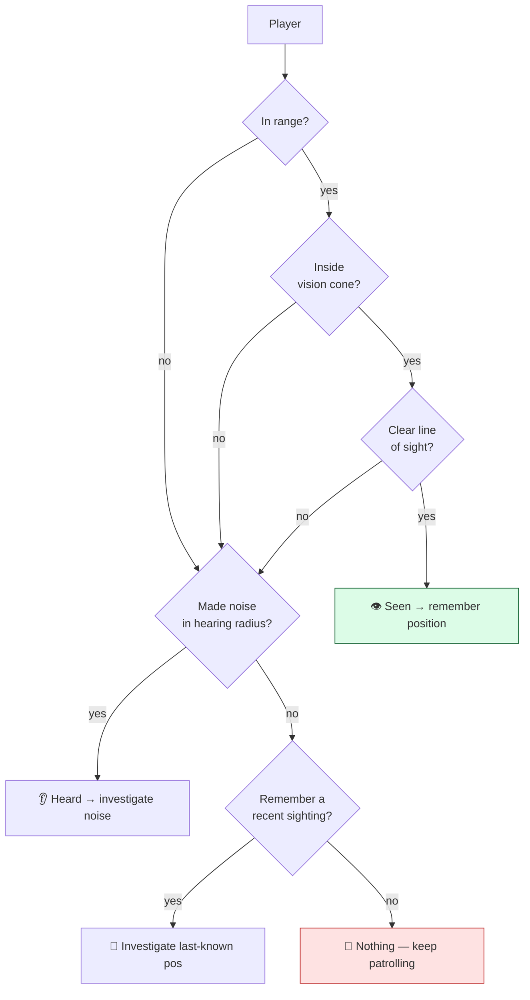
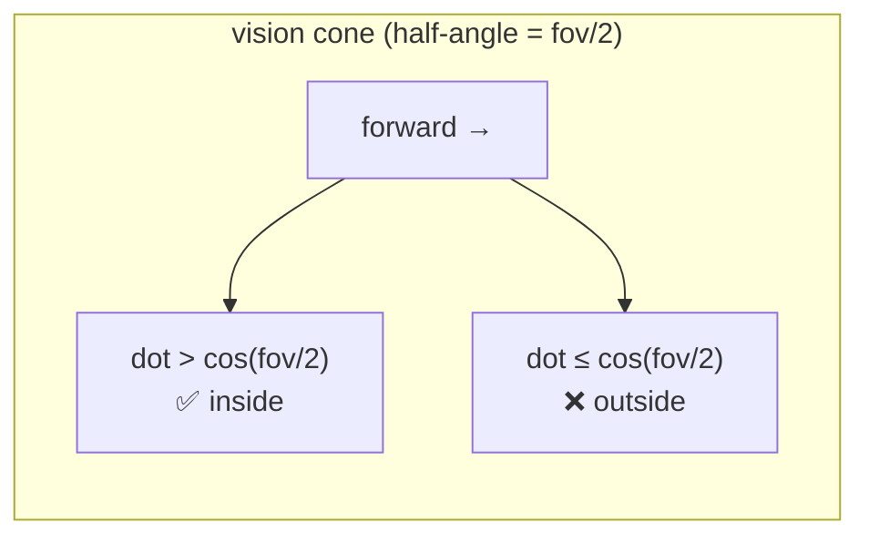

# Level 2 — Perception & Sensing

| | |
|---|---|
| 🎚️ **Difficulty** | 🟡 Medium |
| ⏱️ **Estimated time** | 30 minutes |
| ⭐ **XP reward** | 100 (Quest) + 25 (Quiz) |

[← Prev](01-finite-state-machines.md) · [↑ Phase Home](../README.md) · [→ Next](03-steering-and-navigation.md)

---

## 📖 Story

> *"Your FSM works, but it cheats. `CanSeePlayer()` is just a distance check — the enemy 'sees' the player through walls, behind its back, in pitch dark. That's the #1 thing that makes AI feel fake. Real perception is what makes an enemy feel *alive*: it has to look the right way, have a clear line of sight, and *forget* you when you break contact. Maya wants stealth to matter — sneak behind a guard and it shouldn't notice you. So today we build senses. The good news: you already did the hard math. Remember the **dot product** from World 2 — 'is the player in front of me?' That's a vision cone. Add a **line-of-sight raycast** so walls block vision, a **hearing radius** for noise, and a tiny bit of **memory** (the last place it saw you) so it investigates instead of teleporting back to patrol the instant you duck behind a pillar. These senses become the *real* conditions that drive last lesson's transitions. — Kenji"*

---

## 🎯 Goal

- Build a **vision cone** using World 2's **dot product** (facing + half-angle)
- Add **line-of-sight** so walls block vision (a physics raycast)
- Add a **hearing radius** so the player's noise can alert an enemy it can't see
- Give the enemy **memory**: a *last-known-position* so it investigates instead of instantly giving up
- Replace Lesson 1's fake `CanSeePlayer()` distance check with **real senses** that drive the FSM

---

## 🧠 Concepts

### Three senses, one question: "do I know where the player is?"

Perception answers a single question for the FSM — *can I act on the player right now?* It's built from independent senses that each contribute evidence:

- **Vision** — can I *see* the player? Requires three checks, all true: in **range**, inside my **cone** (facing), and with a clear **line of sight** (no wall between us).
- **Hearing** — did the player make **noise** within my **hearing radius**? Doesn't need facing or line of sight (you hear around corners), but it's vaguer — it tells you *there's something over there*, not exactly where.
- **Memory** — if I *just* saw the player and then lost them, I remember the **last-known position** for a few seconds and go look, instead of snapping back to patrol.



### The vision cone is a dot product (World 2)

A vision cone is "within *X* degrees of where I'm facing." World 2 taught the trick: the **dot product** of two normalized vectors equals the cosine of the angle between them. So the player is inside a cone of *total* angle `fovDegrees` when:

```
dot(forward, dirToPlayer) > cos(fovDegrees / 2)
```

No `atan2`, no branching on quadrants — one dot product and one precomputed cosine. (Compare the cosine, not the angle: `cos` is monotonic on `[0°,180°]`, so "bigger dot = smaller angle = more in front.")



### Line of sight is a raycast

Being inside the cone isn't enough — a wall might be between you and the player. A **raycast** shoots a ray from the enemy's eye toward the player against an *obstacle layer*; if it hits a wall *before* reaching the player, sight is blocked. This is the exact same raycast primitive from World 3's collision lesson, pointed at a new job. Raycasts cost a little, so you only cast **after** the cheap range + cone checks pass — order your senses cheapest-first.

### Memory turns a robot into a hunter

Without memory, the instant the player breaks line of sight the FSM flips straight back to Patrol — robotic and easy to exploit. With memory, the enemy stores `lastKnownPosition` plus a timer. It keeps "knowing" about the player for a few seconds, walks to that spot, looks around, and *then* gives up. Suddenly it feels like it's *hunting* you. This last-known-position is also what Lesson 3's steering will path toward, and what the boss uses to stay aggressive.

### Why this exists

Perception is the bridge between the world and the brain — an FSM is only as smart as the information feeding its transitions. Faking it with a distance check produces the classic "the AI cheated, it saw me through a wall" complaint that instantly breaks immersion and any stealth design. Building real senses — cone, line of sight, hearing, memory — makes detection *fair and legible*: a player can reason about what the AI can perceive and play around it. That legibility is the entire foundation of stealth games (Metal Gear, Splinter Cell, Dishonored) and good combat AI everywhere.

This is **engine-agnostic**: the dot-product cone, the cheapest-first sense ordering, and the last-known-position memory are pure logic identical in any engine; only the raycast and layer mask use Unity's `Physics2D`. See **RESOURCES.md** for this world for perception/stealth-AI references.

---

## 🛠️ Hands-on Lab

> 💻 Builds directly on World 2's dot product, World 3's raycasts/layers, and Lesson 1's `EnemyBrain`/FSM.

### Step 1 — A vision check (cone + range + line of sight)

```csharp
using UnityEngine;

public class Vision : MonoBehaviour
{
    [Header("Eyes")]
    public float viewRange = 7f;
    public float fovDegrees = 110f;            // total cone angle
    public LayerMask obstacleMask;             // walls that block sight (World 3 layers)

    // Returns true only if target is in range, inside the cone, AND in clear line of sight.
    public bool CanSee(Vector2 eyePos, Vector2 forward, Vector2 targetPos)
    {
        Vector2 toTarget = targetPos - eyePos;
        float dist = toTarget.magnitude;

        // 1) Cheapest check first: range.
        if (dist > viewRange) return false;

        // 2) Cone via the World 2 dot product. Compare cosines, not angles.
        float cosHalfFov = Mathf.Cos(fovDegrees * 0.5f * Mathf.Deg2Rad);
        if (Vector2.Dot(forward.normalized, toTarget.normalized) < cosHalfFov)
            return false;

        // 3) Most expensive last: does a wall block the view?
        var hit = Physics2D.Raycast(eyePos, toTarget.normalized, dist, obstacleMask);
        return hit.collider == null;           // nothing in the way → clear line of sight
    }
}
```

### Step 2 — Hearing (a radius, ignores walls and facing)

The player (or a thud, a gunshot) emits noise; nearby enemies "hear" it. A simple global event keeps it decoupled (World 1's observer pattern).

```csharp
using UnityEngine;

public class Hearing : MonoBehaviour
{
    public float hearingRadius = 5f;

    // Called by a NoiseEmitter when the player makes a sound at `pos` with `loudness`.
    // Returns true if this enemy is close enough to notice it.
    public bool CanHear(Vector2 earPos, Vector2 noisePos, float loudness)
    {
        float effectiveRadius = hearingRadius * loudness;   // sprinting = louder
        return Vector2.Distance(earPos, noisePos) <= effectiveRadius;
    }
}
```

### Step 3 — Perception ties the senses together (with memory)

```csharp
using UnityEngine;

[RequireComponent(typeof(Vision), typeof(Hearing))]
public class Perception : MonoBehaviour
{
    public float memoryDuration = 4f;          // how long we "remember" the player

    private Vision _vision;
    private Hearing _hearing;
    private Transform _player;

    public bool HasTarget { get; private set; }            // do we currently act on the player?
    public Vector2 LastKnownPosition { get; private set; } // where steering will go (Lesson 3)
    private float _memoryTimer;

    void Awake()
    {
        _vision = GetComponent<Vision>();
        _hearing = GetComponent<Hearing>();
        _player = GameObject.FindWithTag("Player")?.transform;
    }

    void Update()
    {
        if (!_player) { HasTarget = false; return; }

        Vector2 eye = transform.position;
        Vector2 forward = transform.right;     // 2D facing (rotate this as the enemy turns)

        if (_vision.CanSee(eye, forward, _player.position))
        {
            // Direct sight: refresh memory to full and lock on.
            HasTarget = true;
            LastKnownPosition = _player.position;
            _memoryTimer = memoryDuration;
        }
        else if (_memoryTimer > 0f)
        {
            // Lost sight but still remembering: keep the target, count down.
            _memoryTimer -= Time.deltaTime;
            HasTarget = _memoryTimer > 0f;     // forget when memory runs out
        }
        else
        {
            HasTarget = false;
        }
    }

    // A NoiseEmitter calls this; a heard noise seeds memory just like a sighting.
    public void OnHeardNoise(Vector2 pos, float loudness)
    {
        if (_hearing.CanHear(transform.position, pos, loudness))
        {
            LastKnownPosition = pos;           // go look over there
            _memoryTimer = memoryDuration;
            HasTarget = true;
        }
    }
}
```

### Step 4 — Wire real senses into the FSM (replace the fake check)

In Lesson 1, `EnemyBrain.CanSeePlayer()` was a distance hack. Now it delegates to `Perception` — and the states change nothing else:

```csharp
// In EnemyBrain.cs — add the component reference and rewrite the helpers.
private Perception _perception;

void Awake()
{
    _perception = GetComponent<Perception>();
    // ...existing state construction...
}

// Real senses now drive every transition the states already check.
public bool CanSeePlayer() => _perception.HasTarget;

// Chase/Patrol can pursue the remembered spot, not just the live player position.
public Vector2 TargetPoint() => _perception.LastKnownPosition;
```

> 💡 This is the FSM's payoff from Lesson 1: senses got dramatically smarter, but `IdleState`/`PatrolState`/`ChaseState`/`AttackState` are untouched. They asked "can I see the player?"; we improved the *answer* without touching the *question*.

### Step 5 — Emit noise from the player

```csharp
using UnityEngine;

public class NoiseEmitter : MonoBehaviour
{
    // Call when the player does something loud (sprint step, gunshot, breaking a crate).
    public void MakeNoise(float loudness = 1f)
    {
        foreach (var p in FindObjectsByType<Perception>(FindObjectsSortMode.None))
            p.OnHeardNoise(transform.position, loudness);
    }
}
```

> 💡 `FindObjectsByType` every noise is fine for a handful of enemies, but for a dungeon full of them, reuse **World 4's spatial grid** to query only nearby ears — same cost-scoping lesson as A* repathing.

---

## 🎮 Mini Challenge

Maya tests stealth: she sneaks up *directly behind* a guard and it spots her instantly. The guard's `viewRange` is 7 and `fovDegrees` is 110. The cone math looks right. What's wrong, and what one value is the real culprit?

<details>
<summary>💡 Reveal answer</summary>

The cone code is correct — the bug is **`forward`**. If the enemy's `transform.right` (its facing) isn't actually being rotated to match where it's walking/looking, then "forward" might point a fixed direction (e.g. world-right) regardless of the sprite's orientation. With a stale `forward`, a 110° cone can easily include "behind" the *visual* enemy. Fix: rotate the enemy (or feed `Vision` the real movement/aim direction) so `forward` tracks where it's genuinely looking — perception is only fair if the cone points where the enemy *appears* to be facing. (Also confirm the dot uses `< cosHalfFov` to *reject* outside-cone, not `>`.)
</details>

---

## 📦 Project Mission

Give Ashfall's enemies real senses that drive last lesson's FSM.

1. Create `Assets/Scripts/AI/Vision.cs`, `Hearing.cs`, and `Perception.cs` (Steps 1–3). Add all three to the enemy prefab; set `obstacleMask` to your World 3 wall layer.
2. Make the enemy's `forward` track its facing (rotate it toward its movement/the player) so the cone is honest.
3. Replace `EnemyBrain.CanSeePlayer()` with the `Perception`-backed version (Step 4) — confirm the four states still work untouched.
4. Prove **line of sight**: stand behind a wall *inside* the cone and range — the enemy must **not** detect you; step into the open and it locks on.
5. Prove **memory**: get spotted, then break sight behind a pillar — the enemy should walk to your **last-known position** and only give up after `memoryDuration`, not instantly.
6. Add `NoiseEmitter` to the player (Step 5); make sprinting emit noise and confirm an enemy you can't see still gets alerted by sound.
7. Commit:
   ```bash
   cd ~/projects/ashfall
   git switch -c feature/ai-perception
   git add Assets/Scripts/AI
   git commit -m "feat: AI perception (dot-product vision cone, LoS raycast, hearing, last-known-position memory) driving the FSM"
   git switch main && git merge feature/ai-perception && git push
   ```

🎯 **Mission complete when:** an Ashfall enemy detects the player only when **in range, inside its vision cone, and with clear line of sight** (walls block it), can be alerted by **noise** it can't see, **remembers** the last-known position and investigates before giving up — and all of this drives the Lesson 1 FSM with no changes to the state classes.

---

## ⚠️ Common Mistakes

| Mistake | What happens | Fix |
|--------|--------------|-----|
| Distance-only detection | "It saw me through a wall / behind its back" — feels fake | Range **and** cone **and** line-of-sight raycast |
| `forward` not tracking facing | Cone points the wrong way; spots you from behind | Rotate the enemy / feed real facing into `Vision` |
| Comparing angles instead of cosines | Needless `atan2`, edge-case bugs | `dot > cos(fov/2)` — compare cosines directly |
| Raycasting before cheap checks | Wasted raycasts every frame for far-off targets | Order senses cheapest-first (range → cone → ray) |
| No memory / last-known-position | Enemy snaps to patrol the instant you duck — exploitable | Remember the player for a few seconds and investigate |
| `FindObjectsByType` per noise at scale | O(enemies) every sound → spikes in big rooms | Query only nearby ears via World 4's spatial grid |

---

## 🤔 Reflection Questions

1. Vision requires *three* checks (range, cone, line of sight) ordered cheapest-first. Why does the order matter for performance, and which check would you regret running first on hundreds of enemies?
2. Hearing ignores facing and walls while vision needs both. What does that difference model about real perception — and how does it change how a player can exploit each sense?
3. Adding memory changed *zero* lines in the FSM's state classes — only the answer to "can I see the player?" changed. What does that say about the boundary you drew between **perception** and **decision-making**?

---

## 📝 Quiz

1. **A vision cone is most cheaply implemented with…**
   - a) `atan2` to compute the exact angle to the target every frame
   - b) the dot product of normalized forward and to-target vectors vs `cos(fov/2)`
   - c) checking the target's distance only
2. **Line-of-sight (walls blocking vision) is added with…**
   - a) a larger view range
   - b) a raycast against an obstacle layer between eye and target
   - c) a wider FOV angle
3. **Last-known-position memory exists so the enemy…**
   - a) can see through walls
   - b) investigates where it last saw you instead of instantly giving up
   - c) hears louder noises

<details>
<summary>✅ Answers</summary>

1: **b** · 2: **b** · 3: **b**
</details>

---

## ✅ Completion Checklist

- [ ] Vision uses the World 2 dot-product cone + range + a line-of-sight raycast
- [ ] Walls actually block detection; the cone respects the enemy's real facing
- [ ] Hearing alerts an enemy to noise it can't see
- [ ] Memory stores a last-known-position and the enemy investigates before giving up
- [ ] Perception drives the Lesson 1 FSM with no changes to the state classes
- [ ] I passed the quiz
- [ ] Added **+125 XP** to [PROGRESS.md](../../../PROGRESS.md)

---

[← Prev](01-finite-state-machines.md) · [↑ Phase Home](../README.md) · [→ Next](03-steering-and-navigation.md)
