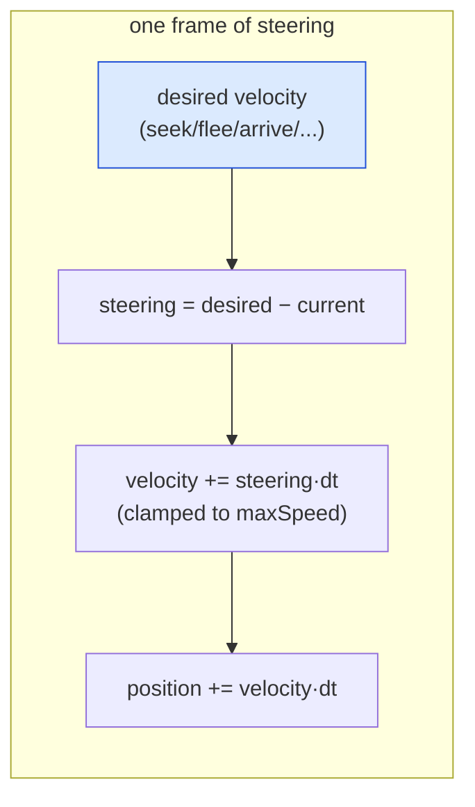
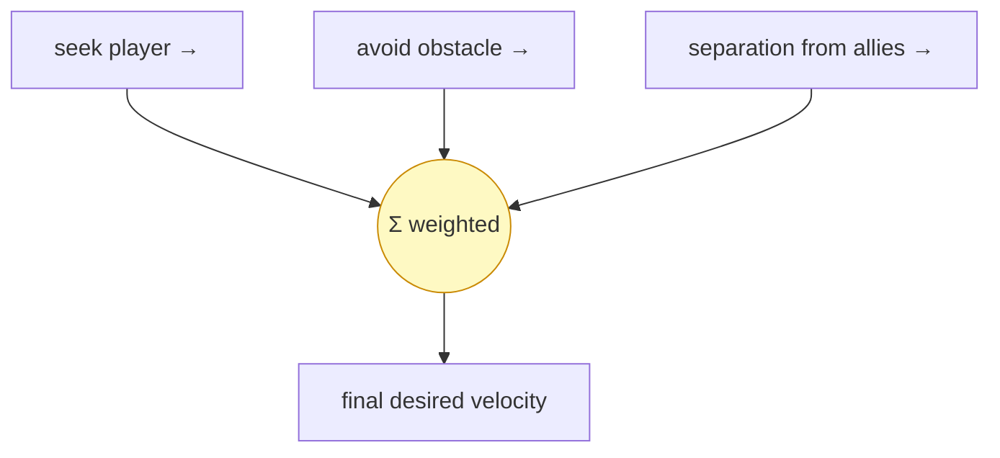
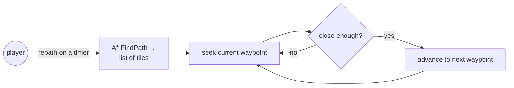

# Level 3 — Steering & Navigation

| | |
|---|---|
| 🎚️ **Difficulty** | 🔴 Hard |
| ⏱️ **Estimated time** | 35 minutes |
| ⭐ **XP reward** | 100 (Quest) + 25 (Quiz) |

[← Prev](02-perception-and-sensing.md) · [↑ Phase Home](../README.md) · [→ Next](04-behavior-trees.md)

---

## 📖 Story

> *"Your enemies now think and see — but watch them move. They snap toward the player in a straight line, jitter, and when three of them chase you they pile into one quivering blob. Maya's exact words: 'They move like Roombas.' Movement is where AI either feels alive or feels like a script. The fix is **steering** — instead of teleporting toward a goal, an enemy computes a *desired velocity* and *gradually turns* toward it, so it banks and arrives smoothly. These are Craig Reynolds' classic steering behaviors: **seek, flee, arrive, wander**, plus **obstacle avoidance** and **separation** so a pack spreads out instead of clumping. And here's the beautiful part — A* from World 4 gives the enemy a *path* (a list of waypoints), and steering makes it *follow that path smoothly*. A* is the GPS; steering is the driver. Wire them together and your enemies chase like predators, not Roombas. — Kenji"*

---

## 🎯 Goal

- Understand **steering** as desired-velocity vectors (World 2 math) layered on movement
- Implement the core behaviors: **seek**, **flee**, **arrive** (slow into the target), **wander**
- Add **obstacle avoidance** so enemies don't grind into walls
- **Follow a path** by steering through World 4's A* waypoints (GPS + driver)
- Add **separation** so a group of enemies chases without clumping into one blob

---

## 🧠 Concepts

### Steering = a desired velocity, applied gradually

A steering behavior outputs a single thing: a **desired velocity** vector — *where I want to be heading and how fast*. The enemy doesn't snap to it; it nudges its current velocity toward the desired one each frame, which produces smooth banking turns instead of instant 90° flicks. The building blocks (all pure World 2 vector math):

- **Seek**: desired = `(target - position).normalized * maxSpeed`. Go straight at the target, full speed.
- **Flee**: seek, negated. Run directly *away*.
- **Arrive**: like seek, but **scale speed down** inside a slowing radius so you decelerate into the target instead of orbiting/overshooting it.
- **Wander**: a slowly-drifting random target ahead of you — natural-looking idle roaming (much better than Lesson 1's teleporting waypoints).



### Behaviors are vectors — so you can *add* them

The killer feature: steering forces are just vectors, so you **sum** them (often weighted) to combine behaviors. "Seek the player **+** avoid that wall **+** stay apart from my buddies" is literally vector addition. This composability is why steering scales where hand-tuned `if`s don't.



### A* gives the route; steering walks it

World 4's `Pathfinder.FindPath` returns a `List<(int,int)>` of tiles — the *route*. Beelining toward the player fails the moment a wall is in the way (you grind into it). The fix is **path-following**: **seek the next waypoint** in the A* path; when you're close to it, advance to the next; when you reach the last, you're there. A* handles the global problem (how do I get around the maze?); steering handles the local one (move there smoothly). Repath on a timer — *not* every frame — exactly the budget rule from World 4.



### Separation keeps the pack from clumping

When several enemies seek the *same* target they converge to the same point and overlap into one jittering blob. **Separation** fixes it: each enemy adds a small steering force *away* from neighbors within a radius, stronger the closer they are. Seek pulls them at the player; separation pushes them apart; the sum is a pack that surrounds you. (Add **alignment** and **cohesion** and you have full **boids** flocking — but separation alone solves the clumping you actually have.)

### Why this exists

Pathfinding answers *which way*; steering answers *how to move* — and players feel the second one constantly. Without steering, even a perfect A* path looks robotic: instant turns, overshoot, jitter, blobbing. With it, enemies bank, decelerate, dodge, and spread out — the difference between "a script is moving a sprite" and "something is hunting me." Treating behaviors as summable vectors is the deep idea: complex, emergent group movement falls out of adding a few simple forces, no central choreographer needed.

This is **engine-agnostic**: Reynolds' steering, path-following, and separation are pure vector math (World 2) that ports to any engine; only the obstacle-avoidance raycast uses Unity's `Physics2D`. See **RESOURCES.md** for this world — Reynolds' steering paper and Red Blob Games are the canonical references.

---

## 🛠️ Hands-on Lab

> 💻 Builds on World 2 vectors, World 4's `Pathfinder.FindPath`/`TileMap`, and Lesson 2's `LastKnownPosition`.

### Step 1 — A steering agent (current velocity + smooth turning)

```csharp
using UnityEngine;

public class SteeringAgent : MonoBehaviour
{
    public float maxSpeed = 4f;
    public float maxAccel = 20f;          // how fast it can change heading (banking)
    public Vector2 Velocity { get; private set; }

    // Feed a desired velocity; we steer current → desired, then move.
    public void Steer(Vector2 desiredVelocity)
    {
        Vector2 steering = desiredVelocity - Velocity;
        steering = Vector2.ClampMagnitude(steering, maxAccel * Time.deltaTime);
        Velocity = Vector2.ClampMagnitude(Velocity + steering, maxSpeed);
        transform.position += (Vector3)(Velocity * Time.deltaTime);

        if (Velocity.sqrMagnitude > 0.001f)       // face where we're going (honest cone, Lesson 2)
            transform.right = Velocity.normalized;
    }
}
```

### Step 2 — The classic behaviors (pure vectors)

```csharp
using UnityEngine;

public static class Steering
{
    public static Vector2 Seek(Vector2 pos, Vector2 target, float maxSpeed)
        => (target - pos).normalized * maxSpeed;

    public static Vector2 Flee(Vector2 pos, Vector2 threat, float maxSpeed)
        => (pos - threat).normalized * maxSpeed;

    // Arrive: full speed far away, easing to 0 inside slowRadius (no overshoot).
    public static Vector2 Arrive(Vector2 pos, Vector2 target, float maxSpeed, float slowRadius)
    {
        Vector2 to = target - pos;
        float dist = to.magnitude;
        if (dist < 0.01f) return Vector2.zero;
        float speed = dist < slowRadius ? maxSpeed * (dist / slowRadius) : maxSpeed;
        return to.normalized * speed;
    }

    // Wander: a jittering point on a circle projected ahead of the agent.
    public static Vector2 Wander(Vector2 pos, Vector2 forward, ref float wanderAngle, float maxSpeed)
    {
        wanderAngle += Random.Range(-0.3f, 0.3f);                 // drift the target slowly
        Vector2 circleCenter = pos + forward.normalized * 1.5f;
        Vector2 offset = new(Mathf.Cos(wanderAngle), Mathf.Sin(wanderAngle));
        return Seek(pos, circleCenter + offset, maxSpeed);
    }
}
```

### Step 3 — Obstacle avoidance (a feeler raycast)

```csharp
using UnityEngine;

public static class Avoidance
{
    // If a wall is dead ahead within lookAhead, steer perpendicular to slip past it.
    public static Vector2 AvoidObstacles(Vector2 pos, Vector2 velocity,
        float lookAhead, LayerMask obstacleMask)
    {
        if (velocity.sqrMagnitude < 0.001f) return Vector2.zero;
        Vector2 dir = velocity.normalized;
        var hit = Physics2D.Raycast(pos, dir, lookAhead, obstacleMask);
        if (hit.collider == null) return Vector2.zero;           // clear road

        // Push away from the wall's surface normal — the avoidance force.
        return hit.normal * velocity.magnitude;
    }
}
```

### Step 4 — Follow an A* path by seeking each waypoint

```csharp
using System.Collections.Generic;
using UnityEngine;

[RequireComponent(typeof(SteeringAgent))]
public class PathFollower : MonoBehaviour
{
    public float tileSize = 1f;
    public float waypointRadius = 0.15f;     // "close enough" to advance

    private SteeringAgent _agent;
    private List<(int x, int y)> _path;
    private int _index;

    void Awake() => _agent = GetComponent<SteeringAgent>();

    // Call from the FSM's Chase state on a timer (NOT every frame — World 4 budget rule).
    public void SetPath(TileMap map, (int x, int y) self, (int x, int y) goal)
    {
        _path = Pathfinder.FindPath(map, self, goal);   // World 4 A*
        _index = 0;
    }

    public bool HasPath => _path != null && _index < _path.Count;

    void Update()
    {
        if (!HasPath) return;

        Vector2 wp = new(_path[_index].x * tileSize, _path[_index].y * tileSize);
        if (Vector2.Distance(transform.position, wp) < waypointRadius)
        { _index++; return; }                            // reached → next waypoint

        _agent.Steer(Steering.Seek(transform.position, wp, _agent.maxSpeed));
    }
}
```

### Step 5 — Separation so a pack doesn't clump

```csharp
using UnityEngine;

public static class Flocking
{
    // Sum of pushes away from nearby allies; closer = stronger. Reuse World 4's
    // spatial grid to gather `neighbors` cheaply instead of scanning every enemy.
    public static Vector2 Separation(Vector2 pos, Transform[] neighbors,
        float radius, float maxSpeed)
    {
        Vector2 push = Vector2.zero;
        foreach (var n in neighbors)
        {
            Vector2 away = pos - (Vector2)n.position;
            float d = away.magnitude;
            if (d > 0f && d < radius)
                push += away.normalized / d;             // 1/d → much stronger up close
        }
        return push == Vector2.zero ? Vector2.zero : push.normalized * maxSpeed;
    }
}
```

### Step 6 — Combine: chase along a path, avoid walls, stay apart

The Chase state now sums weighted behaviors into one desired velocity:

```csharp
// Inside ChaseState.Tick() — compose the forces (each is a World 2 vector).
Vector2 pos = _b.transform.position;

Vector2 follow = pathFollower.HasPath
    ? Steering.Arrive(pos, currentWaypoint, agent.maxSpeed, slowRadius: 1.5f)
    : Steering.Seek(pos, _b.TargetPoint(), agent.maxSpeed);     // last-known-pos (Lesson 2)

Vector2 avoid = Avoidance.AvoidObstacles(pos, agent.Velocity, 1.2f, obstacleMask);
Vector2 spread = Flocking.Separation(pos, nearbyEnemies, radius: 1.0f, agent.maxSpeed);

// Weighted sum → one desired velocity. Tune the weights to taste.
Vector2 desired = follow * 1.0f + avoid * 2.0f + spread * 1.2f;
agent.Steer(Vector2.ClampMagnitude(desired, agent.maxSpeed));
```

> 💡 Avoidance gets the **highest** weight — not hitting a wall beats reaching the player a tenth of a second sooner. Tuning these weights *is* the personality of the enemy; expose them as `[SerializeField]` so Maya can tune without you.

---

## 🎮 Mini Challenge

Five enemies chase the player and immediately fuse into one shaking clump on top of each other. The dev cranks `maxSpeed` thinking they'll "spread out at speed." It doesn't help. What behavior is missing, and why won't speed ever fix it?

<details>
<summary>💡 Reveal answer</summary>

**Separation is missing.** Every enemy is seeking the *same* point (the player), so their desired velocities all converge there — they're *supposed* to end up on top of each other. Speed can't fix it because faster convergence to the same point is still convergence; you just clump quicker.

The fix is a force that depends on *neighbors*, not the target: add `Flocking.Separation` to the weighted sum so each enemy is pushed away from those nearby (stronger the closer they are). Now seek pulls them toward you while separation holds them apart, and the pack *surrounds* you instead of stacking. This is the core insight of steering: emergent group behavior comes from **summing** simple per-agent forces, not from a smarter individual goal.
</details>

---

## 📦 Project Mission

Make Ashfall's enemies move like predators: smooth, path-following, wall-dodging, non-clumping.

1. Create `Assets/Scripts/AI/Steering/` with `SteeringAgent.cs`, `Steering.cs`, `Avoidance.cs`, `PathFollower.cs`, `Flocking.cs` (Steps 1–5). Add `SteeringAgent` + `PathFollower` to the enemy.
2. Swap Lesson 1's `MoveTowards` patrol for **wander** steering, and the Chase beeline for **path-following** through World 4's `Pathfinder` (Step 4). Repath on a timer, not every frame.
3. Use **arrive** at the goal so enemies decelerate into attack range instead of overshooting and orbiting the player.
4. Add **obstacle avoidance** (Step 3) on the wall layer; prove an enemy rounds a corner instead of grinding into it.
5. Spawn 4–5 enemies and add **separation** (Steps 5–6); confirm they surround the player instead of fusing into one blob. Pull neighbors from **World 4's spatial grid**, not a full scan.
6. Expose the steering weights as `[SerializeField]` and tune the feel (avoidance highest).
7. Commit:
   ```bash
   cd ~/projects/ashfall
   git switch -c feature/ai-steering
   git add Assets/Scripts/AI/Steering
   git commit -m "feat: steering behaviors (seek/flee/arrive/wander), obstacle avoidance, A* path-following, separation"
   git switch main && git merge feature/ai-steering && git push
   ```

🎯 **Mission complete when:** Ashfall enemies chase the player **smoothly along an A\* path** (seeking waypoints, arriving without overshoot), **dodge walls** via avoidance, **wander** naturally while idle, and a group of them **surrounds** the player instead of clumping — all built from summed World 2 steering vectors driven by the Lesson 1 FSM.

---

## ⚠️ Common Mistakes

| Mistake | What happens | Fix |
|--------|--------------|-----|
| Beelining toward the player | Enemy grinds into walls / gets stuck | Follow the A* path; seek each waypoint |
| Snapping velocity to desired | Instant flicky turns, jitter | Steer *toward* desired (`steering = desired − current`, clamped) |
| Seek instead of arrive at the goal | Overshoot, orbiting around the target | Arrive: scale speed down inside a slow radius |
| No separation in a group | All enemies fuse into one clump | Add a separation force away from neighbors |
| Repathing A* every frame | Frame spikes with many enemies | Repath on a timer / on tile change (World 4 budget) |
| Avoidance weighted too low | Enemy clips the wall reaching the player | Weight avoidance highest in the sum |

---

## 🤔 Reflection Questions

1. Steering behaviors are vectors you *add* together. What does that composability buy you compared to writing one big `if`-tree that decides "chase OR avoid OR spread"?
2. "A* is the GPS, steering is the driver." Why is it good architecture that path*finding* and path*following* are separate systems — and what could you swap out of each without touching the other?
3. Separation depends on neighbors, not on the goal. Why is *that* the reason five enemies seeking the same player will always clump without it, no matter how you tune speed?

---

## 📝 Quiz

1. **A steering behavior outputs…**
   - a) a boolean "should I move?"
   - b) a desired velocity vector the agent gradually turns toward
   - c) the exact final position to teleport to
2. **To make an enemy navigate around walls to the player, you…**
   - a) increase its move speed
   - b) follow World 4's A* path by seeking each waypoint
   - c) widen its vision cone
3. **A group of enemies stops clumping into one blob when you add…**
   - a) arrive instead of seek
   - b) a separation force pushing each agent away from nearby neighbors
   - c) a higher max speed

<details>
<summary>✅ Answers</summary>

1: **b** · 2: **b** · 3: **b**
</details>

---

## ✅ Completion Checklist

- [ ] `SteeringAgent` turns smoothly toward a desired velocity (no snapping)
- [ ] Seek/flee/arrive/wander implemented as pure World 2 vectors
- [ ] Enemies follow World 4's A* path (repath on a timer, not per frame)
- [ ] Obstacle avoidance keeps them off the walls; arrive prevents overshoot
- [ ] Separation makes a group surround the player instead of clumping
- [ ] I passed the quiz
- [ ] Added **+125 XP** to [PROGRESS.md](../../../PROGRESS.md)

---

[← Prev](02-perception-and-sensing.md) · [↑ Phase Home](../README.md) · [→ Next](04-behavior-trees.md)
