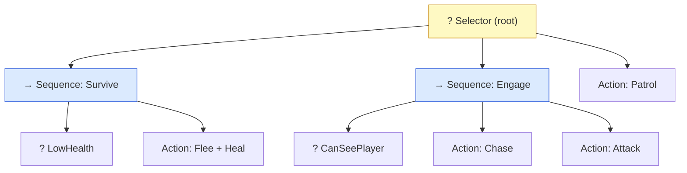
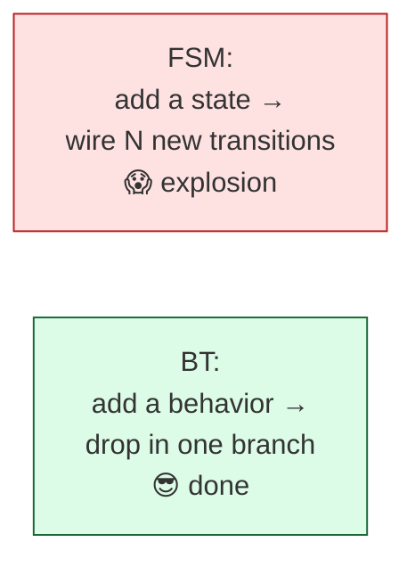

# Level 4 — Behavior Trees

| | |
|---|---|
| 🎚️ **Difficulty** | 🔴 Hard |
| ⏱️ **Estimated time** | 35 minutes |
| ⭐ **XP reward** | 100 (Quest) + 25 (Quiz) |

[← Prev](03-steering-and-navigation.md) · [↑ Phase Home](../README.md) · [→ Next](05-boss-design-and-utility-ai.md)

---

## 📖 Story

> *"Time for the tool the big studios actually use. Your FSM is great for a grunt with four states — but Maya wants an *elite* enemy: patrol, but if it hears something investigate, but if it sees the player chase and attack, but if it's low on health back off and heal, but if cornered turn and fight. Try drawing *that* as an FSM and you get the dreaded 'state explosion' — every state needs a transition to every other, and it becomes spaghetti with arrows. **Behavior trees** solve this. They're how Halo, the Sims, and most modern AAA enemies are built. A BT is a tree of nodes you **tick** every frame; each node returns **Success**, **Failure**, or **Running**. Two control nodes do all the work: a **Sequence** ('do these in order, stop if one fails' — an AND), and a **Selector** ('try these in order, stop at the first that works' — an OR/fallback). Composable, readable, and a designer can rearrange behavior by dragging branches. Build the tiny runtime, then build an elite. — Kenji"*

---

## 🎯 Goal

- Understand **why behavior trees scale** where big FSMs explode
- Learn the node taxonomy: **composites** (Sequence/Selector), **conditions**, **actions**, and the **tick** loop
- Master the three statuses every node returns: **Success / Failure / Running**
- Build a small, reusable **BT runtime** from scratch
- Build an **elite Ashfall enemy** whose behavior is a behavior tree (reusing perception + steering)

---

## 🧠 Concepts

### Tick, and three statuses

A behavior tree is **ticked** every frame from the root. Each node, when ticked, returns one of three statuses — and that's the entire protocol:

- **Success** ✅ — I finished and it worked.
- **Failure** ❌ — I couldn't do it / my condition is false.
- **Running** ⏳ — I'm still working; tick me again next frame (a walk-to that hasn't arrived, an attack mid-swing).

`Running` is the crucial idea FSMs lack natively: a node can span many frames and report "not done yet," and the tree *remembers* to come back to it. That's what makes long actions composable.

### Two composites do almost everything



- **Sequence** (→, an **AND**): ticks children left-to-right. Returns **Failure** on the first child that fails (and stops), **Running** if a child is running, **Success** only if *all* succeed. Use it for "do this, then this, then this."
- **Selector** (?, an **OR / fallback**): ticks children left-to-right. Returns **Success** on the first child that succeeds (and stops), **Running** if a child is running, **Failure** only if *all* fail. Use it for "try this, else that, else fall back."

Read the tree above top-down: *Try to survive (am I low? then flee+heal); else try to engage (can I see the player? then chase, then attack); else just patrol.* Priority is left-to-right order — survival sits above combat, so it always wins. **Conditions** are leaf nodes that just return Success/Failure (`LowHealth?`, `CanSeePlayer?`); **actions** are leaf nodes that *do* something (`Chase`, `Attack`) and may return `Running`.

### Why BTs scale where FSMs explode

An FSM with *N* states can need up to *N×(N−1)* transitions — adding the 6th behavior means wiring it to the other five. A behavior tree adds a behavior by **dropping in one branch**; priority is just its position, and it can't accidentally entangle the rest. The tree is also **self-documenting** — the picture *is* the AI, and designers can re-prioritize by reordering children. (Optional **decorators** wrap a single child to tweak it — `Inverter` flips Success/Failure, `Cooldown` gates how often a branch runs, `Repeat` loops it.)



### FSM vs BT — keep both

BTs don't *replace* the FSM — they sit at a different altitude. A common shipping pattern (and what the boss uses next lesson): an FSM for big modes/phases, a behavior tree *inside* a mode for the moment-to-moment decisions. The FSM you built in Lesson 1 isn't wasted; it's a layer.

### Why this exists

Behavior trees are the industry-standard answer to "my AI got complicated." They make complex behavior **composable** (build big trees from small reusable nodes), **prioritized** (left-to-right = importance, survival over aggression), **interruptible** (re-ticking from the root each frame means a higher-priority branch — fleeing when suddenly low — preempts a lower one automatically), and **designer-readable** (the tree is the spec). The `Running` status is what lets multi-frame actions live inside that structure without an explicit state per step.

This is **engine-agnostic**: the node base class, the three statuses, and Sequence/Selector are pure data-structure logic identical in Unreal (its Behavior Tree is first-class), Godot, or a custom engine; only the leaf *actions* call Unity. See **RESOURCES.md** for this world for behavior-tree references.

---

## 🛠️ Hands-on Lab

> 💻 Builds a tiny BT runtime, then drives it with Lesson 2's `Perception`, Lesson 3's steering, and World 5's `Health`.

### Step 1 — The status enum and node base

```csharp
public enum Status { Success, Failure, Running }

public abstract class Node
{
    public abstract Status Tick();        // called every frame from the parent
}
```

That is the entire contract. Everything below is a `Node`.

### Step 2 — The two composites (Sequence = AND, Selector = OR)

```csharp
using System.Collections.Generic;

// Runs children in order; fails fast. Success only if ALL succeed.
public class Sequence : Node
{
    private readonly List<Node> _children;
    public Sequence(params Node[] children) => _children = new(children);

    public override Status Tick()
    {
        foreach (var child in _children)
        {
            var s = child.Tick();
            if (s != Status.Success) return s;   // Failure or Running → stop here
        }
        return Status.Success;                    // all children succeeded
    }
}

// Tries children in order; succeeds fast. Failure only if ALL fail.
public class Selector : Node
{
    private readonly List<Node> _children;
    public Selector(params Node[] children) => _children = new(children);

    public override Status Tick()
    {
        foreach (var child in _children)
        {
            var s = child.Tick();
            if (s != Status.Failure) return s;   // Success or Running → stop here
        }
        return Status.Failure;                    // everything failed
    }
}
```

> 💡 This simple re-tick-from-root design recomputes the whole tree each frame, which is exactly what makes it **interruptible**: the moment `LowHealth` flips true, the Survive branch (higher in the Selector) wins automatically — no transition to wire. (Production BTs add memory to resume a `Running` branch without rechecking earlier siblings; this version is plenty for Ashfall.)

### Step 3 — Leaf nodes: conditions and actions (delegate-backed)

```csharp
using System;

// A condition wraps a bool test → Success / Failure.
public class Condition : Node
{
    private readonly Func<bool> _test;
    public Condition(Func<bool> test) => _test = test;
    public override Status Tick() => _test() ? Status.Success : Status.Failure;
}

// An action wraps work that returns a Status (so it can report Running).
public class Action : Node
{
    private readonly Func<Status> _act;
    public Action(Func<Status> act) => _act = act;
    public override Status Tick() => _act();
}
```

Backing leaves with delegates means you compose a whole tree inline — no class per condition.

### Step 4 — A decorator (Inverter), to show how they wrap one child

```csharp
// Flips Success<->Failure (Running passes through). Useful for "if NOT ...".
public class Inverter : Node
{
    private readonly Node _child;
    public Inverter(Node child) => _child = child;

    public override Status Tick() => _child.Tick() switch
    {
        Status.Success => Status.Failure,
        Status.Failure => Status.Success,
        _              => Status.Running,
    };
}
```

### Step 5 — Build an elite enemy's tree

```csharp
using UnityEngine;

[RequireComponent(typeof(Perception), typeof(SteeringAgent), typeof(Health))]
public class EliteEnemyBT : MonoBehaviour
{
    public float lowHealthFraction = 0.3f;
    public float attackRange = 1.2f;

    private Node _root;
    private Perception _perception;
    private SteeringAgent _agent;
    private Health _health;

    void Awake()
    {
        _perception = GetComponent<Perception>();
        _agent = GetComponent<SteeringAgent>();
        _health = GetComponent<Health>();

        // Priority top-to-bottom: survive > fight > patrol.
        _root = new Selector(
            // 1) SURVIVE: if low health, flee from the player.
            new Sequence(
                new Condition(IsLowHealth),
                new Action(FleeFromPlayer)
            ),
            // 2) FIGHT: if I can act on the player, attack when close else chase.
            new Sequence(
                new Condition(() => _perception.HasTarget),
                new Selector(
                    new Sequence(                       // close enough? attack.
                        new Condition(InAttackRange),
                        new Action(Attack)
                    ),
                    new Action(ChasePlayer)             // else close the gap.
                )
            ),
            // 3) FALLBACK: patrol/wander.
            new Action(Patrol)
        );
    }

    void Update() => _root.Tick();      // one line ticks the whole brain

    // ---- leaves ----
    private bool IsLowHealth() => _health.Current <= _health.Max * lowHealthFraction;
    private bool InAttackRange() =>
        Vector2.Distance(transform.position, _perception.LastKnownPosition) <= attackRange;

    private Status FleeFromPlayer()
    {
        _agent.Steer(Steering.Flee(transform.position, _perception.LastKnownPosition, _agent.maxSpeed));
        return Status.Running;          // fleeing is ongoing
    }

    private Status ChasePlayer()
    {
        // Reuse Lesson 3 steering toward the last-known position (Lesson 2).
        _agent.Steer(Steering.Arrive(transform.position, _perception.LastKnownPosition,
            _agent.maxSpeed, slowRadius: 1.5f));
        return Status.Running;          // still closing in
    }

    private Status Attack()
    {
        // Route through World 5's pipeline (one path for all damage).
        if (_perception.HasTarget &&
            GameObject.FindWithTag("Player").TryGetComponent<IDamageable>(out var t))
            t.TakeDamage(new DamageInfo { Amount = 8f, Type = DamageType.Physical, Source = gameObject });
        return Status.Success;          // one swing done this tick
    }

    private Status Patrol()
    {
        float a = 0f;
        _agent.Steer(Steering.Wander(transform.position, transform.right, ref a, _agent.maxSpeed));
        return Status.Running;
    }
}
```

> 💡 Notice the **reuse**: conditions read Lesson 2's `Perception`, actions drive Lesson 3's `Steering`, and `Attack` calls World 5's `TakeDamage`. The BT is pure *orchestration* — it decides *what* to do; the systems you already built do it.

---

## 🎮 Mini Challenge

A designer wants the elite to **flee when low health even mid-attack**. They put the Survive branch *below* Fight in the root Selector. In testing, the enemy keeps swinging at the player while dying and never flees. Why — and what's the one-word fix?

<details>
<summary>💡 Reveal answer</summary>

**Order.** A Selector ticks children **left-to-right (top-to-bottom)** and returns at the first non-Failure. With Fight above Survive, whenever the enemy can see the player the Fight branch returns Success/Running and the Selector **stops before ever reaching Survive** — so the flee branch is never evaluated.

The fix is one word: **reorder** — put the Survive sequence *first*. Because the tree re-ticks from the root every frame, the instant `IsLowHealth` becomes true the higher-priority Survive branch wins and *preempts* the attack automatically — no transition to wire. That's the whole point of BT priority: **position = priority**, and survival belongs at the top.
</details>

---

## 📦 Project Mission

Give Ashfall a behavior-tree-driven **elite** enemy that's too complex for a clean FSM.

1. Create `Assets/Scripts/AI/BT/` with `Node.cs` (+ `Status`), `Sequence.cs`, `Selector.cs`, `Condition.cs`, `Action.cs`, `Inverter.cs` (Steps 1–4). This runtime is reused by the boss next lesson.
2. Create `EliteEnemyBT.cs` (Step 5) and build the survive → fight → patrol tree. Add it (with `Perception`, `SteeringAgent`, `Health`) to a new elite prefab.
3. Verify priority: at full HP the elite **chases and attacks**; drop it below `lowHealthFraction` and it must **immediately flee** mid-fight (preemption from re-ticking the root).
4. Verify `Running`: the chase/flee actions return `Running` and continue across frames smoothly (they don't restart or stutter).
5. Confirm reuse: conditions read **Lesson 2's `Perception`**, actions use **Lesson 3's `Steering`**, and `Attack` deals damage through **World 5's `TakeDamage`** — no logic re-implemented inside the BT.
6. Add one **decorator** in practice (e.g. wrap a condition in `Inverter`, or add a `Cooldown` on Attack) to feel how decorators tune a branch.
7. Commit:
   ```bash
   cd ~/projects/ashfall
   git switch -c feature/behavior-trees
   git add Assets/Scripts/AI/BT
   git commit -m "feat: behavior-tree runtime (Sequence/Selector/Condition/Action/Inverter) + BT-driven elite enemy"
   git switch main && git merge feature/behavior-trees && git push
   ```

🎯 **Mission complete when:** Ashfall has a working BT runtime (nodes returning Success/Failure/Running, ticked from the root each frame) driving an **elite enemy** that **prioritizes survival over combat over patrol**, flees mid-attack the instant its HP drops (interruption via re-tick), and reuses perception + steering + the damage pipeline as its leaf nodes.

---

## ⚠️ Common Mistakes

| Mistake | What happens | Fix |
|--------|--------------|-----|
| Confusing Sequence and Selector | Behavior reads backwards (ANDs where you meant ORs) | Sequence = AND (all succeed); Selector = OR (first success) |
| Wrong child order in a Selector | High-priority branch (flee) never runs | Order children by priority, top = most important |
| Action never returns `Running` | Multi-frame actions restart or finish instantly | Return `Running` while ongoing, `Success` when done |
| Re-implementing logic inside nodes | BT duplicates perception/steering/combat | Leaves *call* existing systems; the tree only orchestrates |
| Allocating the tree every frame | GC churn (World 1) | Build the tree once in `Awake`, tick it in `Update` |
| Reaching for a BT for a 3-state grunt | Overkill machinery for trivial AI | FSM for simple modal AI; BT when it gets complex |

---

## 🤔 Reflection Questions

1. An FSM with *N* states can need ~*N²* transitions; a BT adds a behavior with one branch. Walk through what *exactly* you'd have to touch in each to add a "flee when low health" behavior to a 5-state enemy.
2. The tree re-ticks from the root every frame, so a newly-true high-priority branch preempts a lower one with no transition wired. Why is this "free interruption" the property that makes BTs feel responsive?
3. The `Running` status has no clean equivalent in a basic FSM. What does it let a *single* node express that an FSM would need multiple states (and transitions) to represent?

---

## 📝 Quiz

1. **A Selector node returns Success when…**
   - a) all of its children succeed
   - b) the first child that doesn't fail (Success or Running) — it's a fallback/OR
   - c) exactly one child fails
2. **The `Running` status exists so that…**
   - a) the tree can skip a node
   - b) a multi-frame action can report "not done yet" and be re-ticked next frame
   - c) a node can run twice per frame
3. **Behavior trees scale better than big FSMs mainly because…**
   - a) they run faster on the GPU
   - b) adding a behavior is dropping in one branch, not wiring N new transitions
   - c) they don't need conditions

<details>
<summary>✅ Answers</summary>

1: **b** · 2: **b** · 3: **b**
</details>

---

## ✅ Completion Checklist

- [ ] I have a BT runtime: nodes return Success/Failure/Running, ticked from the root
- [ ] Sequence (AND) and Selector (OR/fallback) behave correctly
- [ ] The elite enemy prioritizes survive > fight > patrol and flees mid-attack on low HP
- [ ] Multi-frame actions return `Running` and continue smoothly
- [ ] Leaf nodes reuse perception, steering, and the World 5 damage pipeline
- [ ] I passed the quiz
- [ ] Added **+125 XP** to [PROGRESS.md](../../../PROGRESS.md)

---

[← Prev](03-steering-and-navigation.md) · [↑ Phase Home](../README.md) · [→ Next](05-boss-design-and-utility-ai.md)
