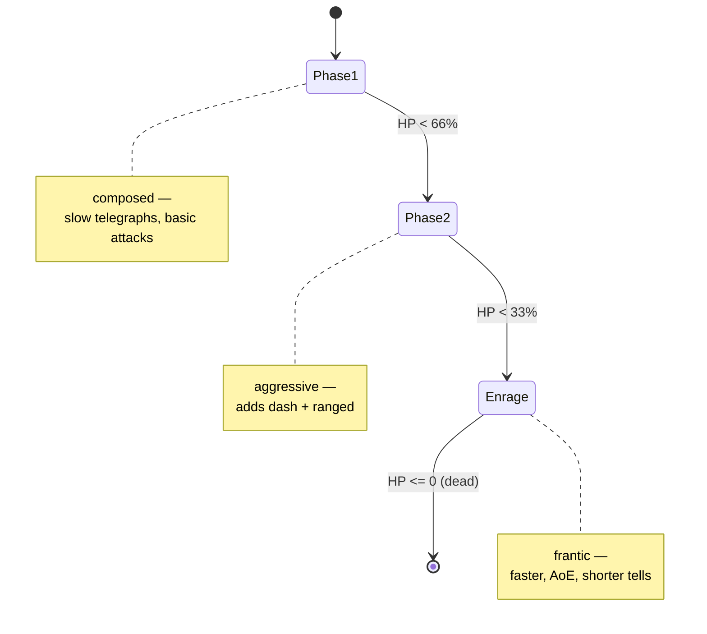
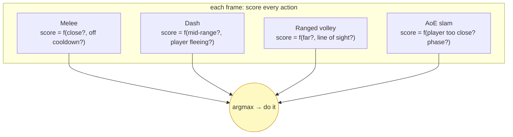
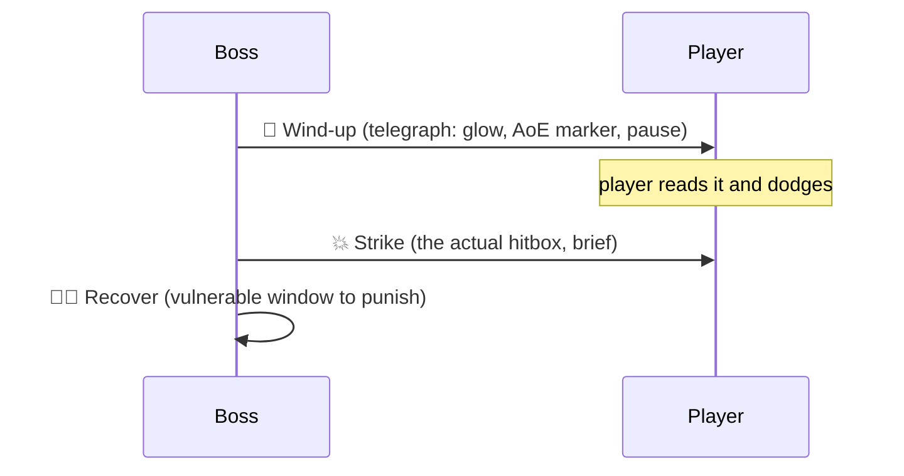

# Level 5 — Boss Design & Utility AI

| | |
|---|---|
| 🎚️ **Difficulty** | 🔴 Hard |
| ⏱️ **Estimated time** | 35 minutes |
| ⭐ **XP reward** | 100 (Quest) + 25 (Quiz) |

[← Prev](04-behavior-trees.md) · [↑ Phase Home](../README.md) · [→ Next](../boss-battle.md)

---

## 📖 Story

> *"Last lesson of the brain world — and it's the fun one. A boss isn't just a big enemy; it's a *designed encounter*. Maya's brief: 'The **Ashen Warden** guards the dungeon's heart. Give it phases — composed at full health, frantic and dangerous at low health — and a *roster* of attacks it chooses intelligently, not randomly.' Two ideas make that work. **Phase-based design**: the boss is an FSM of phases (your Lesson 1 pattern!), each phase a different personality, with a dramatic transition at an HP threshold. And **utility AI**: instead of hard-coding 'if X do Y,' you give each possible action a **score** every frame — based on distance, the player's state, cooldowns — and the boss simply does the **highest-scoring** action. That's how a boss feels smart and unpredictable yet fair. The non-negotiable rule: every heavy attack is **telegraphed** — a wind-up the player can read and dodge. A boss that one-shots you with no warning isn't hard, it's broken. This is the capstone — it combines everything: FSM, perception, steering, and scoring. — Kenji"*

---

## 🎯 Goal

- Design a **multi-phase boss** as an FSM of phases (reusing Lesson 1), with HP-threshold transitions
- Understand **utility AI**: scoring candidate actions each frame and picking the best
- Build a **scoring system** that weighs distance, player state, and cooldowns
- **Telegraph** attacks (wind-up → strike → recover) so they're readable and dodgeable
- Build the **Ashen Warden** — Ashfall's boss — combining phases + utility scoring + telegraphs

---

## 🧠 Concepts

### A boss is a *designed encounter*, in phases

A boss fight should have an **arc**: it changes as it loses health so the fight escalates and stays interesting. Model the phases as an **FSM** — yes, the exact pattern from Lesson 1 — where each phase is a state with its own behavior and attack set, and transitions fire at **HP thresholds**:



A clean trick: at each phase transition, play a **stagger / shockwave** beat (brief invulnerability + a roar + screen shake from World 7 later). It tells the player "the fight just changed" — phases the player can *feel* are the difference between a memorable boss and a damage sponge.

### Utility AI: score everything, do the best thing

Inside a phase, *which* attack should the boss use right now? An FSM would need a sub-state per choice; hard-coded `if`s get brittle fast. **Utility AI** is the elegant answer: every frame, ask each candidate action *"how good an idea are you right now?"* — a **score** in `[0,1]` computed from the situation (distance to player, player's HP, whether the player is dodging, the action's own cooldown). Then just do the **highest-scoring** action.



Why this beats both FSM and random: it's **context-sensitive** (melee scores high only when you're close *and* it's off cooldown), **emergent** (you didn't script "do A then B" — sensible sequences fall out of the scores), and **tunable from data** (shift a curve and the boss's personality changes). The Sims, *F.E.A.R.*, and most modern combat AI run on utility scoring.

### Curves turn raw inputs into scores

The art of utility AI is the **scoring function** — usually a small **curve** mapping a raw input (distance, HP) to `[0,1]`. "Melee desire vs distance" should be high up close and fall to zero far away; "heal desire vs my HP" should be near zero when healthy and spike when low. Keep each action's score a product of a few such curves (range fit × cooldown readiness × phase weight). Multiplying means *any* zero factor (on cooldown, wrong range) zeroes the action — a clean veto.

### Telegraphs: the contract with the player

Every meaningful boss attack runs **wind-up → strike → recover**:



The **wind-up** is the fairness contract: it gives the player time to react. The **recover** window is the risk/reward — the boss is open right after a big move. No-telegraph attacks aren't difficulty, they're unfairness; in Enrage you *shorten* tells to raise tension, never remove them.

### Why this exists

Bosses are the encounters players remember and the hardest AI to author well. Phase-based design gives the fight a **dramatic arc**; utility AI makes the boss feel **intelligent and varied** without a brittle script or unfair randomness; telegraphs make hard attacks **fair and learnable**. Together they're the difference between a boss that's a tense, readable dance and one that's a confusing HP sponge. Crucially, this lesson is a **capstone**: the phase FSM is Lesson 1, the targeting reads Lesson 2's perception, the movement is Lesson 3's steering, and you could even nest Lesson 4's BTs inside a phase — World 6 converging into one fight.

This is **engine-agnostic**: phase FSMs, utility scoring/curves, and the telegraph timeline are pure logic that ports to any engine; only the hitbox overlap, VFX, and timing coroutines touch Unity. See **RESOURCES.md** for this world for boss-design and utility-AI references.

---

## 🛠️ Hands-on Lab

> 💻 The capstone: reuses Lesson 1's `StateMachine`/`IState`, Lesson 2's `Perception`, Lesson 3's `Steering`, and World 5's `Health`/`TakeDamage`.

### Step 1 — A scored action (the utility unit)

```csharp
using System;
using UnityEngine;

// One thing the boss can do, plus a function that rates how good it is right now.
public class UtilityAction
{
    public string Name;
    public float Cooldown;                 // seconds between uses
    public Func<float> Score;              // returns desirability in [0,1]
    public Action Execute;                 // performs the attack (starts its telegraph)

    private float _readyAt;
    public bool IsReady => Time.time >= _readyAt;
    public void MarkUsed() => _readyAt = Time.time + Cooldown;

    // On cooldown → score 0 (a clean veto). Otherwise the action's own rating.
    public float Evaluate() => IsReady ? Mathf.Clamp01(Score()) : 0f;
}
```

### Step 2 — The utility brain: pick the best action

```csharp
using System.Collections.Generic;

public class UtilityBrain
{
    private readonly List<UtilityAction> _actions = new();
    public void Add(UtilityAction a) => _actions.Add(a);

    // Each tick: score every action, run the highest scorer (if any beats 0).
    public void Tick()
    {
        UtilityAction best = null;
        float bestScore = 0f;
        foreach (var a in _actions)
        {
            float s = a.Evaluate();
            if (s > bestScore) { bestScore = s; best = a; }
        }
        if (best != null) { best.Execute(); best.MarkUsed(); }
    }
}
```

### Step 3 — Scoring curves (raw input → [0,1])

```csharp
using UnityEngine;

public static class Curves
{
    // High when close, fading to 0 at maxDist. (melee desire)
    public static float CloseRange(float dist, float maxDist)
        => Mathf.Clamp01(1f - dist / maxDist);

    // High when far, 0 when adjacent. (ranged desire)
    public static float LongRange(float dist, float maxDist)
        => Mathf.Clamp01(dist / maxDist);

    // A band: peaks in the middle of [min,max], 0 outside. (dash desire)
    public static float Band(float v, float min, float max)
    {
        if (v < min || v > max) return 0f;
        float mid = (min + max) * 0.5f, half = (max - min) * 0.5f;
        return 1f - Mathf.Abs(v - mid) / half;
    }
}
```

### Step 4 — A telegraphed attack (wind-up → strike → recover)

```csharp
using System.Collections;
using UnityEngine;

public class TelegraphedAttack : MonoBehaviour
{
    public float windUp = 0.7f;     // fairness window: player can react
    public float recover = 0.5f;    // vulnerable window after the strike
    public float damage = 20f;
    public float radius = 1.8f;

    public bool IsBusy { get; private set; }   // utility scoring vetoes new attacks while busy

    public void Begin() { if (!IsBusy) StartCoroutine(Run()); }

    private IEnumerator Run()
    {
        IsBusy = true;

        // 1) WIND-UP — show the telegraph (glow / AoE marker). Player dodges here.
        ShowTelegraph(true);
        yield return new WaitForSeconds(windUp);
        ShowTelegraph(false);

        // 2) STRIKE — the actual hitbox, brief. One pipeline (World 5).
        foreach (var hit in Physics2D.OverlapCircleAll(transform.position, radius))
            if (hit.TryGetComponent<IDamageable>(out var t))
                t.TakeDamage(new DamageInfo { Amount = damage, Type = DamageType.Fire, Source = gameObject });

        // 3) RECOVER — boss is open to punishment.
        yield return new WaitForSeconds(recover);
        IsBusy = false;
    }

    private void ShowTelegraph(bool on) { /* enable warning VFX / AoE decal (World 7 polish) */ }
}
```

### Step 5 — Boss phases as an FSM (reuse Lesson 1)

```csharp
using UnityEngine;

// Each phase configures the utility brain differently — a distinct personality.
public class BossPhase : IState
{
    private readonly AshenWarden _w;
    private readonly float _speedMult;
    private readonly System.Action _configure;   // sets which actions/weights this phase uses

    public BossPhase(AshenWarden w, float speedMult, System.Action configure)
    { _w = w; _speedMult = speedMult; _configure = configure; }

    public void Enter() { _configure(); _w.Agent.maxSpeed = _w.baseSpeed * _speedMult; _w.PlayPhaseRoar(); }
    public void Tick() => _w.Brain.Tick();       // the phase runs the utility brain
    public void Exit() { }
}
```

### Step 6 — The Ashen Warden (capstone: phases + utility + telegraphs)

```csharp
using UnityEngine;

[RequireComponent(typeof(Health), typeof(Perception), typeof(SteeringAgent))]
public class AshenWarden : MonoBehaviour
{
    public float baseSpeed = 3.5f;
    public TelegraphedAttack slam;      // close AoE
    public TelegraphedAttack emberVolley; // ranged

    public StateMachine Fsm { get; } = new();
    public UtilityBrain Brain { get; private set; }
    public SteeringAgent Agent { get; private set; }
    public Health Health { get; private set; }
    private Perception _perception;

    private BossPhase _composed, _aggressive, _enrage;

    void Awake()
    {
        Brain = new UtilityBrain();
        Agent = GetComponent<SteeringAgent>();
        Health = GetComponent<Health>();
        _perception = GetComponent<Perception>();

        BuildActions();

        // Three phases (Lesson 1 FSM). Configure picks which actions matter + how fast.
        _composed   = new BossPhase(this, 1.0f, () => { /* slam + volley, slow tells */ });
        _aggressive = new BossPhase(this, 1.3f, () => { /* + dash, shorter recover */ });
        _enrage     = new BossPhase(this, 1.7f, () => { /* faster, shorter wind-ups */ });
    }

    void Start() => Fsm.ChangeState(_composed);

    void Update()
    {
        // Phase transitions at HP thresholds (the boss's arc).
        float frac = Health.Current / Health.Max;
        if      (frac <= 0.33f && Fsm.Current != _enrage)     Fsm.ChangeState(_enrage);
        else if (frac <= 0.66f && Fsm.Current == _composed)   Fsm.ChangeState(_aggressive);

        Fsm.Tick();        // current phase ticks the utility brain
        FacePlayer();      // keep facing honest for Lesson 2 perception
    }

    private void BuildActions()
    {
        // SLAM: wants the player CLOSE and itself not mid-attack.
        Brain.Add(new UtilityAction {
            Name = "Slam", Cooldown = 2.5f,
            Score = () => slam.IsBusy ? 0f : Curves.CloseRange(DistToPlayer(), 3f),
            Execute = () => slam.Begin()
        });
        // EMBER VOLLEY: wants the player FAR (kite punisher).
        Brain.Add(new UtilityAction {
            Name = "EmberVolley", Cooldown = 3.5f,
            Score = () => emberVolley.IsBusy ? 0f : Curves.LongRange(DistToPlayer(), 8f) * 0.9f,
            Execute = () => emberVolley.Begin()
        });
        // CHASE: low baseline so the boss closes when no attack scores well.
        Brain.Add(new UtilityAction {
            Name = "Chase", Cooldown = 0f,
            Score = () => 0.25f,
            Execute = () => Agent.Steer(Steering.Arrive(transform.position,
                _perception.LastKnownPosition, Agent.maxSpeed, 1.5f))
        });
    }

    private float DistToPlayer() =>
        Vector2.Distance(transform.position, _perception.LastKnownPosition);
    private void FacePlayer()
    { var d = _perception.LastKnownPosition - (Vector2)transform.position;
      if (d.sqrMagnitude > 0.01f) transform.right = d.normalized; }

    public void PlayPhaseRoar() { /* roar SFX + brief i-frames + screen shake (World 7) */ }
}
```

> 💡 The boss does **nothing hard-coded** about *order*: Slam scores high only when you're close, Volley only when you're far, Chase is the low fallback. Sensible sequences (close → slam, you back off → volley, you flee → chase) *emerge* from the scores. Re-weight a curve and the Warden's whole personality shifts — that's utility AI's gift to designers.

---

## 🎮 Mini Challenge

Maya playtests the Warden and rage-quits: in Enrage, the slam has *no* wind-up — it deletes her health bar the instant she's adjacent, with no way to react. The dev's defense: "it's the *enrage* phase, it's *supposed* to be brutal." Who's right, and what's the actual fix?

<details>
<summary>💡 Reveal answer</summary>

**Maya's right.** Removing the telegraph doesn't make the boss *harder*, it makes it *unfair* — a hit you cannot react to isn't a skill check, it's a coin flip. The telegraph (wind-up) is the **contract** that the attack is dodgeable; break it and "difficulty" becomes randomness.

The fix is to **shorten, not remove**, the wind-up in Enrage (e.g. `windUp` from 0.7s → 0.35s). The player still gets a readable tell — just a tighter reaction window, which *raises tension and skill expression* while staying fair. Optionally pair it with a clearer telegraph (bigger flash) to compensate for the shorter time. Hard bosses are *readable* bosses; the whole craft is tuning the wind-up, never deleting it.
</details>

---

## 📦 Project Mission

Build the **Ashen Warden** — Ashfall's boss — and complete World 6's AI.

1. Create `Assets/Scripts/AI/Utility/` with `UtilityAction.cs`, `UtilityBrain.cs`, `Curves.cs` (Steps 1–3) and `Assets/Scripts/AI/Boss/` with `TelegraphedAttack.cs`, `BossPhase.cs`, `AshenWarden.cs` (Steps 4–6).
2. Reuse, don't rebuild: phases use **Lesson 1's `StateMachine`/`IState`**, targeting uses **Lesson 2's `Perception`**, movement uses **Lesson 3's `Steering`**, and damage uses **World 5's `TakeDamage`**.
3. Give the Warden two telegraphed attacks — a close **Slam** and a ranged **Ember Volley** — each with a visible wind-up, a brief strike, and a recover window.
4. Wire **three phases** (Composed → Aggressive → Enrage) transitioning at 66% and 33% HP, each faster with shorter tells; play a roar + brief i-frames on transition so the player *feels* the change.
5. Verify **utility scoring**: stand close → it slams; back off → it switches to volley; flee → it chases. Confirm you never scripted that order — it emerges from the scores.
6. Verify **fairness**: every attack telegraphs; Enrage *shortens* wind-ups but never removes them. The recover window lets you punish.
7. Commit:
   ```bash
   cd ~/projects/ashfall
   git switch -c feature/boss-utility-ai
   git add Assets/Scripts/AI/Utility Assets/Scripts/AI/Boss
   git commit -m "feat: Ashen Warden boss — phase FSM + utility-scored telegraphed attacks (capstone AI)"
   git switch main && git merge feature/boss-utility-ai && git push
   ```

🎯 **Mission complete when:** the **Ashen Warden** fights in **three HP-gated phases** (escalating speed/aggression with a felt transition), **chooses attacks by utility score** (close→slam, far→volley, else chase) rather than a hard-coded order, and every attack is **telegraphed** (wind-up the player can dodge, recover window to punish) — combining the world's FSM, perception, steering, and scoring into one boss, ready for the World 6 boss battle.

---

## ⚠️ Common Mistakes

| Mistake | What happens | Fix |
|--------|--------------|-----|
| One HP bar, no phases | Boss is a flat damage sponge | FSM of phases gated on HP thresholds, escalating |
| Random attack selection | Feels arbitrary; uses melee at long range | Utility scoring: rate each action by context, pick the max |
| Score function ignores cooldown/range | Spams one move or attacks into nothing | Multiply curves (range × cooldown × phase) — any 0 vetoes |
| No telegraph / instant hits | "Unfair" not "hard" — unreadable, undodgeable | Wind-up → strike → recover on every meaningful attack |
| Enrage removes wind-ups entirely | Coin-flip damage, players rage-quit | *Shorten* tells in Enrage; never delete them |
| Boss FSM re-built from scratch | Duplicates Lesson 1; more to maintain | Reuse the Lesson 1 `StateMachine`/`IState` for phases |

---

## 🤔 Reflection Questions

1. Utility AI never hard-codes "do A then B," yet sensible attack *sequences* emerge. Explain how scoring-per-frame produces ordered behavior — and what you'd change to make the boss prefer ranged attacks overall.
2. The boss's phases reuse Lesson 1's FSM while attack *choice* uses utility scoring. Why is that the right division of labor — what does each paradigm handle that the other handles poorly?
3. A telegraph deliberately *delays* the boss's damage. Argue why adding that delay makes a boss feel **harder** to a skilled player, not easier.

---

## 📝 Quiz

1. **Utility AI selects an action by…**
   - a) picking one at random each frame
   - b) scoring every candidate action by context and executing the highest scorer
   - c) always using the action with the shortest cooldown
2. **A boss's phases are most naturally modeled as…**
   - a) a behavior tree leaf
   - b) an FSM with transitions at HP thresholds (Lesson 1's pattern)
   - c) a single giant `if` per attack
3. **A telegraph (wind-up before a heavy attack) exists to…**
   - a) make the attack deal more damage
   - b) give the player a fair, readable window to react and dodge
   - c) speed the boss up

<details>
<summary>✅ Answers</summary>

1: **b** · 2: **b** · 3: **b**
</details>

---

## ✅ Completion Checklist

- [ ] The Ashen Warden fights in three HP-gated phases with a felt transition
- [ ] A utility brain scores actions each frame and runs the best (no scripted order)
- [ ] Scores combine range/cooldown curves; on-cooldown or wrong-range actions veto to 0
- [ ] Every attack telegraphs (wind-up → strike → recover); Enrage shortens, never removes
- [ ] The boss reuses the world's FSM + perception + steering + the World 5 damage pipeline
- [ ] I passed the quiz
- [ ] Added **+125 XP** to [PROGRESS.md](../../../PROGRESS.md)

---

[← Prev](04-behavior-trees.md) · [↑ Phase Home](../README.md) · [→ Next](../boss-battle.md)
