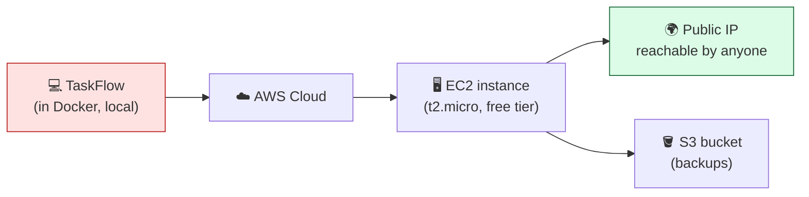
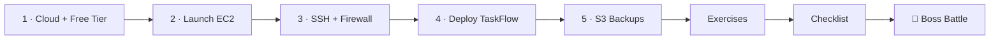

# ☁️ World 6 — AWS

> *"Great, TaskFlow runs in a container on your laptop. But customers can't reach your laptop. Time to put it on a real server — in the cloud. — Dana, your Manager"*



---

## 📨 Your ticket

```
From:    Dana (Manager) <dana@cloudforge.inc>
To:      You <you@cloudforge.inc>
Subject: [TICKET-006] Deploy the app to a real server

Hey — nice work containerizing TaskFlow last sprint. But "runs on my
laptop" isn't a product. I need it on a REAL server that the outside
world can reach.

We use AWS. Here's the job:

  1. Get an AWS account and — this is non-negotiable — set a billing
     alarm FIRST. We do not get surprise bills here.
  2. Launch a small server (EC2). Free tier only. I mean it.
  3. Open the right ports, SSH in, run TaskFlow in Docker.
  4. Give me a public IP I can `curl` from my phone on cellular.
  5. While you're at it, drop our backups in S3.

⚠️ AWS bills real money. Stay on t2.micro/t3.micro, kill anything you
   aren't using, and keep that alarm on. If you follow World 6, your
   bill stays at $0.00. Go.

— Dana
```

This is the world where TaskFlow stops being a toy and becomes **a thing on the internet**. It's also the **only world that touches money**, so we treat cost safety as a first-class skill — not an afterthought.

---

## 🎯 What you'll achieve in this world

- ✅ Understand **the cloud**, AWS, **regions & availability zones**
- ✅ Create a free-tier account and set a **billing alarm at $1** *before anything else*
- ✅ Launch a **free-tier EC2 instance** (t2.micro / t3.micro) with a key pair
- ✅ Configure **security groups** (cloud firewalls) and **SSH** into your server
- ✅ Run **TaskFlow in Docker on EC2**, reachable via a **public IP** from the internet
- ✅ Store backups in **S3 object storage**
- ✅ **Stay at $0.00** — and prove you shut everything down

By the end, you can hand Dana a public IP, and `curl http://<that-ip>:3000` from anywhere answers with TaskFlow.

---

## 🗺️ Level map

| Level | Lesson | Difficulty | Time | XP |
|------:|--------|:----------:|:----:|---:|
| 1 | [The Cloud & Staying Free](lessons/01-cloud-and-free-tier-safety.md) | 🟢 Easy | 25 min | 125 |
| 2 | [Launch an EC2 Instance](lessons/02-launch-an-ec2-instance.md) | 🟡 Medium | 20 min | 125 |
| 3 | [SSH & Security Groups](lessons/03-ssh-and-security-groups.md) | 🟡 Medium | 20 min | 125 |
| 4 | [Deploy TaskFlow to EC2](lessons/04-deploy-taskflow-to-ec2.md) | 🔴 Hard | 25 min | 125 |
| 5 | [Object Storage with S3](lessons/05-storage-with-s3.md) | 🟢 Easy | 20 min | 125 |
| 👹 | [Boss Battle — The Empty Cloud](boss-battle.md) | 🟡 Medium | 45 min | 500 |

➕ Extra reps: [exercises.md](exercises.md) · ✅ Ready to advance? [checklist.md](checklist.md)

---

## 🧭 Recommended order



**Do Level 1 first, no skipping.** It's the lesson that keeps your bill at zero. Everything else builds on a safe, alarmed account.

---

## 💸 The golden rule of this world

> **AWS charges real money for some things. The free tier is generous, but it's not infinite, and it's easy to leave something running.**
>
> Three habits keep you at $0.00:
> 1. **Billing alarm at $1** (Level 1) — your early-warning system.
> 2. **Only `t2.micro` / `t3.micro`** instances — these are free-tier eligible.
> 3. **Stop or terminate** anything you're not actively using — *especially before you close your laptop.*
>
> Every lesson ends with a cost-hygiene reminder. We are not kidding about this.

---

## 📦 Project status after this world

**Coming in:** TaskFlow is containerized — a `Dockerfile` + `docker-compose.yml` from World 5, running on your laptop.

**Going out:** TaskFlow runs **on a real cloud server (EC2)**, reachable from the public internet at `http://<public-ip>:3000`, with backups archived in **S3**. World 7 will automate the deployment you do here by hand.

---

[↑ Back to README](../../README.md)  ·  [🗺️ Roadmap](../../ROADMAP.md)  ·  [▶️ Start Level 1 →](lessons/01-cloud-and-free-tier-safety.md)
