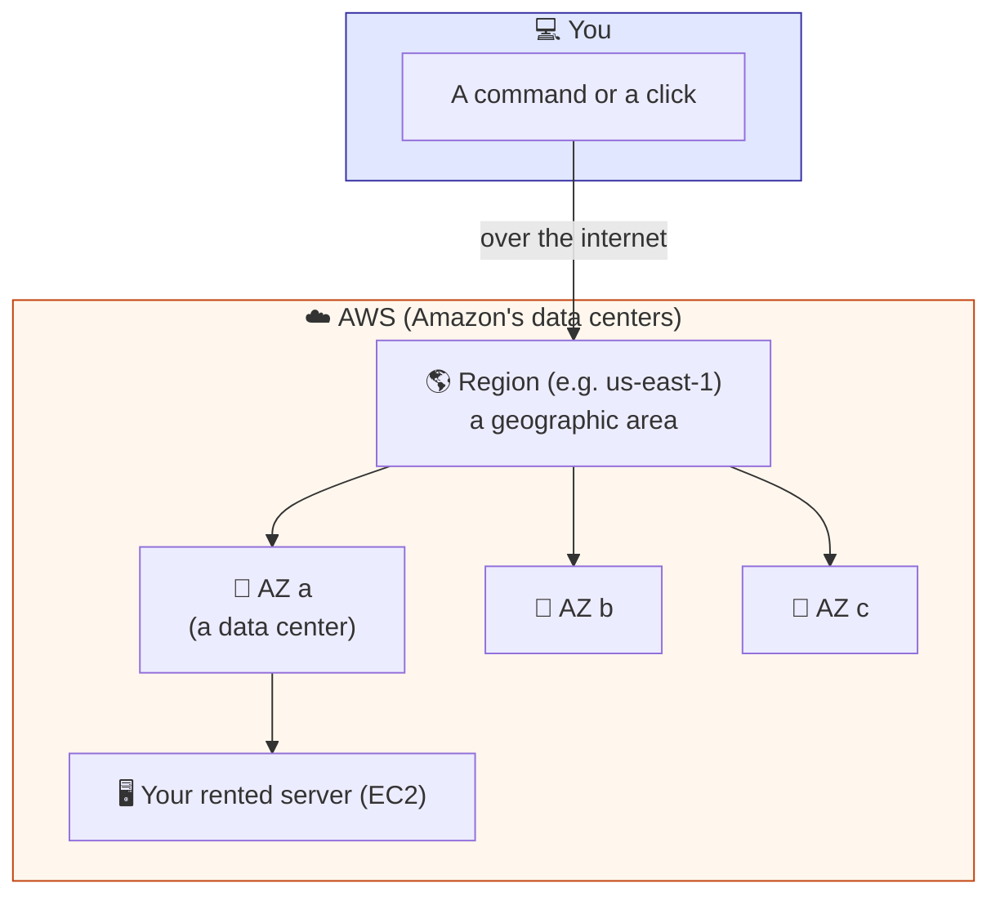
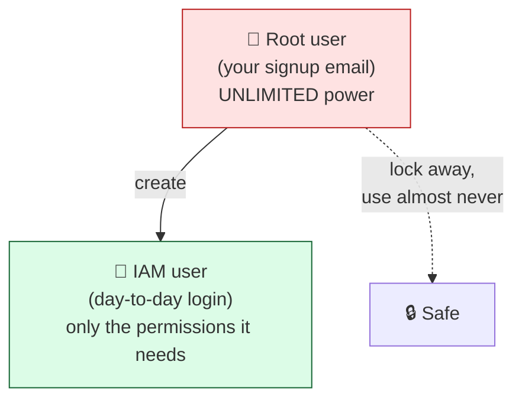

# Level 1 — The Cloud & Staying Free

| | |
|---|---|
| 🎚️ **Difficulty** | 🟢 Easy |
| ⏱️ **Estimated time** | 25 minutes |
| ⭐ **XP reward** | 100 (Quest) + 25 (Quiz) |

[← World Home](../README.md) · [↑ Phase Home](../README.md) · [→ Next: Launch an EC2 Instance](02-launch-an-ec2-instance.md)

---

## 📖 Story

You message Dana that you're ready to start on AWS. She replies instantly:

> *"Before you launch a single thing — set a billing alarm. I've seen new engineers leave a big instance running over a weekend and come back to a four-figure bill. That's a real story, and it's not happening on my team. Lesson one isn't 'launch a server.' Lesson one is 'don't get charged.' Do that part right and the rest is easy."*

So that's the plan. Today we learn what the cloud even *is*, create an account, and wrap it in a safety net **before** we touch anything that costs money.

---

## 🎯 Goal

By the end of this lesson you will:
- Explain what **the cloud** and **AWS** are, in plain words
- Understand **regions** and **availability zones (AZs)**
- Create a **free-tier AWS account**
- Set a **billing alarm at $1** — your financial smoke detector
- Know the difference between the **root user** and an **IAM user**
- Memorize the **golden rules** that keep your bill at **$0.00**

---

## 🧠 Concepts

### What is "the cloud"?

The cloud is **someone else's computers, rented by the minute, reachable over the internet.** Instead of buying a server, racking it in a building, and maintaining it, you rent a slice of Amazon's data centers and give it back when you're done. **AWS (Amazon Web Services)** is the biggest cloud provider.



### Regions and Availability Zones

- A **Region** is a geographic location — e.g. `us-east-1` (N. Virginia), `eu-west-1` (Ireland), `ap-south-1` (Mumbai). You pick the one closest to your users.
- Inside each region are **Availability Zones (AZs)** — separate physical data centers. If one catches fire, the others keep running. (You don't worry about AZs much yet; just know the word.)
- **Pick one region and stay in it** for this whole world. Resources in `us-east-1` are invisible from the `eu-west-1` console — and a forgotten instance in another region is a classic way to get a surprise bill. We'll use **`us-east-1`** in examples (it has the most free-tier options and the cheapest pricing).

### Root user vs IAM user

When you sign up, you get the **root user** — the "owner" account with unlimited power, tied to your email. It can do *anything*, including delete the account and rack up unlimited charges.



Best practice: **lock the root user away** (strong password + MFA) and create an **IAM user** for everyday work. If an IAM user's keys leak, you can delete just that user — your account survives. For this world you *can* learn with the root user, but creating a least-privilege IAM user is the **Side Quest** in [exercises.md](../exercises.md), and the boss battle rewards doing it right.

### Why this exists

Owning servers is expensive and slow: you buy hardware, wait for it to ship, find a place to plug it in, and you're stuck with it even when idle. The cloud turns a **capital purchase** into a **utility bill** — like electricity. You pay for what you use, and you can have a server running **in 60 seconds**. That same speed is the danger: it's just as easy to leave ten servers running and forget. That's why our very first move is a **billing alarm**.

---

## 🛠️ Hands-on Lab

> 📖 **Read this first:** [RESOURCES.md → World 6](../../../RESOURCES.md) — open the **AWS Free Tier** page and skim *exactly which services are free and their limits* before clicking anything.

### Step 1 — Create a free-tier AWS account

1. Go to **https://aws.amazon.com/free/** and click **Create a Free Account**.
2. Enter your email, choose a password, pick an **account name** (e.g. `yourname-bootcamp`).
3. AWS **requires a credit/debit card** to verify identity. You will **not** be charged if you stay in the free tier and follow this world. (A small temporary authorization hold of ~$1 may appear and disappear — that's a verification check, not a charge.)
4. Choose the **Basic support plan (Free)** when asked.
5. Verify your phone number and finish.

> 💡 The free tier has three flavors: **Always Free** (e.g. some S3, Lambda), **12-months free** (e.g. 750 hrs/month of `t2.micro`/`t3.micro` EC2), and **short trials**. We use only the first two.

### Step 2 — Pick and lock your region

1. Sign in to the **AWS Management Console**.
2. Top-right corner: the **region selector**. Set it to **US East (N. Virginia) `us-east-1`**.
3. From now on, **always check this dropdown** before launching anything. A resource you "lost" is almost always in another region.

### Step 3 — Set a BILLING ALARM at $1 (do not skip)

This is the most important thing you'll do in this world. First, turn on billing alerts:

1. Click your account name (top-right) → **Billing and Cost Management**.
2. In the left menu → **Billing preferences** → enable **"Receive Free Tier usage alerts"** and **"Receive Billing alerts."** Save.

Now create the alarm in **CloudWatch** (alarms for billing live in `us-east-1`, which is another reason we use it):

1. Make sure your region is **`us-east-1`**.
2. Open **CloudWatch** (search it in the top search bar).
3. Left menu → **Alarms** → **All alarms** → **Create alarm**.
4. **Select metric** → **Billing** → **Total Estimated Charge** → currency **USD** → **Select metric**.
5. **Conditions:** Threshold type **Static**, **Greater** than **`1`** (one dollar). Click **Next**.
6. **Notification:** Create a new **SNS topic**, give it a name (e.g. `billing-alerts`), enter **your email**, and click **Create topic**. Click **Next**.
7. Name the alarm **`bill-over-1-dollar`**, click **Next** → **Create alarm**.
8. **Check your email** and click the **"Confirm subscription"** link from AWS — the alarm can't email you until you confirm.

> 🚨 If your estimated charges ever cross **$1**, AWS emails you. That's your cue to find and shut down whatever's running **immediately**. $1 is intentionally tiny — it catches mistakes while they're still pennies.

### Step 4 — Turn on MFA for the root user (5 minutes, huge payoff)

1. Top-right account menu → **Security credentials**.
2. Under **Multi-factor authentication (MFA)** → **Assign MFA device**.
3. Use an authenticator app (Google Authenticator, Authy, etc.), scan the QR code, enter two codes.

Now a leaked password alone can't drain your account.

---

## 🎮 Mini Challenge

Without launching anything, answer from the console:

1. What region are you currently in (top-right)?
2. In **Billing → Free Tier**, how many **EC2 `t2.micro`/`t3.micro` hours** do you get free per month?

<details>
<summary>💡 Reveal answer</summary>

1. Whatever the dropdown shows — make sure it's **`us-east-1`** for this world.
2. **750 hours per month** of `t2.micro` (or `t3.micro` in regions where micro isn't available) for the first 12 months. 750 hours ≈ one instance running 24/7 for a full month. Run **two** at once, though, and you burn 1,500 hours — past the free limit. So: **one instance at a time.**
</details>

---

## 📦 Project Mission

TaskFlow doesn't move to the cloud *yet* — today you build the **safety net** it will live behind. Record your setup so future-you (and the boss battle) can verify it.

Create a note on your laptop documenting your AWS safety setup:

```bash
# On your laptop, in your taskflow project folder
cd ~/projects/taskflow
cat > aws-setup-notes.md <<'EOF'
# AWS Safety Setup (World 6)
- Region locked to: us-east-1
- Billing alerts enabled: yes
- Billing alarm "bill-over-1-dollar" at $1: created + email confirmed
- Root user MFA: enabled
- Rule: only t2.micro / t3.micro, one instance at a time, stop when done
EOF
cat aws-setup-notes.md
```

🎯 **Mission complete when:** you have a **confirmed** $1 billing alarm (you clicked the email link), root MFA is on, your region is `us-east-1`, and `aws-setup-notes.md` records it. You are now safe to launch things in Level 2.

---

## ⚠️ Common Mistakes

| Mistake | What happens | Fix |
|--------|--------------|-----|
| Skipping the billing alarm "for now" | A forgotten resource bills silently for days | Set the **$1 alarm before launching anything**. Non-negotiable. |
| Not confirming the SNS email | The alarm exists but **can't email you** | Open the AWS email, click **Confirm subscription** |
| Creating the billing alarm in the wrong region | Billing metric isn't there / alarm never fires | Billing alarms live in **`us-east-1`** — switch region first |
| Launching resources in random regions | A "lost" instance bills in a region you never check | Pick **one region** and always verify the dropdown |
| Daily work as the root user | A leaked root key = unlimited damage | Lock root (MFA), do daily work as an **IAM user** (Side Quest) |
| Assuming "free tier" = "free forever, unlimited" | Two instances, or hour 751, starts charging | Free tier has **limits**; one micro instance, watch usage |

---

## 🤔 Reflection Questions

1. In your own words, why is "set a billing alarm" the *first* lesson of this world and not the last?
2. What's the difference between a **region** and an **availability zone**?
3. Why is using the **root user** for everyday work risky, and what's the safer alternative?

---

## 📝 Quiz

1. **A Region is…**
   - a) a single physical server
   - b) a geographic area containing multiple data centers (AZs)
   - c) your AWS password
2. **The safest first action in a new AWS account is to…**
   - a) launch the biggest server available
   - b) set a billing alarm and enable MFA on root
   - c) delete the free tier
3. **The free tier gives you how much EC2 micro-instance time per month (first 12 months)?**
   - a) unlimited
   - b) 750 hours (≈ one instance, full-time)
   - c) 10 minutes

<details>
<summary>✅ Answers</summary>

1: **b** · 2: **b** · 3: **b**
</details>

---

## 💸 Cost Hygiene Reminder

You haven't launched anything billable yet — good. Before Level 2, confirm:
- [ ] Billing alarm at **$1** exists and the SNS email is **confirmed**
- [ ] Region is **`us-east-1`**
- [ ] No EC2 instances are running (Console → EC2 → Instances should be empty)

---

## ✅ Completion Checklist

- [ ] I created a free-tier AWS account (and understand the card is for verification)
- [ ] I locked my region to `us-east-1`
- [ ] I set a **$1 billing alarm** and **confirmed the email**
- [ ] I enabled **MFA** on the root user
- [ ] I wrote `aws-setup-notes.md` (Project Mission)
- [ ] I passed the quiz
- [ ] I added **+125 XP** to [PROGRESS.md](../../../PROGRESS.md)

---

[← World Home](../README.md) · [↑ Phase Home](../README.md) · [→ Next: Launch an EC2 Instance](02-launch-an-ec2-instance.md)
