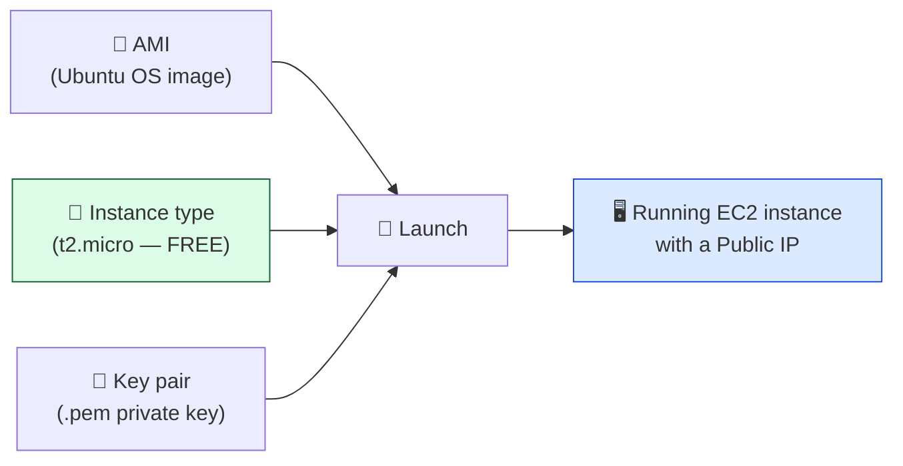
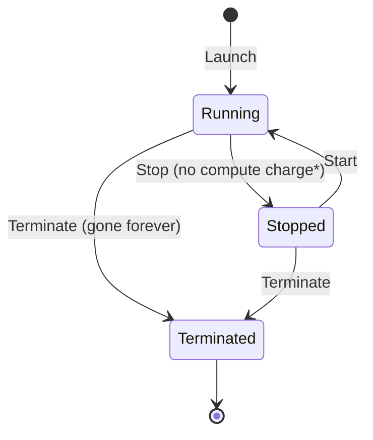

# Level 2 — Launch an EC2 Instance

| | |
|---|---|
| 🎚️ **Difficulty** | 🟡 Medium |
| ⏱️ **Estimated time** | 20 minutes |
| ⭐ **XP reward** | 100 (Quest) + 25 (Quiz) |

[← Prev: The Cloud & Staying Free](01-cloud-and-free-tier-safety.md) · [↑ Phase Home](../README.md) · [→ Next: SSH & Security Groups](03-ssh-and-security-groups.md)

---

## 📖 Story

Your safety net is up. Marcus, the senior engineer, drops by:

> *"Alright, you've got the alarm. Now let's get you a server. We call them **instances** here. The trick everyone fumbles on day one is the **key pair** — that's how you'll log in later, and if you lose it, the server is a brick. Pick `t2.micro`, download that key, and guard it like a password. Don't pick anything bigger no matter how tempting that '8 vCPU' option looks."*

Time to rent your first computer in the cloud.

---

## 🎯 Goal

By the end of this lesson you will:
- Understand what **EC2** is and what an **instance** / **AMI** / **instance type** are
- Launch a **free-tier `t2.micro` / `t3.micro`** instance running Ubuntu
- Create and safely store an **SSH key pair**
- **Confirm** the instance is free-tier eligible before launching

---

## 🧠 Concepts

### What is EC2?

**EC2 (Elastic Compute Cloud)** is AWS's service for renting virtual servers. Each server you rent is an **instance**. You choose:

- **AMI (Amazon Machine Image)** — the operating system + preinstalled software the instance boots from. We'll use **Ubuntu** (matches your World 0–5 environment).
- **Instance type** — the hardware size. `t2.micro` = 1 vCPU, 1 GB RAM. Small, but plenty for TaskFlow — **and free-tier eligible.**
- **Key pair** — a public/private key for SSH login. AWS keeps the public half; **you** keep the private `.pem` file. No file, no login.



### Instance lifecycle (and why it matters for cost)



- **Running** — costs compute hours (free under 750 hrs/mo for one micro).
- **Stopped** — you're not billed for compute, but the attached disk (EBS) still counts toward free-tier storage. Stop an instance overnight to pause charges while keeping your work.
- **Terminated** — the instance and its disk are **deleted permanently**. Use this when you're truly done.

> *\*Stopped instances don't cost compute, but a Public IP you *reserved* (an "Elastic IP") that's **not attached to a running instance** does cost a little. We'll just use the auto-assigned IP and avoid Elastic IPs entirely.*

### Why this exists

Before EC2, getting a server meant a purchase order, shipping, and a rack. EC2 makes a server a **button**. That's transformative — but it also means *cost is a runtime property*: the meter runs while the instance runs. Knowing the **lifecycle** is how you keep the meter at zero.

---

## 🛠️ Hands-on Lab

> 🌎 **First**, confirm your region is **`us-east-1`** (top-right). Launching in the wrong region is the #1 way to lose an instance.

### Step 1 — Open EC2 and start the launch

1. In the console search bar, type **EC2** → open it.
2. Click the orange **Launch instance** button.

### Step 2 — Name and OS image (AMI)

1. **Name:** `taskflow-server`.
2. **Application and OS Images (AMI):** select **Ubuntu** → pick **Ubuntu Server 22.04 LTS** (or the latest LTS).
3. Look for the **"Free tier eligible"** label on the AMI — confirm it's there.

### Step 3 — Instance type (the cost-critical choice)

1. Under **Instance type**, choose **`t2.micro`**. If `t2.micro` isn't offered in your region, choose **`t3.micro`** — both are free-tier eligible.
2. Confirm the green **"Free tier eligible"** badge is next to it.

> 🚫 **Do not** pick anything else. Every other size (t3.large, m5, c5…) bills real money per hour. If you don't see a free-tier badge, **stop and re-select**.

### Step 4 — Key pair (your login key)

1. Under **Key pair (login)** → **Create new key pair**.
2. Name it `taskflow-key`. Type **RSA**, format **`.pem`** (for OpenSSH / Linux / Mac / WSL).
3. Click **Create key pair** — your browser downloads **`taskflow-key.pem`**. This download happens **once**. Save it.

Move it somewhere safe and lock its permissions (SSH refuses keys that are world-readable):

```bash
# In your WSL/Linux/Mac terminal
mkdir -p ~/.ssh
mv ~/Downloads/taskflow-key.pem ~/.ssh/taskflow-key.pem
chmod 400 ~/.ssh/taskflow-key.pem   # read-only, owner only
ls -l ~/.ssh/taskflow-key.pem
```

> 🔑 **Lose this file and you can never SSH into this instance.** There's no "download again." Back it up.

### Step 5 — Network settings (we'll refine these in Level 3)

1. Leave the default **VPC** and **subnet**.
2. **Auto-assign public IP:** **Enable** (so the world can reach it).
3. **Firewall (security groups):** create a new one named `taskflow-sg`. For now, allow **SSH (port 22)** — *but only from your IP*, not "Anywhere." (Level 3 covers this in depth; tightening it now is good hygiene.)

### Step 6 — Storage and launch

1. **Storage:** leave the default **8 GiB gp3** (well within the 30 GB free-tier limit).
2. **Number of instances:** **1** (two would blow the 750-hour free limit).
3. Review the **Summary** panel — confirm **Free tier eligible**.
4. Click **Launch instance**.

### Step 7 — Confirm it's running and free

1. **View all instances.** Wait until **Instance state** = `Running` and **Status check** = `2/2 checks passed`.
2. Click the instance and note its **Public IPv4 address** (e.g. `54.x.x.x`) — you'll need it next lesson.
3. Open **Billing → Free Tier** and confirm your EC2 usage is tracking under **750 hours**.

```bash
# Record the public IP on your laptop for later
echo "EC2 Public IP: <paste-it-here>" >> ~/projects/taskflow/aws-setup-notes.md
```

---

## 🎮 Mini Challenge

Your instance is `Running`. You're done experimenting for the day but want to keep your setup. Should you **Stop** or **Terminate** it? What's the difference for your wallet and your work?

<details>
<summary>💡 Reveal answer</summary>

**Stop** it. A *stopped* instance costs **no compute hours** (so the meter pauses), but **keeps its disk and configuration** so you can **Start** it again tomorrow. **Terminate** deletes the instance and its disk **permanently** — use that only when you're completely finished. For overnight breaks: **Stop**. End of the world / boss battle cleanup: **Terminate**.
</details>

---

## 📦 Project Mission

You now have a real cloud server waiting for TaskFlow. Capture the facts you'll need to deploy:

```bash
cd ~/projects/taskflow
cat >> aws-setup-notes.md <<'EOF'

## EC2 Instance (World 6, Level 2)
- Name: taskflow-server
- Type: t2.micro (free tier eligible) ✅
- OS: Ubuntu 22.04 LTS
- Key file: ~/.ssh/taskflow-key.pem (chmod 400)
- Region: us-east-1
EOF
cat aws-setup-notes.md
```

🎯 **Mission complete when:** a single **`t2.micro` / `t3.micro`** instance shows **Running · 2/2 checks passed**, you have its **Public IPv4** noted, your **`.pem` key is saved with `chmod 400`**, and the launch summary said **Free tier eligible**.

---

## ⚠️ Common Mistakes

| Mistake | What happens | Fix |
|--------|--------------|-----|
| Picking a bigger instance type | Billed real $/hour immediately | Only **`t2.micro`/`t3.micro`** with the **Free tier eligible** badge |
| Closing the key-pair download dialog without saving | Key is lost forever; can't ever SSH in | Save `.pem` immediately; if lost, terminate and relaunch with a new key |
| Key file too permissive | `ssh` errors: *"UNPROTECTED PRIVATE KEY FILE"* | `chmod 400 ~/.ssh/taskflow-key.pem` |
| Launching multiple instances | Burns past 750 free hours → charges | Keep it to **one** running micro instance |
| Forgetting to **Enable** public IP | Can't reach the server from the internet | Set **Auto-assign public IP → Enable** |
| Leaving it Running 24/7 all month | One micro is free; but a second one or other resources can tip you over | **Stop** when not using it; watch the Free Tier dashboard |

---

## 🤔 Reflection Questions

1. What's the difference between an **AMI** and an **instance type**?
2. Why must you save the `.pem` key at creation time — what makes it impossible to recover later?
3. For an overnight break, why **Stop** rather than **Terminate**?

---

## 📝 Quiz

1. **An EC2 "instance" is…**
   - a) a billing alarm
   - b) a virtual server you rent and run
   - c) a region
2. **Which instance type is free-tier eligible?**
   - a) `t2.micro` / `t3.micro`
   - b) `m5.large`
   - c) any type, they're all free
3. **You lost your `.pem` key file. You can…**
   - a) re-download it from the console anytime
   - b) not SSH into that instance — relaunch with a new key
   - c) log in with your AWS password instead

<details>
<summary>✅ Answers</summary>

1: **b** · 2: **a** · 3: **b**
</details>

---

## 💸 Cost Hygiene Reminder

You now have a **billable resource** running. Before you walk away:
- [ ] Only **one** `t2.micro`/`t3.micro` instance exists
- [ ] If you're done for now → **Stop** it (EC2 → Instances → Instance state → Stop)
- [ ] Free Tier dashboard shows EC2 usage well under 750 hrs
- [ ] No Elastic IPs reserved (you didn't create any — good)

---

## ✅ Completion Checklist

- [ ] I launched a **`t2.micro`/`t3.micro`** Ubuntu instance (Free tier eligible)
- [ ] I created and saved `taskflow-key.pem` with `chmod 400`
- [ ] The instance reached **Running · 2/2 checks passed**
- [ ] I noted the **Public IPv4 address**
- [ ] I recorded the instance details in `aws-setup-notes.md` (Project Mission)
- [ ] I passed the quiz
- [ ] I added **+125 XP** to [PROGRESS.md](../../../PROGRESS.md)

---

[← Prev: The Cloud & Staying Free](01-cloud-and-free-tier-safety.md) · [↑ Phase Home](../README.md) · [→ Next: SSH & Security Groups](03-ssh-and-security-groups.md)
