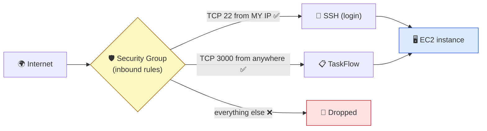

# Level 3 — SSH & Security Groups

| | |
|---|---|
| 🎚️ **Difficulty** | 🟡 Medium |
| ⏱️ **Estimated time** | 20 minutes |
| ⭐ **XP reward** | 100 (Quest) + 25 (Quiz) |

[← Prev: Launch an EC2 Instance](02-launch-an-ec2-instance.md) · [↑ Phase Home](../README.md) · [→ Next: Deploy TaskFlow to EC2](04-deploy-taskflow-to-ec2.md)

---

## 📖 Story

You try to SSH into your shiny new server… and it just hangs. You ping Priya, the DevOps lead:

> *"Classic. The server's fine — it's the **security group** blocking you. Think of it as a firewall wrapped around the instance: by default it says NO to everything inbound. You have to explicitly open the doors you want — port 22 for SSH, and later your app's port. Open only what you need, only to who needs it. Send me a screenshot of your inbound rules."*

Today you learn the cloud's front door: **security groups**, and you finally get a shell on your server.

---

## 🎯 Goal

By the end of this lesson you will:
- Understand a **security group** as a stateful firewall around your instance
- Read and write **inbound rules** (port + protocol + source)
- Open **port 22 (SSH)** to your IP and **port 3000** (TaskFlow's port) appropriately
- **SSH into the instance** with `ssh -i`

---

## 🧠 Concepts

### Security groups = a firewall per instance

A **security group (SG)** is a set of rules that decide what network traffic may reach your instance. The key defaults:

- **Inbound:** everything is **blocked** unless you add a rule allowing it.
- **Outbound:** everything is **allowed** by default (your instance can reach the internet).
- It's **stateful**: if you allow an inbound request, the response is automatically allowed back out — you don't write a matching outbound rule.

Each inbound rule is **(protocol, port, source)**:



### Choosing a "source"

- **My IP** — only your current internet address can connect. Best for **SSH (22)**: only *you* should be able to log in.
- **Anywhere (`0.0.0.0/0`)** — anyone on the internet. Needed for a **public web app** port (3000), because Dana wants to `curl` it from her phone. Acceptable for the app port; **never** for SSH.

### Why this exists

A server with every port open to the world is a server that gets compromised within minutes — bots constantly scan the internet for open SSH and databases. Security groups enforce **least exposure**: the box answers only on the doors you deliberately opened, to the people you allowed. It's the difference between a house with one locked front door and a house with no walls.

---

## 🛠️ Hands-on Lab

### Step 1 — Find your security group

1. **EC2 → Instances →** click `taskflow-server`.
2. **Security** tab → click the security group (`taskflow-sg`).
3. You'll see **Inbound rules** and **Outbound rules**.

### Step 2 — Allow SSH from your IP

1. **Inbound rules → Edit inbound rules.**
2. If there isn't already an SSH rule, **Add rule**:
   - **Type:** `SSH` (auto-fills protocol **TCP**, port **22**)
   - **Source:** **My IP** (AWS fills in your current public IP automatically)
3. **Save rules.**

> 💡 "My IP" is your *current* address. If your home IP changes (common), SSH stops working — just edit the rule and re-select **My IP**.

### Step 3 — Allow the app port (3000)

TaskFlow listens on **port 3000**. For the world to reach it:

1. **Edit inbound rules → Add rule:**
   - **Type:** `Custom TCP`
   - **Port range:** `3000`
   - **Source:** **Anywhere-IPv4** (`0.0.0.0/0`) — this is a public app, so the public must reach it.
2. **Save rules.**

Your inbound rules should now read:

| Type | Protocol | Port | Source | Purpose |
|------|----------|------|--------|---------|
| SSH | TCP | 22 | My IP | You log in |
| Custom TCP | TCP | 3000 | 0.0.0.0/0 | World reaches TaskFlow |

### Step 4 — SSH into the instance

Use the **`.pem` key** from Level 2 and the **Public IPv4** of your instance. Ubuntu AMIs use the username **`ubuntu`**.

```bash
# Replace <PUBLIC_IP> with your instance's public IPv4 address
ssh -i ~/.ssh/taskflow-key.pem ubuntu@<PUBLIC_IP>
```

- `-i` points SSH at your **identity file** (the private key).
- The first time, it asks *"Are you sure you want to continue connecting?"* → type **`yes`**. (It's adding the server's fingerprint to `~/.ssh/known_hosts`.)

You should land at a prompt like:

```
ubuntu@ip-172-31-x-x:~$
```

🎉 You're inside a computer in an Amazon data center. Prove it:

```bash
# Run these ON the server
whoami            # -> ubuntu
hostname          # the instance's internal name
lsb_release -a    # confirms Ubuntu version
curl -s ifconfig.me; echo   # the server's own public IP — should match the one you SSH'd to
```

Type `exit` to return to your laptop.

---

## 🎮 Mini Challenge

Your SSH command hangs forever and eventually times out (no "password" prompt, no rejection — just silence). Before changing anything, what's the **most likely** single cause, and how do you confirm it?

<details>
<summary>💡 Reveal answer</summary>

A **timeout (hang)** almost always means the **security group is blocking port 22** — the packet never reaches the server, so nothing answers. (A *rejection* with "Permission denied" would instead point to the key or username.)

Confirm: EC2 → instance → **Security** tab → check inbound rules for **SSH / TCP / 22** with a **source that includes your current IP**. Your home IP may have changed since you set "My IP" — re-select **My IP** and save. Also double-check you're using `ubuntu@` (not `root@` or `ec2-user@`) for an Ubuntu AMI.
</details>

---

## 📦 Project Mission

A live deploy needs a reliable way in. Lock in your SSH access and make it repeatable.

```bash
# On your laptop — save a one-liner so you never fumble the SSH command again
cd ~/projects/taskflow
cat >> aws-setup-notes.md <<'EOF'

## SSH access (World 6, Level 3)
- Inbound rules: 22/TCP from My IP, 3000/TCP from 0.0.0.0/0
- Connect: ssh -i ~/.ssh/taskflow-key.pem ubuntu@<PUBLIC_IP>
EOF

# Test the connection round-trip in one shot (replace <PUBLIC_IP>)
ssh -i ~/.ssh/taskflow-key.pem ubuntu@<PUBLIC_IP> "echo 'connected as' \$(whoami) 'on' \$(hostname)"
```

🎯 **Mission complete when:** that one-liner runs a command **on the server** and prints back `connected as ubuntu on ip-...` — proving SSH works **and** your security group opens port 22 (and 3000 is open for next lesson).

---

## ⚠️ Common Mistakes

| Mistake | What happens | Fix |
|--------|--------------|-----|
| SSH hangs / times out | Port 22 not open to your IP in the SG | Add inbound **SSH · 22 · My IP**; re-select My IP if your address changed |
| Using wrong username | "Permission denied" | Ubuntu AMI = `ubuntu`; Amazon Linux = `ec2-user`; never `root` |
| `chmod` not applied to key | "UNPROTECTED PRIVATE KEY FILE" error | `chmod 400 ~/.ssh/taskflow-key.pem` |
| Opening **port 22 to `0.0.0.0/0`** | Bots brute-force your SSH worldwide | SSH source = **My IP** only |
| Forgetting port 3000 | App unreachable later in Level 4 | Add inbound **Custom TCP · 3000 · Anywhere** |
| Editing outbound rules to "fix" a hang | Wastes time; outbound is open by default | The problem is almost always **inbound**; SGs are stateful |

---

## 🤔 Reflection Questions

1. Why is a security group "deny by default" for inbound but "allow by default" for outbound a sensible design?
2. Why should SSH (22) be sourced to **My IP** but the app port (3000) to **Anywhere**?
3. What does "stateful" mean for a security group, and why does it save you from writing extra rules?

---

## 📝 Quiz

1. **A security group is…**
   - a) a billing feature
   - b) a stateful firewall controlling traffic to an instance
   - c) a group of AWS users
2. **For SSH, the safest inbound source is…**
   - a) Anywhere (`0.0.0.0/0`)
   - b) My IP
   - c) no source needed
3. **Your `ssh -i` command hangs and times out. Most likely cause?**
   - a) wrong AWS password
   - b) security group isn't allowing port 22 from your IP
   - c) the region is too far away

<details>
<summary>✅ Answers</summary>

1: **b** · 2: **b** · 3: **b**
</details>

---

## 💸 Cost Hygiene Reminder

Security groups are **free** — open ports cost nothing. But the **instance** behind them isn't:
- [ ] Still just **one** `t2.micro`/`t3.micro` running
- [ ] If you're stopping for the day → **Stop** the instance (it'll get a new public IP on restart — that's fine; just update your notes)
- [ ] Billing alarm still armed

---

## ✅ Completion Checklist

- [ ] My security group allows **SSH · 22 · My IP**
- [ ] My security group allows **Custom TCP · 3000 · Anywhere**
- [ ] I SSH'd into the instance with `ssh -i` and saw the `ubuntu@...` prompt
- [ ] I ran a command remotely and got output back (Project Mission)
- [ ] I recorded my SSH one-liner in `aws-setup-notes.md`
- [ ] I passed the quiz
- [ ] I added **+125 XP** to [PROGRESS.md](../../../PROGRESS.md)

---

[← Prev: Launch an EC2 Instance](02-launch-an-ec2-instance.md) · [↑ Phase Home](../README.md) · [→ Next: Deploy TaskFlow to EC2](04-deploy-taskflow-to-ec2.md)
