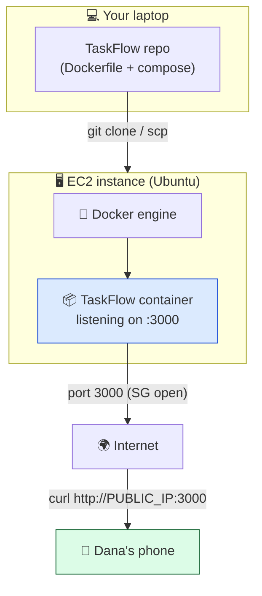

# Level 4 — Deploy TaskFlow to EC2

| | |
|---|---|
| 🎚️ **Difficulty** | 🔴 Hard |
| ⏱️ **Estimated time** | 25 minutes |
| ⭐ **XP reward** | 100 (Quest) + 25 (Quiz) |

[← Prev: SSH & Security Groups](03-ssh-and-security-groups.md) · [↑ Phase Home](../README.md) · [→ Next: Object Storage with S3](05-storage-with-s3.md)

---

## 📖 Story

This is the moment. Dana pings the team channel:

> *"You've got a server, you can SSH in, the ports are open. Now make TaskFlow actually RUN on it. Same Docker setup you built in World 5 — just on the cloud box instead of your laptop. When you can send me a public IP and I `curl` it from my phone and get TaskFlow back, you've shipped. Don't celebrate until that curl works from OUTSIDE the office network."*

Everything you've built — the container from World 5, the EC2 instance, the open ports — comes together right now. TaskFlow goes **live**.

---

## 🎯 Goal

By the end of this lesson you will:
- Install **Docker + Docker Compose** on the EC2 instance
- Get your **TaskFlow code onto the server** (git clone or copy)
- Run it with **`docker compose up`** on the cloud box
- Reach **`http://<PUBLIC_IP>:3000`** from your browser **and** `curl` from anywhere

---

## 🧠 Concepts

### The deploy, end to end

You already containerized TaskFlow in World 5. Deploying to the cloud is the *same container*, just running on a remote host. The only new work is: **install Docker on the server**, **get the code there**, and **run it**.



### Why "it works locally" isn't enough

A container that runs on your laptop proves the *image* is correct — but a deploy also depends on the **host having Docker**, the **code being present**, the **process staying up**, and the **network letting traffic in**. World 6 is where those last pieces get real. The payoff: TaskFlow now answers requests from people who've never seen your laptop.

---

## 🛠️ Hands-on Lab

> 🌎 Confirm your instance is **Running** and you can SSH in (Level 3). All steps below run **on the server** unless noted.

### Step 1 — SSH into the server

```bash
# On your laptop
ssh -i ~/.ssh/taskflow-key.pem ubuntu@<PUBLIC_IP>
```

### Step 2 — Install Docker on Ubuntu

Run these **on the server**, one block at a time:

```bash
# Update package lists and install Docker engine + compose plugin
sudo apt update
sudo apt install -y docker.io docker-compose-v2 git

# Start Docker and have it start on every boot
sudo systemctl enable --now docker

# Let the 'ubuntu' user run docker without sudo
sudo usermod -aG docker ubuntu
```

The group change needs a fresh login. Exit and SSH back in:

```bash
exit   # back to laptop
ssh -i ~/.ssh/taskflow-key.pem ubuntu@<PUBLIC_IP>
```

Verify (on the server):

```bash
docker --version
docker compose version
docker run --rm hello-world   # should print "Hello from Docker!"
```

### Step 3 — Get TaskFlow onto the server

**Option A — Clone from GitHub (recommended)** if you pushed TaskFlow to a repo in World 3:

```bash
# On the server
git clone https://github.com/<your-username>/taskflow.git
cd taskflow
```

**Option B — Copy from your laptop with `scp`** if it isn't on GitHub. Run this **on your laptop** (note the direction — local → server):

```bash
# On your laptop, from the folder ABOVE taskflow
scp -i ~/.ssh/taskflow-key.pem -r ~/projects/taskflow ubuntu@<PUBLIC_IP>:~/taskflow
```

Then SSH back in and `cd ~/taskflow`.

### Step 4 — Run TaskFlow with Docker Compose

On the server, in the `taskflow` folder (where `docker-compose.yml` lives):

```bash
# Build and start in the background
docker compose up -d --build

# Confirm the container is up
docker compose ps

# Check it's answering locally on the server
curl -s http://localhost:3000 | head
```

If `docker compose ps` shows the service **Up** and the local `curl` returns TaskFlow's response, the app is running on the cloud box. Now make sure it survives the network hop.

### Step 5 — Reach it from the internet 🎉

From your **laptop** (or any device, even off your network):

```bash
# Replace with your instance's public IP
curl http://<PUBLIC_IP>:3000
```

Or open `http://<PUBLIC_IP>:3000` in your **browser**.

✅ **If TaskFlow responds, it is LIVE on the internet.** Anyone, anywhere, can now reach the app you built.

> 🛠️ **If the local curl (Step 4) works but the public one (Step 5) doesn't:** it's the network, not the app. Re-check the **security group** has **port 3000 open to `0.0.0.0/0`** (Level 3), and that the container actually **publishes** port 3000 to the host (your compose `ports:` should map `3000:3000`).

### Step 6 — Keep it running across reboots (optional polish)

`docker compose up -d` keeps the container running, and because you set Docker to start on boot, a reboot will bring it back if you add a restart policy. In your `docker-compose.yml`, the service should have:

```yaml
    restart: unless-stopped
```

Re-run `docker compose up -d` after editing.

---

## 🎮 Mini Challenge

`curl http://localhost:3000` **on the server** works, but `curl http://<PUBLIC_IP>:3000` **from your laptop** hangs. The app is clearly running. Name the two most likely causes and how you'd check each.

<details>
<summary>💡 Reveal answer</summary>

Since the app answers locally, it's a **network/exposure** problem, not the app:

1. **Security group doesn't allow port 3000 from the internet.** Check EC2 → instance → Security → inbound rules for **Custom TCP · 3000 · `0.0.0.0/0`**. Add it if missing.
2. **The container isn't publishing port 3000 to the host.** `docker compose ps` should show `0.0.0.0:3000->3000/tcp`. If it shows only an internal port, your compose `ports:` mapping is missing/wrong — add `"3000:3000"` and re-run `docker compose up -d`.

(Bonus third cause: the app binds to `127.0.0.1` instead of `0.0.0.0` inside the container — then even the host can't forward it externally.)
</details>

---

## 📦 Project Mission

This is the headline mission of World 6: **TaskFlow live on the public internet.**

```bash
# On your laptop — record the live URL and prove it from outside
cd ~/projects/taskflow
echo "LIVE: http://<PUBLIC_IP>:3000 (TaskFlow on EC2)" >> aws-setup-notes.md

# The proof Dana asked for — run from your laptop
curl -i http://<PUBLIC_IP>:3000
```

🎯 **Mission complete when:** `curl http://<PUBLIC_IP>:3000` from your **laptop** (ideally also from your **phone on cellular**, off your home WiFi) returns TaskFlow's response — Docker is running it on EC2, and the world can reach it.

---

## ⚠️ Common Mistakes

| Mistake | What happens | Fix |
|--------|--------------|-----|
| `docker` needs `sudo` every time | Permission errors | `sudo usermod -aG docker ubuntu`, then log out/in |
| Local curl works, public doesn't | Network, not the app | Open **3000 in the security group**; ensure compose maps `3000:3000` |
| App binds to `127.0.0.1` inside container | Only the container itself can reach it | App must listen on `0.0.0.0`; publish the port in compose |
| `git clone` over SSH fails on the server | No GitHub keys on the EC2 box | Use the **HTTPS** clone URL, or `scp` the code over |
| Forgetting `restart: unless-stopped` | App dies on reboot and stays down | Add the restart policy; re-run `docker compose up -d` |
| Leaving the instance Running forever after the deploy | Slowly eats free-tier hours / risks charges | **Stop** it when not demoing; it keeps the code on its disk |

---

## 🤔 Reflection Questions

1. Why does deploying barely change your *container* but adds new concerns (host setup, code transfer, networking)?
2. If the app answers on `localhost` on the server but not from outside, what layers could be blocking it?
3. Why add `restart: unless-stopped` — what failure does it protect against?

---

## 📝 Quiz

1. **After `sudo usermod -aG docker ubuntu`, you must…**
   - a) reboot the whole AWS region
   - b) log out and back in for the group to take effect
   - c) reinstall Docker
2. **Local `curl localhost:3000` works but public IP doesn't. First thing to check?**
   - a) your AWS password
   - b) security group allows port 3000 + container publishes 3000
   - c) the billing alarm
3. **The cleanest way to keep TaskFlow running in the background is…**
   - a) `docker compose up -d`
   - b) leaving the SSH window open forever
   - c) running it with `sudo node` manually

<details>
<summary>✅ Answers</summary>

1: **b** · 2: **b** · 3: **a**
</details>

---

## 💸 Cost Hygiene Reminder

TaskFlow is live — but a live demo doesn't need to run 24/7 while you sleep:
- [ ] After demoing, **Stop** the instance (the container + code stay on its disk; **Start** to bring it back — note the public IP may change)
- [ ] Still only **one** `t2.micro`/`t3.micro`
- [ ] No extra resources spun up (load balancers, extra volumes, Elastic IPs)
- [ ] Billing alarm armed; Free Tier dashboard under limits

---

## ✅ Completion Checklist

- [ ] I installed **Docker + Compose** on the EC2 instance
- [ ] I got the TaskFlow code onto the server (clone or `scp`)
- [ ] `docker compose up -d` runs TaskFlow on the server
- [ ] `curl localhost:3000` works **on the server**
- [ ] `curl http://<PUBLIC_IP>:3000` works **from my laptop/phone** (Project Mission)
- [ ] I passed the quiz
- [ ] I added **+125 XP** to [PROGRESS.md](../../../PROGRESS.md)

---

[← Prev: SSH & Security Groups](03-ssh-and-security-groups.md) · [↑ Phase Home](../README.md) · [→ Next: Object Storage with S3](05-storage-with-s3.md)
