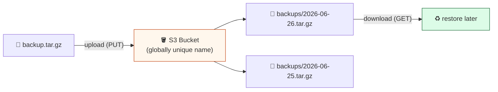

# Level 5 — Object Storage with S3

| | |
|---|---|
| 🎚️ **Difficulty** | 🟢 Easy |
| ⏱️ **Estimated time** | 20 minutes |
| ⭐ **XP reward** | 100 (Quest) + 25 (Quiz) |

[← Prev: Deploy TaskFlow to EC2](04-deploy-taskflow-to-ec2.md) · [↑ Phase Home](../README.md) · [→ Boss Battle](../boss-battle.md)

---

## 📖 Story

TaskFlow is live, and Dana is happy. Then Priya raises the obvious worry:

> *"The app's on one server with one disk. If that instance dies — or you `terminate` it by mistake — every task and backup goes with it. We need backups somewhere durable and separate from the server. That's what S3 is for: cheap, basically-infinite, super-durable file storage. Remember that backup script you wrote way back in World 2? Let's ship its output to S3."*

Today: object storage, and a backup that survives even if the whole server vanishes.

---

## 🎯 Goal

By the end of this lesson you will:
- Understand **S3** (buckets, objects, keys) and how it differs from a disk
- Create an **S3 bucket**
- **Upload a backup** (from your World 2 backup script) via the **AWS CLI** and the console
- Know the **free-tier limits** for S3 and how to stay inside them

---

## 🧠 Concepts

### What is S3?

**S3 (Simple Storage Service)** is AWS's **object storage**: you put files ("objects") into named containers ("buckets"). It's not a disk you mount — it's an API you `put` and `get` files through. It's extremely **durable** (designed for 99.999999999% — "eleven nines" — durability) and effectively **unlimited**.



- **Bucket** — a container. Its **name is globally unique across all of AWS** (so `taskflow-backups` is probably taken — add randomness, e.g. `taskflow-backups-yourname-4821`).
- **Object** — a file you store.
- **Key** — the object's full name/path inside the bucket, e.g. `backups/2026-06-26.tar.gz`.

### Disk vs object storage — why two things?

A server's **disk (EBS)** is fast and attached to *one* instance — great for the running app, terrible as a safe place for backups (it dies with the instance). **S3** is separate, durable, and reachable from anywhere — perfect for **backups, logs, and static files** you must not lose.

### Why this exists

Before S3, "store this file durably and serve it anywhere" meant running your own storage servers with redundancy and backups-of-backups. S3 turns that into an API call. For us it solves Priya's exact fear: backups that **outlive the server**. If the EC2 box explodes, the backups are untouched in S3.

### Free-tier limits (stay inside them)

The S3 free tier (first 12 months) gives roughly **5 GB of standard storage**, **20,000 GET** requests, and **2,000 PUT** requests per month. A few small backup tarballs are *nowhere near* this. To stay safe: keep backups small, **delete old ones**, and don't store huge media.

---

## 🛠️ Hands-on Lab

### Step 1 — Create a bucket (console)

1. In the console search bar → **S3** → **Create bucket**.
2. **Bucket name:** a globally unique name, e.g. `taskflow-backups-<yourname>-<random4digits>`.
3. **Region:** **`us-east-1`** (same as everything else).
4. Leave **Block all public access = ON** (backups should be private!).
5. **Create bucket.**

### Step 2 — Install & configure the AWS CLI

The CLI lets you script uploads (this is what your backup script will use). Install it on **your laptop** (or the EC2 box — either works):

```bash
# Ubuntu / WSL
sudo apt update && sudo apt install -y awscli
aws --version
```

Configure credentials. You'll need an **access key** for an IAM user (creating a least-privilege IAM user is the [Side Quest](../exercises.md) — do that for real use; for learning you can create an access key under your user):

```bash
aws configure
# AWS Access Key ID:     <paste>
# AWS Secret Access Key: <paste>
# Default region name:   us-east-1
# Default output format: json
```

> 🔒 Treat access keys like passwords. Never commit them to git, never paste them in chat. If one leaks, **deactivate it** immediately in IAM.

### Step 3 — Make a backup and upload it

Reuse the spirit of your **World 2 backup script** — archive the TaskFlow data, then push it to S3. Run on whichever machine has your TaskFlow data:

```bash
# 1. Create a dated backup archive (adjust path to your taskflow data/db)
cd ~/projects/taskflow
BUCKET="taskflow-backups-<yourname>-<random4digits>"
STAMP=$(date +%F)          # e.g. 2026-06-26
tar -czf /tmp/taskflow-backup-$STAMP.tar.gz ./data 2>/dev/null || \
  tar -czf /tmp/taskflow-backup-$STAMP.tar.gz ./*.db ./*.sqlite 2>/dev/null

# 2. Upload it to S3 under a backups/ "folder" (key prefix)
aws s3 cp /tmp/taskflow-backup-$STAMP.tar.gz s3://$BUCKET/backups/taskflow-$STAMP.tar.gz

# 3. List what's in the bucket to confirm
aws s3 ls s3://$BUCKET/backups/
```

You should see your archive listed with its size and timestamp.

### Step 4 — Verify in the console (and try a download)

1. **S3 → your bucket → `backups/`** — your object is there.
2. Round-trip it to prove restore works:

```bash
aws s3 cp s3://$BUCKET/backups/taskflow-$STAMP.tar.gz /tmp/restored.tar.gz
tar -tzf /tmp/restored.tar.gz | head    # list contents without extracting
```

### Step 5 — Upgrade the World 2 backup script to push to S3

Add one line to the end of your existing backup script so every backup lands in S3 automatically:

```bash
# inside your backup script, after the tar step:
aws s3 cp "$BACKUP_FILE" "s3://taskflow-backups-<yourname>-<random4digits>/backups/$(basename "$BACKUP_FILE")"
```

Now your local cron-able backup also keeps an **off-server copy** in durable storage.

---

## 🎮 Mini Challenge

You try to create a bucket named `taskflow-backups` and AWS rejects it: *"Bucket name already exists."* You're sure *you* never made it. Why does this happen, and what's the fix?

<details>
<summary>💡 Reveal answer</summary>

S3 bucket names are **globally unique across every AWS account on Earth** — not just yours. Someone, somewhere already owns `taskflow-backups`. The fix is to add uniqueness: include your name and some random digits, e.g. `taskflow-backups-priya-7392`. (Object *keys* inside your bucket can be anything; only the **bucket name** is global.)
</details>

---

## 📦 Project Mission

Give TaskFlow durable, off-server backups in S3.

🎯 **Mission complete when:**
- A **private** S3 bucket exists in `us-east-1` (block-public-access ON)
- `aws s3 ls s3://<your-bucket>/backups/` lists at least **one** TaskFlow backup archive you uploaded via the CLI
- Your World 2 backup script has a line that copies its output to that bucket
- You confirmed you can **download** the backup again (restore path works)

---

## ⚠️ Common Mistakes

| Mistake | What happens | Fix |
|--------|--------------|-----|
| Bucket name not globally unique | "Bucket already exists" error | Add your name + random digits |
| Turning **off** block-public-access | Backups exposed to the whole internet | Keep buckets **private**; block public access ON |
| Committing access keys to git | Keys leak; attackers run up your bill | Use `aws configure`; never commit keys; deactivate leaked keys in IAM |
| Storing huge files in S3 | Can exceed the 5 GB free tier | Keep backups small; **delete old ones** |
| Hoarding every backup forever | Storage + request counts creep up | Periodically `aws s3 rm` old backups (or add a lifecycle rule later) |
| Wrong region for the bucket | Confusing latency / "lost" bucket | Create it in **`us-east-1`** like everything else |

---

## 🤔 Reflection Questions

1. Why is a server's disk a bad place to keep the *only* copy of your backups?
2. Why must S3 bucket names be globally unique, while object keys don't?
3. What would happen to your backups if you `terminated` the EC2 instance — and why does that make S3 valuable?

---

## 📝 Quiz

1. **An S3 bucket is…**
   - a) a virtual server
   - b) a globally-named container for storing file objects
   - c) a type of firewall
2. **S3 bucket names are unique…**
   - a) only within your account
   - b) globally, across all of AWS
   - c) not required to be unique
3. **The best reason to back up TaskFlow to S3 (vs the EC2 disk) is…**
   - a) it's faster than the disk
   - b) it survives even if the instance is terminated
   - c) it's the only place AWS allows files

<details>
<summary>✅ Answers</summary>

1: **b** · 2: **b** · 3: **b**
</details>

---

## 💸 Cost Hygiene Reminder

S3 free tier is generous, but it's not zero-effort-forever:
- [ ] Bucket is in `us-east-1`, **private**, holding only small backups
- [ ] Old/junk objects deleted (`aws s3 rm`), well under **5 GB**
- [ ] Access keys are stored safely, never in git
- [ ] **EC2 instance Stopped/Terminated** if you're done — S3 ≠ the only thing that bills
- [ ] Billing alarm still armed

---

## ✅ Completion Checklist

- [ ] I created a **private** S3 bucket with a globally-unique name in `us-east-1`
- [ ] I installed + configured the **AWS CLI**
- [ ] I uploaded a TaskFlow backup with `aws s3 cp` and saw it in `aws s3 ls`
- [ ] I downloaded it back to confirm the restore path
- [ ] I added an S3 upload line to my World 2 backup script (Project Mission)
- [ ] I passed the quiz
- [ ] I added **+125 XP** to [PROGRESS.md](../../../PROGRESS.md)

---

[← Prev: Deploy TaskFlow to EC2](04-deploy-taskflow-to-ec2.md) · [↑ Phase Home](../README.md) · [→ Boss Battle: The Empty Cloud](../boss-battle.md)
