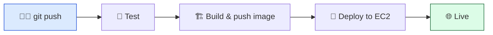
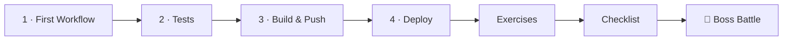

# 🔁 World 7 — CI/CD

> *"Our deployment process is manual and error-prone. Last week someone deployed a branch with failing tests and took the site down. I want a robot that runs the tests, builds the image, and deploys — every push, the same way, every time. — Priya, DevOps Lead @ CloudForge"*



[↑ Back to README](../../README.md) · [🗺️ Roadmap](../../ROADMAP.md)

---

## 📨 Your ticket

```
From:    Priya <priya@cloudforge.inc>
To:      You <junior-eng@cloudforge.inc>
Subject: [TICKET-070] Automate the TaskFlow deploy — for real

TaskFlow is on GitHub (World 3), containerized (World 5), and running on
an EC2 box you can SSH into (World 6). But shipping a change is still six
manual steps over SSH, and last week a tired engineer shipped failing
code straight to prod.

Build us a real pipeline with GitHub Actions:
  1. Run the tests on every push
  2. Build the Docker image and push it to GHCR
  3. Deploy automatically to EC2 over SSH

When you're done, `git push` to main should be the only "deploy command"
we ever run again. There's a 2 AM incident waiting as your final test.

— Priya
```

This world turns your hands-on deploy into a hands-off one. By the end, a robot does the boring, dangerous steps perfectly — every time.

---

## 🎯 What you'll achieve in this world

- ✅ Understand **CI/CD** and write your first GitHub Actions workflow
- ✅ Run the **TaskFlow test suite automatically** on every push (red/green)
- ✅ **Build and push** the Docker image to **GHCR**, tagged with the commit SHA
- ✅ **Deploy to EC2 automatically** over SSH, using encrypted GitHub Secrets
- ✅ Make the pipeline **safe**: tests gate the deploy, secrets are stored properly

By the end, every push to `main` tests, builds, and ships TaskFlow with zero manual steps.

---

## 🗺️ Level map

| Level | Lesson | Difficulty | Time | XP |
|------:|--------|:----------:|:----:|---:|
| 1 | [Why CI/CD + Your First Workflow](lessons/01-why-cicd-and-first-workflow.md) | 🟢 Easy | 20 min | 125 |
| 2 | [Run Tests Automatically](lessons/02-automated-tests-on-push.md) | 🟡 Medium | 20 min | 125 |
| 3 | [Build & Push the Docker Image](lessons/03-build-and-push-image.md) | 🟡 Medium | 25 min | 125 |
| 4 | [Deploy to EC2 Automatically](lessons/04-deploy-to-ec2-automatically.md) | 🔴 Hard | 25 min | 125 |
| 👹 | [Boss Battle — The 2 AM Deploy](boss-battle.md) | 🟡 Medium | 30 min | 500 |

➕ Extra reps: [exercises.md](exercises.md) · ✅ Ready to advance? [checklist.md](checklist.md)

---

## 🧭 Recommended order



Go in order — each lesson adds a job to the *same* `ci.yml` file, so by Level 4 you've built one complete pipeline.

---

## 📦 Project status

**Coming in:** TaskFlow is on GitHub, containerized, and running on an EC2 instance you deploy to **by hand**.

**Going out:** TaskFlow has a full GitHub Actions pipeline — `git push` to `main` runs tests, builds & pushes a SHA-tagged image to GHCR, and auto-deploys to EC2. Manual deploys are gone. World 8 (Terraform) will let you define the EC2 box itself as code.

---

## 🏆 Achievement

Beat the Boss Battle to earn **🤖 Robot Overlord** — you taught a machine to ship your code.

---

[↑ Back to README](../../README.md) · [🗺️ Roadmap](../../ROADMAP.md) · [▶️ Start Level 1 →](lessons/01-why-cicd-and-first-workflow.md)
