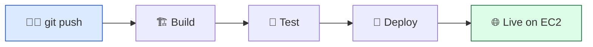
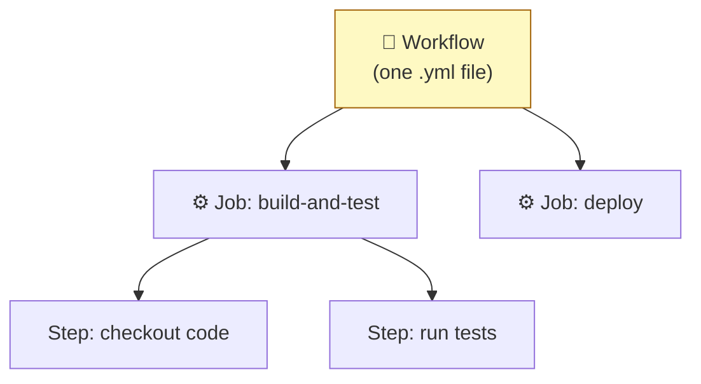

# Level 1 — Why CI/CD + Your First Workflow

| | |
|---|---|
| 🎚️ **Difficulty** | 🟢 Easy |
| ⏱️ **Estimated time** | 20 minutes |
| ⭐ **XP reward** | 100 (Quest) + 25 (Quiz) |

[← World Home](../README.md) · [↑ Phase Home](../README.md) · [→ Next: Run Tests Automatically](02-automated-tests-on-push.md)

---

## 📖 Story

It's Friday, 5:40 PM. You just pushed a small fix to TaskFlow. Now comes the ritual you've done a dozen times: SSH into the EC2 box, `git pull`, rebuild the image, restart Compose, squint at the logs, hope nothing broke. Six manual steps, every single time.

Priya, the DevOps lead, pings you:

> *"Our deployment process is manual and error-prone. Last week someone deployed a branch with failing tests and took the site down for an hour. I want a robot that does the boring steps the same way every time — tests, build, deploy — triggered by a `git push`. That's the whole job this world. Let's automate it."*

Today you teach a robot to wake up every time you push. By the end of the world, you'll never SSH in to deploy again.

---

## 🎯 Goal

By the end of this lesson you will:
- Understand what **CI/CD** actually means and why manual deploys hurt
- Know what **GitHub Actions** is and where workflows live
- Write `.github/workflows/ci.yml` — a real workflow that runs on every push
- See your first green checkmark in the **Actions** tab

---

## 🧠 Concepts

**CI/CD** is two ideas stacked together:

- **CI — Continuous Integration:** every time code is pushed, a robot automatically *builds it and runs the tests*. Bugs get caught in minutes, not in production.
- **CD — Continuous Delivery/Deployment:** if CI passes, the robot automatically *ships* that code to a server. No human SSH-ing in at 5:40 PM on a Friday.

A **pipeline** is the assembly line those steps run on:



**GitHub Actions** is GitHub's built-in robot for running these pipelines. You describe the pipeline in a **YAML file** inside your repo at `.github/workflows/`. GitHub watches for events (like a push), spins up a fresh Linux machine called a **runner**, and runs your steps on it.

The vocabulary you'll use all world:



- **Workflow** = the whole file. Triggered by an event (`on:`).
- **Job** = a group of steps that run together on one fresh runner.
- **Step** = a single action or shell command.
- **Action** = a reusable building block (e.g. `actions/checkout`).

### Why this exists
Humans are inconsistent. You forget a step when you're tired, you skip the tests "just this once," you fat-finger a command over SSH. A pipeline does the *exact same steps in the exact same order* every time, and it leaves a log. The cost of a mistake drops from "the site is down" to "the build is red and nothing shipped." That trade — catching failure *before* production instead of after — is the entire reason CI/CD exists.

---

## 🛠️ Hands-on Lab

> 💡 Free-tier note: GitHub Actions is **free with unlimited minutes on public repositories**. Your TaskFlow repo from World 3 should be public — confirm it before you start (repo **Settings → General → Danger Zone → Change visibility**). See [RESOURCES.md](../../../RESOURCES.md) for this world.

**1. Go to your TaskFlow project on your machine:**

```bash
cd ~/projects/taskflow
```

**2. Create the workflows folder.** GitHub *only* looks in this exact path:

```bash
# The folder name and path are mandatory — spelling matters
mkdir -p .github/workflows
```

**3. Create the workflow file** `.github/workflows/ci.yml` with this content:

```yaml
# .github/workflows/ci.yml
name: CI

# WHEN should this run? On every push, and on every pull request.
on:
  push:
  pull_request:

jobs:
  hello:
    # WHERE does it run? A fresh Ubuntu machine GitHub gives us for free.
    runs-on: ubuntu-latest

    steps:
      # WHAT does it do? Just say hello — for now.
      - name: Greet the team
        run: echo "👋 Hello from the TaskFlow pipeline!"

      - name: Show where we are
        run: |
          echo "Running on: $(uname -a)"
          echo "Triggered by a '${{ github.event_name }}' event"
          echo "On branch: ${{ github.ref_name }}"
```

> 🧷 **YAML is whitespace-sensitive.** Indentation must be **spaces, never tabs**. Two spaces per level. If your file misbehaves, 90% of the time it's indentation.

**4. Commit and push:**

```bash
git add .github/workflows/ci.yml
git commit -m "ci: add first GitHub Actions workflow"
git push
```

**5. Watch the robot run.** Open your repo on GitHub → click the **Actions** tab. You'll see a run named **CI** with a spinning yellow dot that turns into a green ✅. Click it → click the `hello` job → expand the steps and read your `echo` output in the live log.

You just ran code on a machine you'll never see, triggered entirely by `git push`.

---

## 🎮 Mini Challenge

Add a step that prints the **short commit SHA** that triggered the run. (Hint: GitHub gives you `github.sha`, but it's long.)

<details>
<summary>💡 Reveal answer</summary>

```yaml
      - name: Show the commit
        run: echo "Building commit ${GITHUB_SHA:0:7}"
```

`GITHUB_SHA` is an environment variable GitHub injects into every step. `${GITHUB_SHA:0:7}` is Bash substring syntax — take 7 characters starting at position 0, giving you the familiar short SHA like `a1b2c3d`. You'll tag your Docker image with this exact value in Level 3.
</details>

---

## 📦 Project Mission

Give TaskFlow its first heartbeat: a workflow that proves the pipeline is wired up.

1. Add `.github/workflows/ci.yml` to your `~/projects/taskflow` repo with the `hello` job above.
2. Push it and confirm a **green check** appears in the **Actions** tab.
3. Make a trivial change (edit the README), push again, and watch a **second** run trigger automatically — proving it fires on *every* push.

🎯 **Mission complete when:** the **Actions** tab shows at least two green CI runs, and you can open a run and read your own `echo` output in the log.

---

## ⚠️ Common Mistakes

| Mistake | What happens | Fix |
|--------|--------------|-----|
| File not in `.github/workflows/` | Nothing runs; Actions tab is empty | Path must be exactly `.github/workflows/*.yml` |
| Used tabs for indentation | "Invalid workflow file" error | Use **spaces** only — 2 per level |
| Repo is private | Free minutes get consumed / limited | Make the TaskFlow repo **public** for free unlimited minutes |
| Forgot to `git push` | Workflow never triggers | Actions react to GitHub events — local commits don't count until pushed |
| Misspelled `runs-on` or `on` | Workflow ignored or errors | Keys are case-sensitive; copy them exactly |

---

## 🤔 Reflection Questions

1. In your own words, what's the difference between the **CI** part and the **CD** part?
2. Why does the workflow run on a *fresh* machine every time instead of reusing one?
3. The lab printed `github.event_name`. Why might a pipeline want to behave differently on a `push` vs a `pull_request`?

---

## 📝 Quiz

1. **A GitHub Actions workflow file must live in…**
   - a) the repo root
   - b) `.github/workflows/`
   - c) `/etc/github/`
2. **What triggers a workflow to run?**
   - a) Saving the file locally
   - b) An event you declare under `on:` (like a push)
   - c) Restarting your laptop
3. **What is a "runner"?**
   - a) A person who approves deploys
   - b) The fresh virtual machine GitHub provides to execute your job
   - c) A type of Docker image

<details>
<summary>✅ Answers</summary>

1: **b** · 2: **b** · 3: **b**
</details>

---

## ✅ Completion Checklist

- [ ] I made my TaskFlow repo **public**
- [ ] I created `.github/workflows/ci.yml` with the `hello` job
- [ ] I pushed and saw a **green check** in the Actions tab
- [ ] I read my own `echo` output in the run log
- [ ] I completed the Mini Challenge (short SHA)
- [ ] I passed the quiz
- [ ] I added **+125 XP** to [PROGRESS.md](../../../PROGRESS.md)

---

[← World Home](../README.md) · [↑ Phase Home](../README.md) · [→ Next: Run Tests Automatically](02-automated-tests-on-push.md)
