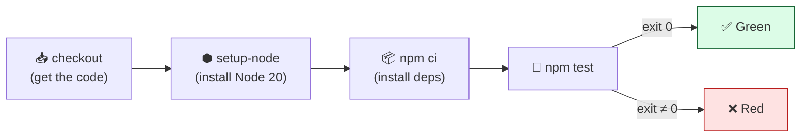

# Level 2 — Run Tests Automatically

| | |
|---|---|
| 🎚️ **Difficulty** | 🟡 Medium |
| ⏱️ **Estimated time** | 20 minutes |
| ⭐ **XP reward** | 100 (Quest) + 25 (Quiz) |

[← Prev: First Workflow](01-why-cicd-and-first-workflow.md) · [↑ Phase Home](../README.md) · [→ Next: Build & Push the Image](03-build-and-push-image.md)

---

## 📖 Story

Priya drops by with coffee:

> *"Hello-world is cute, but it doesn't protect us. Last week's outage happened because someone pushed code with a failing test and nobody noticed. I want the pipeline to run our actual TaskFlow tests on every push — and I want the build to go **red** the moment a test fails. A red X should be impossible to ignore."*

You wrote those tests back in World 4 (`npm test`). Right now they only run when *you* remember to run them. Today the robot runs them for you — every push, no exceptions.

---

## 🎯 Goal

By the end of this lesson you will:
- Check out your code onto the runner with `actions/checkout`
- Install a specific Node.js version with `actions/setup-node`
- Install dependencies the CI way with `npm ci`
- Run `npm test` and make the build go **red on failure, green on pass**

---

## 🧠 Concepts

A test job is a tiny pipeline of its own. The runner starts empty — it has no copy of your code and no Node version chosen — so you must *set up* before you can test:



Two new building blocks:

- **`actions/checkout`** — a reusable Action that clones your repo onto the runner. Without it, the runner has *nothing* to test.
- **`actions/setup-node`** — installs the Node version you specify, so CI matches your machine.

**Why `npm ci` and not `npm install`?** `npm ci` ("clean install") installs *exactly* what's pinned in `package-lock.json` and fails if the lockfile is out of sync. It's faster and reproducible — perfect for robots. `npm install` can quietly change your lockfile, which you never want in CI.

### Why this exists
A step **fails the job if its command exits with a non-zero code** — and that's the whole trick. `npm test` exits `0` when tests pass and non-zero when they fail. GitHub reads that exit code, turns the run red, and (in Level 4) blocks the deploy. You don't write any "if failed" logic — Unix exit codes do it for you. This is how a pipeline *protects* you instead of just *informing* you.

---

## 🛠️ Hands-on Lab

> 🧪 This assumes the World 4 tests exist. From `~/projects/taskflow`, `npm test` should already run your test suite locally. If `package.json` has no `test` script, add one (e.g. `"test": "node --test"` or your Jest command) before continuing.

**1. Replace `.github/workflows/ci.yml`** with a real test job:

```yaml
# .github/workflows/ci.yml
name: CI

on:
  push:
  pull_request:

jobs:
  test:
    name: Run tests
    runs-on: ubuntu-latest

    steps:
      # 1. Pull the repo onto the runner
      - name: Check out the code
        uses: actions/checkout@v4

      # 2. Install the exact Node version we develop against
      - name: Set up Node.js
        uses: actions/setup-node@v4
        with:
          node-version: '20'
          cache: 'npm'        # cache ~/.npm between runs to speed up installs

      # 3. Install dependencies reproducibly
      - name: Install dependencies
        run: npm ci

      # 4. Run the test suite. A non-zero exit turns the build RED.
      - name: Run tests
        run: npm test
```

> 🔖 `uses:` runs a published Action; `run:` runs a shell command. Pin Actions to a major version (`@v4`) so they don't change under you.

**2. Commit and push:**

```bash
git add .github/workflows/ci.yml
git commit -m "ci: run npm test on every push"
git push
```

**3. Watch it go green.** In the **Actions** tab, the `test` job should install Node, run `npm ci`, run your tests, and finish ✅.

**4. Prove it goes red.** Deliberately break a test to feel the safety net work:

```bash
# Open any test file and change an expected value so it must fail,
# e.g. expect a route to return 999 instead of 200. Then:
git add -A
git commit -m "test: intentionally break a test (temporary)"
git push
```

Watch the run turn **red ❌**. Open the failing step — you'll see the exact assertion that failed. Now fix it and push again to go green:

```bash
git revert --no-edit HEAD   # undo the broken commit
git push
```

You just experienced the core loop of CI: **red means stop, green means go.**

---

## 🎮 Mini Challenge

You want CI to test against **two** Node versions (18 and 20) to catch version-specific bugs — without copy-pasting the whole job. How?

<details>
<summary>💡 Reveal answer</summary>

Use a **matrix**:

```yaml
jobs:
  test:
    runs-on: ubuntu-latest
    strategy:
      matrix:
        node-version: ['18', '20']
    steps:
      - uses: actions/checkout@v4
      - uses: actions/setup-node@v4
        with:
          node-version: ${{ matrix.node-version }}
          cache: 'npm'
      - run: npm ci
      - run: npm test
```

GitHub runs the whole job **once per matrix value** in parallel — two runners, two Node versions, from one job definition.
</details>

---

## 📦 Project Mission

Make TaskFlow's tests a gate that no push can skip.

1. Update `.github/workflows/ci.yml` to check out the code, set up Node 20, run `npm ci`, then `npm test`.
2. Push and confirm a **green** run where your World 4 tests actually execute (read the test output in the log).
3. Break a test, push, and confirm the run goes **red**. Then revert and confirm green again.

🎯 **Mission complete when:** your real test suite runs in CI, a passing push is green, and a failing test makes the build red — with the failure visible in the run log.

---

## ⚠️ Common Mistakes

| Mistake | What happens | Fix |
|--------|--------------|-----|
| Forgot `actions/checkout` | `npm ci` errors — no `package.json` found | Checkout must be the **first** step |
| Used `npm install` | Lockfile drifts; flaky CI | Use `npm ci` in CI |
| No `test` script in `package.json` | `npm test` errors with "missing script" | Add a `"test"` script |
| Wrong `node-version` | "Unsupported engine" or odd failures | Match the Node version you develop on (20) |
| Tests pass locally but fail in CI | Relied on local files/env not in the repo | Commit everything tests need; don't depend on your machine |

---

## 🤔 Reflection Questions

1. Why must `actions/checkout` come before `npm ci`?
2. How does GitHub *know* a test failed without you writing any failure-handling code?
3. What's a real bug a Node-version matrix could catch that a single version wouldn't?

---

## 📝 Quiz

1. **What makes a GitHub Actions step (and the job) fail?**
   - a) A red color in the YAML
   - b) The command exiting with a non-zero status code
   - c) Taking longer than one minute
2. **Why use `npm ci` instead of `npm install` in CI?**
   - a) It's the only command runners support
   - b) It installs exactly the locked versions, reproducibly, and is faster
   - c) It skips the tests
3. **What does `actions/checkout` do?**
   - a) Logs you into GitHub
   - b) Clones your repository onto the runner
   - c) Deploys your code

<details>
<summary>✅ Answers</summary>

1: **b** · 2: **b** · 3: **b**
</details>

---

## ✅ Completion Checklist

- [ ] My workflow checks out code, sets up Node 20, and runs `npm ci`
- [ ] `npm test` runs my real World 4 tests in CI (green)
- [ ] I broke a test and saw the build go **red**
- [ ] I reverted and confirmed it goes **green** again
- [ ] I completed the Mini Challenge (matrix)
- [ ] I passed the quiz
- [ ] I added **+125 XP** to [PROGRESS.md](../../../PROGRESS.md)

---

[← Prev: First Workflow](01-why-cicd-and-first-workflow.md) · [↑ Phase Home](../README.md) · [→ Next: Build & Push the Image](03-build-and-push-image.md)
