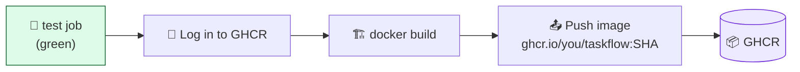

# Level 3 — Build & Push the Docker Image

| | |
|---|---|
| 🎚️ **Difficulty** | 🟡 Medium |
| ⏱️ **Estimated time** | 25 minutes |
| ⭐ **XP reward** | 100 (Quest) + 25 (Quiz) |

[← Prev: Run Tests Automatically](02-automated-tests-on-push.md) · [↑ Phase Home](../README.md) · [→ Next: Deploy to EC2 Automatically](04-deploy-to-ec2-automatically.md)

---

## 📖 Story

Priya reviews your green test runs and grins:

> *"Tests pass — great. But the EC2 box doesn't run your source code, it runs a **Docker image**. Right now you build that image by hand on the server. I want the pipeline to build the TaskFlow image and push it to a registry, tagged with the commit it came from. Then deploying is just 'pull image `a1b2c3d`'. No more building on the production box."*

You containerized TaskFlow in World 5. Today the robot builds that image for you and stores it in **GitHub Container Registry (GHCR)** — free for public images, and already attached to your repo.

---

## 🎯 Goal

By the end of this lesson you will:
- Understand what a **container registry** is and why we push images there
- Use the built-in **`GITHUB_TOKEN`** to log in to **GHCR** — no password to manage
- Build the TaskFlow Docker image in CI
- **Push** it tagged with both the commit **SHA** and `latest`
- Understand **secrets** vs. plain values in a workflow

---

## 🧠 Concepts

A **container registry** is a warehouse for Docker images — like npm is for packages. You build an image once, push it, and any server can pull that exact image by name and tag. **GHCR** (`ghcr.io`) is GitHub's registry; public images are free and live next to your repo.



**The magic credential: `GITHUB_TOKEN`.** Every workflow run gets a temporary, auto-generated token in `secrets.GITHUB_TOKEN`. It can push to *your own repo's* GHCR with no setup — you never create or store a password. You just grant the job `packages: write` permission.

**Secrets** are encrypted values GitHub injects at runtime and **masks in logs** (they print as `***`). Anything sensitive — tokens, SSH keys, API keys — goes in a secret, *never* hard-coded in the YAML. `GITHUB_TOKEN` is a secret GitHub manages for you; in Level 4 you'll create your own.

**Tagging with the SHA.** We tag the image with the 7-char commit SHA (e.g. `ghcr.io/you/taskflow:a1b2c3d`). That makes every image traceable to exact code — and gives you something precise to deploy and, if needed, roll back to. We also tag `latest` as a convenience pointer.

### Why this exists
Building on the production server is slow, eats the server's CPU/RAM, and means "what's running" depends on whatever was on disk that day. Building once in CI and pushing an **immutable, SHA-tagged image** means production runs *exactly* what passed tests — bit for bit. The registry becomes the single source of truth for "what can be deployed."

---

## 🛠️ Hands-on Lab

> 🐳 Assumes the World 5 `Dockerfile` is in your repo root and builds TaskFlow locally with `docker build -t taskflow .`. Image names on GHCR must be **lowercase**, which is why we lowercase the owner below.

**1. Add a `build-and-push` job** that runs *after* tests pass. Your `.github/workflows/ci.yml` now has two jobs:

```yaml
# .github/workflows/ci.yml
name: CI

on:
  push:
  pull_request:

jobs:
  test:
    name: Run tests
    runs-on: ubuntu-latest
    steps:
      - uses: actions/checkout@v4
      - uses: actions/setup-node@v4
        with:
          node-version: '20'
          cache: 'npm'
      - run: npm ci
      - run: npm test

  build-and-push:
    name: Build & push image
    runs-on: ubuntu-latest
    needs: test                 # ⛔ only runs if 'test' succeeded
    # Don't push images for PRs from forks — only build on pushes
    if: github.event_name == 'push'

    permissions:
      contents: read
      packages: write           # allow this job to push to GHCR

    steps:
      - name: Check out the code
        uses: actions/checkout@v4

      - name: Log in to GHCR
        uses: docker/login-action@v3
        with:
          registry: ghcr.io
          username: ${{ github.actor }}
          password: ${{ secrets.GITHUB_TOKEN }}

      # Compute a lowercase image name and a short SHA tag
      - name: Prepare image name
        id: img
        run: |
          OWNER=$(echo "${{ github.repository_owner }}" | tr '[:upper:]' '[:lower:]')
          echo "name=ghcr.io/${OWNER}/taskflow" >> "$GITHUB_OUTPUT"
          echo "sha=${GITHUB_SHA:0:7}" >> "$GITHUB_OUTPUT"

      - name: Build and push
        uses: docker/build-push-action@v6
        with:
          context: .
          push: true
          tags: |
            ${{ steps.img.outputs.name }}:${{ steps.img.outputs.sha }}
            ${{ steps.img.outputs.name }}:latest
```

> 🔍 Key lines: `needs: test` makes this job wait for green tests (a real gate — central to the Boss Battle). `permissions: packages: write` lets `GITHUB_TOKEN` push. `$GITHUB_OUTPUT` is how one step hands a value to later steps.

**2. Commit and push:**

```bash
git add .github/workflows/ci.yml
git commit -m "ci: build and push image to GHCR on green tests"
git push
```

**3. Watch both jobs.** In **Actions**, `test` runs first; when it's green, `build-and-push` starts. It logs into GHCR, builds the image, and pushes two tags.

**4. See your image.** On your GitHub profile (or repo's right sidebar) → **Packages** → `taskflow`. You'll see a package with tags `latest` and your short SHA. Make it **public** if it isn't: package → **Package settings** → **Change visibility → Public** (free for public images).

You can now pull it from anywhere:

```bash
docker pull ghcr.io/<your-username-lowercase>/taskflow:latest
```

---

## 🎮 Mini Challenge

A teammate hard-codes a registry password right in the YAML:

```yaml
password: ghp_aVeryRealLookingToken123
```

Why is this dangerous even on a private repo, and what should they do instead?

<details>
<summary>💡 Reveal answer</summary>

Anything in the YAML is **committed to git history forever** — visible to every collaborator, leaked in any fork or screen-share, and *not masked in logs*. Even after deleting it, it stays in history and must be treated as compromised (rotate it immediately).

Instead: store it as an encrypted **repository secret** (repo **Settings → Secrets and variables → Actions**) and reference it as `${{ secrets.MY_TOKEN }}`. GitHub injects it at runtime and masks it as `***` in logs. Better still here — use the built-in `GITHUB_TOKEN` and store no password at all.
</details>

---

## 📦 Project Mission

Turn TaskFlow's pipeline into a builder.

1. Add the `build-and-push` job with `needs: test` so it only runs on green.
2. Use `GITHUB_TOKEN` to log in to GHCR — **no hard-coded passwords**.
3. Push the image tagged with both the **short commit SHA** and `latest`.
4. Confirm the image appears under **Packages** with both tags, and make it **public**.

🎯 **Mission complete when:** a push with passing tests produces a GHCR image at `ghcr.io/<you>/taskflow:<sha>` (and `:latest`), the package is public, and you can `docker pull` it.

---

## ⚠️ Common Mistakes

| Mistake | What happens | Fix |
|--------|--------------|-----|
| Uppercase in image name | `invalid reference format` on push | Lowercase the owner/repo for GHCR |
| Missing `packages: write` | `denied: permission_denied` on push | Add `permissions: packages: write` to the job |
| No `needs: test` | Broken code still builds & ships | Add `needs: test` so build waits for green |
| Hard-coded token in YAML | Secret leaked into git history | Use `secrets.GITHUB_TOKEN` (or a real secret) |
| Image left private | Teammates/servers can't pull it | Set package visibility to **Public** (free) |

---

## 🤔 Reflection Questions

1. Why tag the image with the commit SHA instead of only `latest`?
2. What does `needs: test` guarantee, and why does Priya care about it?
3. Why is `GITHUB_TOKEN` safer than creating your own GHCR password?

---

## 📝 Quiz

1. **What is `secrets.GITHUB_TOKEN`?**
   - a) Your personal GitHub password
   - b) A temporary, auto-generated token each run, used to authenticate to GitHub services like GHCR
   - c) A file you must commit to the repo
2. **What does `needs: test` do?**
   - a) Renames the test job
   - b) Makes `build-and-push` run only after `test` succeeds
   - c) Runs the tests twice
3. **Why tag an image with the commit SHA?**
   - a) It looks professional
   - b) It makes the image immutable and traceable to exact code (and easy to roll back to)
   - c) GHCR requires it

<details>
<summary>✅ Answers</summary>

1: **b** · 2: **b** · 3: **b**
</details>

---

## ✅ Completion Checklist

- [ ] My pipeline has a `build-and-push` job with `needs: test`
- [ ] I log in to GHCR with `GITHUB_TOKEN` (no hard-coded password)
- [ ] The image is pushed tagged with the **short SHA** and `latest`
- [ ] The package appears under **Packages** and is **public**
- [ ] I `docker pull`-ed the image to confirm
- [ ] I completed the Mini Challenge (secrets)
- [ ] I passed the quiz
- [ ] I added **+125 XP** to [PROGRESS.md](../../../PROGRESS.md)

---

[← Prev: Run Tests Automatically](02-automated-tests-on-push.md) · [↑ Phase Home](../README.md) · [→ Next: Deploy to EC2 Automatically](04-deploy-to-ec2-automatically.md)
