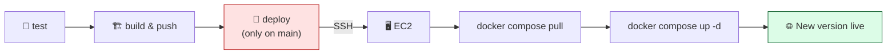

# Level 4 — Deploy to EC2 Automatically

| | |
|---|---|
| 🎚️ **Difficulty** | 🔴 Hard |
| ⏱️ **Estimated time** | 25 minutes |
| ⭐ **XP reward** | 100 (Quest) + 25 (Quiz) |

[← Prev: Build & Push the Image](03-build-and-push-image.md) · [↑ Phase Home](../README.md) · [→ Boss Battle](../boss-battle.md)

---

## 📖 Story

Priya leans on your desk, clearly enjoying this:

> *"Tests gate the build, the build pushes a tagged image. The last manual thing left is the part that broke us in the first place — the deploy. I want the robot to SSH into the EC2 box, pull the new image, and restart Compose. Every push to `main` should land on the live server with **zero humans touching the terminal**. Make it happen and I'll stop scheduling Friday deploys around your weekend."*

This is the finale of the world: full **Continuous Deployment**. You set up SSH access to the EC2 box in World 6. Now the pipeline uses it for you.

---

## 🎯 Goal

By the end of this lesson you will:
- Store the EC2 **SSH private key** and **host** as encrypted **GitHub Secrets**
- Add a `deploy` job that runs only on `main`, only after a green build
- Use an SSH action to run `docker compose pull && up -d` on the server
- Achieve true CD: **every push to `main` deploys automatically**

---

## 🧠 Concepts

The deploy job is the last link in the chain. It connects to your real server and tells it to run the new image:



**Why secrets matter here most.** To SSH in, the runner needs your **private key** — the single most sensitive thing you own. It absolutely cannot live in the YAML. It goes into an encrypted GitHub Secret; GitHub decrypts it only inside the running job and masks it in logs.

The secrets you'll create:

| Secret name | What it holds |
|---|---|
| `EC2_SSH_KEY` | The contents of your private key (`~/.ssh/taskflow-ec2.pem`) |
| `EC2_HOST` | The EC2 public IP or DNS (e.g. `ec2-13-50-1-2.eu-north-1.compute.amazonaws.com`) |
| `EC2_USER` | The Linux login (usually `ubuntu` for Ubuntu AMIs) |

**Guarding the deploy.** Tests and builds should run on every branch and PR, but you only want to *deploy* the official line of code. So the deploy job carries `if: github.ref == 'refs/heads/main'` — it runs only when the push is to `main`.

### Why this exists
This closes the loop that started the world. The exact image that passed tests gets pulled and run on production — no rebuild, no drift, no human SSH-ing in tired on a Friday. And because the job is gated (`needs` the build, only on `main`), a red test or a feature branch can never reach the server. *That* is the safety Priya wanted: automation that's faster **and** harder to get wrong than a human.

---

## 🛠️ Hands-on Lab

> ⚠️ This touches your real EC2 box from World 6. The instance must already have Docker + Compose installed and your `~/projects/taskflow` (with `docker-compose.yml`) on it. Best practice: create a **dedicated deploy key** rather than reusing your personal key.

**1. Create the GitHub Secrets.** In your repo → **Settings → Secrets and variables → Actions → New repository secret**. Add three:

- `EC2_SSH_KEY` — paste the *entire* private key, including the `-----BEGIN ... KEY-----` and `-----END ... KEY-----` lines. Get it with:
  ```bash
  cat ~/.ssh/taskflow-ec2.pem
  ```
- `EC2_HOST` — your instance's public IP or DNS.
- `EC2_USER` — `ubuntu`.

> 🔐 Once saved, GitHub will *never* show a secret's value again — only let you update or delete it. That's by design.

**2. Make the compose file pull the SHA-tagged image.** On the EC2 box (or in your repo), your `docker-compose.yml` should reference the GHCR image and read a tag from an env var so the pipeline can pin an exact version:

```yaml
# docker-compose.yml (on the EC2 box)
services:
  taskflow:
    image: ghcr.io/<your-username-lowercase>/taskflow:${TAG:-latest}
    ports:
      - "80:3000"
    restart: unless-stopped
```

**3. Add the `deploy` job** to `.github/workflows/ci.yml`, after `build-and-push`:

```yaml
  deploy:
    name: Deploy to EC2
    runs-on: ubuntu-latest
    needs: build-and-push                       # only after a successful build
    if: github.ref == 'refs/heads/main'         # only deploy main

    steps:
      - name: Compute short SHA
        id: vars
        run: echo "sha=${GITHUB_SHA:0:7}" >> "$GITHUB_OUTPUT"

      - name: SSH in and roll out the new image
        uses: appleboy/ssh-action@v1
        with:
          host: ${{ secrets.EC2_HOST }}
          username: ${{ secrets.EC2_USER }}
          key: ${{ secrets.EC2_SSH_KEY }}
          script: |
            cd ~/projects/taskflow
            # Pin the exact image this commit produced
            export TAG=${{ steps.vars.outputs.sha }}
            # GHCR public images need no login to pull; pull the new one
            docker compose pull
            # Recreate the container with the new image, in the background
            docker compose up -d
            # Clean up old, unused images so the disk doesn't fill
            docker image prune -f
            echo "✅ Deployed TAG=$TAG"
```

> 🧩 `appleboy/ssh-action` opens an SSH session using your key secret and runs the `script` block on the server. Everything in `script:` runs *on the EC2 box*, not the runner.

**4. Commit and push to `main`:**

```bash
git add .github/workflows/ci.yml docker-compose.yml
git commit -m "ci: auto-deploy to EC2 on push to main"
git push origin main
```

**5. Watch the full pipeline.** In **Actions**: `test` → `build-and-push` → `deploy`, each waiting for the last. When `deploy` is green, open your EC2 box's public URL in a browser — TaskFlow is running the freshly built image. Confirm on the server:

```bash
ssh -i ~/.ssh/taskflow-ec2.pem ubuntu@<EC2_HOST>
cd ~/projects/taskflow && docker compose ps
```

You just deployed without typing a single deploy command. From here on, **`git push` to `main` ships to production.**

---

## 🎮 Mini Challenge

Your colleague pushes to a branch called `experiment` and panics that it might hit production. Will it deploy? Why or why not?

<details>
<summary>💡 Reveal answer</summary>

No. The deploy job has `if: github.ref == 'refs/heads/main'`. A push to `experiment` sets `github.ref` to `refs/heads/experiment`, the condition is false, and the **deploy job is skipped entirely** — even though `test` and `build-and-push` still run. Branches are safe to experiment on; only `main` ships. This branch guard is exactly the kind of safety the Boss Battle tests.
</details>

---

## 📦 Project Mission

Achieve hands-free deployment for TaskFlow.

1. Store `EC2_SSH_KEY`, `EC2_HOST`, and `EC2_USER` as encrypted repository secrets.
2. Add a `deploy` job that `needs: build-and-push` and only runs on `main`.
3. Over SSH, run `docker compose pull` then `docker compose up -d` on the EC2 box, pinning the SHA tag.
4. Push to `main` and confirm the new version is live in your browser — with no manual SSH.

🎯 **Mission complete when:** a push to `main` runs test → build → deploy all green, and the live EC2 URL serves the newly built image **without you SSH-ing in to deploy**.

---

## ⚠️ Common Mistakes

| Mistake | What happens | Fix |
|--------|--------------|-----|
| Pasted only part of the key | SSH auth fails | Include the full `-----BEGIN/END-----` block in `EC2_SSH_KEY` |
| Hard-coded the key/IP in YAML | Critical secret leaked | Use repository secrets; never commit keys |
| No `if: ...main` guard | Feature branches deploy to prod | Add the `refs/heads/main` condition |
| EC2 security group blocks SSH | Connection times out | Allow port 22 from GitHub/your IP (World 6 setup) |
| Compose can't pull image | `manifest unknown` / pull denied | Make the GHCR package **public**, or `docker login` on the box |
| Forgot `restart: unless-stopped` | App doesn't survive reboots | Add it so the container comes back up |

---

## 🤔 Reflection Questions

1. Why must the SSH private key be a secret instead of a value in the workflow file?
2. What three gates now stand between a bad commit and production?
3. Pinning `TAG` to the SHA instead of always using `latest` — how does that help if a deploy goes wrong?

---

## 📝 Quiz

1. **Where does the EC2 SSH private key belong?**
   - a) In the workflow YAML
   - b) In an encrypted GitHub repository secret
   - c) In the README
2. **What does `if: github.ref == 'refs/heads/main'` on the deploy job do?**
   - a) Deploys every branch
   - b) Runs the deploy only for pushes to `main`
   - c) Disables the deploy
3. **In the deploy job, where does the `script:` block run?**
   - a) On the GitHub runner
   - b) On the EC2 server over SSH
   - c) In your browser

<details>
<summary>✅ Answers</summary>

1: **b** · 2: **b** · 3: **b**
</details>

---

## ✅ Completion Checklist

- [ ] I stored `EC2_SSH_KEY`, `EC2_HOST`, and `EC2_USER` as repository secrets
- [ ] My `deploy` job has `needs: build-and-push` and the `main` branch guard
- [ ] The job SSHes in and runs `docker compose pull` + `up -d`
- [ ] A push to `main` deployed the new image with **no manual SSH**
- [ ] I confirmed the new version is live in the browser
- [ ] I completed the Mini Challenge (branch guard)
- [ ] I passed the quiz
- [ ] I added **+125 XP** to [PROGRESS.md](../../../PROGRESS.md)

---

[← Prev: Build & Push the Image](03-build-and-push-image.md) · [↑ Phase Home](../README.md) · [→ 👹 Boss Battle: The 2 AM Deploy](../boss-battle.md)
