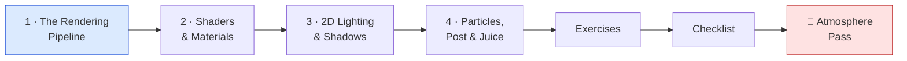
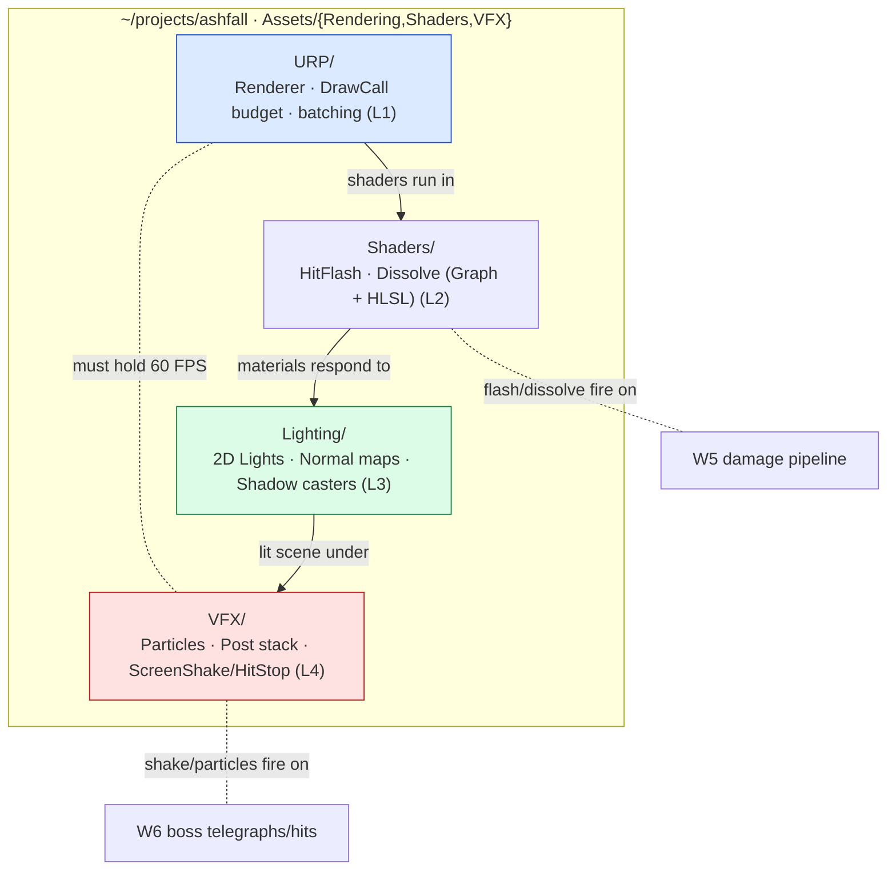

# 🎨 World 7 — Rendering & Graphics

> Ashfall *plays* like a game now (World 6): enemies perceive, decide, path, steer, and a multi-phase boss telegraphs its attacks. The fights are smart — but the game is **flat**. Untextured-looking sprites on a flat-lit scene, no shadows, no impact, no mood. A hit lands with zero feedback; an enemy dies with a silent despawn; the dungeon is uniformly bright and lifeless. And the first time someone added a few hundred lights and particles, it **dropped below 60 FPS**. This world is the *look* and the *feel*: you'll put Ashfall on URP and audit draw calls, write a hit-flash and a dissolve shader, light the dungeon with dynamic 2D lights and shadows for mood, then layer particles, a post-processing stack, and screen shake / hit-stop for juice — **all while holding a stable 60 FPS**. By the end, the smart fights finally *read* as a real game.

[↑ Home](../../README.md) · [🗺️ Roadmap](../../ROADMAP.md) · [📊 Progress](../../PROGRESS.md)

---

## 📨 Your ticket

```
From:    Lena <lena@pixelforge.studio>
To:      You <new-hire@pixelforge.studio>
Cc:      Theo <theo@pixelforge.studio>, Maya <maya@pixelforge.studio>

Subject: [W7-GFX] The game looks flat and lifeless — and it drops below 60 FPS

The AI is gorgeous under the hood. I watched the boss fight three times.
And then Theo watched it and said one word: "flat." He's right, and it's
my note to fix — with you.

Here's the problem. The combat is great but nothing SELLS it. A hit lands
and the sprite doesn't even flinch. An enemy dies and just... vanishes.
The whole dungeon is one flat brightness — no shadows, no torch glow, no
mood, no sense of a dark place you're fighting through. It plays like a
game and looks like a prototype.

This world is the look and the feel — and none of it is "draw better art,"
it's all the rendering pipeline:

  - PUT US ON URP and AUDIT DRAW CALLS first. We render on the GPU; I want
    you to understand the pipeline (vertices → fragments) and know our
    draw-call budget before we pile on lights and VFX. Measure, then build.
  - SHADERS. A hit-FLASH so a struck enemy goes white for a frame, and a
    DISSOLVE so a dying enemy burns away instead of popping. Shader Graph
    is fine, but I want you to read the hand-written hlsl too.
  - 2D LIGHTING + SHADOWS. Dynamic lights — a torch, a glow around the
    player — with shadow casters so the dungeon has depth and mood.
  - JUICE. Impact particles when you hit, a post-processing stack (bloom,
    vignette, a touch of chromatic aberration), and screen shake / hit-stop
    so every hit FEELS like it connects. This is "game feel."

And the hard constraint, because I broke it once already: ALL of this has
to hold 60 FPS. Lights and particles are cheap to add and expensive to
ship. If it drops frames, it doesn't go in. Watch the draw calls.

Boss check ("Atmosphere Pass"): take one dungeon room and give it a full
atmosphere pass — lit for mood, a custom hit-flash/dissolve shader, impact
particles + post + screen shake/hit-stop — locked at a stable 60 FPS. No
tutorial; you'll have all four lessons.

Land this and World 8 — co-op over the network, in a container — is yours.

— Lena
```

This is World 7 of 13. Everything you build advances the **one growing Ashfall project** in `~/projects/ashfall`. You arrive with a mechanically complete action-roguelite (W6); you leave with one that's **lit, shaded, juicy, and performant** — a game that finally looks the part.

---

## 🎯 What you'll achieve in this world

- 🖥️ Understand the **GPU render pipeline** from first principles (vertices → fragments), put Ashfall on **URP**, and **audit draw calls** so you build on a measured framerate budget — not hope
- 🎛️ Write **shaders** — vertex/fragment, UVs, material properties — and ship a **hit-flash** (white-out on damage) and a **dissolve** (burn-away on death), in both **Shader Graph** and hand-written **HLSL**
- 💡 Add **dynamic 2D lighting & shadows** — lights, normal maps, shadow casters, emissive glow — for a torch-lit, moody dungeon with real depth
- ✨ Layer **particles**, a **post-processing stack** (bloom / vignette / chromatic aberration), and **screen shake / hit-stop** so every hit *feels* like it lands — the essence of **game feel** / juice
- 📈 Hold a **stable 60 FPS** through all of it — measuring draw calls and frame time so the polish *ships* instead of tanking performance

---

## 🗺️ Level map

| Level | Lesson | Difficulty | XP |
|------:|--------|:----------:|---:|
| 1 | [The Rendering Pipeline](lessons/01-the-rendering-pipeline.md) | 🟢 Easy | 125 |
| 2 | [Shaders & Materials](lessons/02-shaders-and-materials.md) | 🟡 Medium | 125 |
| 3 | [2D Lighting & Shadows](lessons/03-2d-lighting-and-shadows.md) | 🟡 Medium | 125 |
| 4 | [Particles, Post-Processing & Juice](lessons/04-particles-postprocessing-and-juice.md) | 🔴 Hard | 125 |
| 🎨 | [Boss Battle — Atmosphere Pass](boss-battle.md) | 🔴 Hard | 500 |

➕ Extra reps: [exercises.md](exercises.md) · ✅ Ready to advance? [checklist.md](checklist.md)

---

## 🧭 Recommended order



Go in order — each lesson is the surface the next one paints on. The **pipeline** (L1) is the foundation: you can't reason about shaders, lights, or your framerate budget until you know how the GPU turns vertices into fragments, what a draw call costs, and how batching saves them — so you put Ashfall on URP and measure *first*. **Shaders** (L2) run *inside* that pipeline: the hit-flash and dissolve are fragment shaders, and you can only write them once you know where they execute. **2D lighting** (L3) then interacts with those materials — lights need the URP setup from L1 and surfaces that respond from L2 — to give the dungeon mood and depth. **Juice** (L4) goes *on top of* the lit, shaded scene: particles, post-processing, screen shake, hit-stop — the layer that makes a hit feel like a hit. The boss battle is all four at once, under a 60 FPS constraint.

---

## 📦 Ashfall project status

**Entering World 7:** a *mechanically complete* action-roguelite. Procedurally generated, navigable dungeons (W4) with A\* pathing; a full combat game (W5) — data-driven items/abilities, inventory/equipment, a damage pipeline with i-frames and knockback, status effects, weighted loot, gold — all persisted (W3); and enemies that *think* (W6) — FSM, perception, steering on A\*, behavior trees, and a multi-phase boss with telegraphed, utility-scored attacks. It **plays** like a game. But it's **flat**: no shadows, no shaders, uniform lighting, no impact feedback, and it stutters the moment you add effects.

**Leaving World 7:** the same game, now **lit, shaded, juicy, and performant**. Ashfall renders on **URP** with an audited draw-call budget; struck enemies **flash white** and dying ones **dissolve** via custom shaders; the dungeon is **dynamically lit** with torches, a player glow, and **shadow casters** for mood; and every hit lands with **impact particles**, a **post-processing stack**, and **screen shake / hit-stop** — all holding a **stable 60 FPS**. The smart fights from W6 finally read as cinematic.



You hand this to **World 8 — Networking & Multiplayer**, where Priya makes Ashfall *co-op* — two players in one dungeon over the network, with a dedicated server in a Docker container — so the game you just made beautiful becomes a game you can play *together*.

---

## 🎨 Boss teaser

**"Atmosphere Pass"** — Lena wants proof you can make Ashfall *look and feel* like a shipped game without breaking it. Take one W4 dungeon room and give it a complete atmosphere pass: **2D lighting** (torches, player glow, shadow casters) for mood, a **custom hit-flash / dissolve shader** on enemies, **impact particles + a post-processing stack + screen shake / hit-stop** for juice — **all while holding a stable 60 FPS** (and you'll check the draw calls to prove it). No tutorial — you'll fuse all four lessons into one room and ship it under a performance budget. Win to earn the **🎨 Render Artist** badge, a +250 world-complete bonus, and unlock World 8.

---

## 📚 Resources

Don't go link-hunting — the curated free list lives in [RESOURCES.md](../../RESOURCES.md). For this world, the standouts are Unity's own free **Universal Render Pipeline (URP)** and **2D lighting** docs (the pipeline, the 2D renderer, Light 2D and shadow casters — L1/L3), **Shader Graph** plus a first-principles read on the **vertex/fragment pipeline** so the hand-written HLSL in L2 makes sense, and any solid talk on **"game feel" / juice** (the classic *"Juice it or lose it"* talk is the canonical why for L4 — screen shake, hit-stop, and particles are *feedback*, not decoration). Above all, learn the **Frame Debugger / Stats / Profiler** early — measuring draw calls and frame time is the skill that lets all of this *ship*, and it's how every engine (Unity, Unreal, Godot, custom) keeps polish from killing performance.

---

[↑ Home](../../README.md) · [🗺️ Roadmap](../../ROADMAP.md) · [📊 Progress](../../PROGRESS.md) · [➡️ Next World: Networking & Multiplayer](../phase-08-networking-multiplayer/README.md) · [▶️ Start Level 1 →](lessons/01-the-rendering-pipeline.md)
