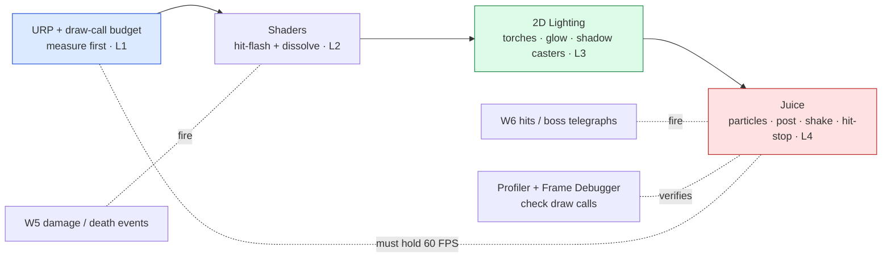

# 🎨 Boss Battle — Atmosphere Pass

| | |
|---|---|
| 🎚️ **Difficulty** | 🔴 Hard |
| ⏱️ **Estimated time** | 120 minutes |
| ⭐ **XP reward** | 500 |
| 🔓 **Unlocks** | World 8 — Networking & Multiplayer |

[← Checklist](checklist.md) · [↑ Phase Home](README.md) · [↑ Home](../../README.md)

---

## 📨 The incident

```
From:    Lena <lena@pixelforge.studio>
To:      You <new-hire@pixelforge.studio>
Cc:      Theo <theo@pixelforge.studio>, Maya <maya@pixelforge.studio>

Subject: [W7-BOSS] One room. Make it look and feel like a real game — at 60.

We're recording a teaser for Theo on Friday. I don't need the whole game
polished — I need ONE room that proves Ashfall can look shipped. That's
your boss this world: an Atmosphere Pass.

Take a single dungeon room with a fight in it and give it the full
treatment. No tutorial this time — you've got all four lessons:

  - LIGHT IT FOR MOOD. Drop the global light, put torches and a glow on the
    player, add shadow casters on the walls and pillars. I want pools of
    light in the dark, not a flat-lit box.
  - SHADE IT. A hit-flash so a struck enemy snaps white, and a dissolve so
    a dying enemy burns away. These fire off the W5 damage and death events.
  - JUICE IT. Impact particles on every hit, a post stack (bloom on the
    torches and the dissolve edge, a vignette, a touch of chromatic
    aberration), and screen shake + hit-stop so the hits CONNECT.

And the line I will not move on: it holds 60 FPS. I broke that once and
it cost us a week. Before you call it done, open the profiler and the
Frame Debugger and CHECK THE DRAW CALLS. If a beautiful room runs at 45,
it's not done — it's a bug. Beautiful AND cheap, or it doesn't ship.

Land this and World 8 — co-op over the network, in a container — is yours.

— Lena
```

> 🎨 **Boss Battle rules:** No tutorials, no copying lesson files wholesale. **Apply** World 7: set up URP and your draw-call budget, write the hit-flash and dissolve shaders, light the room and place shadow casters, and layer particles + post + screen shake / hit-stop yourself, and fuse them into one room. You win when every victory condition is met **and you can explain which layer owns each effect** (pipeline measures the budget → shaders color the pixels → lights set the mood → juice sells the feel) **and where your framerate went**.

---

## 🎯 Your mission

Give one W4 dungeon room a **complete atmosphere pass** — **2D lighting** for mood, a **custom hit-flash and dissolve shader**, **impact particles + a post-processing stack + screen shake / hit-stop** for juice — and lock it at a **stable 60 FPS**, proven in the profiler. This is the capstone that fuses every lesson:



Build it from these pieces (at minimum):

1. **Pipeline & budget (L1):** Ashfall on **URP** with the 2D renderer; set a draw-call / frame-time **budget** and measure where the room starts before you add anything.
2. **Shaders (L2):** a **hit-flash** (lerp-to-white via `_FlashAmount`) on struck enemies and a **dissolve** (noise threshold + `clip()` + emissive edge) on dying ones — driven by the W5 damage/death events, batch-safe via `MaterialPropertyBlock`.
3. **Lighting (L3):** dim the **global light**, add **torch/point lights** and a **player glow**, and place **shadow casters** on walls/pillars so the room has depth and mood.
4. **Juice (L4):** **impact particles** on hit, a **post-processing volume** (bloom + vignette + a touch of chromatic aberration), and **screen shake + hit-stop** at the moment of impact.
5. **Performance (L1):** open the **Profiler / Frame Debugger**, confirm a **stable 60 FPS**, and cut draw calls / overdraw if anything dropped the frame — measured, not guessed.
6. **Data, not code:** light intensities, flash/dissolve durations, shake amplitude, hit-stop frames, and post settings are **tunable knobs** so the feel lives in assets.

---

## 🏆 Victory conditions

- [ ] The room is rendered on **URP** with a **stated draw-call / frame-time budget** I measured *before* adding effects
- [ ] The room is **lit for mood** — dimmed global light, **torch/point lights**, a **player glow**, and **shadow casters** on walls/pillars (pools of light in the dark, not a flat box)
- [ ] Struck enemies **flash white** (hit-flash shader) on the **W5 damage event**, and dying enemies **dissolve** (burn-away with a glowing edge) on the **W5 death event**
- [ ] Every hit lands with **impact particles**, and the scene runs a **post-processing stack** (bloom + vignette + chromatic aberration)
- [ ] Impacts trigger **screen shake** *and* **hit-stop** so hits feel like they connect
- [ ] The entire atmosphere pass holds a **stable 60 FPS** — and I **opened the Profiler / Frame Debugger and checked the draw calls** to prove it
- [ ] Shaders stay **batch-safe** (`MaterialPropertyBlock`, shared materials / atlas) — adding effects didn't blow up the draw-call count
- [ ] Key feel knobs are **data** (light intensity, flash/dissolve durations, shake amplitude, hit-stop frames, post settings) — I can retune **without editing code**
- [ ] I can explain which layer owns each effect (pipeline → shader → light → juice) and **where my framerate budget went**

---

## 🧪 How you'll know you won

```bash
cd ~/projects/ashfall
ls Assets/Rendering Assets/Shaders Assets/VFX
# → URP_Renderer2D.asset, HitFlash.shader, Dissolve.shader,
#   ImpactParticles.prefab, PostVolume.asset, ScreenShake.cs, HitStop.cs ...
```

Then enter the room and run one continuous fight:
- **Walk in** — it's **dark with pools of torchlight**, your player carries a glow, and the pillars **cast shadows**. It reads as a place, not a flat box.
- **Hit an enemy** — it **snaps white** for a frame, **particles** burst at the contact point, the screen **shakes**, and the action **hitches** (hit-stop) so the blow lands with weight.
- **Kill an enemy** — it **burns away** along a noise edge with a **glowing rim** (bloom on the dissolve edge) instead of popping out.
- **Look at the whole frame** — **bloom** glows on the torches, a **vignette** frames the room, a **subtle chromatic aberration** at the edges. It looks shot, not rendered.
- **Open the Stats / Profiler / Frame Debugger** — **locked 60 FPS**, draw calls under your stated budget, no overdraw spike from the particles. If it dipped, you found the offender and cut it.
- **Retune in the Inspector** — dim a torch, lengthen the dissolve, crank the shake → the feel shifts with **no recompile**.

If all that holds in one continuous fight at a steady 60, the room is shipped. You've won.

<details>
<summary>🔎 Reference solution — only after you've tried! (high-level sketch + key code)</summary>

**The shape of it (each layer owns one job):**

| Layer | Job | Lesson |
|---|---|---|
| URP + budget | measure the draw-call / frame-time floor *first* | L1 |
| `HitFlash` / `Dissolve` shaders | color the pixels (white-out, burn-away) | L2 |
| Light 2D + shadow casters | set the mood (pools of light, depth) | L3 |
| Particles + post + shake/hit-stop | sell the feel (impact = feedback) | L4 |
| Profiler / Frame Debugger | prove 60 FPS, find the offender | L1 |

**Hit-flash: lerp the fragment toward white by a property (L2):**

```hlsl
// Fragment of the hit-flash sprite shader.
fixed4 frag (v2f i) : SV_Target
{
    fixed4 c = tex2D(_MainTex, i.uv) * i.color;
    c.rgb = lerp(c.rgb, fixed3(1,1,1), _FlashAmount);  // 0 = normal, 1 = full white
    return c;                                           // alpha kept => silhouette flashes
}
```

```csharp
// Drive it off the W5 damage event, batch-safe.
void OnDamaged() => StartCoroutine(Flash());
IEnumerator Flash() {
    var mpb = new MaterialPropertyBlock();
    for (float t = 0.08f; t > 0; t -= Time.unscaledDeltaTime) {   // DATA: flash duration
        sr.GetPropertyBlock(mpb);
        mpb.SetFloat("_FlashAmount", t / 0.08f);
        sr.SetPropertyBlock(mpb);                                  // no new material => batch holds
        yield return null;
    }
    sr.GetPropertyBlock(mpb); mpb.SetFloat("_FlashAmount", 0); sr.SetPropertyBlock(mpb);
}
```

**Dissolve: noise threshold + clip + glowing edge, off the death event (L2):**

```hlsl
fixed4 frag (v2f i) : SV_Target {
    fixed4 col   = tex2D(_MainTex, i.uv);
    float  noise = tex2D(_NoiseTex, i.uv).r;
    clip(noise - _DissolveAmount);                                 // discard burned pixels
    float edge = step(noise - _DissolveAmount, _EdgeWidth);
    col.rgb = lerp(col.rgb, _EdgeColor.rgb, edge);                 // HDR edge => bloom glows it
    return col;
}
// On death: animate _DissolveAmount 0→1 over ~0.4s (DATA), THEN pool the object.
```

**Lighting: kill the ambient, light with intent, cast shadows (L3):**

```
Global Light 2D  intensity ~0.15      (the room is DARK by default)
Torch  Point Light 2D  (warm, falloff) ×N on the walls   → pools of light
Player Point Light 2D  (soft glow, follows the player)
Shadow Caster 2D on every wall + pillar collider          → depth
Emissive sprites (torch flame, runes) at HDR              → bloom picks them up
```

**Juice: particles + screen shake + hit-stop at impact (L4):**

```csharp
void OnHitLanded(Vector2 point) {
    Instantiate(impactVfx, point, Quaternion.identity);           // particles (pooled)
    CameraShake.Shake(amplitude: 0.25f, duration: 0.12f);         // DATA knobs
    HitStop.Do(frames: 4);                                        // freeze => weight
}

public static class HitStop {
    public static IEnumerator Routine(int frames) {
        float prev = Time.timeScale;
        Time.timeScale = 0f;                                       // freeze the world
        for (int i = 0; i < frames; i++) yield return null;       // unscaled frames
        Time.timeScale = prev;                                    // resume
    }
}
```

**Post stack (a single global Volume, L4):** `Bloom` (threshold tuned so torches + the HDR dissolve edge glow), `Vignette` (subtle, frames the room), `Chromatic Aberration` (low — easy to overdo). One Volume, profiled.

**Performance pass (L1) — the part that makes it shippable:**

```
1. Stats overlay → read Batches + FPS BEFORE and AFTER each addition.
2. Frame Debugger → enemies not batching? → atlas + shared material +
   MaterialPropertyBlock (never per-instance materials for flash/dissolve).
3. Particles dropping the frame? → fewer/smaller/shorter-lived (transparent
   OVERDRAW is the killer), or cap the emission.
4. Too many real-time lights? → fewer, smaller radii, lower the count.
5. Re-measure. "Beautiful at 45" is a bug; cut until it's beautiful at 60.
```

**Why each layer is the right tool:**
- **Measuring first (L1)** is what separates polish that ships from polish that gets cut — you build against a number, so you always know what a light or a particle cost you.
- **Shaders (L2)** put the feedback *on the pixels* — the flash and dissolve are gameplay events rendered, fired by the same W5 pipeline that already owns damage and death.
- **2D lighting (L3)** is mood from *contrast* — pools of torchlight in the dark read as a dungeon; a flat-lit room never will, no matter the art.
- **Juice (L4)** is feedback, not decoration — particles, shake, and hit-stop make the brain register *impact*; the same hit feels twice as strong with them, with zero change to the damage value.
- **Batch-safety throughout** is the discipline that lets all four layers coexist at 60 — the flashy effect that breaks batching is the one that drops the frame.

One room, four layers, a stable 60 — that's all of World 7 in a single atmosphere pass.
</details>

---

## 🎁 Rewards

- 🏆 **+500 XP**
- 🏅 Achievement unlocked: **🎨 Render Artist** — you made Ashfall *look and feel* like a shipped game: lit for mood, shaded with custom hit-flash and dissolve, juiced with particles, post, shake, and hit-stop — and held 60 FPS through all of it
- 🔓 **World 8 — Networking & Multiplayer** unlocks
- 📈 Update [PROGRESS.md](../../PROGRESS.md): mark World 7 ✅ and add the **+250 World Complete bonus**

> 🗒️ Reflection: "looks good" is not one thing — it's a stack of cheap layers cooperating, and *every* one of them costs frames. The pipeline sets your budget, shaders color the pixels, lights set the mood from contrast, and juice (particles, shake, hit-stop) sells the feel — and the discipline that makes it ship is measuring, because a beautiful room at 45 FPS is a bug, not a feature. World 8 takes this game you just made beautiful and makes it *multiplayer*: two players in one Ashfall dungeon over the network, server-authoritative, with a dedicated server running in a Docker container.

---

[← Checklist](checklist.md) · [↑ Phase Home](README.md) · [↑ Home](../../README.md) · [🌐 Enter World 8 →](../phase-08-networking-multiplayer/README.md)
